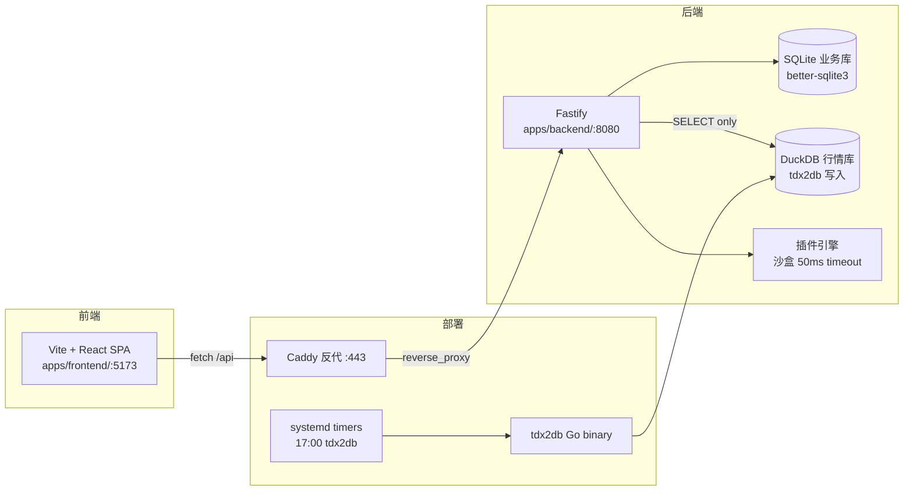

# InvestAssistant MVP

个人股票管理 + 策略信号系统，Phase 1-3 已完成（后端 + 前端 SPA）。

## 架构概览



## 快速开始

### 要求

- Node >= 22
- npm 9+
- Windows 11 / Linux x86_64/arm64

### 本地开发

```bash
# 1. 安装依赖（npm workspaces）
npm install

# 2. 起后端 Fastify（另开一个终端）
cd apps/backend
node --import tsx src/server.js
# 监听 http://127.0.0.1:8080

# 3. 起前端 Vite（另开一个终端）
cd apps/frontend
npm run dev
# 监听 http://127.0.0.1:5173，proxy /api -> :8080

# 4. 默认管理员
curl -X POST http://127.0.0.1:8080/api/auth/login ^
  -H "Content-Type: application/json" ^
  -d "{\"username\":\"admin\",\"password\":\"admin123\"}"
```

### 运行测试

```bash
# 全量（backend 用 forks pool 隔离 ConfigStore）
npm run test
# backend 125 tests + core 24 tests = 149 tests

# coverage
npm run test:coverage
```

### 构建

```bash
# backend（tsup -> ESM dist/server.js）
npm run build -w @invest/backend

# frontend（Vite -> dist/ 静态资源）
npm run build -w @invest/frontend
```

## 项目结构

```
InvestAssistantMVP/
├── apps/
│   ├── backend/       Fastify 后端（TypeScript + better-sqlite3）
│   │   ├── src/
│   │   │   ├── routes/    auth/trade/signal/watch/admin/health
│   │   │   ├── services/  auth/positionCalculator/signalService/backup/...
│   │   │   ├── db/        duckdb.ts（只读连接）
│   │   │   └── config/    configStore.ts（单例）
│   │   └── tests/         unit / integration / smoke-m1-m3
│   └── frontend/      Vite + React + Zustand SPA
│       └── src/
│           ├── pages/     Dashboard / TradeInput / Signals / Admin / Login
│           ├── api/       axios client + JWT interceptor
│           └── store/     Zustand user store
├── packages/
│   └── core/          纯算法层（零业务依赖）
│       └── src/         movingWeightedCost / RSI / MACD
├── deploy/            systemd units + Caddyfile + deploy.sh
└── docs/              SDD / PRD / MVP 计划 / 编码规范
```

## 关键约束（AGENTS.md）

- 前后端通过 HTTP API 通信，**frontend 禁止 import packages/core**
- Fastify 只监听 127.0.0.1，CORS 只允许 localhost
- DuckDB 行情库 **只有 tdx2db 能写**，Fastify 只有 SELECT 权限
- 插件引擎 `execute()` 硬限制 50ms timeout，沙盒禁止 global/process/require
- 后端 17:00-17:05 cron 链路：tdx2db -> C1-C12 校验 -> 信号生成 -> 双库备份

## 部署

详见 [docs/deploy.md](docs/deploy.md)

## CI

GitHub Actions 在 `.github/workflows/ci.yml`：

- Node 22
- npm ci -> build -> test
- 覆盖 unit / integration / smoke-m1
- 上传 coverage artifact

## 技术栈

| 层 | 技术 |
|----|------|
| 语言 | TypeScript strict |
| 后端框架 | Fastify |
| 前端框架 | React 18 + Vite 5 |
| 状态管理 | Zustand |
| API 客户端 | axios |
| 数据库 | better-sqlite3（业务）+ DuckDB（行情） |
| 测试 | Vitest 5.x（后端 --pool=forks） |
| 部署 | systemd + Caddy |
| Node | >=22 |
