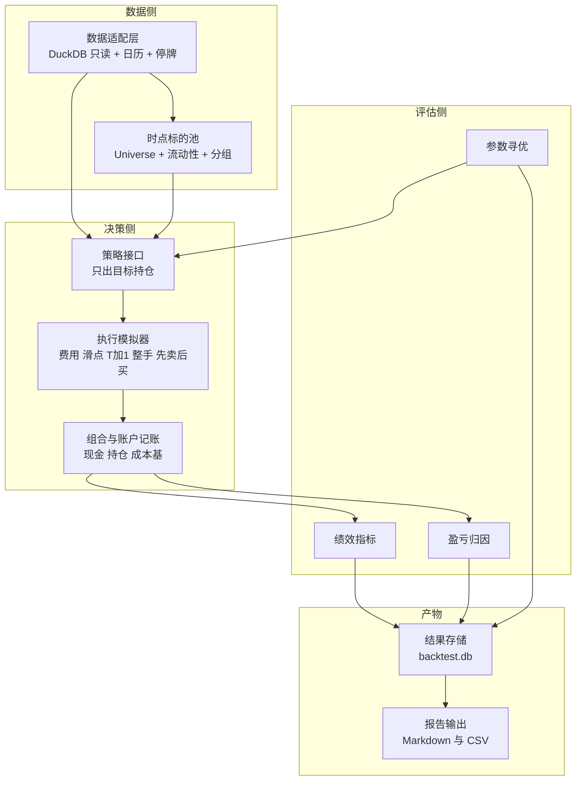

# 提案：策略研究框架（回测 / 盈亏归因 / 参数寻优）

> **文档性质：提案（Proposal），不是技术契约，也不是执行依据。**
>
> **落位说明（与任务要求的偏差）**：任务指定路径为 `docs/design/strategy-backtest-framework.md`，
> 但 `AGENTS.md`「文档分层与层界规则」的分层表**没有 `docs/design/` 这一层**，新建一层会与
> 「每条事实只在它所属的那一层定义」冲突。本仓已有提案先例 `docs/audit/proposal-market-update-pipeline-fix.md`，
> 故本提案落在 `docs/audit/`，并在汇报中说明。
>
> **采纳后的去向（避免形成第二套权威）**：owner 决策通过后，本提案中的
> ① 技术契约（接口签名 / 表结构 / 数据口径）迁入 `docs/client/SDD_v3.md`；
> ② 任务与排期迁入 `docs/client/code_implementation_plan_v3.md`；
> ③ 选型与取舍理由迁入 `docs/adr/ADR-019-*.md`；
> 本文件随即降级为历史提案，**不再作为执行依据**。
>
> | 项 | 内容 |
> |---|---|
> | 版本 | v1 |
> | 日期 | 2026-11-06 |
> | 状态 | 待 owner 决策（见 §12） |
> | 首个策略 | 五福轮动 ETF v5.2（`五福轮动ETF_v5.2.py`，1266 行，仓库外只读） |
> | 前置证据 | `docs/audit/wufu-etf-rotation-feasibility-2026-11-06.md`、`wufu-etf-rotation-v5.2-feasibility-2026-11-06.md` |
> | 本轮范围 | **纯设计**：不写实现代码、不建表、不跑回测、不写 `data/business.db` |

---

## 0. 结论速览

| # | 结论 | 一句话理由 |
|---|---|---|
| C1 | **语言选 TypeScript 移植，不用 Python sidecar** | 数据适配层与成本口径已在 TS 侧被实测验证；Python 会引入第二套口径与第二个运行时 |
| C2 | **引擎落在 `apps/backend/src/services/backtest/`，CLI 用 `tsx`** | 不新增 workspace；复用 `duckdb.ts`／`marketData.ts`／`core` 成本函数；可进 `tsc` 与 vitest |
| C3 | **结果存独立 SQLite `data/backtest.db`** | Parquet 在 Node 侧无处可写（DuckDB 只读禁令），JSON 无法支撑上千次试验的查询 |
| C4 | **M1–M4 合计 12–16 人天**，四个里程碑各有可当场证伪的数值锚点 | 与可行性报告 S0–S5 的 10–17 人天同量级，且拆得更细（多了归因与寻优） |
| C5 | **归因不是新口径，是复盘页三口径的「回测镜像」** | 复用 `portfolioReturn.ts` 的 `risk / cash / total` 可加性恒等式与 `core` 成本函数 |
| C6 | **参数寻优选「随机搜索 + 滚动 walk-forward」** | 10 维参数下网格是 5.9 万次；贝叶斯要引入 Python，收益不足以抵消代价 |
| C7 | **v5.2 的执行层差异全部降级为「口径开关」，并在报告里量化** | 13:10 取价／分时量／分钟止损三项不可 1:1，但都可用日线近似并给出方向 |

---

## 1. 目标与非目标

### 1.1 目标（框架要能回答的三个问题）

1. **某策略历史上赚不赚钱、赚在哪** —— 回测 + 归因；
2. **规则里哪几条真的在贡献收益** —— 分支归因（正常期／走弱期、固定池／动态池、主线／防御）；
3. **参数是不是过拟合出来的** —— 参数寻优 + 样本外检验。

### 1.2 非目标（本框架明确不做）

- ❌ 不做实盘／模拟委托对接，不产生任何真实订单；
- ❌ 不做分钟级、tick 级回测（与 `AGENTS.md` Out-Scope「禁止分钟 K 线 / 分钟周期策略 / 盘中实时信号」一致）；
- ❌ 不改动现有交易链路（`user_trade_record` 写入、券商导入、对账、资产快照）；
- ❌ 不写 `data/business.db`，不参与任何用户真实持仓计算；
- ❌ 不做因子库／多策略组合优化（V2 再说）；
- ❌ 不在 M1–M4 期间给前端加页面（见 §12 D4）。

---

## 2. 现状盘点：哪些能复用，哪些是从零

| # | 能力 | 现状 | 本框架的处理 |
|---|---|---|---|
| 1 | DuckDB 只读访问 | `apps/backend/src/db/duckdb.ts`（`queryDuckDB` / `queryDuckDBColumnar`，按需开关） | **直接复用**，一行不改（若需要批量列式，走 `queryDuckDBColumnar`） |
| 2 | 行情视图 | `v_etf_qfq / v_etf_hfq / v_etf_bfq`（前复权 / 后复权 / 不复权原始），日线 3,095,680 根，截至 2026-10-12 | 信号用 qfq；成交与记账用**不复权**（`v_etf_bfq` ≡ `raw_kline_daily`） |
| 3 | 交易日历 | `raw_holidays`（680 行，1991–2030）+ `sh000001` 的 date 全集 | 新建 `tradingCalendar.ts` 薄封装（工作日减节假日，与 `sh000001` 取交集校验） |
| 4 | 标的分类与名称 | `raw_symbol_class`（etf 2839）、`raw_symbol_name`（ETF 2511 行，**15.4% 末字损坏**） | 时点池用「首末 bar 区间」；名称分组用前 2 字（天然抗末字损坏） |
| 5 | 除权除息 | `raw_gbbq`（cat=1，5126 条 / 754 只；字段 `c1` 每 10 份派现、`c3` 每 10 份送转） | 现金分红/送转入账的唯一来源 |
| 6 | 成本与持仓口径 | `packages/core/src/movingWeightedCost.ts` 的 `calculateMovingWeightedCost` | **归因直接调它**，保证与复盘页逐分对齐 |
| 7 | 三口径收益率 | `apps/backend/src/services/portfolioReturn.ts`（risk / cash / total，`total.pnl = risk.pnl + cash.pnl − fees`） | 归因沿用同一恒等式（§6.2） |
| 8 | 风险/现金分类 | `apps/backend/src/services/assetClass.ts`（**`sh511880` 属 cash**） | v5.2 的防御 ETF 511880 在归因里**归入现金**，不混进风险收益 |
| 9 | 插件参数 schema | `apps/backend/src/services/pluginEngine.ts` 的 `ParamField` + `deriveDefaultParams` | 策略参数声明**复用同一类型**，不另立一套 |
| 10 | 调度 | `@fastify/schedule`（17:01 / 17:02 / 17:05） | **不接入**；回测由 CLI/手动触发 |
| 11 | 回测引擎 | **全仓无实现**（可行性报告已确认） | 从零写，M2 交付 |
| 12 | 绩效/归因/寻优 | **全仓无实现** | 从零写，M2–M4 |

> ⚠️ **不得照抄未验证的表名/列名**（`AGENTS.md` 硬约束）。§附录 A 列出的表、视图、列名均来自
> 可行性报告的实测 SQL 输出；实现时仍须 `DESCRIBE` 再确认一次。

---

## 3. 模块边界（10 块）



### 3.1 数据适配层（`data/`）

| 项 | 内容 |
|---|---|
| 输入 | 回测区间、标的集合、需要的字段（`qfq_close` / `open` / `high` / `low` / `raw_close` / `volume` / `amount` / `preclose`） |
| 输出 | 常驻内存的**列式**行情面板：`Map<symbol, {dates: Int32Array, o,h,l,c: Float64Array, vol, amt}>` + 交易日数组 + 停牌位图 |
| 不做什么 | ❌ 不做复权因子的「实时重算」；❌ 不写 DuckDB；❌ 不做跨源校验（C1–C12 归校验层）；❌ 不做缓存落盘 |

关键规则（全部来自实测，不是推测）：

1. **一次性批量取数**：一条 `IN (...)` 查询取全部标的区间数据（`AGENTS.md`「禁止逐标的循环查询」）；
2. **零量行剔除**：`volume = 0 ∧ amount = 0` 的行不进入历史序列（与 v5.2 `volume > 0` 掩码一致）；
3. **停牌两种形态**（§5.2）；
4. **复权双轨**：信号轨读 `v_etf_qfq`，成交/记账轨读 `v_etf_bfq`；
5. 面板构建后**关闭 DuckDB 连接**，回测全程不再触碰数据库（避免长事务锁与性能抖动）。

### 3.2 时点标的池（`universe/`）

| 项 | 内容 |
|---|---|
| 输入 | 交易日 T、`raw_symbol_class`、`raw_symbol_name`、`raw_kline_daily`（算 3 日均额） |
| 输出 | `Universe(T)`：可交易标的集合 + 每只的 `firstBar / lastBar / name / groupKey` |
| 不做什么 | ❌ 不做「当前快照名录」（这是 v5.2 的生存偏差来源，**不要照抄**）；❌ 不做行业分类的语义推导；❌ 不访问外部数据源 |

时点化公式（可行性报告 §5.5 原样）：

```text
Universe(T) = { s | firstBar(s) ≤ T ≤ lastBar(s) }
上市日(s)    = firstBar(s)                    # 替代 get_security_info.start_date
名称(s)      ≈ 当前名称（无历史名称表，接受近似）
阈值(T)      = mean(近 3 日全市场 ETF amount) / divisor
固定池(T)    = 固定池 ∩ Universe(T) ∩ {近 3 日均额 ≥ 阈值(T)}
走弱期池(T)  = 全球池 ∩ Universe(T) ∩ {近 3 日均额 ≥ 阈值(T)}
动态池(T)    = clean-name(Universe(T) ∩ 流动性通过) → 组内金额第一 → top N
```

> ⚠️ **固定池的时间可用性**：固定池 114 只中，32 只（28%）2023 年后才上市、80 只（70%）2020 年后。
> 因此**固定池口径的回测只能从 2023 年起算**；2015–2022 一律用动态时点池，并在报告里分段呈现。
> 这是本框架与 v5.2 原脚本的**第一个刻意分歧**，不是缺陷。

### 3.3 策略接口（`strategy/`）

见 §4（单独成节）。

### 3.4 执行模拟器（`execution/`）

| 项 | 内容 |
|---|---|
| 输入 | 目标持仓集合 + 当前持仓 + T 日**成交价轨**（开盘或收盘）+ 涨跌停/停牌标记 |
| 输出 | `Fill[]`（`symbol, side, qty, price, fee, slippageCost, ts, reason`）+ `Skipped[]`（含原因码） |
| 不做什么 | ❌ 不做订单簿/冲击成本建模；❌ 不做部分成交（按整笔成交）；❌ 不改策略的目标价；❌ 不做盘中择时 |

规则（与 v5.2 对齐，逐条可测）：

| 规则 | 默认值 | 说明 |
|---|---|---|
| 成交价 | T 日**开盘价**（主口径）／T 日收盘价（乐观上界） | 见 §5.1 |
| 滑点 | 万 1（价格相关，买加卖减） | v5.2 `PriceRelatedSlippage(0.0001)` |
| 佣金 | 万 1，**最低 5 元**，ETF 免印花税 | v5.2 `set_order_cost` |
| 最小成交额 | 10 元，低于则跳过 | v5.2 `min_money = 10` |
| 整手 | 100 份向下取整；不足 100 份但现金够则按 100 份 | v5.2 `int(x // 100 * 100)` |
| T+1 | 当日买入份额当日不可卖 | 引擎内部维护 `closeableQty` |
| 顺序 | **先卖后买**，同一时点 | v5.2 `sell_routine` → `buy_routine` |
| 涨跌停 | `preclose × (1 ± 10%)` 不成交 | ⚠️ 科创/创业 ETF 实为 20% 档，见 §8 A6 |
| 停牌 | 缺 bar 或零量 → 不成交 | — |
| 现金 | 不允许负现金；不足则缩减该笔或跳过并记原因 | — |

### 3.5 组合与账户记账（`account/`）

| 项 | 内容 |
|---|---|
| 输入 | `Fill[]`、T 日收盘价、`raw_gbbq` 除权事件 |
| 输出 | 日终 `PortfolioSnapshot`（现金、各持仓数量/成本基/市值）+ 权益曲线点 + 与业务库同构的 `TradeRecord[]` |
| 不做什么 | ❌ 不落任何业务表；❌ 不碰用户维度；❌ 不做券商模型（回购/佣金档） |

要点：

1. **成本基必须调 `core.calculateMovingWeightedCost`**，不要自己写一套 —— 这是归因能与复盘页对齐的物理保证；
2. 引擎向记账层输出**与业务库同构的七类交易记录**（`buy / add / reduce / clear / dividend / bonus / transfer`），
   回测自身只产生 `buy` 与 `reduce|clear`，`dividend / bonus` 由 `raw_gbbq` 生成；
3. 每日 `equity = cash + Σ(qty × rawClose)`，停牌用最近可得收盘并打 `stale` 标记；
4. 现金闲置按 0 计息（v5.2 只有货币 ETF 才有利息，无现金利息）。

### 3.6 绩效指标（`metrics/`）

| 项 | 内容 |
|---|---|
| 输入 | 权益曲线（日频）+ 交易流水 + 基准（`sh510300`） |
| 输出 | `Metrics`：累计收益、年化（CAGR）、年化波动、Sharpe（无风险利率可配，默认 0）、最大回撤 + 回撤持续天数、Calmar、换手率、仓位暴露率、胜率、盈亏比、基准 Alpha/Beta、月度收益表 |
| 不做什么 | ❌ 不做择时能力分解（Timing/Selection 归因）；❌ 不做风险平价等组合优化指标 |

⚠️ **硬规则**：**禁止只给一个全样本年化**。必须分段（按年 + 按「正常期/走弱期」）呈现，
并同时标注池子口径（固定池／时点池）。

### 3.7 盈亏归因（`attribution/`）

见 §6（单独成节）。

### 3.8 参数寻优（`optimize/`）

见 §7（单独成节）。

### 3.9 结果存储（`store/`）

| 项 | 内容 |
|---|---|
| 输入 | 一次 run（策略、参数、区间、口径开关）的全部产物 |
| 输出 | `data/backtest.db`（SQLite，独立文件）+ 可选导出件 |
| 不做什么 | ❌ 不写 `data/business.db`；❌ 不建在 `ConfigStore` 里（不加载业务表、不跑迁移）；❌ 不写 DuckDB |

提议表结构（**设计稿，M2 落地时才建**，字段名待 SDD 定稿）：

| 表 | 主键 | 关键列 | 用途 |
|---|---|---|---|
| `bt_run` | `run_id` | `strategy_id, strategy_version, params_json, start_date, end_date, price_mode, universe_mode, engine_version, git_commit, created_at, status` | 一次回测的「环境指纹」，保证可复现 |
| `bt_equity` | `(run_id, date)` | `equity, cash, risk_mv, benchmark_close, drawdown, exposure` | 权益曲线 |
| `bt_trade` | `trade_id` | `run_id, symbol, side, qty, price, fee, slip, date, reason, holding_id, score_snapshot_json` | 逐笔成交 + 归因标签 |
| `bt_round_trip` | `round_trip_id` | `run_id, symbol, open_date, close_date, holding_days, qty, pnl, return_pct, exit_reason, branch_tag` | 一笔完整持仓周期 |
| `bt_attribution` | `(run_id, dim, key)` | `pnl, pnl_pct_of_total, trades, round_trips` | 六维归因的物化结果 |
| `bt_trial` | `(sweep_id, trial_id)` | `params_json, metrics_json, seed, fold_id, split(train|test), status` | 寻优试验台账 |
| `bt_metric` | `(run_id, key)` | `value` | 标量指标（便于 SQL 比较多次 run） |

选型理由（**结论，不是选项罗列**）：

- **不用 Parquet**：Node 侧写 Parquet 只有两条路 —— 用 DuckDB 写（**违反「Fastify 进程对 DuckDB 只读」**）
  或新增 `parquetjs` 依赖（违反「新增依赖须说明理由」且收益仅是列存压缩，回测数据量在 MB 级用不上）。
- **不用纯 JSON**：上千次试验 × 每次数千笔交易，无索引查询会退化成全文件扫描；且无事务，写到一半崩溃即脏。
- **SQLite 是唯一既零新依赖、又能事务、又能被现有 `better-sqlite3` 直读的选项**；单进程串行写，无并发写风险。

### 3.10 报告输出（`report/`）

| 项 | 内容 |
|---|---|
| 输入 | `backtest.db` 的一次 run |
| 输出 | `data/backtest-runs/<run_id>/`：`report.md`（人读摘要）、`equity.csv`、`trades.csv`、`round_trips.csv`、`attribution.csv`、`params.json` |
| 不做什么 | ❌ 不生成前端可渲染的 JSON API（M1–M4 不做接口）；❌ 不做 HTML 交互式图表（可选 M5） |

`report.md` 固定骨架（保证多次 run 可横向对比）：
环境指纹 → 口径声明（价格模式/池模式/近似项）→ 头部指标 → 分年表 → 正常期/走弱期分段 →
归因六维 → 前 10 大盈利/亏损笔 → 已知偏差清单。

---

## 4. 策略接口

### 4.1 签名（TypeScript，伪代码级）

```ts
// apps/backend/src/services/backtest/strategy/types.ts

/** 策略可见的数据上限：恒为 T-1，引擎在物理上不提供 T 日及以后的数据 */
export interface StrategyContext {
  readonly asOf: string;        // 决策日 T（YYYY-MM-DD）
  readonly dataCutoff: string;  // 可见数据最后一日（= 上一交易日）

  universe(): ReadonlyArray<SymbolMeta>;
  /** 返回截至 dataCutoff 的最近 n 个值；不足则返回实际长度 */
  series(symbol: string, n: number, field: SeriesField): ReadonlyArray<number>;
  seriesBatch(symbols: readonly string[], n: number, field: SeriesField): ReadonlyMap<string, ReadonlyArray<number>>;
  indexSeries(symbol: string, n: number): ReadonlyArray<number>;

  isPaused(symbol: string): boolean;
  position(symbol: string): PositionView | null;
  positions(): ReadonlyArray<PositionView>;
  cash(): number;
  equity(): number;
  params(): Readonly<Record<string, number | string | boolean>>;
  /** 引擎侧计算并缓存，策略不重复实现 */
  movingAverage(symbol: string, n: number): number | null;
  /** 供分支归因的标签写入 */
  tag(key: string, value: string | number): void;
  log(level: 'info' | 'warn', msg: string, data?: Record<string, unknown>): void;
}

export interface TargetPosition {
  symbol: string;
  targetWeight?: number;    // 0..1
  targetNotional?: number;  // 元；与 targetWeight 二选一
  reason: ExitReason | EntryReason;  // 归因必填
  score?: number;
}

export interface TargetSet {
  targets: TargetPosition[];
  mode: 'replace' | 'incremental';  // replace = 不在目标里的持仓清掉（v5.2 语义）
  maxTurnoverRatio?: number;
}

export interface Strategy {
  readonly id: string;
  readonly version: string;
  readonly name: string;
  readonly paramSchema: ParamField[];                 // 复用 pluginEngine.ParamField
  readonly defaultParams: Record<string, unknown>;    // 由 deriveDefaultParams(paramSchema) 派生
  readonly warmupDays: number;                        // 引擎据此判定最早可回测起点
  readonly priceMode: 'open' | 'close';               // 主口径声明，引擎据此选成交轨

  init?(ctx: InitContext): Promise<void> | void;
  /** 每根 bar 调一次：只允许「读 T-1 数据 + 返回目标」，禁止产生成交 */
  decide(ctx: StrategyContext): TargetSet | null;
  /** 收盘后风控（日线模式下的止损只能在这里判、次日开盘执行） */
  onClose?(ctx: StrategyContext, bars: ReadonlyArray<BarView>): ExitIntent[];
  onFill?(fill: Fill): void;
  onRoundTrip?(rt: RoundTrip): void;
}
```

### 4.2 参数声明

- **唯一真相源是 `paramSchema[].default`**，`defaultParams` 由 `deriveDefaultParams()` 派生，禁止两处各写一份
  （沿用 `pluginEngine.ts:169` 的既有裁决）。
- 字段支持 `type / default / min / max / step / options / unit / description`；**跨字段约束**（如 `scoreThresholdRatio ≤ 1`）
  走 `validateCrossFields?(params)`，抛 `StrategyParamError`。
- 寻优时**只允许在 schema 声明的 `[min,max]` 内取值**，越界即视为非法试验（不是「跑一下试试」）。

### 4.3 与执行层解耦的三条硬边界

| # | 边界 | 违反后果 |
|---|---|---|
| E1 | 策略**只见 T-1 数据**：`ctx.dataCutoff` 恒为上一交易日，引擎不出 T 日任何价格 | 前视偏差，回测虚高 |
| E2 | 策略**只给目标**，不算股数、不算费用、不决定成交时点 | 费用口径漂移，无法跨策略比较 |
| E3 | 策略**不直接改持仓**，一切持仓变化只由执行层 `Fill` 产生 | 绕过 T+1/整手/停牌约束 |

---

## 5. 回测正确性要点

### 5.1 无前视的三条硬约束

| # | 约束 | 具体做法 | 反面案例（本项目或 v5.2 真实存在过） |
|---|---|---|---|
| H1 | **决策只用 T-1 数据** | `dataCutoff = prevTradingDay(T)`；所有 `series()` 截止到该日；当日 `amount/volume` 物理不可见 | v5.2 用 13:10 实时价 → 白拿当日 2 小时信息 |
| H2 | **成交在 T 日**（开盘或收盘），决策在 T-1 收盘后 | 主口径：`decide@T-1收盘 → fill@T开盘`；乐观上界：`decide@T-1收盘 → fill@T收盘` | 用 T 收盘价决策 + T 收盘价成交 = 同日收盘前视 |
| H3 | **时点池在 T 日按 T-1 可知信息构建** | Universe 用 `firstBar ≤ T ≤ lastBar`；流动性用近 3 日（≤ T-1）成交额 | v5.2 用「当前快照名录」，含 657 只已停更标的 |

> **可执行的验收锚点（M2 必测）**：把 T 日及以后的行情**人为篡改**（例如把未来 30 日全部乘以 3），
> 断言 T 日及之前的决策与成交**逐字节不变**。这一条能一次性抓住绝大多数前视漏洞。

### 5.2 停牌两种形态

| 形态 | 判定 | 决策影响 | 估值影响 |
|---|---|---|---|
| **整日无 bar** | `T` 不在该标的 bar 日期集中 | 当日不可买/不可卖（`isPaused = true`） | 用最近可得收盘估值，打 `stale_days` |
| **有 bar 但零量** | `volume = 0 ∧ amount = 0` | 同上，视为不可交易 | 当日收盘可作估值（价格通常等于前收） |

补充：**历史序列里的零量行必须在计算指标前剔除**，否则会把「没成交的日子」当成真实价格点进入回归窗口。
实测两种形态在 ETF 中都存在（可行性报告 §4.2 #16）。

### 5.3 复权口径与「不重复计价」

| 用途 | 用哪套价 | 为什么 |
|---|---|---|
| 动量回归 / MA / 量比 / 跌幅风控（**信号**） | `v_etf_qfq` 前复权收盘 | 回归取 `ln(price)`，常数缩放只平移截距、不改斜率，故前复权对**比值类**指标等价；实测 931 只存在非 1 因子，必须用复权序列 |
| 成交价、整手取整、现金扣减、市值估值（**记账**） | `v_etf_bfq`（≡ `raw_kline_daily`，不复权原始价） | 实际能成交的只有真实挂牌价；用复权价算 100 份整手会算错金额 |
| 分红 / 送转（**现金流**） | `raw_gbbq`（`category = 1`；`c1` 每 10 份派现、`c3` 每 10 份送转） | 与不复权价格配合，才构成完整「总收益」 |

**重复计价的成因与规避（一句话版本）**：
> 「复权价 + 分红现金流」= 双边计价（复权价里已经隐含了分红）；「不复权价 + 分红现金流」= 正确的总收益。

所以本框架**只允许**「信号读复权、记账读不复权、分红单独入账」这一种组合；
`bt_run` 表里记录 `price_mode` 与 `adj_mode`，报告页必须声明，任何一次 run 都不允许出现第三种组合。

> ⚠️ 另有一条隐性陷阱：`v_etf_qfq` 的前复权因子以**最新** hfq 因子为锚（`qfq_factor = hfq_factor / 最新 hfq_factor`），
> 因此**历史 qfq 价格会随未来分红变化**。用它算净值曲线 = 每一天的净值都可能被未来的分红改写。
> 这就是「净值只能来自不复权 + 分红」的另一条理由。

### 5.4 其他正确性要点

1. **warmup 完整性**：序列长度 `< lookback × 0.8`（v5.2 口径为 20）直接返回「该标的不参与」；
2. **跨市场交易日**：ETF 全部在 A 股日历上交易，用 `sh000001` 的 date 全集即可，不需要港美股日历；
3. **农历/临时休市**：只信 `raw_holidays` + `sh000001`，不自造日历；
4. **手续费计入成本基**：买单 `costBasis += qty × price + fee`；
5. **最后一日的浮盈**：期末未平仓持仓按最后收盘价计入 `unrealized`，不伪装成已实现。

---

## 6. 盈亏归因

### 6.1 六个维度（缺一不可）

| 维度 | key | 单位 | 回答什么问题 |
|---|---|---|---|
| **按标的** | `symbol` | 元 / 占比 | 钱是哪些 ETF 赚的 |
| **按持仓周期** | `round_trip_id` | 元 / 收益率 / 持有天数 | 单笔交易赚亏分布（胜率、盈亏比） |
| **按退出原因** | `exit_reason` | 元 / 笔数 | 卖出是因为「掉出候选」「止损」「走弱期切换」还是「防御回退」 |
| **按时间** | `month` / `year` | 元 | 月度/年度分布；与复盘页月度曲线同构 |
| **按策略分支** | `branch_tag` | 元 / 占比 | 正常期 vs 走弱期、固定池 vs 动态池、主线持仓保留 vs 新进 |
| **按资产桶** | `bucket` = `risk` / `cash` | 元 | 风险资产赚的 vs 货币 ETF 赚的（**这是与复盘页对接的关键**） |

退出原因枚举（`ExitReason`）：
`weak-period-exit` / `drop-from-pool` / `out-of-candidate` / `stop-loss` / `rebalance-replace` / `defensive-fallback` / `end-of-backtest`。

### 6.2 与复盘页现有口径的关系（**必须对齐，不得另立**）

复盘页 `portfolioReturn.ts` 的定义（原文三级口径）：

```text
① 风险资产收益率 = (风险浮盈 + 已实现 + 现金分红) ÷ 风险投入
② 现金类收益率   = (逆回购利息 + 货币 ETF 市值变动) ÷ 现金投入
③ 总收益率       = (总资产 − 总投入 − 累计费用) ÷ 总投入
可加性：total.pnl = risk.pnl + cash.pnl − fees
```

本框架的归因**直接复用这条恒等式**，映射关系如下：

| 复盘页概念 | 回测侧对应 | 差异说明 |
|---|---|---|
| `risk` 桶 | 全部 ETF（**除 511880 等现金类**） | 分类走 `asset_class` 同一张表，不另写规则 |
| `cash` 桶 | 防御 ETF `sh511880`（`assetClass.ts` 实测归为 cash）+ 闲置现金 | 回测无逆回购，`repoInterest = 0` |
| `dividend` | `raw_gbbq` cat=1 的 `c1` 现金流 | 回测里同口径 |
| `fees` | 佣金（含最低 5 元）；ETF 无印花税 | 复盘页费用含卖出印花税，ETF 恒 0 |
| `realized` / `unrealized` | 已平仓 round trip 之和 / 期末浮盈 | 拆分方式一致 |
| `transfer`（送转） | `c3` 送转份额，**成本基不变** | 沿用 core 现有语义（零成本获得） |

**可加性断言（M2/M3 必测）**：

```text
Σ(by symbol) == Σ(by round trip closed) == Σ(by exit reason) == Σ(by month) == Σ(by branch) == total.pnl
|residual| ≤ 0.01 × 样本笔数        # 仅允许分位四舍五入误差
total.pnl == risk.pnl + cash.pnl − fees
```

**两条防止「第二套数字」的工程措施**：

1. **同一个成本函数**：回测的 `TradeRecord[]` 直接喂给 `core.calculateMovingWeightedCost`，
   不写第二套成本基逻辑（复盘页也是这么算的）。
2. **同一段真实数据的交叉校验（M4 验收项）**：拿用户在真实库里 2025 年的 ETF 交易流，
   用回测记账层重放，断言其结果与 `calcAllPositions()` + `computePortfolioReturn()` 的
   `风险已实现 / 风险浮盈 / 现金变动` **逐分相等**。这一条一旦通过，说明「回测口径 = 复盘口径」。

> ⚠️ 在真实库上做这条校验必须走**只读连接**（`db.pragma('query_only = ON')`），且**不得写业务库**；
> 更好的是拷贝一份到临时目录再跑（见 `scripts/cleanup-business-data.mjs` 的既有做法）。

### 6.3 归因的输出纪律

- 每个维度必须给出 `pnl` 与 `pnl_pct_of_total`，且**按贡献排序的前 10 项**必须出现在报告首屏；
- 单一维度内「其它」聚合项占比 > 20% 时报告必须告警（说明分类粒度不足）；
- 归因只解释**已发生**的钱，不对未来收益做任何外推。

---

## 7. 参数寻优

### 7.1 方法选型：**随机搜索 + 滚动 walk-forward**（结论）

| 方法 | 评估 | 结论 |
|---|---|---|
| **网格** | v5.2 可调参数约 10 个，各取 3 档 = 3^10 = **59,049** 次；单次 5–8 秒 → **3.5–5.5 天/轮**，且低维边界处精度浪费 | ❌ 不适用 |
| **随机搜索** | 同样 500–1000 次能覆盖同等体积；**天然可并行、种子可复现、零新依赖**；对 10 维空间的实际表现与网格无显著差距（随机搜索的经典结论） | ✅ **主方案** |
| **贝叶斯** | 需引入 Python（Optuna/Ax）→ 与 §9.1「TS 单语言」结论冲突，需 sidecar/IPC；目标函数噪声大（回测收益不稳定），代理模型收益被噪声吃掉；可复现性差（依赖采样器版本） | ❌ 本轮不做（M4 之后再评估） |

补充手段（都属于「便宜且有效」，纳入 M4）：

1. **分层抽样**：按参数重要性给不同取值集 —— 核心参数（`lookback / r2 / volume / scoreRatio`）连续采样，
   次要参数（`holdings / divisor / topN`）离散少量档；
2. **由粗到细（coarse-to-fine）**：先在宽域采 200 次定位「参数高原」，再在高原邻域精细采 200 次；
3. **确定性种子**：每个 trial 用 `hash(sweepId, trialId)` 派生随机数种子，落 `bt_trial.seed`，可逐次复跑。

### 7.2 过拟合防护（三层，缺一层不算过）

| 层 | 做法 | 验收判据 |
|---|---|---|
| **L1 分段** | 滚动 walk-forward：训练 3 年 / 测试 1 年 / 步进 1 年（锚定起点，不扩张） | 每一折都给出「训练最优参数」与「该参数在测试段的真实表现」；**报告只允许用测试段汇总数做结论** |
| **L2 参数稳定性** | 对选中参数做 ±1 档邻域扰动（如 `lookback 20/25/30`、`r2 0.3/0.4/0.5`、`volume 1.5/1.8/2.0`、`scoreRatio 0.85/0.9/0.95`）；要求邻域内**年化收益排序不翻转**、且邻域中位数不低于最优值的 70% | 邻域内出现「孤峰」（唯一点最优、邻域大幅塌陷）即判定过拟合 |
| **L3 样本外报告** | 单独一节 `OOS`：测试段合并净值、逐年收益、与「固定默认参数」的对照 | 若调参后的 OOS 不优于默认参数，则**结论是「参数无用」**，必须如实写进报告 |

附加纪律：

- **最小样本约束**：任一折的完整 round trip < 30 笔 → 该折结果标记 `LOW_SAMPLE`，不参与最优选择；
- **不得用全样本最优参数直接下结论**：全样本最优只能称为「上限估计」；
- **多重检验披露**：报告写明「本次共比较 N 组参数」，并给出「最好组 vs 中位数组」的 OOS 落差。

### 7.3 计算预算与并行

| 项 | 估算 | 依据 |
|---|---|---|
| 数据装载（一次） | **2–4 秒** | 3,095,680 行全表约 1.24 GB 库的 ETF 子集 |
| 单次回测（内存面板，2018–2026 约 2,000 交易日 × 约 600 只） | **4–8 秒** | 每日 600 次 26 点加权回归 ≈ 15.6 万次浮点运算/日 → 约 3 亿次/run，JS 单线程可承受 |
| 500 次试验（单线程） | **35–70 分钟** | 500 × 6s |
| 500 次试验（4 并发） | **10–20 分钟** | 线性近似，留 20% 损耗 |

并行方式（**纯本地，无集群**）：

- `worker_threads`，并发度 `min(os.cpus()-1, 6)`，默认 4；
- **主线程一次性装载行情面板，再通过 `workerData` 结构化克隆分发给 worker**；
  **worker 内绝不打开 DuckDB**（DuckDB 实例在进程内多开会引发锁冲突，`AGENTS.md` 已有前车之鉴）；
- 内存预算：600 只 × 2,000 日 × 6 字段 × 8 字节 ≈ **58 MB/份**；4 worker ≈ 290 MB（可接受）；
- 试验按 `trialId % N` 分片，结果回传主线程统一写库（单写者，避免 SQLite 并发写）；
- 提供 `--max-minutes` 软上限，超时后停止派发新试验并把已有结果落库（不做硬杀）。

---

## 8. 首个策略适配：五福轮动 ETF v5.2

### 8.1 可直接映射（逐位等价，共 8 类）

| # | v5.2 规则 | 本地实现 | 等价性 |
|---|---|---|---|
| A1 | 固定池 114 只 + 防御 1 只（`511880`） | 硬编码清单常量化，`fixedPool.ts` | ✅ 库内 115/115 命中，8 只共 14 日缺口 |
| A2 | 流动性阈值 = 近 3 日全市场 ETF 成交额均值 / `divisor`（v5.2 = 20000） | 参数化 `divisor` | ✅ T=2026-10-12 → 4345.2 亿 / 20000 = **2172.6 万** |
| A3 | 动态池：名称清洗 → 前 2 字分组 → 组内金额第一 → top N（v5.2 = 300） | `dynamicPool.ts`，排除词表常量化 | ✅ 当前复现 **140 组**（未触顶） |
| A4 | 动量 = 加权对数回归斜率年化 × 混合口径 R² | `momentum.ts`，**逐位照抄混合 R²** | ✅ 纯日线 |
| A5 | 过滤：`0 ≤ score ≤ 5`、`R² > 0.4`（仅正常期）、`MA10`（仅走弱期）、`量比 < 1.8`、近 3 日单日跌幅 > 3% 淘汰、候选系数 0.9 | 全部参数化 | ✅ 纯日线 |
| A6 | 走弱期状态机：四指数 MA10 投票 3/4 进、3/4 出、计数 20 日（**含「持续走弱时每日重置计数」的原脚本行为**） | `weakPeriod.ts` | ✅ 纯日线；口径即为「现状」，不擅自修正 |
| A7 | 持仓保留（持仓仍在候选池则优先保留）、防御回退、100 份整手、先卖后买、最小 10 元、万 1 佣金最低 5 元、万 1 滑点、基准 510300 | 执行层规则（§3.4） | ✅ 规则可逐位 |

### 8.2 必须近似（5 项，每项给默认口径与影响方向）

| # | v5.2 原始 | 默认实现口径 | 预期影响方向 | 量级（来自实测/估算） |
|---|---|---|---|---|
| B1 | 13:10 `last_price`（打分末点 + 下单基准） | **T-1 收盘**作打分末点；成交用 **T 开盘** | 无前视、结果更保守；与聚宽曲线必然有差 | 池内 `\|(H+L)/2 ÷ C − 1\|` 均值 **0.766%**；score 变动 **<2%**（估算） |
| B2 | 13:10 分时量投影（`today_vol × 240/已过分钟`） | **全日成交量**替代投影量 | 均匀分布下等价；真实 U 型分布下**量比被低估 10–20%（估算）** → 方向是**多放行**标的 | 量比阈值 1.8 → 提供 `×0.85 / ×1.0` 敏感性 |
| B3 | `every_bar` 分钟级固定止损（成本 × 0.95） | **T 收盘触发 + T+1 开盘成交** | **低估回撤**、收益略高；少日内触发、多隔夜跳空 | 年化影响 **0.3–1%（估算）**；同时输出「无止损」版本给区间 |
| B4 | 盘中临时停牌（10 分钟无成交） | 不实现；把「当日零量」并入不可交易 | 极少数日误成交，方向混合 | **<0.5%（估算）** |
| B5 | `paused` / `high_limit` / `low_limit` 字段 | `paused = 缺 bar ∪ (volume=0 ∧ amount=0)`；涨跌停 = `preclose × (1±10%)` | 科创/创业 ETF 实为 **20% 档** → 少数日被误判为涨跌停而放弃交易 | 低；提供「标的档位表」作为 M4 增强项 |
| B6 | 空仓期防御标的仓位（L1041-L1048 → L1077-L1105）：**首次进防御时吃满可用现金**，之后已持有即 `etfs_to_buy` 为空 | 目标权重 100% = 首次进防御吃满可用现金；「之后不再调整」由 `hold` 表达（已持有防御 → 不补仓） | 与 v5.2 一致。**100% 不是「每日按总权益配平」**——那样会持续补仓，与 v5.2 不同 | — |

### 8.3 刻意与 v5.2 不同（3 项，属于修 bug而非偏差）

| # | v5.2 现状 | 本框架 | 理由 |
|---|---|---|---|
| C1 | 固定池按 2026 年流动性人工筛选 → 早期回测「事后选池」 | 时点化 + **固定池口径只从 2023 年起算**；长样本用动态时点池 | 生存偏差 = 收益虚高，可行性报告 R1（严重） |
| C2 | `get_all_securities(['etf'])` **不带 date** → 当前快照名录 | `firstBar ≤ T ≤ lastBar` 时点名录 | 同上，R4（中高） |
| C3 | 13:10 决策 → 隐含当日信息 | 主口径 T-1 决策 + T 开盘；**另跑 T 收盘口径作为「乐观上界」** | R2（严重）；两口径差值即「前视税」，必须披露 |

### 8.4 v5.2 参数表（`paramSchema` 初稿）

| key | 类型 | 默认 | 域 | 说明 |
|---|---|---|---|---|
| `divisor` | integer | 20000 | 3000–50000 | 流动性阈值除数 |
| `topN` | integer | 300 | 50–500 | 动态池上限 |
| `holdingsNum` | integer | 1 | 1–5 | 持仓数 |
| `lookbackDays` | integer | 25 | 15–40 | 动量回归窗口 |
| `minScore` / `maxScore` | number | 0 / 5 | — | 动量区间 |
| `r2Threshold` | number | 0.4 | 0.1–0.8 | 仅正常期生效 |
| `maLookback` / `maThreshold` | integer/number | 10 / 1.0 | 5–30 / 0.97–1.05 | 仅走弱期生效 |
| `volumeRatioThreshold` | number | 1.8 | 1.0–3.0 | 5 日均量比上限 |
| `lossThreshold` | number | 0.97 | 0.9–1.0 | 近 3 日单日跌幅风控 |
| `scoreThresholdRatio` | number | 0.9 | 0.5–1.0 | 候选池系数（走弱期固定 1.0） |
| `maxWeakDays` | integer | 20 | 5–60 | 走弱期强退计数 |
| `stopLossThreshold` | number | 0.95 | 0.8–1.0 | 固定止损（收盘触发） |
| `defensiveEtf` | string | `sh511880` | — | 防御 ETF（**归入 cash 桶**） |

---

## 9. 技术选型（结论）

### 9.1 语言：**TypeScript 移植**（不选 Python sidecar / 不选纯 Python 离线）

| 方案 | 优势 | 代价 | 判定 |
|---|---|---|---|
| **A. TS 移植** | 复用已实测的 `duckdb.ts` 只读封装与视图名；复用 `core.calculateMovingWeightedCost` → 归因天然与复盘页同口径；一个运行时（Node ≥22）；进 `tsc` + vitest，可进 CI；无 IPC；多人/多 agent 可维护 | 需把 1266 行 Python 规则翻译成 TS（实际规则约 300 行，其余是日志与注释） | ✅ **推荐** |
| B. Python sidecar（Node 调子进程） | 可直接跑原脚本逻辑，省移植 | 部署机需 Python 环境（arm64 目标机未验证）→ 与「systemd 管理普通 Node 进程」的运维模型分叉；需 IPC 协议；**数据适配层要在 Python 里重写一遍** → 两套取数口径；核心算法无法复用 core → **归因必然与复盘页对不上** | ❌ 否决 |
| C. 纯 Python 离线（脱离本仓） | 最省事 | 与仓库隔离 → 无法进 CI、无法被前端/接口消费、无法与业务库口径校验；结论不可复现（不在版本控制内） | ❌ 否决 |

> **移植风险的控制手段**：保留 `.py` 作为「口径字典」与「人工 oracle」——
> 在 M3 里挑 3 个交易日，把 Python 脚本跑出的 `score / r² / ma / 量比 / 目标标的`录成 golden fixture，
> TS 实现必须逐位对上。这是「双端一致性断言」在本框架里的落法（与 `docs/coding-standards.md` 的 golden 思路一致）。

### 9.2 结果存储：**独立 SQLite `data/backtest.db`**（不是 Parquet / 不是 JSON）

理由见 §3.9。补充三条硬约束：

1. **独立文件**：`BACKTEST_DB_PATH` 环境变量可覆盖，默认 `data/backtest.db`；
2. **不经过 `ConfigStore`**：不加载业务表、不跑业务迁移，避免把回测产物污染进业务 schema；
3. **可删除重建**：回测库是纯派生数据，删了重跑即可（与 `business.db` 的「不可重建」形成对比）。

### 9.3 与现有系统的对接：**M1–M4 不接，M5 可选**

| 阶段 | 对接内容 | 结论 |
|---|---|---|
| M1–M4 | 无任何 HTTP 接口、无前端页面、无 cron 接入 | ✅ 只出 Markdown/CSV 报告 |
| M5（可选，需 owner 决策） | `GET /api/backtest/runs`、`/api/backtest/:runId` 只读接口 + 前端一个只读页面 | 待定（§12 D4） |

**若将来接前端，必须遵守的既有规则**：前端只走 HTTP，**禁止 import `apps/backend` 或 `packages/core` 类型**；
接口沿用 `{success, data}` envelope；只监听 127.0.0.1。

---

## 10. 里程碑

> 人天 = 单人有效开发日；全部为**日线级**工作量，不含分钟数据接入（与 Out-Scope 冲突，不做）。

### M1 数据适配层 + 时点标的池（**2–3 人天**）

| 交付物 | 验收锚点（**可当场证伪**） |
|---|---|
| `data/marketPanel.ts`（批量取数 + 列式面板 + 停牌位图）<br/>`calendar.ts`（`raw_holidays` + `sh000001`）<br/>`universe/pointInTime.ts`（时点名录、固定池、动态池、走弱期池） | ① T=2026-10-12 流动性阈值 = **2172.6 万元**（4345.2 亿 / 20000）<br/>② 同日全市场通过 = **673 只**<br/>③ 固定池通过 = **112 / 114**（被剔：`sh520830` 1423.7 万、`sh516190` 1819.7 万）<br/>④ 动态池 = **140 组**<br/>⑤ 固定池库内命中 = **115 / 115**（含防御）<br/>⑥ 除权日校验：ETF `raw_gbbq` cat=1 的除权日，qfq 序列**无跳空**（用比值验证） |

任一项对不上 → 停在 M1 修，不进 M2。这五项是可行性报告已实测过的数，属于「免费的正确性网」。

### M2 回测引擎 + 记账 + 指标（**4–5 人天**）

| 交付物 | 验收锚点 |
|---|---|
| `execution/simulator.ts`（费用/滑点/T+1/整手/先卖后买/涨跌停/停牌）<br/>`account/portfolio.ts`（成本基调 core）<br/>`metrics/*`<br/>`store/backtestDb.ts`（建表 + 写入）<br/>`cli.ts`（`run` 子命令） | ① 3 笔**手工计算**样例逐分对账（含最低 5 元佣金、整手、T+1 拒卖）<br/>② **前视探针**：篡改 T 日及以后的行情 → T 日决策与成交逐字节不变<br/>③ 基准净值复现：`sh510300` 买入持有 vs 引擎空仓位基准曲线，误差 = 0<br/>④ 现金恒等式：`equity = cash + ΣMV` 每日成立，且 `cash ≥ 0` 从未被击穿<br/>⑤ 单测覆盖：费用/整手/T+1/停牌/涨跌停 5 个分支各 ≥ 2 例 |

### M3 v5.2 策略移植 + 归因（**3–4 人天**）

| 交付物 | 验收锚点 |
|---|---|
| `strategies/wufuRotation/`（动量/过滤/走弱期/候选/防御/持仓保留）<br/>`attribution/*`（六维 + 可加性）<br/>golden fixtures（3 个交易日的 Python oracle） | ① 3 个交易日的 `score / r² / ma / volumeRatio / 目标标的` 与 Python oracle **逐位相等**（浮点按 1e-9）<br/>② 归因可加性：五维各自求和 == `total.pnl`，残差 ≤ 0.01 × 笔数<br/>③ `total.pnl == risk.pnl + cash.pnl − fees` 成立<br/>④ 2023–2025 全样本跑通，报告含分年 + 正常期/走弱期分段，**无单一全样本年化** |

### M4 参数寻优 + 报告输出（**3–4 人天**）

| 交付物 | 验收锚点 |
|---|---|
| `optimize/sweep.ts`（随机搜索 + seed）<br/>`optimize/walkForward.ts`<br/>`optimize/stability.ts`<br/>`report/render.ts`（report.md + CSV）<br/>CLI `sweep` / `report` 子命令 | ① 同一 `sweepId` 重跑 → 结果**逐位复现**（seed 生效）<br/>② walk-forward 每折都输出「训练最优」与「测试段真实表现」，OOS 汇总单独成节<br/>③ 参数 ±1 档邻域：年化排序不翻转；出现孤峰即判过拟合并如实报告<br/>④ **口径对齐验收**：用真实库 2025 年 ETF 交易流（**只读 + 临时副本**）重放，`已实现 / 浮盈 / 现金变动` 与 `portfolioReturn.ts` 逐分相等<br/>⑤ 报告字段完整（环境指纹 / 口径声明 / 六维归因 / 偏差清单） |

**合计：12–16 人天**（M1 2–3 + M2 4–5 + M3 3–4 + M4 3–4）。

> 与可行性报告 S0–S5（10–17 人天）的差异：本框架把「归因」与「寻优/过拟合防护」显式拆成里程碑，
> 因此总量略高；若砍掉 M4 只做「单策略单次回测」，可回到 9–12 人天，但那样回答不了「参数是否过拟合」。

---

## 11. 风险与不做的事

### 11.1 风险清单

| 序 | 风险 | 级别 | 缓解 |
|---|---|---|---|
| R1 | 引擎从零写，静默错误多（费用/整手/T+1 错一位，净值全错） | **高** | M2 的 5 条锚点 + 前视探针；关键分支单测先行 |
| R2 | 固定池是「事后选池」，早年收益天然虚高 | **高** | 固定池口径只从 2023 起；长样本用动态时点池；报告强制分段 |
| R3 | 参数寻优把小样本噪声当成 alpha | **高** | walk-forward + 最小 30 笔约束 + 邻域稳定性三层防护 |
| R4 | 归因另立口径，与复盘页数字对不上 | **高** | 复用 core 成本函数 + §6.2 的「真实流水重放」验收 |
| R5 | 名称末字损坏 15.4% 导致分组漂移 | 中 | 分组键取前 2 字（天然抗损坏）；名称缺失的停更标的本就通不过流动性 |
| R6 | 涨跌停 ±10% 对科创/创业 ETF 误判 | 中低 | 先按 ±10%，M4 补「标的涨跌幅档位表」 |
| R7 | DuckDB 与后端进程抢文件锁 | 中 | 回测 CLI 启动前检查端口/进程；只读打开；数据装完即关连接 |
| R8 | 回测库被误当成业务库去写 | 中 | 路径默认 `data/backtest.db`，与 `business.db` 不同名；不挂 `ConfigStore` |
| R9 | 内存面板在多 worker 下爆内存 | 低 | 并发度可配，默认 4；面板按需裁剪字段 |

### 11.2 本轮明确不做（Out of Scope）

1. ❌ **实盘/模拟盘对接**，任何真实下单；
2. ❌ **分钟级数据与分钟级形态**（补数、存储、回测）——与 `AGENTS.md` 禁令直接冲突；
3. ❌ **改动现有交易链路**（`user_trade_record`、券商导入、对账、资产快照、17:00–17:05 调度）；
4. ❌ **写 `data/business.db`**（只允许只读副本做口径校验）；
5. ❌ **新增 npm workspace**（引擎放 `apps/backend` 内，CLI 走 `tsx`）；
6. ❌ **新增前端页面 / HTTP 接口**（M1–M4）；
7. ❌ **因子库 / 多策略组合 / 风险平价**；
8. ❌ **贝叶斯优化 / 机器学习模型**（本轮只用随机搜索）；
9. ❌ **对 2026-10-12 之后的缺口补数**（行情库最新日就是回测终点）。

---

## 12. 待决策（≤5 条，每条给推荐项）

| # | 决策点 | 推荐项 | 备选与代价 | 影响 |
|---|---|---|---|---|
| **D1** | 语言与形态 | **TypeScript 移植**（`.py` 仅留作口径 oracle） | Python sidecar：需在 arm64 目标机装 Python 运行时，且归因口径与复盘页必然分叉 | 决定 M1–M3 的全部工作量与可维护性 |
| **D2** | 代码落位 | **`apps/backend/src/services/backtest/`** + `tsx` CLI（不新增 workspace） | 根 `scripts/*.mjs`：不进 `tsc`/vitest，类型与测试都失去保护 | 决定能否进 CI 回归网 |
| **D3** | 结果存储 | **独立 SQLite `data/backtest.db`** | Parquet（Node 侧无处可写，除非违反 DuckDB 只读禁令）／JSON（无法查询上千次试验） | 决定寻优能否落地 |
| **D4** | 是否接前端 | **M1–M4 不接**，只出 Markdown/CSV 报告；M5 再评估只读页面 | 早接前端：多一层 API 契约与页面维护，但回测尚无稳定结论时收益为负 | 决定本轮范围是否膨胀 |
| **D5** | 首个回测区间与主口径 | **2018-01-01 起（动态时点池）+ T-1 决策 / T 开盘成交**；固定池口径仅 2023 起对照；同时输出 T 收盘口径为乐观上界 | 只用固定池长样本：结论已被「事后选池」污染 | 决定报告结论可信度 |

---

## 附录 A：数据字典（实测确认，实现前仍须 `DESCRIBE` 复核）

| 对象 | 类型 | 关键列 | 用途 | 备注 |
|---|---|---|---|---|
| `raw_kline_daily` | 表 | `symbol, date, open, high, low, close, volume, amount` | 不复权成交与记账价、成交量/额 | 与 `v_etf_bfq` 等价 |
| `v_etf_qfq` | 视图 | 同上 + `qfq_factor` | 信号（回归/MA/量比） | `close` ROUND(3)；`qfq_factor = hfq_factor / 最新 hfq_factor` |
| `v_etf_bfq` | 视图 | 同上 + `qfq_factor` | 成交/估值（不复权原始） | — |
| `raw_basic_daily` | 表 | `symbol, date, preclose` | 涨跌停推算 | ETF 的 `preclose` **0 缺失** |
| `raw_symbol_class` | 表 | `symbol, class` | `class='etf'` → 2839 只 | — |
| `raw_symbol_name` | 表 | `symbol, name` | 动态池名称清洗与分组 | ETF 2511 行；**15.4% 末字 U+FFFD 损坏** |
| `raw_gbbq` | 表 | `symbol, date, category, c1, c3` | 分红 / 送转 | 只取 `category = 1`；5126 条 / 754 只 |
| `raw_holidays` | 表 | 节假日日期 | 交易日历 | 680 行，1991–2030 |
| `raw_kline_1min` | 表 | — | ❌ **0 行，不可用** | 分钟级不可行（与 Out-Scope 一致） |
| `raw_tdx_blocks_info/member` | 表 | — | ❌ **各 0 行** | 板块成分不可用 |
| `raw_adjust_factor` | 表 | `symbol, date, hfq_factor` | 复权因子核对 | C9 既有用法 |

指数（走弱期投票，均覆盖至 2026-10-12）：`sh000300`(5285) / `sh000510`(5286) / `sz399101`(5186) / `sz399006`(3971)；
基准：`sh510300`（自 2012-05-28 完整）；日历基准：`sh000001`（8739 根）。

## 附录 B：术语

| 术语 | 含义 |
|---|---|
| 时点池（point-in-time universe） | 在 T 日只使用 T 日可知信息构建的标的集合，避免生存偏差 |
| 前视税（lookahead tax） | 「T 收盘口径」与「T 开盘口径」的收益差，衡量前视带来的虚高 |
| round trip | 一笔从建仓到清仓（或部分减至 0）的完整持仓周期，归因的基本单位 |
| 前复权（qfq） | 以最新复权因子为锚的历史价格，**比率可比、绝对金额不可比、且随未来分红变化** |
| 不复权（bfq） | 真实挂牌价，成交与记账的唯一合法价格 |
| 孤峰 | 参数高原中唯一点最优、邻域急剧塌陷的形态，过拟合的典型指纹 |

## 附录 C：与两份既有可行性报告的对应关系

| 本提案章节 | `wufu-etf-rotation-feasibility-2026-11-06.md` | `wufu-etf-rotation-v5.2-feasibility-2026-11-06.md` |
|---|---|---|
| §3.2 时点池 | §5 时点池与前视偏差 | §5.5 时点化落地公式 |
| §5 正确性要点 | §4 数据依赖、§5.4 前视量级 | §4.2 执行层缺口、§5.1–5.4 |
| §8 策略适配 | §3 规则映射 | §2 策略全貌、§3 差异总表、§4 数据依赖 |
| §10 里程碑 | —（旧报告无里程碑） | §6 落地路径 S0–S5 |
| §11 风险 | §7 风险清单 | §7.1 风险 / §7.2 约束冲突 |

> 两份报告对同一策略给出不同阈值（2897 万 vs 2172.6 万），原因是**分别对应两个不同脚本**
> （`五福轮动ETF.py` divisor=15000；`五福轮动ETF_v5.2.py` divisor=20000），**不是矛盾**，
> 本框架一律以 v5.2（20000 / 2172.6 万）为准。
