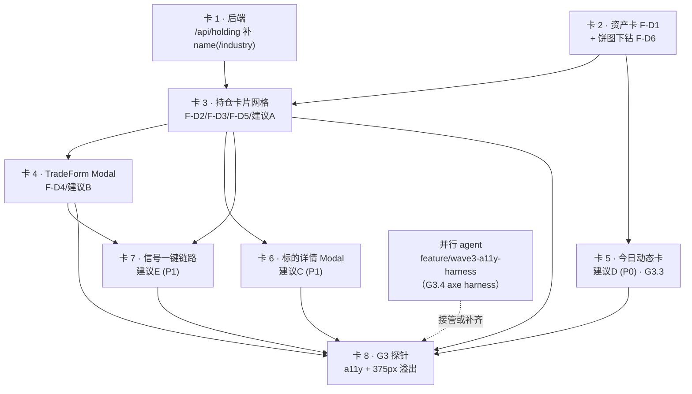

# Wave 3 · T67「Dashboard 持仓页重写」子任务卡（派发用）

> **本文档性质**：`docs/audit/` 是「证据层」，**不新增任何事实定义、不复述技术契约**。
> 本文件只做三件事：① 把 PRD / gap-list / ux_v2 / 现状代码**翻译成可派发的动作**；
> ② 给出**可自动验证**的验收断言；③ 显式记录拆解过程中的**口径裁决**。
> **执行依据仍然是** `docs/client/code_implementation_plan_v2.md` §5 Wave 3（T67，plan 行 306）+
> `docs/client/PRD.md` §5.3（PRD 行 224-232）+ `docs/client/SDD.md` §4.4（SDD 行 1391-1420）。
>
> **快照时间**：2026-10-20
> **工作树状态**：`feature/wave3-a11y-harness`（分支），
> 后端 enrich（`prevClose` / `signal`）**已在工作树中**（未合入 `main`），
> `/api/ex-dividend/imports` 亦为工作树新增端点（未合入）。

---

## 0. 一句话总览

T67 = 「重写 Dashboard」这一个任务，但实际含 **9 项交付（plan ①~⑨）+ 6 个 gap（F-D1~F-D6）+ 5 条 ux_v2 建议（A~E）**，
外加 **2 个当前无人认领的出口门槛（G3.4 a11y / G3.5 溢出探针）**。
本文件拆成 **8 张卡**，依赖顺序编号，**卡 2~卡 8 全部改 `Dashboard.tsx` → 必须串行**，
唯一天然可并行的卡是 **卡 1（纯后端）**。

---

## 1. 规格摘要对照表

### 1.1 PRD §5.3 五行 → gap / 建议 / T67 项 映射

| 需求来源 | 要求（逐字） | 对应 F-D 编号 | 对应 ux_v2 建议 | 对应 T67 第几项 |
|---|---|---|---|---|
| PRD §5.3 行 228「总资产卡片」 | 「顶部大卡片：总资产、总盈亏、总收益率（颜色区分正负）、双口径切换」 | **F-D1**（标签「总资产」取值错 + 审计描述已过期，见裁决 D-1） | ux_v2 问题 3-1-1（行 269-287，「缺少资产汇总卡片」，P0，0.8d） | ①（部分已完成：双口径 Tab 已存在，缺的是取值语义修正） |
| PRD §5.3 行 229「资产组成饼图」 | 「股票 + ETF 按市值分布，支持点击下钻到持仓列表过滤」 | **F-D6**（图已存在，缺下钻） | ux_v2 问题 3-1-3（行 316-322，P1，1.0d）+ 建议 D 的「总资产变化」块 | ⑥ + ⑦ |
| PRD §5.3 行 230「持仓卡片列表」 | 「每只标的：代码 + 名称、现价、持仓数量、移动加权成本、盈亏、收益率、仓位占比（进度条）」 | **F-D2**（仍是 `<table>`）+ **F-D3**（无进度条） | ux_v2 问题 3-1-2（行 289-314，P0，2.0d，3 列/2 列/1 列网格） | ② + ③ |
| PRD §5.3 行 231「快速操作」 | 「每张持仓卡片右侧【买入】【卖出】快捷按钮 → 弹出交易录入弹窗」 | **F-D4**（按钮数 = 0） | ux_v2 **建议 B**（行 370-405，P0，1.0d，Modal 而非跳页） | ④ |
| PRD §5.3 行 232「筛选排序」 | 「按盈亏金额/收益率/仓位占比排序；按标的类型/行业过滤」 | **F-D5**（无排序、无过滤） | ux_v2 问题 3-1-2 的卡片网格 + 建议 A 的信号标记 | ③ + ⑤ |
| PRD §5.3 行 230 隐含（名称） | 「代码 + **名称**」 | 无独立 F-D 条目（gap-list 未单列「缺名称」） | ux_v2 行 294「缺少标的中文名称（只有代码）」 | ③（**依赖卡 1 后端补 `name`**，见裁决 D-2） |

### 1.2 F-D1 ~ F-D6 精确描述与证据

| 编号 | 精确描述（gap-list 行 46-51 逐字） | 证据行号 | 现状复核（2026-10-20 实测） | 归属卡 |
|---|---|---|---|---|
| **F-D1** | 「**「总资产」大字显示的语义错误**：标签写「总资产」但取值为 `posSummary?.totalCostBasis`（**持仓总成本**），应为 `totalMarketValue`；`stat.total_assets_price_yield`/`total_assets_actual_yield` **声明了但从不渲染**」 | `Dashboard.tsx:241` + `:243`；声明于 `:20-21` | ⚠️ **前半句成立、后半句不成立**。当前 `Dashboard.tsx:295` 仍是 `fmt(posSummary?.totalCostBasis)` + `:297` 标签「总资产」→ **前半句为真**；但 `git show 7fa1eca:apps/frontend/src/pages/Dashboard.tsx`（gap-list 落档的同一 commit）行 258/260 **已经在渲染** `total_assets_price_yield`/`total_assets_actual_yield`（作为「总收益率」）→ **后半句为假**（见裁决 D-1） | 卡 2 |
| **F-D2** | 「持仓仍是 `<table>`，PRD §5.3 要求「持仓**卡片列表**」」 | `Dashboard.tsx:304-342`；动态确认 `tables=3`、`th` 为 9 列 | 仍成立：当前 `Dashboard.tsx:376-448` 是 `<table aria-label="持仓明细">`，9 个 `<th>` | 卡 3 |
| **F-D3** | 「仓位占比**只有文字无进度条**」 | `Dashboard.tsx:314,335`；动态实测进度条元素数 = **0** | 仍成立：当前 `:439` 只有 `{fmtPct(p.weight)}` | 卡 3 |
| **F-D4** | 「持仓行无【买入】【卖出】快捷按钮 → 交易录入弹窗」 | `Dashboard.tsx:319-340` 全是 `<td>`；动态实测「买入/卖出」按钮数 = **0** | 仍成立：当前 `:409-446` 全部是 `<td>` | 卡 4 |
| **F-D5** | 「无排序（盈亏/收益率/仓位占比）、无过滤（标的类型/行业）」 | 动态实测排序控件 = **false**；`Dashboard.tsx` 无任何 `onClick` handler | 主体成立；**「无任何 onClick」已过期** —— 当前 `:271` 有口径 Tab 的 `onClick`。**「无排序/无过滤」为真** | 卡 3 |
| **F-D6** | 「资产组成图**已存在**（`conic-gradient` donut，股票/ETF 两段），但**无「点击下钻过滤持仓列表」**」 | `Dashboard.tsx:93-117`；动态实测 `conic-gradient` 元素 = 1 | 仍成立：当前 `DonutChart`（`:101-152`）的 donut div 与图例**均无 `onClick`** | 卡 2 |

### 1.3 ux_v2 建议 A ~ F 交互设计拆解

| 建议 | 优先级 | ux_v2 行号 | 交互要点（原文摘录） | 归属 |
|---|---|---|---|---|
| **A** 持仓卡直显策略信号 | **P0** | 349-368 | 「每张持仓卡片右侧（或名称下方）直接显示当前策略信号状态，用**极简图标**」；「无信号时显示 `·持有`（灰色小点）」；「信号过期（超过 5 个交易日未更新）显示 `⚠信号过期`（橙色三角）」；「**后端实现**：…批量 `IN (...)` 查询信号表…（避免 N+1）」 | 卡 3 |
| **B** 交易录入改模态 | **P0** | 370-405 | 「保留 `/trade` 路由…但 Dashboard 持仓卡片…的"买入/卖出"按钮**触发 Modal**」；「Modal 宽度 600-680px，居中，背景 dim 0.4」；「ESC 关闭 / 点击遮罩关闭」；「打开时**自动填入**：标的代码…交易类型」；「预估面板**实时计算**」 | 卡 4（**实时预估归 T68**，见裁决 D-3） |
| **C** 标的详情 Modal + K 线小图 | P1 | 407-447 | 「持仓卡片上的标的代码/名称**可点击**，点击后弹出一个**详情 Modal**（宽度约 800-900px）」；内容 = 持仓概览 + 今日信号 + 最近交易 + K 线小图；「Modal 里展示的是**压缩版 K 线**（只画 MA + 一个副图，时间范围默认 120 天）」；「底部有"进入完整 K 线页"链接」 | 卡 6 |
| **D** 今日动态概览卡 | **P0** | 474-495 | 「插在资产汇总卡和持仓卡之间，一条**窄条时间线**（高度约 100px）」；5 块 = 总资产变化（对比昨收）/ 今日信号 ▲▼· / 今日成交（前 1-2 条）/ 今日除权导入 / 重点关注（持仓+候选有信号）；「整体风格：**一行四列**」 | 卡 5 |
| **E** 信号→交易一键链路 | P1 | 497-528 | 「在建议 A 的信号标记上加一个**二级点击交互**」；「Mini-Menu 宽度约 180px，显示插件名 + 参数摘要 + 【立即买入/卖出】按钮」；点【立即买入 →】→ Modal「**所有字段预填**」：代码 / 类型 / 数量（建议值）/ 价格（现价）/ 操作理由「"MACD 金叉买入 (2026-10-16)"」 | 卡 7 |
| **F** 候选池联动面板 | P1 | 530-556 | 「Dashboard 底部增加一个**候选池 Top 5 面板**（默认折叠成一个窄条，点击展开）」 | 🔴 **不属 T67** —— plan T79 ⑥ 已承接（plan 行 344：「⑥ 候选池联动面板（ux_v2 建议 F…）」，卡点写明「⑤⑥ 依赖 T67（信号 enrich）与 T74（候选池 API）」）。见裁决 D-12 |

### 1.4 T67 九项交付 → 卡片归属

| T67 项（plan 行 306） | 内容摘要 | 归属卡 |
|---|---|---|
| ① | 总资产大字改市值（修 F-D1） | 卡 2 |
| ② | 持仓改卡片网格（桌面 3 列/平板 2/手机 1） | 卡 3 |
| ③ | 每卡补 名称/现价/持仓/成本/盈亏/收益率/进度条/信号标记（建议 A） | 卡 3（`name` 由卡 1 提供） |
| ④ | 卡片【买入】【卖出】→ TradeForm Modal（建议 B） | 卡 4 |
| ⑤ | 排序（盈亏/收益率/仓位占比）+ 过滤（标的类型/行业） | 卡 3 |
| ⑥ | 饼图支持点击下钻 | 卡 2 |
| ⑦ | 建议 D 今日动态概览卡（P0） | 卡 5 |
| ⑧ | 建议 C 标的详情 Modal（P1） | 卡 6 |
| ⑨ | 建议 E 信号→交易一键链路（P1） | 卡 7 |
| （建议 F） | 候选池联动面板 | **T79 ⑥，不在 T67** |
| — | G3.4 a11y / G3.5 溢出探针（当前无人认领） | 卡 8 |

---

## 2. 子任务卡

> **通用约定（每张卡都适用，agent 必读）**
>
> 1. **只改本卡「改哪些文件」列出的文件**；要改别的文件 → 停手并在交付报告里说明原因。
> 2. **禁止** `git commit` / `git push` / `git add`；只改文件 + 跑测试，提交由主 agent 统一做。
> 3. 样式**必须**走 `apps/frontend/src/theme/tokens.ts` 的 token；**禁止裸 hex**（T62 验收：`grep -rn '#[0-9a-fA-F]\{6\}' apps/frontend/src --include=*.tsx` 命中归零，token 文件除外）。
> 4. 类型**禁止 `any`**（T86 已开 `no-explicit-any`）；`npm run lint` 与 `npm run typecheck` 必须 0 退出。
> 5. 测试用 **Vitest 2.x**（与仓库实际对齐，**不要升到 5.x** —— DEC-3 已裁决）；前端入口 `npm run test -w @invest/frontend`。
> 6. 组件测试用 `apps/frontend/tests/helpers.tsx` 的 `renderWithRouter`（自动包 `MemoryRouter`）与 `mockResponse`；`toBeInTheDocument` 等断言来自 `tests/setup.ts` 已注册的 `@testing-library/jest-dom/vitest`。
> 7. **跑测试前先停掉后端进程** —— 后端持有 DuckDB 文件独占锁，会让 12 个用例报 `IO Error: Could not set lock on file`（AGENTS.md「CI 与本地不一致的三个陷阱」第 3 条）。
> 8. 注释只写「为什么」，不写「是什么」；**注释不是规格**，改既有代码前先证明现状是错的（AGENTS.md「注释不是规格」门禁）。

---

### 卡 1 — 后端就绪：`/api/holding` 补 `name`（中文名），并把 `industry` 预留到契约里

- **依赖**
  - **前置卡**：无。可与 卡 2 ~ 卡 8 **完全并行**（文件零重叠）。
  - **后端字段是否已就绪**：`prevClose` / `signal` **已在工作树就绪**（`apps/backend/src/routes/trade.ts:455` `prevClose`、`:457` `signal`），**本卡不动这两个字段**。
  - **本卡新增**：`name`（**必做**）、`industry`（**可选**，见下）。
- **改哪些文件**
  - `apps/backend/src/services/marketData.ts` —— 新增 `batchGetSymbolNames(codes: string[]): Promise<Map<string, string>>`（**1 次 IN 查询** `raw_symbol_name`）。
  - `apps/backend/src/services/marketData.ts` 或新建 `apps/backend/src/services/industryService.ts` —— 新增 `batchGetIndustries(codes: string[]): Promise<Map<string, string>>`（**1 次 IN 查询** `raw_tdx_blocks_member`）。
  - `apps/backend/src/routes/trade.ts` —— `GET /api/holding` 的 `enriched` 映射里追加 2 个字段（**只加不改**）。
  - `apps/backend/tests/unit/t67-dashboard-enrich.test.ts` —— 该文件已存在（工作树新增），**追加**用例。
  - `docs/client/SDD.md` §4.4 —— `/api/holding` 行（SDD 行 1404）追加「中文名 `name` / 行业 `industry`」。
- **交付内容**（逐条可验证）
  1. `GET /api/holding` 的每个 position 新增 `name: string | null` —— 取自 `raw_symbol_name.name`（按 `symbol` 精确匹配）；查不到 → `null`。
  2. 每个 position 新增 `industry: string | null` —— 取自 `raw_tdx_blocks_member` 的板块/行业列（**口径按 T55 裁决 = 板块口径**）；查不到 → `null`。
     > **可选项**：若你认为为一张**实测 0 行**的表专门加一次 DuckDB 查询不划算，**可以只做 `name`**，但必须在交付报告里写明「`industry` 未做」，并让 卡 3 按「`industry` 字段不存在 → 行业筛选恒为不可用」处理。**两种做法都接受**，但必须二选一，不许含糊。
  3. **只加不改**：既有字段（`asset_code` / `totalQuantity` / `totalCostBasis` / `avgCost` / `realizedPnL` / `currentPrice` / `priceDate` / `marketValue` / `unrealizedPnl` / `unrealizedYield` / `weight` / `prevClose` / `signal`）的**路径、方法、响应形状全部不变**；顶层 `summary` 的 6 个键不变。
  4. **降级**：DuckDB 不可用 → `name` / `industry` 全为 `null`，**接口必须仍返回 200**（不得 500）。
  5. **1 次 IN 查询**（`where symbol IN (?, ?, ...)`），**禁止逐标的循环查**（AGENTS.md DuckDB 硬约束 2）。
- **不改什么**（负向边界）
  - 不改 SQLite 业务层、不改任何 DDL、不加表、不加索引。
  - 不改 `/api/holding` 的**既有字段**、不改 `summary` 结构、不改路由路径/方法。
  - 不碰 `prevClose` / `signal` 的实现与语义。
  - 不新增任何**前端**文件（前端由 卡 3 消费）。
  - 不删 `apps/backend/src/services/todaySignals.ts` 的 `getTodaySignalStats`（**它当前是未被调用的导出**，处理方式见裁决 D-13）。
- **验收断言**（可自动验证）
  - A1：`GET /api/holding` → `res.data.data[0].name` 存在，类型为 `string | null`。
  - A2：fixture 命中 `raw_symbol_name`（如 `sh600000` → `浦发银行`）→ `name === '浦发银行'`。
  - A3：fixture 未命中 → `name === null`，HTTP 仍为 200。
  - A4：mock DuckDB 查询抛错 → HTTP **200**，`data[i].name === null` 且 `data[i].industry === null`。
  - A5：**N+1 反证** —— spy `queryDuckDB`（或 `batchGetLatestAndPrevClose` 同级的新函数），3 只持仓时**调用次数 = 1**（不是 3）。
  - A6：**只加不改回归** —— 加字段前后 `asset_code` / `marketValue` / `weight` / `prevClose` / `signal` 的值完全一致（同一 fixture 下断言相等）。
  - A7：`summary` 的键集合仍为 `{ totalMarketValue, totalCostBasis, unrealizedPnl, realizedPnl, priceDate, positionCount }`（不多不少）。
- **测试要求**
  - 文件：`apps/backend/tests/unit/t67-dashboard-enrich.test.ts`（已存在，**追加** describe 块）。
  - 用例名（必须能体现验收点）：
    - `GET /api/holding enrich: 每个持仓带 name（raw_symbol_name 命中时）`
    - `GET /api/holding enrich: name 未命中时为 null 且不报错`
    - `GET /api/holding enrich: DuckDB 不可用时 name/industry 为 null 且仍返回 200`
    - `GET /api/holding enrich: 批量查名只发 1 次 IN 查询（无 N+1）`
    - `GET /api/holding enrich: 只加不改 —— prevClose/signal/weight/summary 回归`
  - 运行：`npx vitest run apps/backend/tests/unit/t67-dashboard-enrich.test.ts --pool=forks --poolOptions.forks.singleFork=true`
- **实测口径**（数值/字段以什么为准）
  - `raw_symbol_name` 的列 = `symbol, name`（**实测** 8726 行；全市场 12449 只 → 覆盖约 70%，**缺失是常态**，前端必须容忍 `null`）。
  - `raw_tdx_blocks_member` **实测 0 行**（2026-10-20，`duckdb -readonly /opt/invol/quotes.duckdb "SELECT count(*) FROM raw_tdx_blocks_member"` → 0）。⇒ `industry` 当前**恒为 `null`**。
  - `raw_tdx_blocks_info` **实测 0 行**。
  - 行业口径：T55 已裁决「行业字段用板块表近似（`block_type` 需甄别），MVP 标注为「板块口径」」（plan 行 258）。
  - `name` 字段类型：`string | null`；`industry` 字段类型：`string | null`。
- **风险与坑**
  - 🔴 **DuckDB 文件锁**：本地真实库 `/opt/invol/quotes.duckdb`（1.24GB）被后端进程持有时，测试进程打开会报 `IO Error: Could not set lock on file ... Conflicting lock is held in /usr/bin/node (PID …)`。**跑测试前先停后端**（AGENTS.md）。
  - 🔴 **CI 没有真实行情库**：仓库里的 `data/quotes.duckdb` 只是 12KB 空壳 → **依赖真实行情的用例在 CI 必红**。判定「行情库可用」**不能用 `fs.existsSync`**，要探测表是否存在（参考 `apps/backend/tests/_marketData.ts`）；无库时 `it.skipIf`。
  - 🟡 `raw_symbol_name` 只覆盖 70% → `name` 缺失时前端回退显示代码，**不许显示 `null`/`undefined` 字面量**。
  - 🟡 `industry` 恒 `null` → 行业筛选必须**显式降级**，不许「静默失效」（用户会以为没筛到）。

---

### 卡 2 — 资产汇总卡取值修正（F-D1）+ 资产组成饼图点击下钻（F-D6）

- **依赖**
  - **前置卡**：无。
  - **后端字段是否已就绪**：✅ 已就绪 —— `/api/holding` 顶层 `summary.totalMarketValue`（`routes/trade.ts:471`）与 `summary.totalCostBasis`（`:472`）**现成可用**；本卡**不需要任何后端改动**。
  - ⚠️ 与 卡 1 **文件零重叠** → **可并行**。
- **改哪些文件**
  - `apps/frontend/src/pages/Dashboard.tsx` —— **只改「总资产」大字取值 + 资产组成卡的下钻交互 + 持仓过滤 state**。
  - `apps/frontend/tests/unit/dashboard.test.tsx` —— 追加 describe 块。
  - （可选）`apps/frontend/src/theme/tokens.ts` —— 若需要新的交互态 token（如「选中态边框色」），**必须**走 token，不得裸 hex。
- **交付内容**
  1. **F-D1 核心**：标签「总资产」的大字取值，从 `fmt(posSummary?.totalCostBasis)`（持仓总成本）改为 **`fmt(posSummary?.totalMarketValue)`**（总市值）。
     > 依据：PRD §5.3 行 228「顶部大卡片：**总资产**、总盈亏、总收益率（颜色区分正负）、双口径切换」；gap-list 行 46「标签写「总资产」但取值为 `posSummary?.totalCostBasis`（**持仓总成本**），应为 `totalMarketValue`」。
  2. 「总资产」卡内**同时**显示两个口径且互不混淆：主数字 = 总市值；副行给出「持仓总成本 ¥xxx」的小字（成本口径不能被当成总资产）。若 `summary` 为 `null` → 显示 `--`。
  3. **F-D6 核心**：`DonutChart` 的 **「股票」段与「ETF」段可点击** → 点击后**过滤下方持仓列表**为该类型。
     > 依据：PRD §5.3 行 229「股票 + ETF 按市值分布，**支持点击下钻到持仓列表过滤**」。
  4. 图例（当前是 `
` 文本）改为可点击控件：`<button type="button" role="button" aria-pressed={选中}>`，宽度沿用现有图例排版。
  5. donut 本体（conic-gradient 圆）也可点击，行为与点击对应图例**一致**。
  6. **选中态**：当前选中的类型，图例按钮有可见差异（背景/边框/字重三选一以上，**必须能被人眼与测试区分**）；再点一次同一段 → **取消过滤**（回到全部）。
  7. 过滤 state 与 卡 3 的「标的类型筛选」**共用同一个**（单一真相源），避免两套过滤互相打架 → **约定 state 名 `typeFilter: 'all' | 'stock' | 'etf'`**。
- **不改什么**（负向边界）
  - **不改** `DonutChart` 的 conic-gradient 计算口径 —— 现有断言 `conic-gradient(#2563eb 0% 60%, #16a34a 60% 100%)`（背景用**原始数值** `stockPct`，图例才 `toFixed(1)`）必须**逐字保持**（现有 `dashboard.test.tsx:229` 依赖它）。
  - **不改** 双口径 Tab 的换源逻辑（`stat.total_profit_price` / `stat.total_profit_actual` / `total_assets_price_yield` / `total_assets_actual_yield`），也不删它们的渲染 —— **实测它们已在渲染**（见裁决 D-1）。
  - 不动「最新信号」卡、「最近日志」卡（T79 ⑤ 才重构）。
  - 不做「Dashboard 概览页重定位」（T79 ⑤）、不做「候选池联动面板」（建议 F → T79 ⑥）。
  - 不新增 npm 依赖、不引图表库（ui-spec §5 决策 3）。
  - **不改** `apps/backend/**`（后端归 卡 1）。
- **验收断言**（可自动验证）
  - A1（F-D1）：fixture `summary = { totalMarketValue: 1000, totalCostBasis: 850, ... }` → 标签「总资产」对应的数值文本 === `'1000.00'`，且**页面上不出现** `'850.00'`（避免误把成本当总资产）。
  - A2（F-D1）：`summary === null` → 总资产位置显示 `'--'`，**不显示** `NaN` / `undefined` / `0.00`。
  - A3（F-D1 副行）：副行含「持仓总成本」四字 + 成本值 `850.00`（证明两个口径都在，且不互相顶替）。
  - A4（F-D6）：点击图例按钮「股票」→ 持仓区只含非 ETF 标的（`sh600000` 在，`sh510300` 不在）。
  - A5（F-D6）：点击图例按钮「ETF」→ 持仓区只含 ETF 标的。
  - A6（F-D6）：再次点击同一图例按钮 → 过滤解除，持仓区恢复全部标的。
  - A7（F-D6）：图例按钮带 `aria-pressed`，选中态 `'true'` / 未选 `'false'`（用 `getByRole('button', { name: '股票' })` 拿，再断言属性）。
  - A8（回归）：`conic-gradient(#2563eb 0% 60%, #16a34a 60% 100%)` 仍出现在背景 style 里；图例文本仍为「股票 600.00（60.0%）」/「ETF 400.00（40.0%）」。
  - A9（回归）：双口径 Tab 切换仍让「总盈亏」/「总收益率」换源（现有用例不得被改红）。
- **测试要求**
  - 文件：`apps/frontend/tests/unit/dashboard.test.tsx`（**追加** describe，不改现有用例的断言强度）。
  - 用例名：
    - `F-D1 总资产：显示 summary.totalMarketValue 而非 totalCostBasis`
    - `F-D1 总资产：summary 缺失时显示 -- 不显示 NaN`
    - `F-D1 总资产：副行显示持仓总成本，两个口径不互相顶替`
    - `F-D6 饼图下钻：点击「股票」图例后持仓列表只剩股票标的`
    - `F-D6 饼图下钻：点击「ETF」图例后持仓列表只剩 ETF 标的`
    - `F-D6 饼图下钻：再次点击同一图例取消过滤`
    - `F-D6 饼图下钻：图例按钮 aria-pressed 反映选中态`
    - `回归：donut 渐变角度与图例文案不变`
- **实测口径**
  - `/api/holding` 响应形状：`{ code: 0, success: true, data: Position[], summary: {...}, timestamp }` —— **`summary` 是顶层键**，不是 `data.summary`（`routes/trade.ts:467` 的注释「T89a：summary 是**顶层**字段（前端 Dashboard.tsx 读 `res.data.summary`）」）。
  - `summary` 键：`totalMarketValue` / `totalCostBasis` / `unrealizedPnl` / `realizedPnl` / `priceDate` / `positionCount`（`routes/trade.ts:470-477`）。
  - 测试里 mock 写法沿用现有 `installApiMock`：`case '/holding': return mockResponse(positions, { summary });`。
- **风险与坑**
  - 🟡 现有 `dashboard.test.tsx` 的 `metricText(label)` helper 取「标签的父元素的首个子元素」——总资产大字改成 `totalMarketValue` 后**取值方式不变**，helper 无需改；但若你把「总资产」与「持仓总成本」放在**同一个父 div** 里，helper 会取错节点 → **两个口径必须各自独立成「值 div + 标签 div」结构**。
  - 🟡 现有用例 `expect(getMock).toHaveBeenCalledWith('/signal', { params: { page_size: 5 } })`（`:246`）**会被 卡 5 的新请求撞红** → 卡 5 必须同步更新它；本卡不要动它。
  - 🟡 「点击 donut 本体」与「点击图例」若用同一个 handler，测试里 `getByRole('button')` 只会拿到图例按钮（donut 是 `div`）→ donut 本体的点击用 `container.querySelector('[style*="conic-gradient"]')` 定位。

---

### 卡 3 — 持仓卡片网格 + 仓位占比进度条 + 信号标记 + 排序/过滤（F-D2 / F-D3 / F-D5 / 建议 A）

- **依赖**
  - **前置卡**：**卡 2**（两者都改 `Dashboard.tsx` → 必须串行）；**卡 1**（`name` 字段；`industry` 可选）。
  - **后端字段是否已就绪**：`currentPrice` / `marketValue` / `unrealizedPnl` / `unrealizedYield` / `weight` / `signal` ✅ 已就绪（`signal` 在工作树）；`name` 由 卡 1 补。
- **改哪些文件**
  - `apps/frontend/src/pages/Dashboard.tsx` —— 持仓区：`<table>` → 卡片网格；加排序/过滤控件；与 卡 2 共用 `typeFilter`。
  - `apps/frontend/src/components/PositionCard.tsx` —— **新建**（单只持仓卡）。
  - `apps/frontend/src/components/WeightBar.tsx` —— **新建**（仓位占比进度条）。
  - `apps/frontend/src/components/SignalBadge.tsx` —— **新建**（信号标记 ▲▼· / ⚠过期；**卡 7 会扩展它**）。
  - `apps/frontend/src/theme/tokens.ts` 或新建 `apps/frontend/src/theme/breakpoints.ts` —— **三档断点常量**（见「风险与坑」）。
  - `apps/frontend/tests/unit/dashboard.test.tsx` —— 追加 describe。
  - `apps/frontend/tests/unit/positionCard.test.tsx` —— **新建**（组件级用例，与 Dashboard 解耦）。
- **交付内容**
  1. **F-D2**：持仓区从 `<table>` 改为**卡片网格**。
     > 依据：PRD §5.3 行 230「**持仓卡片列表** | 每只标的：代码 + 名称、现价、持仓数量、移动加权成本、盈亏、收益率、仓位占比（进度条）」；ux_v2 行 289-314 问题 3-1-2「改为响应式网格卡片」「桌面端 3 列，平板 2 列，手机 1 列」。
  2. **每卡字段（7 项，逐字照 PRD 行 230）**：代码、名称、现价、持仓数量、移动加权成本、盈亏、收益率、仓位占比（进度条）。**一个都不能少。**
  3. **响应式三档**：桌面 ≥1200px **3 列**；平板 768~1199px **2 列**；手机 <768px **1 列**。
  4. **F-D3**：仓位占比**进度条**（可访问：外层 `role="progressbar"` + `aria-valuenow` / `aria-valuemin=0` / `aria-valuemax=100`）。
     > 依据：PRD §5.3 行 230「仓位占比（**进度条**）」；gap-list 行 48「仓位占比**只有文字无进度条**」。
  5. **建议 A**：每卡显示**信号标记**：▲ 买入（绿）/ ▼ 卖出（红）/ · 持有（灰）；无信号 → `·持有`；信号过期 → `⚠信号过期`（橙）。
     > 依据：ux_v2 行 349-368「每张持仓卡片右侧（或名称下方）直接显示当前策略信号状态，用**极简图标**」「无信号时显示 `·持有`（灰色小点）」「信号过期（超过 5 个交易日未更新）显示 `⚠信号过期`（橙色三角）」。
  6. **F-D5 排序**：三档 —— 按**盈亏金额** / 按**收益率** / 按**仓位占比**（PRD 行 232「按盈亏金额/收益率/仓位占比排序」）。默认按盈亏金额**降序**。控件用 3 个互斥按钮（`aria-pressed`）。
  7. **F-D5 过滤**：按**标的类型**（全部 / 股票 / ETF）+ 按**行业**。类型过滤用 前端已有的 `isEtf(code)`（`Dashboard.tsx:82`，**已有单测**，直接复用，**不要另写一份正则**）。
  8. **行业过滤必须显式降级**：`industry` 字段缺失或恒 `null`（实测 `raw_tdx_blocks_member` 0 行）→ 行业筛选控件 **disabled** + 旁边显示「行业数据源暂不可用」（**不许静默失效**）。
  9. 卡片上的**标的名**可点击（为 卡 6 预留）：`onOpenDetail?(asset_code: string)` 回调；`name === null` 时锚点文本回退为**代码**（仍可点击）。
  10. 卡片上的【买入】【卖出】按钮**由 卡 4 接入** —— 本卡先留出 `onTrade?(asset_code: string, side: 'buy'|'sell')` 回调与按钮位（可先渲染 disabled 占位），**卡 4 负责真正接上**。
- **不改什么**（负向边界）
  - **不改** `apps/backend/**`。
  - **不改**「最新信号」卡、「最近日志」卡、「资产组成」卡（卡 2 的范围）。
  - 不改 `isEtf` 的判定口径（现有单测 `isEtf · A 股 ETF 代码判定` 必须仍全绿）。
  - 不做「持仓 Top 3 概览」、不做「今日快捷操作区」（T79 ⑤）。
  - 不引图表库 / CSS 框架；样式走 token。
  - 不做「导出 CSV」「批量操作」等 PRD 没有的。
- **验收断言**（可自动验证）
  - A1（F-D2）：渲染后**持仓区不再有 table** —— 断言 `container.querySelector('table[aria-label="持仓明细"]')` 为 `null`；且页面 table 总数从 3 降到 2（信号表 + 日志表仍在）。
  - A2（PRD 行 230 逐字段）：每张卡**同时**含 7 个字段的可读文本：代码、名称、现价、持仓数量、成本、盈亏、收益率。用 `getByText` **精确匹配**（不要 `stringContaining` 大包），且**必须能区分是持仓卡里的值**（用 `within(card)` 限定范围）。
  - A3（F-D3）：进度条宽度 = `weight * 100` —— fixture `weight: 0.6` → 进度条内层 `style.width === '60%'`；`weight: 0.4` → `'40%'`。**精确字符串相等**，不用 `toBeCloseTo`。
  - A4（F-D3 a11y）：进度条带 `role="progressbar"` 且 `aria-valuenow="60"`。
  - A5（F-D5 排序三档）：3 只持仓，盈亏 / 收益率 / 仓位占比的排序结果**各不相同** → 依次点 3 个排序按钮，断言**首卡的 `asset_code`** 依次为 `A` / `B` / `C`（fixture 必须设计成三档顺序互异，否则断言无效）。
  - A6（F-D5 过滤-类型）：选「股票」→ 只剩非 ETF 卡；选「ETF」→ 只剩 ETF 卡；选「全部」→ 恢复。
  - A7（F-D5 过滤-行业）：`industry` 全为 `null` 时，行业控件 `disabled` 为 `true`，且页面出现「行业数据源暂不可用」。
  - A8（建议 A 四态）：`signal.direction` = `'buy'` → 卡内出现 `▲`；`'sell'` → `▼`；`'hold'` → `·`；`signal === null` → 出现「·持有」。
  - A9（建议 A 过期）：`signal.trade_date` 距最新行情日 ≥ 5 天（见裁决 D-5）→ 出现「⚠信号过期」；< 5 天 → **不出现**该文案。
  - A10（名称降级）：`name === null` → 卡内**不出现**字符串 `'null'` / `'undefined'`，且名称锚点文本 === 代码。
  - A11（响应式）：把 `window.innerWidth` 设为 375 并派发 `resize` → 网格列数为 **1**；设为 1024 → **2**；设为 1440 → **3**。
  - A12（溢出预判）：在 375 宽度下，**任意元素的 `scrollWidth` 不得超过其 `clientWidth` + 2**（卡 8 的浏览器探针的前置版，可先在 jsdom 粗查）。
- **测试要求**
  - 文件 1：`apps/frontend/tests/unit/positionCard.test.tsx`（**新建**）—— 组件级（props 驱动，不依赖 Dashboard）。
    - `PositionCard：7 个字段全部渲染`
    - `PositionCard：进度条宽度等于 weight 百分比`
    - `PositionCard：信号四态 buy/sell/hold/null 分别渲染 ▲/▼/·/·持有`
    - `PositionCard：信号过期显示 ⚠信号过期`
    - `PositionCard：name 为 null 时回退显示代码且无 null 字面量`
  - 文件 2：`apps/frontend/tests/unit/dashboard.test.tsx`（**追加**）—— 集成级。
    - `F-D2 持仓卡片化：持仓区不再是 table，卡片数 = 持仓数`
    - `F-D3 进度条：宽度等于 weight 百分比`
    - `F-D5 排序：按盈亏金额 / 收益率 / 仓位占比 三档首卡正确`
    - `F-D5 过滤：按标的类型过滤后卡片集合正确`
    - `F-D5 过滤：行业数据源不可用时控件禁用并有说明文案`
    - `建议 A 信号标记：buy/sell/hold/null 四态分别渲染`
    - `响应式：375 / 1024 / 1440 三档列数分别为 1 / 2 / 3`
  - 运行：`npm run test -w @invest/frontend`
- **实测口径**
  - `/api/holding` 每个 position 的字段（**全部以 `routes/trade.ts:439-459` 的实际返回为准**）：
    `asset_code: string` / `totalQuantity: number` / `totalCostBasis: number` / `avgCost: number` / `realizedPnL: number` /
    `currentPrice: number | null` / `priceDate: string | null` / `marketValue: number | null` /
    `unrealizedPnl: number | null` / `unrealizedYield: number | null` / **`weight: number | null`（0~1 的小数）** /
    **`prevClose: number | null`** / **`signal: { plugin_id: string, direction: 'buy'|'sell'|'hold', label: string, trade_date: string } | null`** /
    **`name: string | null`（卡 1）** / **`industry: string | null`（卡 1，可选）**。
  - `weight` 是**小数**（后端 `p.marketValue / totalMarketValue`，`routes/trade.ts:464`）→ 前端必须 `* 100`。
  - `signal.direction` 的取值域是 **`buy` / `sell` / `hold`**（`services/todaySignals.ts:13` + DDL CHECK），**不是** PRD 的「买入/卖出/持仓」中文。
  - `DIRECTION_LABEL` 映射 `{ buy: '买入', sell: '卖出', hold: '持仓' }` **已存在于 `Dashboard.tsx:67`** → **直接复用，不要另建一份**。
- **风险与坑**
  - 🔴 **三档断点不是现成的**：现有只有 `MOBILE_BREAKPOINT = 768`（`pages/_shared.tsx:34`）+ `useIsMobile()`（**只有二值**）。三档需要新增一个 `useViewportWidth()`（返回 `window.innerWidth`）+ resize 监听，或新增 3 个断点常量。
    ⚠️ `tests/setup.ts:80-94` 的 `matchMedia` mock **恒返回 `matches: false`** → 用 `matchMedia` 做断点，测试里**测不出三档差异**，必须走 `window.innerWidth` + `resize` 事件（jsdom 可控）。
  - 🔴 **`weight` 可能为 `null`**（无行情时）→ 进度条宽度必须落成 `'0%'`，**不得出现 `NaN%`**。
  - 🟡 **排序三档的 fixture 必须让三档顺序互异**，否则 A5 会「假绿」（三档排出来一样，断言也过）。
  - 🟡 `signal === null` 与 `signal.direction === 'hold'` **渲染上要能区分**？—— ux_v2 行 355 说「无信号时显示 `·持有`（灰色小点）」，而 `direction === 'hold'` 也是 `·`。本卡按「两者都显示 `·持有`」实现（**卡 7 的 Mini-Menu 才是区分点**：只有 `signal` 存在才有 Mini-Menu 入口）。
  - 🟡 **PRD 行 232 要求「行业过滤」，但数据源 0 行** → 必须**显式降级**（disabled + 文案），不能假装筛了。
  - 🟡 卡 2 已占 `typeFilter` state → 本卡的类型过滤**必须复用**，否则点 donut 筛出来的结果会被类型下拉覆盖。
  - 🟡 `Dashboard.tsx` 的 `Position` interface（`:29-41`）**缺** `prevClose` / `signal` / `name` / `industry` 字段 → 本卡要补齐，否则 TS 报错。

---

### 卡 4 — 持仓卡【买入】【卖出】→ TradeForm Modal（F-D4 / 建议 B）

- **依赖**
  - **前置卡**：**卡 3**（按钮位在持仓卡上）。
  - **后端字段是否已就绪**：✅ `POST /api/trade` 现成（`routes/trade.ts:97`），**本卡不改后端**。
- **改哪些文件**
  - `apps/frontend/src/components/TradeFormModal.tsx` —— **新建**。
  - `apps/frontend/src/components/PositionCard.tsx` —— 卡 3 的产物，本卡把 disabled 占位按钮接成真实按钮（透传 `onTrade`）。
  - `apps/frontend/src/pages/Dashboard.tsx` —— 接线（持有 Modal 的 open/预填 state）。
  - `apps/frontend/tests/unit/tradeFormModal.test.tsx` —— **新建**。
- **交付内容**
  1. **F-D4**：每张持仓卡右侧有【买入】【卖出】按钮。
     > 依据：PRD §5.3 行 231「每张持仓卡片右侧【买入】【卖出】快捷按钮 → 弹出交易录入弹窗」；gap-list 行 49「持仓行无【买入】【卖出】快捷按钮 → 交易录入弹窗」「动态实测「买入/卖出」按钮数 = **0**」。
  2. 点击按钮 → 弹出 **Modal**（**不跳 `/trade` 页**）。
     > 依据：ux_v2 行 370-405 建议 B「Dashboard 持仓卡片和 Review 交易编辑的"买入/卖出"按钮**触发 Modal**」「**PRD 对齐**：**§5.4 标题就是"交易录入弹窗"**」。
  3. **自动预填**：标的代码（来自持仓卡）、交易类型（买入 / 卖出）。
     > 依据：ux_v2 行 404「打开时**自动填入**：标的代码（从持仓卡片带过来）、交易类型（买入/减仓根据按钮）」。
  4. Modal 字段：标的代码 / 交易类型 / 数量 / 价格 / 手续费 / **操作理由** / 交易日期 / 交易时刻。
  5. **a11y**：`role="dialog"` + `aria-modal="true"` + `aria-labelledby`（用 `useId()`，多实例不串）+ `aria-describedby`（有正文时）。
  6. **关闭**：ESC 关闭 + 点击遮罩关闭（与 `components/ConfirmDialog.tsx:56-70` 同款实现，可参考）。
     > 依据：ux_v2 行 402「ESC 关闭 / 点击遮罩关闭」。
  7. Modal 宽度 600-680px、居中、遮罩 dim 0.4（ux_v2 行 399-400）。
  8. **提交**：`POST /api/trade`；成功后**重新拉取 `/api/holding`**（持仓卡与资产卡一起刷新）。
     > 依据：ux_v2 行 452-454「点提交 → 后端 → 持仓卡自动刷新（资产卡也刷新）」。
  9. **交易时刻自动预填当前时间** `HH:mm:ss` —— 后端 `trade_time` **必填无默认**（`routes/trade.ts:25` `validateTradeTime`，T87 裁决）。
  10. **本地必填校验**（不发请求、直接给中文提示）：数量 > 0；价格 ≥ 0；**操作理由非空**（后端 `NEED_REASON_TYPES` 对 `buy/sell/reduce/clear` 强制 `trade_reason`，`routes/trade.ts:133-140`）。
- **不改什么**（负向边界）
  - 🔴 **不改 `apps/frontend/src/pages/TradeInput.tsx`** —— T68（Wave 4）才重写它。本卡只**新建** `components/TradeFormModal.tsx`。
  - 不改 `POST /api/trade` 后端逻辑、不改 DDL。
  - 不做**实时预估面板**（新均价 / 总投入 / 手续费计入）—— 那是 T68 ④ 的交付（见裁决 D-3）。
  - 不做**预设标签按钮**（T68 ⑦）、不做**除权补充 Tab**（T68 ①）、不做 label 中文化以外的 TradeInput 改动（T68 ②）。
  - 不做焦点锁定 / 焦点回归（`ConfirmDialog.tsx:16-19` 明确那是 **T76 ⑤**）。
  - 不做「系统 vs 人工标签」（PRD §5.4 最后一行，T68 范围）。
  - 不引第三方表单库 / 弹窗库。
- **验收断言**（可自动验证）
  - A1：点持仓卡【买入】→ `getByRole('dialog')` 出现；代码输入框的 `value` === 该持仓 `asset_code`。
  - A2：点【卖出】→ 交易类型控件的值为**卖出**（断言方式：若用 select 则断言 `select.value`；若用 Tab/按钮组则断言 `aria-pressed`/`aria-selected` 的那一项）。
  - A3：ESC → `queryByRole('dialog')` 为 `null`（且 DOM 中不残留遮罩节点）。
  - A4：点击遮罩（`role="dialog"` 的父节点）→ Modal 关闭。
  - A5：填合法值提交 → `api.post` 被调用**恰好 1 次**，URL 为 `'/trade'`，body 含 `asset_code` / `trade_type` / `quantity` / `price` / `fee` / `trade_reason` / `trade_date` / `trade_time`（`trade_time` 匹配 `/^\d{2}:\d{2}:\d{2}$/`）。
  - A6：`trade_reason` 留空 → `api.post` **未被调用**，且出现中文提示（含「理由」二字）。
  - A7：数量填 `0` → `api.post` 未被调用，出现中文提示。
  - A8：提交成功 → `/api/holding` 被**重新拉取 1 次**（`getMock` 对 `'/holding'` 的调用次数 +1）。
  - A9：`open === false` → **不渲染任何 DOM**（`container.innerHTML === ''`），与 `ConfirmDialog` 的约定一致（`ConfirmDialog.tsx:72`）。
  - A10：Modal 内**没有**实时预估面板（`queryByText(/预估/)` 为 `null`）—— 防止顺手把 T68 的活干了（可选断言）。
- **测试要求**
  - 文件：`apps/frontend/tests/unit/tradeFormModal.test.tsx`（**新建**）。
  - 用例名：
    - `建议 B：点击【买入】弹出 Modal 且代码预填`
    - `建议 B：点击【卖出】交易类型预填为卖出`
    - `建议 B：ESC 关闭 Modal`
    - `建议 B：点击遮罩关闭 Modal`
    - `建议 B：操作理由为空时阻止提交并提示`
    - `建议 B：数量为 0 时阻止提交`
    - `建议 B：提交成功后刷新持仓列表`
    - `TradeFormModal：closed 时不渲染任何 DOM`
  - mock 约定：`vi.mock('../../src/api/client', () => ({ api: { get: getMock, post: postMock } }))`（**注意**：现有 `dashboard.test.tsx` 的 mock 只暴露 `api.get`；若你在同一个文件里加 `post`，要把 `api` mock 补全成 `{ get, post }`，否则其它用例会因 `api.post` 未定义而崩）。
- **实测口径**
  - `POST /api/trade` 请求体（`routes/trade.ts:98-110` 逐字）：
    `asset_code: string` / `trade_type: 'buy'|'sell'|'reduce'|'clear'|'dividend'|'bonus'|'transfer'` /
    `trade_date: string` / `trade_time?: string`（**必填**，`HH:mm:ss`）/ `quantity: number` / `price: number` /
    `fee?: number` / `trade_reason?: string` / `remark?: string` / `system_followed?: number`。
  - 后端校验：`trade_type` 非法 → 400 `PARAM_INVALID`；`quantity <= 0 || price < 0` → 400；`trade_time` 格式错 → 400；`buy/sell/reduce/clear` 缺 `trade_reason` → 400 `TRADE_REASON_REQUIRED`。
  - 前端调用写法：`api.post('/trade', body)`（`src/api/client.ts:40` 的 `baseURL = '/api'`）。
- **风险与坑**
  - 🔴 **与 T68 的重复实现风险**：T68（Wave 4）会重写 `TradeInput.tsx`。本卡的 `TradeFormModal` 必须设计成**可被 TradeInput 复用**（纯 props 驱动、无 Dashboard 依赖），并在交付报告里写明「T68 应让 TradeInput 复用本组件」。见裁决 D-3。
  - 🔴 **`trade_time` 必填**：不预填 → 后端 400 `trade_time 必填，格式 HH:mm:ss（秒级）`。
  - 🟡 `api` 的 mock 在 `dashboard.test.tsx` 里只暴露 `get` → 新增 `post` 用例若复用同一文件，需补全 mock。
  - 🟡 **375px 溢出**：Modal 必须 `width: '100%'` + `maxWidth: 680`（照 `ConfirmDialog.tsx:88-95` 的 `maxWidth: 480, width: '100%'` 模式），否则卡 8 的 375px 探针会红。
  - 🟡 提交成功后刷新的是 `/api/holding`（**不是** `/positions`）—— 后端路由是 `/api/holding`（`routes/trade.ts:406`）。

---

### 卡 5 — 今日动态概览卡（建议 D，P0；G3.3 的唯一覆盖）

- **依赖**
  - **前置卡**：卡 2（占位/布局）；与 卡 3 同样改 `Dashboard.tsx` → **串行**。
  - **后端字段是否已就绪**：✅ **本卡不需要任何后端改动** —— 4 个数据源端点**全部已在 SDD §4.4 登记**：
    `GET /api/holding`（SDD 行 1404）、`GET /api/signal`（SDD 行 1408）、`GET /api/trade`（SDD 行 1400）、`GET /api/ex-dividend/imports`（SDD 行 1414，工作树新增未合入）。
    ⚠️ `/api/candidate`（SDD 行 1413 只有 POST/PATCH，**GET 未在 SDD 登记**，但代码里存在 `routes/candidate.ts:51`）→ 用它取候选代码集合，**必须先在 SDD §4.4 补一行 GET**（属 L3 契约层）。
- **改哪些文件**
  - `apps/frontend/src/components/TodayActivityCard.tsx` —— **新建**。
  - `apps/frontend/src/pages/Dashboard.tsx` —— 插入位置 + 接线。
  - `apps/frontend/tests/unit/todayActivityCard.test.tsx` —— **新建**。
  - `docs/client/SDD.md` §4.4 —— 补 `GET /api/candidate` 一行。
- **交付内容**（5 个数据块，**每块非空或有降级文案** —— 这是 G3.3 的原文判据）
  > 依据：ux_v2 行 474-495 建议 D「插在资产汇总卡和持仓卡之间，一条**窄条时间线**（高度约 100px），信息密度高但不占用太多垂直空间」；plan 行 306 ⑦「**建议 D 今日动态概览卡（P0）**：窄条时间线 —— 总资产变化（对比昨收）/ 今日信号 ▲▼· 统计 / 今日成交前 1-2 条 / 今日除权导入 / 重点关注（持仓+候选有信号）」。
  1. **位置**：插在「资产汇总卡」与「持仓卡」之间。窄条样式（一行多列，桌面 4~5 列，窄屏折行）。
  2. **块 1 · 总资产变化（对比昨收）**：用 `/api/holding` 每个 position 的 `prevClose` 与 `currentPrice` × `totalQuantity` 求和对比 → 金额（带正负号）+ 百分比。
     - 口径：Σ(`currentPrice`×`totalQuantity`) − Σ(`prevClose`×`totalQuantity`)。
     - 降级：`prevClose` 全为 `null` → 显示「无昨收数据，暂无法对比今日变化」。
  3. **块 2 · 今日信号 ▲▼· 统计**：`GET /api/signal?trade_date=<date>&page_size=200` → 按 `direction` 分组计数 → `▲N / ▼M / ·K`。
     - 降级：接口失败 → 「今日信号暂不可用」。
     - **截断**：`pagination.total > data.length` → 追加「（仅显示前 200 条）」。
  4. **块 3 · 今日成交（前 1-2 条）**：`GET /api/trade?start_date=<date>&end_date=<date>&limit=2` → 渲染 1~2 条（代码 + 类型 + 数量）。
     - 降级：0 条 → 「今日暂无成交」。
  5. **块 4 · 今日除权导入**：`GET /api/ex-dividend/imports?date=<date>` → 渲染 `summary.total` + 首条 `items[]`（代码 + 类型）。
     - 降级：0 条 → 「今日无除权导入记录」；接口 404/失败 → 「除权导入记录暂不可用」。
  6. **块 5 · 重点关注（持仓 + 候选有信号）**：
     - 持仓有信号 → 直接取 `/api/holding` 的 `signal` 字段（非 null 即算）。
     - 候选有信号 → `GET /api/signal?trade_date=<date>` 的结果 ∩ `GET /api/candidate` 返回的 `asset_code` 集合。
     - 降级：`/api/candidate` 失败 → 仍显示持仓部分 + 文案「候选信号暂不可用」；两者都空 → 「今日暂无重点关注标的」。
  7. **卡头**：`今日动态（2026-10-20 周二）` —— 日期 + 中文星期。
  8. **日期锚点**：`<date>` = `/api/holding` 的 `summary.priceDate`（最新行情交易日）；`priceDate` 为 `null` 时回退到**本地自然日**（见裁决 D-6）。
- **不改什么**（负向边界）
  - 🔴 **不新增后端端点**（4 个数据源端点已登记）；**不改** `apps/backend/**`。
  - 不动「最新信号」卡、「最近日志」卡（PRD 没要求删；T79 ⑤ 才重构 Dashboard 信息架构）。
  - 不做「Dashboard 概览页重定位」（T79 ⑤）、不做「候选池联动面板」（建议 F → T79 ⑥）。
  - 不做「空状态引导」（ux_v2 问题 3-1-4 的「收盘后 17:02 自动运行信号生成」提示 → **T79 ③**，见裁决 D-14）。
  - 不引图表库。
- **验收断言**（可自动验证）
  - A1（**G3.3 核心**）：5 个块容器**各自** `textContent.trim().length > 0` —— 空数据时也必须有降级文案。断言方式：给每个块一个稳定的 `data-testid` 或 `aria-label`，逐个断言非空。
  - A2（块 1）：fixture `prevClose: 6, currentPrice: 6.5, totalQuantity: 100` → 变化金额 `+50.00`（另一只 `prevClose === null` 不计入）；百分比按 Σ昨收市值 为基数。
  - A3（块 1 降级）：全部 `prevClose === null` → 出现「无昨收数据，暂无法对比今日变化」，**且不出现** `NaN`。
  - A4（块 2）：fixture 2 条 buy + 1 条 sell + 1 条 hold → 渲染文本含 `▲2` / `▼1` / `·1`。
  - A5（块 2 截断）：mock `pagination.total = 500`、`data.length = 200` → 出现「仅显示前 200 条」。
  - A6（块 3）：`/api/trade` 返回 2 条 → 渲染 2 条；返回 0 条 → 出现「今日暂无成交」。
  - A7（块 4）：`items` 非空 → 出现 `summary.total` 的数字；`items` 为空 → 出现「今日无除权导入记录」。
  - A8（块 5）：持仓有信号 + 候选有信号 → 两者都出现在重点关注里；`/api/candidate` 抛错 → 持仓部分仍在 + 出现「候选信号暂不可用」。
  - A9（**单点失败不拖垮整卡**）：4 个端点里任意 1 个抛错 → 对应块显示降级文案，**其余块照常渲染**（逐个端点做参数化用例）。
  - A10（日期锚点）：`summary.priceDate = '2026-10-17'` → 请求 `/api/signal` 的参数为 `{ trade_date: '2026-10-17', page_size: 200 }`；`/api/trade` 为 `{ start_date: '2026-10-17', end_date: '2026-10-17', limit: 2 }`；`/api/ex-dividend/imports` 为 `{ date: '2026-10-17' }`；卡头显示 `2026-10-17`。
  - A11（`priceDate` 为 null）：回退到本地自然日（断言请求参数里的日期 === 本地 `YYYY-MM-DD`）。
- **测试要求**
  - 文件：`apps/frontend/tests/unit/todayActivityCard.test.tsx`（**新建**）。
  - 用例名：
    - `建议 D：5 个数据块各自非空或有降级文案（G3.3）`
    - `建议 D：总资产变化按昨收计算金额与百分比`
    - `建议 D：总资产变化在 prevClose 缺失时降级且不出现 NaN`
    - `建议 D：今日信号按 buy/sell/hold 三态计数`
    - `建议 D：今日信号超过 200 条时提示截断`
    - `建议 D：今日成交渲染前 1-2 条，空则显示降级文案`
    - `建议 D：今日除权导入渲染 summary，空则显示降级文案`
    - `建议 D：重点关注同时含持仓有信号与候选有信号`
    - `建议 D：单端点失败只降级对应块，其余块正常（参数化 4 端点）`
    - `建议 D：日期锚点取 summary.priceDate，缺失时回退本地自然日`
  - **同步修改**：`apps/frontend/tests/unit/dashboard.test.tsx:246` 的既有断言 `expect(getMock).toHaveBeenCalledWith('/signal', { params: { page_size: 5 } })` —— 新增的今日信号请求参数**不同**，会把 `toHaveBeenCalledWith` 打成 2 次调用而失败。改法二选一：
    - 保留旧断言并放宽为 `expect(getMock.mock.calls.some(c => c[0] === '/signal' && c[1]?.params?.page_size === 5)).toBe(true)`；**或**
    - 改为两次分别断言（`page_size: 5` 存在 + `trade_date` + `page_size: 200` 存在）。
    **不得**直接删掉这条断言。
- **实测口径**
  - `GET /api/signal`（`routes/signal.ts:26-77`）：query 支持 `trade_date` / `start_date` / `end_date` / `asset_code` / `plugin_id` / `direction` / `page` / `page_size`（**上限 200**，`:31`）；返回 `data[]`（每行含 `asset_code` / `plugin_id` / `direction` / `label` / `trade_date`）+ `pagination.total`。
  - `GET /api/trade`（`routes/trade.ts:213-226`）：query 支持 `asset_code` / `trade_type` / `start_date` / `end_date` / `system_followed` / `strategy_match` / `is_stop_loss` / `has_review` / `page` / **`limit`（默认 50，上限 200）**。
  - `GET /api/ex-dividend/imports`（工作树 `apps/backend/src/routes/exDividend.ts:56-127`）：query `date`（YYYY-MM-DD 精确日）/ `days`（默认 1）/ `limit`；返回 `{ from, to, items[], summary{total, dividendCount, bonusCount} }`；`items[]` 元素含 `asset_code` / `trade_type` / `trade_date` / `quantity` / `price` / `fee` / `trade_reason` / `created_at`。
  - `GET /api/candidate`（`routes/candidate.ts:51-55`）：返回 `data[]`，元素含 `asset_code` / `candidate_base_price` / `current_close` / `relative_return` / `watch_date` 等（**SDD §4.4 未登记 GET** → 本卡要补）。
  - 日期锚点 = `/api/holding` 的 `summary.priceDate`（`routes/trade.ts:475`）—— 单一行情日口径。
- **风险与坑**
  - 🔴 **`/api/ex-dividend/imports` 尚未合入 `main`**（工作树新增的 `apps/backend/src/routes/exDividend.ts` + `routes/index.ts` 的注册行）→ 本卡落地前该端点必须已合入；未合入时该块必须走降级文案（**A9 的参数化用例正好覆盖这个情形**）。
  - 🔴 **`/api/signal` 的 `page_size` 上限是 200**（`routes/signal.ts:31` `Math.min(200, ...)`）→ 今日信号超过 200 条时**客户端计数会少**，必须显式提示截断（A5）。
  - 🟡 **`/api/candidate` 会打 DuckDB**（`listCandidatesWithReturn` → `batchGetLatestClose`，`services/candidateService.ts:232`）→ 行情不可用时它**自己降级**返回 `current_close: null`，但**候选行仍返回** → 仍可用于取 `asset_code` 集合。行情不可用时它会 `catch` 吞掉异常（不 500）。
  - 🟡 **「今日」的日期口径**：本卡统一用 `summary.priceDate`（见裁决 D-6）；若用户在非交易日录了交易，当天不显示 —— 这是**有意为之**，但卡头必须显示该日期让用户知道「这是哪一天」。
  - 🟡 ux_v2 的 emoji（📅💹📊📋✅🔔）**不得作为唯一语义载体**（见裁决 D-7）：每块必须有中文文字标签。

---

### 卡 6 — 标的详情 Modal + K 线小图（建议 C，P1）

- **依赖**
  - **前置卡**：**卡 3**（卡上的名称可点击 + `onOpenDetail` 回调）。
  - **后端字段是否已就绪**：`GET /api/quote/:symbol/kline` ✅（SDD 行 1405）、`GET /api/trade?asset_code=` ✅（SDD 行 1400）→ **不需要后端改动**。
- **改哪些文件**
  - `apps/frontend/src/components/PositionDetailModal.tsx` —— **新建**。
  - `apps/frontend/src/components/KlineMiniChart.tsx` —— **新建**（小图壳）。
  - `apps/frontend/src/components/klineCanvas.ts` —— **新建**（从 `pages/Kline.tsx` 抽出的**纯绘制函数**，见风险与坑）。
  - `apps/frontend/src/pages/Kline.tsx` —— **改为从 `components/klineCanvas.ts` import** 3 个绘制函数；**行为零变化**。
  - `apps/frontend/src/pages/Dashboard.tsx` —— 接线。
  - `apps/frontend/tests/unit/positionDetailModal.test.tsx` —— **新建**。
  - `apps/frontend/tests/unit/lazyLoading.test.tsx` —— **追加**一条回归用例。
- **交付内容**
  1. 点持仓卡的**标的名** → 弹出详情 Modal。
     > 依据：ux_v2 行 407-447 建议 C「持仓卡片上的标的代码/名称**可点击**，点击后弹出一个**详情 Modal**（宽度约 800-900px）」；PRD §5.3 行 230 的「代码 + 名称」是**唯一被点开**的锚点。
  2. Modal 含 4 块（逐字照 ux_v2 行 419-441 的 ASCII 稿）：
     - **持仓概览**：持仓数量 / 成本 / 现价 / 浮动盈亏（金额 + 百分比）/ 仓位占比。
     - **今日信号**（来自 `/api/holding` 的 `signal`；无 → 「今日无策略信号」）。
     - **最近交易**（`GET /api/trade?asset_code=<code>`，取最近 5 条；无 → 「暂无交易记录」）。
     - **K 线小图**。
  3. **K 线小图**：只画 **MA + 一个副图（MACD）**，**时间范围默认 120 天**。
     > 依据：ux_v2 行 433-434「Modal 里展示的是**压缩版 K 线**（只画 MA + 一个副图，时间范围默认 120 天）」。
  4. 底部：**【进入完整 K 线页 →】**（跳 `/kline/<symbol>`）+ 【买入】【卖出】（复用 卡 4 的 `TradeFormModal`，预填代码）。
     > 依据：ux_v2 行 435「底部有"进入完整 K 线页"链接——深度研究时才跳转」；行 443「**完整 K 线页 `/kline/:symbol` 保留**」。
  5. 名称作为**锚点**：蓝色带下划线 + `cursor: pointer`（ux_v2 行 425-426）。
  6. Modal 宽度约 800-900px、ESC 关闭、`role="dialog"` + `aria-modal="true"`。
- **不改什么**（负向边界）
  - 🔴 **不改 Kline 页的行为**：不改参数、不改默认天数（Kline 页默认 `days = 120`，`pages/Kline.tsx:347`）、不改指标计算、不改画布尺寸。
  - 🔴 **不破坏 T66 的代码分割**：Kline 仍必须是 `React.lazy`（`App.tsx:32`），且 **Dashboard 首屏 chunk 不得包含 Kline 的完整页面代码**。
  - 不做「面包屑」（T79 ④）、不做焦点锁定（T76 ⑤）。
  - 不改 `apps/backend/**`。
  - 不引图表库（ui-spec §5 决策 3：K 线继续手写 Canvas）。
- **验收断言**（可自动验证）
  - A1：点名称 → `getByRole('dialog')` 出现，标题里含标的代码与名称（`name` 为 null 时含代码）。
  - A2：K 线请求参数 === `{ params: { days: 120, fq: 'qfq' } }`（**默认 120 天**）—— 断言 `getMock` 的调用参数。
  - A3：Modal 内存在 `<canvas>` 元素，且**渲染后** `canvas.width > 0`（jsdom 无 2D context → 测试里必须 stub `HTMLCanvasElement.prototype.getContext`）。
  - A4：点【进入完整 K 线页 →】→ `routerPath` 变为 `/kline/sh600000`（用 `renderWithRouter` 返回的 `routerPath` 断言）。
  - A5：持仓概览的 5 个数值与 `/api/holding` 里该条持仓**逐个相等**（数量 / 成本 / 现价 / 浮动盈亏 / 仓位占比）。
  - A6：`GET /api/trade?asset_code=<code>` 返回 0 条 → 出现「暂无交易记录」；返回 N 条 → 渲染 N 条。
  - A7：ESC → Modal 关闭。
  - A8：K 线接口失败 → 小图区显示降级文案（**不白屏、不抛未捕获异常**）。
  - A9（**回归**）：`apps/frontend/tests/unit/lazyLoading.test.tsx` 追加「访问 Dashboard 时不加载 Kline chunk」用例**仍通过**（T66 的既有断言不得被改红）。
- **测试要求**
  - 文件：`apps/frontend/tests/unit/positionDetailModal.test.tsx`（**新建**）。
  - 用例名：
    - `建议 C：点击标的名打开详情 Modal，含持仓概览 5 项`
    - `建议 C：K 线小图默认 120 天且渲染 canvas`
    - `建议 C：【进入完整 K 线页】跳转 /kline/:symbol`
    - `建议 C：最近交易为空时显示「暂无交易记录」`
    - `建议 C：K 线接口失败时小图区显示降级文案`
    - `建议 C：ESC 关闭 Modal`
    - `建议 C：底部【买入】【卖出】打开 TradeForm Modal 并预填代码`
  - 文件 2：`apps/frontend/tests/unit/lazyLoading.test.tsx`（**追加**）
    - `回归：访问 Dashboard 不加载 Kline chunk（T66 不变量）`
- **实测口径**
  - `GET /api/quote/:symbol/kline`（`routes/kline.ts:98-108`）：query `days`（**默认 120**，clamp 到 10~500）/ `fq`（`qfq|raw|hfq`，默认 `DEFAULT_FQ`）/ `rsi_period` / `macd_fast` / `macd_slow` / `macd_signal`。
    返回 `data.klines[]`（`date`/`open`/`high`/`low`/`close`/`volume`/`amount`）+ `data.indicators`（`macd{dif[],dea[],macd[]}` / `rsi[]` / `ma5[]` / `ma10[]` / `ma20[]`）+ `data.signals[]`。
  - `GET /api/trade?asset_code=<code>` —— 最近交易。
  - Kline 页现有常量：`CANVAS_WIDTH = 1000` / `MOBILE_CANVAS_WIDTH = 360` / `MAIN_HEIGHT = 400` / `MACD_HEIGHT = 160` / `RSI_HEIGHT = 160`（`pages/Kline.tsx:47-51`）；小图另定一组小尺寸常量（建议 `MAIN_HEIGHT = 220` / `MACD_HEIGHT = 100`，**在小图文件内定义，不要改 Kline 页的**）。
  - 前端调用写法：`api.get('/kline/' + symbol, { params: { days, fq } })`（照 `pages/Kline.tsx:381`）。
- **风险与坑**
  - 🔴 **jsdom 没有 Canvas 2D context** —— `pages/Kline.tsx:59` 的 `canvas.getContext('2d')!` 在 jsdom 下返回 `null` → 抽出的绘制函数必须对 `null` context 做**防御**（直接 return，不抛），否则测试全崩。**这是硬要求**，不是可选。
  - 🔴 **导出 `drawMain` 会把 Kline 的绘制代码拉进 Dashboard 首屏 chunk** → 违反 T66 的验收（`lazyLoading.test.tsx`）。**解法**：把 `setupCanvas` / `drawMain` / `drawMACD`（以及 `drawRSI`）抽到**独立模块** `src/components/klineCanvas.ts`，`pages/Kline.tsx` 与 `components/KlineMiniChart.tsx` **都**从它 import。这样 Kline 仍是 lazy chunk，Dashboard 只带小图绘制模块。见裁决 D-8。
  - 🟡 `name === null` → 锚点回退为代码（卡 1 的覆盖问题）。
  - 🟡 Modal 宽度 800-900px 在 375px 下必须 `width: '100%'` + `maxWidth`，否则卡 8 的溢出探针会红。
  - 🟡 Kline 页的 `KlineBar` / `Indicators` interface 是 `pages/Kline.tsx` 的**模块私有**类型 → 抽到 `klineCanvas.ts` 时要一并导出（否则 `klineCanvas.ts` 无法类型化）。

---

### 卡 7 — 信号 → 交易一键链路 Mini-Menu（建议 E，P1）

- **依赖**
  - **前置卡**：**卡 3**（`SignalBadge.tsx`）+ **卡 4**（`TradeFormModal.tsx`）。
  - **后端字段是否已就绪**：`/api/holding` 的 `signal` ✅ 已就绪 → **不需要后端改动**。
- **改哪些文件**
  - `apps/frontend/src/components/SignalMiniMenu.tsx` —— **新建**。
  - `apps/frontend/src/components/SignalBadge.tsx` —— 卡 3 的产物，本卡加 hover/click 触发 + Mini-Menu 挂载。
  - `apps/frontend/src/pages/Dashboard.tsx` —— 接线（把 Mini-Menu 的「立即买入/卖出」接到 `TradeFormModal` 的预填入口）。
  - `apps/frontend/tests/unit/signalMiniMenu.test.tsx` —— **新建**。
- **交付内容**
  1. 持仓卡的**信号标记**上做**二级交互**：hover（+ click，见裁决 D-10）→ 弹出 **Mini-Menu**。
     > 依据：ux_v2 行 497-528 建议 E「在建议 A 的信号标记上加一个**二级点击交互**」「持仓卡（建议 A 增强后）：🔔 [▲买入] RSI 32 超卖 ← hover 信号标记 → 弹出 Mini-Menu」。
  2. Mini-Menu 内容（宽约 180px）：**插件名**（`plugin_id`）+ **参数摘要**（`label`，如「RSI 32 超卖」）+ 【立即买入】/【立即卖出】按钮。
     > 依据：ux_v2 行 525「Mini-Menu 宽度约 180px，显示插件名 + 参数摘要 + 【立即买入/卖出】按钮」。
  3. 点【立即买入/卖出】→ 打开 卡 4 的 `TradeFormModal`，**全部字段预填**（ux_v2 行 517-523）：
     - **代码** = 持仓 `asset_code`
     - **类型** = 买入（`direction === 'buy'`）/ 卖出（`direction === 'sell'`）
     - **数量** = 建议值（**公式见下**）
     - **价格** = `currentPrice`（当前现价）
     - **操作理由** = `"<plugin_id> <label> <方向中文> (<trade_date>)"`，如 `"MACD 金叉买入 (2026-10-16)"`
  4. `direction === 'hold'`（灰 ·）时：Mini-Menu **只显示**「当前无触发信号」，**不显示**买入/卖出按钮。
     > 依据：ux_v2 行 527-528「信号方向=持有（灰·）时，Mini-Menu 只显示"当前无触发信号"提示」。
  5. `signal === null` → 卡片只显示「·持有」，**没有** Mini-Menu 触发点（无 hover 浮层）。
- **不改什么**（负向边界）
  - 不改 `TradeFormModal` 的对外接口 —— **只通过已有的预填 props 传值**（卡 4 已定义好预填入口）。
  - 不改 `apps/backend/**`。
  - 不做候选池的同款链路（建议 F → T79 ⑥）。
  - 不做「立即运行信号」按钮（T79 ③）。
  - 不改 `DIRECTION_LABEL`（`Dashboard.tsx:67`）—— **复用**，不新建。
  - 不动「最新信号」卡。
- **验收断言**（可自动验证）
  - A1：hover 信号标记 → Mini-Menu 出现，含 `plugin_id` 与 `label` 两个字符串。
  - A2：点【立即买入】→ Modal 打开，且 **5 个字段**的值 === 期望值：
    - `asset_code` = 持仓代码
    - `trade_type` = `'buy'`
    - `quantity` = `Math.ceil(totalQuantity / 2)`（100 股 → 50）
    - `price` = `currentPrice`（如 1750）
    - `trade_reason` = `"<plugin_id> <label> 买入 (<trade_date>)"`（`label` 为空时省略该段）
  - A3：`direction === 'sell'` → `trade_type` = `'sell'`。
  - A4：`direction === 'hold'` → Mini-Menu 出现「当前无触发信号」，且**没有**「立即买入」「立即卖出」按钮（`queryByRole('button', { name: '立即买入' })` 为 `null`）。
  - A5：`signal === null` → 卡片显示「·持有」，**hover 后不出现任何 Mini-Menu 浮层**。
  - A6：Mini-Menu 在 375px 下 `maxWidth` 受限（内层 `scrollWidth - clientWidth <= 2`）。
  - A7（**click 等价**）：**只用 click**（不 hover）也能打开 Mini-Menu（触屏可达性）。
- **测试要求**
  - 文件：`apps/frontend/tests/unit/signalMiniMenu.test.tsx`（**新建**）。
  - 用例名：
    - `建议 E：hover 信号标记弹出 Mini-Menu（含 plugin_id 与 label）`
    - `建议 E：click 信号标记同样弹出 Mini-Menu（触屏可达）`
    - `建议 E：【立即买入】打开 Modal 且 5 个字段全部预填正确`
    - `建议 E：【立即卖出】预填 trade_type=sell`
    - `建议 E：hold 方向只显示「当前无触发信号」且无操作按钮`
    - `建议 E：无信号时不出现 Mini-Menu 入口`
- **实测口径**
  - `signal` 对象（`services/todaySignals.ts:32-41`，经 `/api/holding` 返回）：
    `{ plugin_id: string, direction: 'buy'|'sell'|'hold', label: string, trade_date: string }`。
  - **数量建议公式**：`Math.ceil(totalQuantity / 2)`（买卖同公式，避免「一键清仓」的误操作；`totalQuantity = 0` → `0`，由卡 4 的必填校验拦下）。
  - **理由文案公式**：`${plugin_id} ${label} ${DIRECTION_LABEL[direction]} (${trade_date})`；
    `label` 为空串时 → `${plugin_id} ${DIRECTION_LABEL[direction]} (${trade_date})`；
    `DIRECTION_LABEL = { buy: '买入', sell: '卖出', hold: '持仓' }`（**复用 `Dashboard.tsx:67`**）。
- **风险与坑**
  - 🔴 **hover 在触屏不可用** —— PRD §5.8 #1 要求「桌面和手机功能对等」。必须 **hover + click 双触发**（裁决 D-10）。只做 hover → 手机端整条链路不可达 → 违反 PRD。
  - 🟡 **Mini-Menu 的定位**：`position: absolute` → 持仓卡容器必须 `position: relative`，否则浮层会跑到页面别处（尤其在卡片网格里）。
  - 🟡 `plugin_id` 是英文 id（如 `macd_cross`），`label` 才是中文（如「金叉」）→ 理由文案按公式拼，别自己另编。
  - 🟡 Mini-Menu 打开时若恰好有 Card 2 的 donut 过滤状态，两者互不影响（不同 state）。

---

### 卡 8 — 出口门槛探针：a11y（G3.4）+ 响应式横向溢出（G3.5）

- **依赖**
  - **前置卡**：卡 2 ~ 卡 7 **全部**（探针要在最终 UI 上跑）。
  - **后端字段是否已就绪**：不涉及。
  - ✅ **G3.4 的主体已由并行 agent 交付**（2026-10-20 实测工作树）：
    `apps/frontend/tests/unit/a11y.test.tsx`（含 `dashboard` 页用例「无 critical 级 a11y 违规（G3.4 门禁）」+「全量违规基线未漂移（任何等级）」）、
    `apps/frontend/tests/helpers/a11y.ts`（`AXE_RULES_UNSUPPORTED_IN_JSDOM` / `runA11y` / `expectNoCriticalA11yViolations`）、
    `scripts/a11y-check.mjs`（Chromium 真渲染门禁，**一条规则都不关**）。
    → **本卡 = 接管 + 补缺口**，**不新建第二个 a11y 测试文件**。
- **改哪些文件**
  - `apps/frontend/tests/unit/a11y.test.tsx` —— **接管并补一条**（**不新建**）：补「反证（negative control）」用例。
  - `apps/frontend/tests/unit/dashboardResponsive.test.tsx` —— **新建**（jsdom 层的结构断言）。
  - `scripts/probe-overflow.mjs` —— **新建**：真浏览器**横向溢出**探针脚本（**仓库当前没有** —— `scripts/a11y-check.mjs` 只跑 axe，**不含 `scrollWidth` 探测，也不切视口**）。
  - `docs/audit/wave-3-a11y-probe.md` —— **新建**：探针实测原始数据落档（G3 的「实测原始数据」要求）。
- **交付内容**
  1. **G3.4 · a11y（接管）**：并行 agent 已把「0 critical」写成可执行断言；本卡**只需确认它在 Wave 3 改完 UI 后仍绿**，并**补一条反证用例**（当前 `a11y.test.tsx` 里 `grep -n "反证|故意|negative"` **无命中** → 缺反向验证）。
     > 门槛原文（plan 行 722）：「**a11y：axe 核心规则 0 critical** | axe」。
  2. **G3.5 · 375px 无横向溢出**：对 dashboard 页断言 `document.documentElement.scrollWidth - document.documentElement.clientWidth <= 2`。
     > 门槛原文（plan 行 723）：「浏览器动态探针：`document.documentElement.scrollWidth − clientWidth ≤ 2`」。
     > ⚠️ **G3.5 的跨页部分已被计划自身前移**：plan 行 723 的 2026-10-18 修订明写「Wave 3 只对 dashboard 判定 PASS/FAIL，**stockscan/review/admin 三页的溢出判定分别前移到 G6 / G4 / G7**」。**本卡只对 dashboard 出结论。**
  3. **G3.5b · 768px 平板 admin 页无溢出** —— 🔴 **本卡不做、也做不了**（admin 页属 Wave 7 / T75）。见「风险与坑」与第 4 节。
  4. **探针脚本**必须能**逐视口**跑（375 / 768 / 1440），并把**原始数值**写进 `docs/audit/wave-3-a11y-probe.md`。
  5. **jsdom 层的兜底断言**（不依赖真浏览器，先行拦住结构性溢出）：
     - 375px 下持仓网格为 **1 列**；
     - 所有 Modal 的 `maxWidth` 均有值且 `width: '100%'`；
     - 页面内**不存在** `minWidth` ≥ 375px 的固定宽表格/容器（持仓表已改卡片 → 不再有）。
- **不改什么**（负向边界）
  - 🔴 **不改任何业务组件代码** —— 本卡只加测试与探针；若探针报红，**把红点写进报告交给对应卡的 owner**，不要在探针卡里顺手改 UI（否则会与卡 2~7 的 owner 抢同一文件）。
  - 不改 `apps/backend/**`。
  - **不改**并行 a11y agent 的既有产物结构（`a11y.ts` 的 `AXE_RULES_UNSUPPORTED_IN_JSDOM` 5 条白名单、`a11y-check.mjs` 的「一条规则都不关」原则）；**只允许追加**，不允许改白名单来「让门禁变绿」。
- **验收断言**（可自动验证）
  - A1（G3.4）：`axe.run(document.body)` 的 `violations.filter(v => v.impact === 'critical')` 长度 **=== 0**（现有 `a11y.test.tsx` 已覆盖，本卡只需确认 Wave 3 改完仍绿）。
  - A2（G3.4 反证 —— **本卡必须补**，当前缺失）：临时把某个交互元素的 `aria-label` 去掉 / 制造一个已知 critical 级违规，**断言 axe 用例必须失败**；随后还原。**只断言「0 critical」无法区分「真干净」与「axe 没跑到东西」。**
  - A3（G3.5）：375px 视口下 `document.documentElement.scrollWidth - document.documentElement.clientWidth <= 2`。
  - A4：探针脚本对 3 个视口各跑一遍，**输出原始数值**（`scrollWidth` / `clientWidth` / 差值）到 `docs/audit/wave-3-a11y-probe.md`。
  - A5（jsdom 兜底）：375px 下网格 1 列；Modal `maxWidth` 有值。
  - A6：`npm run test -w @invest/frontend` 全绿；`npm run lint` 退出码 0。
- **测试要求**
  - 文件 1：`apps/frontend/tests/unit/a11y.test.tsx`（**接管 + 追加 1 条**，不新建文件）
    - `G3.4 a11y 反证：制造已知 critical 违规后用例必须失败`
  - 文件 2：`apps/frontend/tests/unit/dashboardResponsive.test.tsx`（新建）
    - `G3.5：375px 下持仓网格为 1 列`
    - `G3.5：Modal 在窄屏下 maxWidth 有值且 width 100%`
    - `G3.5：页面不存在固定 minWidth ≥ 375px 的表格容器`
  - 文件 3：`scripts/probe-overflow.mjs`（新建）
    - 逐视口（375 / 768 / 1440）输出 `scrollWidth / clientWidth / 差值 / 首个溢出元素选择器`
- **实测口径**
  - G3.5 的判定式（plan 行 723 逐字）：`document.documentElement.scrollWidth − clientWidth ≤ 2`。
  - F-Q12 的**基线**（gap-list 行 152-160）：dashboard **+163px**（375px）、0（768px）、0（1440px）；trade 0；review +250px；kline 0；stockscan +39px；admin +416px / 768px +23px。
    ⚠️ 注意 gap-list 原始表是 **dashboard +163px**，plan 行 723 写的是 **+177px** —— 两个数不一致，**以探针实测为准**，把实测值写进落档。
  - axe：`axe-core@^4.14.0`（**已在 `apps/frontend/package.json` 的 devDependencies 里 —— 工作树中并行 agent 已加**）。
  - `tests/setup.ts` 已注册 `@testing-library/jest-dom/vitest` + `matchMedia` / `scrollTo` / `ResizeObserver` 的 jsdom 兜底。
- **风险与坑**
  - 🔴 **G3.4 的主体已由并行 agent 交付**（2026-10-20 实测工作树）—— `apps/frontend/tests/unit/a11y.test.tsx` + `apps/frontend/tests/helpers/a11y.ts` + `scripts/a11y-check.mjs`。
    → **本卡只接管 + 补反证**，**不要新建第二个 a11y 测试文件**（两份 axe 断言会互相掩盖）。
  - 🔴 **G3.5b 无人可做** —— 768px 的 admin 页溢出 +23px，admin 页属 Wave 7（T75）；plan 行 723 的修订把 admin 整体前移到了 G7.7（plan 行 769：「**375px + 768px admin 页均无横向溢出**（F-Q12 实测 375px +460px、768px +23px，G3.5/G3.5b 前移项）」）。
    → **本卡明确不做 G3.5b**，并把它标为「**前移至 G7.7**」写进落档 + 报告（见第 4 节「缺口」）。**不要为了「让 G3 全绿」去动 admin 页。**
  - 🟡 **axe 反证（不可省）** —— 并行 agent 的 `a11y.test.tsx` 现有用例是「0 critical」与「全量违规基线未漂移」，**没有反向验证**。AGENTS.md 的精神：只断言「有」无法区分「真在检查」与「恰好通过」。必须补一条「故意破坏 → 用例必须失败」。
  - 🟡 **jsdom 覆盖不到 5 条 axe 规则**（`AXE_RULES_UNSUPPORTED_IN_JSDOM`，含 `color-contrast`）→ **颜色对比度只能靠 `scripts/a11y-check.mjs` 的真浏览器门禁**。Wave 3 新增的卡片 / 进度条 / 徽章**必须**跑一次真浏览器脚本。
  - 🟡 jsdom **没有真实布局**（`clientWidth` 恒 0、`getBoundingClientRect` 全 0）→ **jsdom 只能做结构断言，真实溢出必须靠真浏览器探针**（playwright / chrome headless）。若环境无浏览器，**在落档里写明「G3.5 探针未能执行」并标 COND**，不要伪造数值。
  - 🟡 探针需要**真起后端 + 前端**（dashboard 要有登录态与数据）→ 按 AGENTS.md 的端口段用 **51200-51999**；收尾按四步流程杀进程树。

---

## 3. 依赖图与建议派发顺序

### 3.1 依赖图

### 3.2 哪些可并行 / 哪些必须串行

| 关系 | 卡 | 原因 |
|---|---|---|
| ✅ **可并行** | **卡 1 ∥ 卡 2** | 文件零重叠：卡 1 只碰 `apps/backend/**` + `docs/client/SDD.md`；卡 2 只碰 `apps/frontend/src/pages/Dashboard.tsx` |
| ✅ **可并行（阶段内）** | 卡 5 ∥ 卡 6 的「新组件部分」 | `TodayActivityCard.tsx` 与 `PositionDetailModal.tsx` + `klineCanvas.ts` + `KlineMiniChart.tsx` 文件互不重叠 |
| ⚠️ **半并行** | 卡 4 ∥ 卡 6 | 文件不重叠，但两者都要在 `Dashboard.tsx` 接线 → **组件可并行，接线必须串行** |
| 🔴 **必须串行** | 卡 2 → 卡 3 → 卡 4 → 卡 5 → 卡 6 → 卡 7 | **全部改 `apps/frontend/src/pages/Dashboard.tsx`** —— 同一文件并发改必冲突 |
| 🔴 **必须串行** | 卡 4 → 卡 7 | 卡 7 扩展 卡 3 的 `SignalBadge.tsx`，且依赖 卡 4 的 `TradeFormModal.tsx` |
| 🔴 **必须串行** | 卡 3 → 卡 6 | 卡 6 依赖 卡 3 的 `onOpenDetail` 回调与 `PositionCard.tsx` |

### 3.3 建议批次划分

| 批次 | 卡 | 并行度 | 产出 | 出口检查 |
|---|---|---|---|---|
| **批次 1** | 卡 1（后端） ∥ 卡 2（资产卡 + 饼图下钻） | **2 张并行** | 后端 `name` 契约就绪；Dashboard 资产卡修正 + 下钻 | `npm run typecheck` 通过；`dashboard.test.tsx` 新增用例绿 |
| **批次 2** | 卡 3（持仓卡片网格） | 1 张（串行） | `PositionCard.tsx` / `WeightBar.tsx` / `SignalBadge.tsx` 三个新组件 + Dashboard 接线 | 7 字段断言 + 进度条宽度 + 排序三档 + 过滤 + 信号四态 + 三档列数 全绿 |
| **批次 3** | 卡 4（TradeFormModal） ∥ 卡 5（TodayActivityCard） ∥ 卡 6（PositionDetailModal + klineCanvas 抽取） | **3 张并行**（各自只产出**新组件 + 组件级单测**） | 3 个新组件文件 + 3 个新测试文件 | 三张卡的**组件级**断言全绿；**Dashboard 接线留到批次 5** |
| **批次 4** | 卡 7（SignalMiniMenu） | 1 张（串行，等 卡 3 的 SignalBadge + 卡 4 的 TradeFormModal） | `SignalMiniMenu.tsx` + `SignalBadge.tsx` 扩展 | 5 字段预填断言 + hold 分支 + 无信号分支 全绿 |
| **批次 5** | **接线 + 回归 + 探针**（卡 2~7 的 Dashboard 集成 + 卡 8） | 1 张（串行） | `Dashboard.tsx` 全部接线完成；a11y 断言 + 375px 探针 + 落档 | **G3.1~G3.5 逐条判定**；`docs/audit/wave-3-a11y-probe.md` 落档；全量 `npm test` + `npm run lint` + `npm run typecheck` 绿 |

> **批次 3 → 批次 5 的拆法说明**：卡 4/5/6 的组件都用 **props 驱动**设计（不 import Dashboard），组件级单测不碰 `Dashboard.tsx`；
> 这样 3 个组件可并行开发，**`Dashboard.tsx` 的唯一写者变成批次 5** → 彻底消除同文件冲突。
> **代价**：卡 4/5/6 的「集成级断言」要留到批次 5 验证 —— 所以每张卡的「验收断言」里已用「集成级」标注区分。

---

## 4. G3 门槛 → 卡片映射

| 门槛（plan 行 719-724 逐字） | 覆盖卡片 | 覆盖该门槛的具体验收断言 | 覆盖状态 |
|---|---|---|---|
| **G3.1** 「§12.3 中 **PRD §5.3 对应行零 gap**」 | 卡 2 / 卡 3 / 卡 4 / 卡 5 | PRD §5.3 行 228（总资产卡片）→ 卡 2 A1/A2/A3；行 229（资产组成饼图）→ 卡 2 A4/A5/A6/A7；行 230（持仓卡片列表）→ 卡 3 A2/A3/A4；行 231（快速操作）→ 卡 4 A1/A2；行 232（筛选排序）→ 卡 3 A5/A6/A7 | ✅ **全覆盖**（5 行 PRD 逐行有归属） |
| **G3.2** 「**F-D1~F-D6 全部关闭**（附录 A）」 | 卡 2（F-D1, F-D6）/ 卡 3（F-D2, F-D3, F-D5）/ 卡 4（F-D4） | F-D1 → 卡 2 A1/A2/A3；F-D2 → 卡 3 A1/A2；F-D3 → 卡 3 A3/A4；F-D4 → 卡 4 A1/A2；F-D5 → 卡 3 A5/A6/A7；F-D6 → 卡 2 A4~A7 | ✅ **全覆盖**（6 个 gap 各有归属） |
| **G3.3** 「今日动态概览卡 **5 个数据块各自非空或有降级文案**」 | **卡 5** | A1（5 块各自非空）+ A2/A3（块 1 与降级）+ A4/A5（块 2 与截断）+ A6（块 3）+ A7（块 4）+ A8（块 5）+ A9（单点失败只降级对应块） | ✅ **全覆盖**（唯一归属卡 5） |
| **G3.4** 「a11y：**axe 核心规则 0 critical**」 | **并行 agent 已交付主体**（`tests/unit/a11y.test.tsx` + `tests/helpers/a11y.ts` + `scripts/a11y-check.mjs`）；**卡 8 接管 + 补反证** | 并行 agent 已有：dashboard 页「无 critical 级 a11y 违规（G3.4 门禁）」+「全量违规基线未漂移（任何等级）」；卡 8 补：A2（反证：故意破坏 → 用例必须失败）+ A1（Wave 3 改完 UI 后仍绿） | ✅ **有主人，但缺一条反证** —— 卡 8 补齐即可闭合。**注意**：jsdom 覆盖不到的 5 条 axe 规则（含 `color-contrast`）**必须**靠 `scripts/a11y-check.mjs` 的真浏览器门禁补上 |
| **G3.5** 「**375px 无横向溢出 — 覆盖全站 6 页，不止 Dashboard**」 | 卡 3 / 卡 4 / 卡 6（结构层） + 卡 8（探针层） | 结构层：卡 3 A11（三档列数）、卡 3 A12、卡 8 A5；探针层：卡 8 A3（`scrollWidth - clientWidth <= 2`）+ A4（原始数值落档） | ⚠️ **部分覆盖，且是计划自身的拆分** —— plan 行 723 的 2026-10-18 修订已把 stockscan/review/admin 三页的溢出判定**前移到 G6.6 / G4.6 / G7.7**，「Wave 3 只对 dashboard 判定 PASS/FAIL」。**Wave 3 只需对 dashboard 出结论**；但「探针脚本本身当前不存在」，必须由卡 8 产出 |
| **G3.5b** 「**768px 平板视口 admin 页无溢出**（F-Q12 实测 +23px）」 | **无** | 无 | 🔴 **缺口（计划级重复登记）** —— admin 页属 Wave 7（T75），Wave 3 **无法**修；且 plan 行 769 的 **G7.7** 已把「375px + 768px admin 页均无横向溢出」整体承接（G3.5/G3.5b 前移项）。⇒ **需主 agent 裁决**：① 从 §12.7 的 G3 表中**删除 G3.5b**（改由 G7.7 唯一承接），或 ② 在 Wave 3 落档中显式标注「G3.5b 前移至 G7.7」并指向 G7.7。**任何情况下都不得为了「让 G3 全绿」去改 admin 页** |

### 4.1 门槛覆盖汇总（一句话）

- **G3.1 / G3.2 / G3.3**：✅ 被 卡 2 / 卡 3 / 卡 4 / 卡 5 **完全覆盖**。
- **G3.4**：✅ **有主人**（并行 agent 已交付 `a11y.test.tsx` / `a11y.ts` / `a11y-check.mjs`）—— 但**缺一条反证用例**，卡 8 补齐即可闭合；且 jsdom 覆盖不到的 5 条 axe 规则（含 `color-contrast`）**必须**跑真浏览器门禁。
- **G3.5**：⚠️ **部分覆盖** —— dashboard 部分被覆盖（卡 3 + 卡 8）；其余 3 页已被计划自身前移，**不属于 Wave 3**。**缺的是「横向溢出探针脚本」这个交付物本身**（`scripts/a11y-check.mjs` 只跑 axe，**不含 `scrollWidth` 探测、不切视口**；仓库当前没有溢出探针）。
- **G3.5b**：🔴 **完全无人覆盖**，且 Wave 3 **做不了**（admin 页属 Wave 7）。这是**计划自身的重复登记**问题，不是本卡组的遗漏。

---

## 5. 口径裁决清单

> 每条含「事项 / 裁决 / 依据」。主 agent 可直接并进 Wave 3 的验收落档，供所有者最终过目。

| # | 事项 | 裁决 | 依据 |
|---|---|---|---|
| **D-1** | F-D1 的后半句「`stat.total_assets_price_yield`/`total_assets_actual_yield` **声明了但从不渲染**」是否属实？ | **不属实 —— 该项已自动满足，T67 ① 只需修「总资产」取值语义这一条。** 不删字段、不改渲染。 | 逐字实测：`git show 7fa1eca:apps/frontend/src/pages/Dashboard.tsx`（**gap-list 落档的同一个 commit**）行 258/260 已在渲染这两个字段（作为「总收益率」）；当前 `Dashboard.tsx:317-335` 同理。⇒ gap-list 的后半句在写下时即已过期。依据 AGENTS.md「**注释与行为不一致时，先怀疑注释/描述**」「改动既有代码前，先证明现状是错的」。**同时建议在 Wave 3 落档里更正 gap-list 的 F-D1 描述。** |
| **D-2** | 持仓卡的**中文名称**从哪来？ | **后端 `/api/holding` enrich 补 `name`**（1 次 IN 查询 `raw_symbol_name`），**不用**前端逐标的调 `/api/symbols/search`（那是 N+1，违反 AGENTS.md DuckDB 批量查询硬约束）。`name === null` 时前端回退显示代码。 | PRD §5.3 行 230 要求「代码 + 名称」；SDD 行 1298 已把 `raw_symbol_name` 放行给「选股/持仓/候选池展示证券名称（T55/T67/T73/T74）」；`raw_symbol_name` 实测 8726 行 / 全市场 12449 只 → **覆盖约 70%，缺失是常态**，故必须有降级。 |
| **D-3** | 建议 B 的 **TradeForm Modal** 与 T68 的 `TradeInput.tsx` 重写**重复**怎么办？ | **T67 只新建 `components/TradeFormModal.tsx`（纯 props 驱动），不动 `pages/TradeInput.tsx`；「让 TradeInput 复用该组件」登记为 **T68 的收口项**。T67 **不做**建议 B 的「实时预估面板 / 预设标签 / 除权补充 Tab / label 中文化」—— 全部归 T68。 | T67 与 T68 是**相邻两波**（Wave 3 / Wave 4）；T68（plan 行 310）交付项 ①②③④⑤⑥⑦⑧ 已覆盖这些。ui-spec 行 606 把 U10 标为「T67/T68」**共担**。→ **不做重复实现，也不在 Wave 3 越界实现 Wave 4 的活。** |
| **D-4** | PRD §5.3 行 232 要求「按标的类型/**行业**过滤」，但 `raw_tdx_blocks_member` **实测 0 行** —— 怎么办？ | **行业筛选控件显式降级**：`disabled` + 文案「行业数据源暂不可用」。**标的类型筛选（股票/ETF）正常可用**（用前端现成的 `isEtf()`，已有单测）。后端可预留 `industry: string | null` 字段（卡 1 可选项），等数据源有数据后直接启用。 | 实测（2026-10-20，`duckdb -readonly /opt/invol/quotes.duckdb`）：`raw_tdx_blocks_member` = **0 行**、`raw_tdx_blocks_info` = **0 行**。T85b ④（plan 行 269）已把这条登记为「板块/行业数据全空」，并定「行业/标的类型过滤在数据缺失时**降级为「不按行业过滤」并在响应中标注**（不得静默丢标的）」。⇒ 本裁决与 T85b 一致，只是把「降级」前移到 UI 层。 |
| **D-5** | 建议 A 的「信号过期（**超过 5 个交易日**未更新）显示 ⚠信号过期」如何判定？ | **用「信号交易日 与 最新行情交易日（`summary.priceDate`）之间的自然日差 ≥ 5」** 作为过期判据。前端**无法**算交易日（SDD §4.4 无交易日历端点）。 | ux_v2 行 360 原文「信号过期（超过 5 个交易日未更新）」；可用锚点 = `/api/holding` 的 `summary.priceDate`（最新行情交易日，`routes/trade.ts:475`）与 `signal.trade_date`（信号所属交易日，`services/todaySignals.ts:38`）。**偏差登记**：口径由「交易日」放宽为「自然日」—— 交易日历端点登记为 §13 待办（不在 Wave 3 实现）。 |
| **D-6** | 建议 D 的「今日」用哪个日期？ | **统一用 `/api/holding` 的 `summary.priceDate`（最新行情交易日）**；`priceDate` 为 `null` 时回退本地自然日。卡头显式展示该日期。 | 5 个数据块中「总资产变化」与「今日信号」天然锚定在行情日（信号由 17:02 收盘后生成，`SDD §5.1`）；统一锚点可避免卡内出现两个不同日期。**副作用（已知并接受）**：非交易日录入的交易当天不显示 → 卡头日期让用户可判读。 |
| **D-7** | 建议 D 的 emoji（📅💹📊📋✅🔔）用不用？ | **用，但每块必须同时有中文文字标签** —— emoji 不得作为唯一语义载体。 | ux_v2 行 480-490 的 ASCII 稿带 emoji；但 emoji 对读屏与色盲用户不友好，且 PRD §5.8 #10 要求无障碍。与 ux_v2 §5「a11y」取向一致。 |
| **D-8** | 建议 C 的「小图**复用 Kline Canvas**」怎么复用，才不破坏 T66 的代码分割？ | **把 `setupCanvas` / `drawMain` / `drawMACD` / `drawRSI` 抽到独立模块 `src/components/klineCanvas.ts`**，`pages/Kline.tsx` 与 `components/KlineMiniChart.tsx` **都**从它 import。**禁止**直接从 `pages/Kline.tsx` import（会把 lazy chunk 拉进首屏）。 | T66（plan 行 297）验收项 ①「首屏 chunk 不含 Kline」+ `apps/frontend/tests/unit/lazyLoading.test.tsx`；`App.tsx:32` 的 `React.lazy(() => import('./pages/Kline'))`。 |
| **D-9** | 建议 E 的「数量：建议值（当前持仓 100股 → 建议加 50股，可改）」怎么定？ | **统一公式 `Math.ceil(totalQuantity / 2)`**（买入与卖出同公式）。`totalQuantity = 0` → `0`，由 卡 4 的「数量 > 0」必填校验拦下。 | ux_v2 行 522 只给了买入的例子；**买卖同公式**避免「一键清仓」的误操作风险（AGENTS.md 安全编码约束 2 的精神：减仓/清仓必须做充足性校验）。 |
| **D-10** | 建议 E 的 Mini-Menu **只在 hover 触发**，手机端怎么办？ | **hover + click 双触发**（两者都能打开 Mini-Menu）。 | ux_v2 行 501/503 只写 hover；但 PRD §5.8 #1「全站响应式，桌面和手机功能对等」+ T67 卡点 ②「手机 1 列」意味着这条链路必须触屏可达。只做 hover → 手机端整条链路不可达 → **违反 PRD**。 |
| **D-11** | 建议 E 的操作理由文案「"MACD 金叉买入 (2026-10-16)"」怎么拼？ | **`${plugin_id} ${label} ${DIRECTION_LABEL[direction]} (${trade_date})`**；`label` 为空时省略该段。`DIRECTION_LABEL` **复用** `Dashboard.tsx:67` 已有定义，不新建。 | ux_v2 行 523 逐字；`plugin_id` 是英文插件 id、`label` 是中文标签（如「金叉」）、`direction` 是 buy/sell/hold，三段齐全才等于原文的「MACD 金叉买入」。 |
| **D-12** | **ux_v2 建议 F（候选池联动面板）**归 T67 还是 T79？ | **归 T79 ⑥，不在 T67。** T67 只做建议 A/B/C/D/E 五条。 | plan 行 306 的 T67 标题写了「建议 A/B/C/D/E/F」，但 plan 行 344 的 **T79 ⑥ 明确承接「ux_v2 建议 F：Dashboard 底部可折叠窄条…」**，且卡点写「⑤⑥ 依赖 T67（信号 enrich）与 T74（候选池 API）」。ui-spec 行 608（U13）也把 建议 F 标为 **T79**。⇒ **plan T67 标题里的「F」是标题笔误，以 T79 ⑥ 为准**（建议在 Wave 3 落档里顺手更正 T67 标题）。 |
| **D-13** | `apps/backend/src/services/todaySignals.ts` 的 `getTodaySignalStats`（**当前全仓无人调用**）怎么处理？ | **本组卡不调用它，也不删它** —— 今日信号统计走**已登记的** `GET /api/signal?trade_date=…&page_size=200` + 前端计数（**避免新增端点 + 避免改 SDD §4.4**）。`getTodaySignalStats` 的去留登记为 **§13 偏差待办**（AGENTS.md：无死代码 → 但删一个服务层导出属于后端清理，不在 T67 范围）。 | `routes/signal.ts` 已是 SDD §4.4 登记端点（行 1408），且支持 `trade_date` / `direction` 过滤；`todaySignals.ts:125` 的 `getTodaySignalStats` **无调用方**（`grep -rn "getTodaySignalStats" apps/backend/src` 只命中定义处）。 |
| **D-14** | 「今日暂无策略信号」的空态引导（「收盘后 **17:02** 自动运行信号生成」+ 管理员【立即运行信号】）归哪张卡？ | **不归本组卡 —— 归 T79 ③**（ux_v2 问题 3-1-4）。T67 的今日动态卡**只做**「今日信号暂不可用」这类**降级文案**（接口失败时），**不做**「今日还没跑信号」的引导。 | plan 行 344 的 T79 ③ 明确承接 ux_v2 问题 3-1-4；且 T79 ③ 已把时刻纠正为 **17:02**（`scheduler.ts:126` 的 `'2 17 * * 1-5'` 是 17:02 信号生成，17:03 是除权导入）—— **不要在 Wave 3 抄错时刻**。 |
| **D-15** | G3.5b（768px admin 页无溢出）在 Wave 3 怎么办？ | **Wave 3 不做、不豁免、只登记前移**：在 `docs/audit/wave-3-a11y-probe.md` 与 Wave 3 落档里写明「G3.5b 已由 G7.7 承接（plan 行 769），Wave 3 不判定」。**同时建议主 agent 推动删除 §12.7 G3 表里的 G3.5b 行**（它与 G7.7 重复登记）。 | plan 行 724（G3.5b 在 G3 表内）与 plan 行 769（G7.7「G3.5/G3.5b 前移项」）**重复**；admin 页属 Wave 7（T75）。AGENTS.md：门槛「标 🔒 的数据正确性类门槛永久不可豁免；其余须写明理由 + 指向 §9.3/§13 条目」。 |
| **D-16** | 「持仓卡 7 个字段」里的**行业**算不算一个必填字段？ | **不算**。PRD 行 230 的字段清单是「代码 + 名称、现价、持仓数量、移动加权成本、盈亏、收益率、仓位占比（进度条）」—— **共 8 项，不含行业**（行业属**筛选维度**，在行 232）。 | PRD §5.3 行 230 与行 232 的原文分工。⇒ 卡 3 的 A2 断言按 **8 项**写（代码、名称、现价、持仓数量、成本、盈亏、收益率、仓位占比进度条）。 |
| **D-17** | F-D5 的证据「`Dashboard.tsx` **无任何 `onClick` handler**」是否属实？ | **已过期** —— 当前 `Dashboard.tsx:271` 有口径 Tab 的 `onClick`。**F-D5 的实质结论（无排序、无过滤）仍成立**。 | 逐字实测（`git show 7fa1eca:...` 同一 commit 的文件里即有 `onClick`）→ 与 D-1 同类问题：**gap-list 的「证据描述」部分过期，结论部分仍成立**。建议落档时一并更正。 |

---

## 6. 派发前必须确认的 3 件事（给主 agent）

1. **并行 a11y agent 的交付物（已落档）**：`apps/frontend/tests/unit/a11y.test.tsx`（含 dashboard 用例）+ `apps/frontend/tests/helpers/a11y.ts` + `scripts/a11y-check.mjs`（真浏览器）。→ **G3.4 已有主人**；**卡 8 只接管 + 补反证**，不要再造一份。**但**：Wave 3 新增卡片 / 进度条 / 徽章的**颜色对比度**必须在真浏览器跑一次 `scripts/a11y-check.mjs`（jsdom 测不了 `color-contrast`）。
2. **`/api/ex-dividend/imports` 的合入状态**：工作树新增、**未合入 `main`** → 卡 5 的块 4 依赖它。**建议卡 5 开工前先把该端点合入**，否则块 4 只能走降级。
3. **`get /api/candidate` 未在 SDD §4.4 登记**：卡 5 会用到它取候选代码集合 → **需在 SDD §4.4 补一行**（L3 契约层，合法改动），否则违反「前端只能调已登记的端点」。
