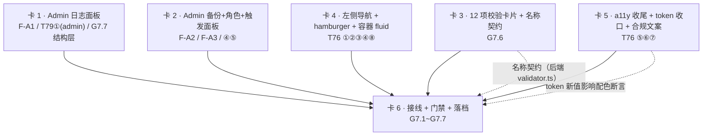

# Wave 7 · T75「Admin 补全」+ T76「桌面侧边导航 / 全站 a11y 收尾 / 响应式基础」子任务卡（派发用）

> **本文档性质**：`docs/audit/` 是「证据层」。本文件**不新增任何事实定义、不复述技术契约**，
> 只做三件事：① 把 PRD / plan / gap-list / ui-spec / 现状代码翻译成**可派发的动作**；
> ② 给出**可自动验证**的验收断言；③ 显式记录拆解过程中的**口径裁决**。
>
> **执行依据（唯一真相源）**：
> `docs/client/code_implementation_plan_v2.md` §5 Wave 7（T75 行 347 / T76 行 348）+
> §12.7 G7 表（行 784-794）+ `docs/client/PRD.md` §5.7（行 266-275）/ §5.8（行 276-289）/ §5.9（行 291-302）+
> `docs/client/ui-spec.md` §4（a11y 明细）/ §5（架构决策）+
> `docs/audit/gap-list-2026-10-17.md` §3.3（F-A1~F-A3 / F-G1~F-G4）/ §3.4（F-A11~F-A18）/ §3.5（F-Q12）。
>
> **快照时间**：2026-10-21
> **工作树状态**：`main` = `266e1a2`（Wave 5 已合入）；**工作树有并行 agent 在改**（Wave 6：T73/T74，
> 已改 `pages/StockScan.tsx` / `pages/Candidates.tsx` / `pages/_shared.tsx` / `App.tsx` / 后端 `routes/candidate.ts` 等）。
> **本卡组的 agent 开工前必须先 `git status` 复核**，若并行 agent 已改动了本卡组「改哪些文件」里的文件 → **先与其对齐再动手**。

---

## 0. 一句话总览

Wave 7 含 **2 个 plan 任务（T75 + T76）**，实际交付 **T75 的 5 项 + T76 的 8 项 = 13 项**，
外加 **G7 的 7 道出口门槛**。本文件拆成 **6 张卡**：

- **卡 1 / 卡 2 / 卡 3** = T75 的三个功能面（**日志** / **备份·角色** / **校验仪表盘**），文件零重叠 → **可并行**；
- **卡 4 / 卡 5** = T76 的两条主线（**导航与布局** / **a11y 与 token**），文件零重叠 → **可并行**；
- **卡 6** = **接线 + 门禁 + 落档**，依赖前 5 张 → **必须串行最后做**。

**G7 的 7 道门槛全部有人认领**，但有 **5 处「门槛子句当前无人覆盖」**（详见 §4.2）——
最关键的两处是 **G7.6 的「校验名称」**（代码里现在只有 `C1`~`C12`，**没有名称**）与
**G7.1 的 F10 载体**（SDD §12.5 索引自己标着「❌ 待建」）。

---

## 1. 规格摘要表

### 1.1 PRD §5.7「管理员界面」五行 → gap / 卡 / 门槛

| 需求来源 | 要求（PRD 逐字） | 对应 gap 编号 | 对应门槛 |
|---|---|---|---|
| PRD §5.7 行 268「校验仪表盘」 | 「12 项校验卡片，四色（PASS=绿 / WARN=黄 / ERROR=红 / SKIP=灰）；点击卡片展开详情 JSON」 | **F-A3** 附带 / **G7.6**（🔒 数据正确性） | **G7.2** / **G7.6** |
| PRD §5.7 行 269「手动触发行情更新」 | 「按钮 + **二次确认弹窗** + **进度轮询显示**」 | **F-A** 无独立编号（plan T75 ⑤）/ **I-13**（§13.2「进度轮询显示」漏做） | **G7.2** / **G7.4** |
| PRD §5.7 行 270「日志查看」 | 「分页 + **日期过滤** + **类型过滤**（行情更新/校验/信号/除权/备份）；**显示系统日志降级记录**（正常日志库不可用时的兜底）」 | **F-A1**（日期/类型/level 过滤从未传） + **I-13**（降级记录无读取端点） | **G7.2** / **G7.3** |
| PRD §5.7 行 271「备份恢复」 | 「手动备份按钮 + 备份列表（**日期 + 体积**）+ 恢复按钮 + **恢复前二次确认**」 | **F-A2**（备份列表 + 恢复 UI 完全缺失，`GET /api/admin/backups` / `POST .../restore` 是死路由） | **G7.2** / **G7.3** |
| PRD §5.7 行 272「角色管理」 | 「用户列表 + 升级/降级按钮（**admin 仅 1 人，可转移**）」 | **F-A3**（角色管理 UI 完全缺失，`GET /api/admin/users` / `PATCH .../role` 是死路由） | **G7.2** / **G7.3** |
| PRD §5.9 行 302「管理员双重鉴权」 | 「管理员操作（手动触发行情更新、**角色升级/降级**）需**再次确认**；日志审计可追溯」 | plan T75 卡点列「角色管理按钮的二次确认」 | **G7.2** |

### 1.2 PRD §5.8「全局体验要求」→ gap / 卡 / 门槛

| 需求来源 | 要求（PRD 逐字） | 对应 gap 编号 | 对应门槛 |
|---|---|---|---|
| PRD §5.8 行 279 #1 | 「全站响应式，桌面和手机功能对等（不是两套独立前端）」 | **F-Q12**（响应式横向溢出） | **G7.7**（🔒 admin 页 375+768） |
| PRD §5.8 行 283 #6 | 「移动端底部 Tab 栏：持仓 / K线 / 选股 / 复盘 / 设置」 | **F-G2** 附带 | **G7.2**（§12.3 的 §5.8 行） |
| PRD §5.8 行 284 #7 | 「桌面端**左侧导航栏**：持仓 / K线 / 选股 / 复盘 / 候选池 / 设置」 | **F-G2**（桌面左侧导航栏缺失；现有顶栏也缺候选池入口） | **G7.2** |
| PRD §5.8 行 288 #10 | 「无障碍：Tab 导航完整、表单 label 关联、错误 field 高亮」 | **F-A11~F-A18**（8 项） | **G7.2** / T76 ⑤⑦ |
| PRD §5.9 行 297「隐私声明常驻」 | 「**注册页 + 设置页**展示隐私声明：不收集手机号、位置、社交账号等多余个人信息；仅存储交易数据和行情相关数据」 | 无独立编号（`Settings.tsx:254` 自承未落地） | **G7.2** |
| PRD §5.9 行 300「插件安全承诺」 | 「设置页插件管理区域提示：所有插件禁止包含荐股、资金托管、实盘对接功能；自定义插件默认执行超时保护」 | 无独立编号 | **G7.2** |

### 1.3 ui-spec §4 a11y 明细 / §5 架构决策 → 卡

| 需求来源 | 要求（ui-spec 逐字） | 对应 gap 编号 | 对应门槛 |
|---|---|---|---|
| ui-spec §4 行 115「Focus 样式」 | 「完全缺失 → 全局 `:focus-visible`」 | **F-A11** | ✅ **Wave 2 已落地**（`styles/global.css:35`），本波只需回归 |
| ui-spec §4 行 116「表单 label」 | 「所有 input/select 加 `id` + `<label htmlFor>`」 | **F-A12** | ✅ Wave 2/4 已落地 → 本波回归 |
| ui-spec §4 行 117「表格 scope」 | 「`<th>` 加 `scope="col"`」 | **F-A13** | ✅ Wave 2 已落地（`Admin.tsx:350` 已有 `scope="col"`）→ 本波回归 |
| ui-spec §4 行 118「颜色对比度」 | 「`#16a34a` 白字 4.5:1 临界；`#6b7280` 白底 4.6:1 临界 → 升级为 `#15803d` / `#c81e1e` / `#4b5563`（P2，可选）」 | **G3.4 遗留**（4 个 token <4.5:1） | T76 收口项（**非 critical，不卡 G7**） |
| ui-spec §4 行 119「语义标签」 | 「引入 `<header>/<main>/<nav>/<footer>`」 | **F-A16** | ✅ Wave 2 已落地 → 本波回归 |
| ui-spec §4 行 120「aria-live」 | 「动态内容区加 `aria-live="polite"`」 | **F-A14** | T76 ⑤ |
| ui-spec §4 行 121「焦点锁定」 | 「Modal 打开时锁定焦点」 | **F-A15** | T76 ⑤ |
| ui-spec §5 决策 2 行 126 | 「允许引一个轻量 CSS 文件（global.css）定义 inline style 表达不了的东西」 | — | **卡 4 的断点 padding 只能走 CSS media query**（见裁决 D-6） |
| ui-spec §5 决策 1 行 125 | 「inline style 方案保留，但必须引入 Token 常量层；**不急于切 CSS Module / Tailwind**」 | — | **约束项**：本波禁止引入 CSS Module / Tailwind（U21） |

### 1.4 gap-list 关键条目现状复核（2026-10-21 实测）

| gap | gap-list 逐字摘要 | 现状复核 | 归属卡 |
|---|---|---|---|
| **F-A1** | 「system_log 无日期过滤、无类型过滤（后端 `log_type`/`level`/`trade_date` 已支持，从未传）」 | **仍成立**：`Admin.tsx:100-102` 只传 `page`/`page_size`；后端 `routes/admin.ts:95-106` 已支持 `log_type`/`level`/`trade_date`（**注意：后端只支持单日 `trade_date`，不支持日期区间** → 见裁决 D-3） | 卡 1 |
| **F-A2** | 「备份列表 + 恢复 UI 完全缺失。`GET /api/admin/backups`、`POST .../restore` 是死路由」 | **仍成立**：`Admin.tsx` 从不调用这两个端点；后端 `routes/admin.ts:214/238` 均已实现 | 卡 2 |
| **F-A3** | 「角色管理 UI 完全缺失。`GET /api/admin/users`、`PATCH .../role` 是死路由」 | **仍成立**：`Admin.tsx` 从不调用；后端 `routes/admin.ts:125/137` 均已实现（且已含「禁止降级自己」「admin 仅 1 人」两条约束） | 卡 2 |
| **F-A1 附带** | 「`Admin.tsx:140` 用**阻塞式 `alert()`** 反馈备份结果」 | **仍成立，且已漂移**：当前在 `Admin.tsx:177` 与 `:180`（两处 `alert()`） | 卡 2（面板）/ 卡 6（删除接线） |
| **F-G2** | 「桌面端左侧导航栏缺失（PRD §5.8 #7）；现有顶栏也缺候选池入口」 | **前半句仍成立**（导航在顶栏 `pages/_shared.tsx:121`）；**后半句已过期** —— 顶栏与移动 Tab **已含「候选池」**（`_shared.tsx:76` / `:93`，Wave 6 T74 落地） | 卡 4 |
| **F-G1** | 「无当前页高亮（`NavLink`/`useLocation` 全仓命中 = 0）」 | **已过期 —— Wave 2（T63）已关闭**：`_shared.tsx:127` 已用函数式 `style={({isActive}) => …}` 做激活态 | 卡 4（回归断言） |
| **F-Q12** | 「响应式横向溢出」 | **admin 页仍 FAIL**：`admin@375 = +711px`、`admin@768 = +318px`；根因 = 系统日志 **6 列表格**（总宽 734px，`message`/`detail` 是长路径文本）+ **表格无滚动容器** | 卡 1（结构）+ 卡 6（探针） |
| **F-A14 / F-A15** | 「零 `aria-*`」「Review 弹窗无焦点锁定、无 ESC 关闭」 | **部分已过期、实质仍在**：`aria-live` 已在 `Candidates.tsx:352`、`TradeTypeTabs.tsx:116`、`SignalMiniMenu.tsx:442` 等多处；**但** Admin 页 / Settings 折叠 / Review 编辑弹窗仍缺（`Review.tsx:783-860` 是裸 `position:fixed` 遮罩，**无 `role="dialog"`、无 ESC、无焦点锁定**） | 卡 3 / 卡 4 / 卡 5 |
| **F-A15 附带** | `ConfirmDialog.tsx` 已有 `role="dialog"` + ESC | **焦点锁定 / 焦点回归仍缺**（`ConfirmDialog.tsx:26-28` 注释自承「属 T76 ⑤」） | 卡 5 |

### 1.5 G7 门槛原文（plan §12.7 行 784-794，逐条抄录）

| # | 门槛原文 | 验证方式（原文） |
|---|---|---|
| G7.1 | SDD §12.5 **F10 PASS**（备份恢复） | 用例 |
| G7.2 | §12.3 中 **PRD §5.7 对应行零 gap** | 逐条勾对 |
| G7.3 | **F-A1~F-A3 关闭** | 逐条勾对 |
| G7.4 | **管理员二次鉴权**：普通用户访问全部 admin 端点均 **403** | 集成测试逐端点 |
| 🔒 G7.5 | **DuckDB 备份恢复用例真实跑通**（`COPY TO PARQUET GZIP` → 恢复 → `COUNT(*)` 相等），**不得只 mock** | T91 用例，临时目录 |
| 🔒 G7.6 | **12 项校验卡片真实渲染 12 条**（不再是空态/ `checkId` 只有 2 个），且卡片显示的**校验名称与 SDD §5.7 主表一致**（停牌/退市/ST 等扩展校验**不得占用 C 编号**） | 浏览器探针 |
| 🔒 G7.7 | **375px + 768px admin 页均无横向溢出**（F-Q12 实测 375px +460px、768px +23px，G3.5/G3.5b 前移项） | 浏览器探针（两个视口各跑一次） |

---

## 2. 子任务卡

> **通用约定（每张卡都适用，agent 必读）**
>
> 1. **只改本卡「改哪些文件」列出的文件**；要改别的 → 停手并在交付报告里说明原因。
> 2. **禁止** `git commit` / `git push` / `git add`；只改文件 + 跑测试，提交由主 agent 统一做。
> 3. 样式**必须**走 `apps/frontend/src/theme/tokens.ts` 的 token；**禁止裸 hex**
>    （T62 验收：`grep -rn '#[0-9a-fA-F]\{6\}' apps/frontend/src --include=*.tsx` 命中归零，token 文件除外）。
> 4. 类型**禁止 `any`**（T86 已开 `no-explicit-any`）；`npm run lint` 与 `npm run typecheck` 必须 0 退出。
> 5. 测试用 **Vitest 2.x**（DEC-3 已裁决，**不要升到 5.x**）；前端入口 `npm run test -w @invest/frontend`；
>    后端入口 `npx vitest run apps/backend/tests/<目录> --pool=forks --poolOptions.forks.singleFork=true`。
> 6. 组件测试用 `apps/frontend/tests/helpers.tsx` 的 `renderWithRouter`（自动包 `MemoryRouter`）；
>    `toBeInTheDocument` 等来自 `tests/setup.ts` 已注册的 `@testing-library/jest-dom/vitest`。
> 7. **跑测试前先停掉占用 DuckDB 的后端进程**（文件独占锁会让 12+ 用例报 `Could not set lock on file`）。
> 8. **本波禁止引入** CSS Module / Tailwind / 图表库（ui-spec §5 决策 1/3，plan U21）——
>    引入即判 FAIL，**即使功能齐全**。
> 9. **注释只写「为什么」**；注释不是规格 —— 改既有代码前先证明现状是错的（AGENTS.md 门禁）。
> 10. **新增后端端点必须同步登记 `docs/client/SDD.md` §4.4**（L3 契约层），否则前端不得调用。
> 11. **新增/改动响应字段必须同步登记 SDD §4.4**（含字段名与语义）。

---

### 卡 1 — Admin 日志面板：三类筛选 + 长文本截断 + 375/768 无溢出（新建 `components/AdminLogPanel.tsx`）

- **依赖**
  - **前置卡**：无（可与 卡 2 / 卡 3 / 卡 4 / 卡 5 **完全并行**，文件零重叠）。
  - **门槛**：G7.3（F-A1）、G7.7（结构层）、G7.2（PRD §5.7「日志查看」行）。
  - **复用（不要重造）**：`components/ScrollableTable.tsx`（Wave 3 已交付，带 `role="region"` + `tabIndex={0}` + `aria-label`）、
    `theme/styles.ts:119 scrollableTableContainerStyle`、`theme/styles.ts:144 truncatedTextStyle`。
- **改哪些文件**
  - `apps/frontend/src/components/AdminLogPanel.tsx`（**新建**）—— props 驱动，**不 import `pages/Admin.tsx`**。
  - `apps/frontend/tests/unit/admin-log-panel.test.tsx`（**新建**）。
  - `apps/backend/src/routes/admin.ts` —— **新增** `GET /api/admin/system-log/fallback`（读降级日志文件尾部 N 行）。
  - `apps/backend/src/services/logger.ts` —— 导出读取函数 `readFallbackLogTail(n)`；`FALLBACK_FILE` 改为 **env 可覆盖**（`SYSTEM_LOG_FALLBACK_FILE`，默认仍 `/var/log/invol/err.log`）。
  - `apps/backend/tests/integration/admin.test.ts`（**追加** describe）。
  - `docs/client/SDD.md` §4.4 —— 登记 `GET /api/admin/system-log/fallback`（admin 专属 + 响应字段）。
- **交付内容**（逐条可验证）
  1. **日期范围筛选**：起止两个 `<input type="date">`；查询时按 `start_date`/`end_date` 传给后端。
     ⚠️ 后端 `routes/admin.ts:103-106` 现在只认**单个** `trade_date`（等值）→ 本卡**必须**把后端改成**区间**（`log_date BETWEEN ? AND ?`），否则「日期范围」是假的（见裁决 D-3）。
  2. **类型下拉**：取值来自 `Admin.tsx:57-67 LOG_TYPE_LABEL` 的同一份清单（行情更新/数据校验/插件执行/信号生成/除权导入/备份/手动触发/启动/交易），
     **下拉项必须与后端实际 `log_type` 一致**；「全部」= 不传 `log_type`。
  3. **level 下拉**：全部 / INFO / WARN / ERROR / SKIP / SUCCESS（`logger.ts` 的 `ALLOWED_LEVELS` 逐字）。
  4. **筛选 + 分页联动**：任一筛选变化 → `page` 重置为 1；请求参数含 `page`/`page_size`/`log_type`/`level`/`start_date`/`end_date`。
  5. **长文本不撑破文档**：日志表外套 `ScrollableTable`；`message` / `detail` 单元格用 `truncatedTextStyle` 截断 + `title` 属性暴露全文。
  6. **`<768px` 日志表改卡片列表**（plan T79 ① 的 **admin 部分随 T75 交付**，见裁决 D-2）：每条日志渲染成一张卡（时间 / 类型 / 级别 / message / detail 可展开），
     **不渲染 `<table>`**；`≥768px` 仍渲染表格。断点用**渲染期 JS 判断**（`useIsMobile()` 已有，`pages/_shared.tsx:224`），
     **不要**用 CSS media query 做「显示/隐藏」—— 那会同时渲染两份 DOM（读屏会读两遍）。
  7. **系统日志降级记录展示**（PRD §5.7「日志查看」行 + I-13）：面板内新增「降级日志（SQLite 不可用时的兜底文件）」折叠区，
     读 `GET /api/admin/system-log/fallback`；文件不存在 → 显示「无降级记录」**空态**（不是报错）。
  8. **降级端点安全**：仅 admin；只读尾部 N 行（建议 N=200）；**不得**把文件绝对路径返回给前端（路径泄露）；响应体只含 `lines[]` 与 `exists`。
- **不改什么**（负向边界）
  - **不改** `pages/Admin.tsx`（接线归 卡 6）—— 这是本卡能与其他卡并行的前提。
  - **不改** `theme/styles.ts` / `theme/tokens.ts` / `pages/_shared.tsx` / `App.tsx` / `styles/global.css`（卡 4 / 卡 5 的地盘）。
  - **不改** `system_log` 的 **DDL**（不加列、不改索引）；区间过滤走 `WHERE log_date BETWEEN ? AND ?`。
  - **不删** `logger.ts` 的三层降级写入逻辑，只**加**读取端。
  - **不碰** dashboard / review 页的日志表（Wave 3/4 已各自处理）。
  - **不实现**「手动备份 / 角色管理 / 校验卡片」—— 分别归 卡 2 / 卡 3。
- **验收断言**（可自动验证）
  - A1：渲染面板后，请求参数含 `log_type=datacheck&level=ERROR&start_date=2026-10-01&end_date=2026-10-21`（mock axios 断言 `config.params`）。
  - A2：只选类型、不选 level → `level` **不在** params 里（不是空串）。
  - A3：筛选变化 → `page` 重置为 1（断言第二次请求的 `page === 1`）。
  - A4：渲染出 `<table>` 时，其祖先链上存在 `role="region"` 且带 `aria-label` 的滚动容器（`getByTestId('scrollable-table')`）。
  - A5：`message` 为 400 字符长串时，其**祖先 `<td>` 之外**不得有宽度 > 视口的元素；单元格里同时存在 `title` 属性（全文可取）。
  - A6：把 `window.innerWidth` 置为 375 → 面板内 **`queryByRole('table')` 为 null**，且日志条数 ≥ 1（走了卡片分支）。
  - A7：`innerWidth = 1024` → 面板内 `getByRole('table')` 存在（走表格分支）。
  - A8：调用 `GET /api/admin/system-log/fallback` → 返回 `{ exists: false, lines: [] }` 时 UI 显示空态文案，**不显示错误**。
  - A9（后端）：`GET /api/admin/system-log?start_date=2026-10-01&end_date=2026-10-21` → 只返回区间内的行；区间外的不返回。
  - A10（后端）：普通用户访问 `GET /api/admin/system-log/fallback` → **403**。
- **测试要求**
  - 新建 `apps/frontend/tests/unit/admin-log-panel.test.tsx`，用例名：
    - `Admin 日志面板：三类筛选（日期范围/类型/level）参数正确传入请求`
    - `Admin 日志面板：筛选变化后分页重置为第 1 页`
    - `Admin 日志面板：日志表套在 role=region 的横向滚动容器内（长路径不撑破文档）`
    - `Admin 日志面板：<768px 渲染为卡片列表且不渲染 table`
    - `Admin 日志面板：降级日志为空时显示空态而非报错`
  - 追加 `apps/backend/tests/integration/admin.test.ts`：
    - `admin 日志区间过滤：start_date/end_date 只返回区间内行`
    - `admin 降级日志端点：普通用户 403 / admin 返回 exists+lines`
- **实测口径**
  - 区间过滤以 `system_log.log_date`（TEXT，`YYYY-MM-DD`）为准，**字符串比较**即可（定长格式）。
  - `log_type` 取值以 `logger.ts` 的写入方为准（`Admin.tsx:57-67` 的 `LOG_TYPE_LABEL` 是当前唯一的中文映射表，**若发现后端还有未映射的 `log_type`，本卡负责补齐映射**）。
  - 降级文件格式 = **JSON Lines**（`logger.ts:111-117` 的 `JSON.stringify({source, logType, level, checkItem, message, detail, date})`），一行一条。
  - 溢出判据统一用 `document.documentElement.scrollWidth - clientWidth <= 2`（`scripts/probe-overflow.mjs`）。
- **风险与坑**
  - 🔴 **「有滚动容器」≠「768px 就不溢出」**：滚动容器解决**文档级**溢出；**卡片化**解决**可读性**。两个都要做（裁决 D-2）。
  - 🔴 **溢出像素随日志内容漂移**（`docs/audit/overflow-probe.md` §6.4 实测记录：同一份代码 admin@375 在 +416 ~ +460 之间波动）→
    **门槛判定必须固定同一份数据副本**（沿用 overflow-probe.md §8 的副本做法），否则无法复现。
  - 🔴 **`MAX(log_date)` 被测试污染**：开发库 `data/business.db` 里 `log_type='datacheck'` 的 `MAX(log_date)` 是 **`2026-99-99`**
    （来源：`apps/backend/tests/unit/validator.test.ts:84` 的 `runAllChecks('2026-99-99')` 曾写进真实库）→ 本卡**不得**用 `MAX(log_date)` 推断「最近一次校验」；区间筛选不受影响，但**不得**因此把该假日期当默认筛选值。
  - ⚠️ `detail` 里可能有 JSON 串与 SQL 报错（实测最长 233 字符）→ 截断阈值不能按「短文案」定。
  - ⚠️ 读 `/var/log/invol/err.log` 需要权限；本机该目录可能不存在 → **必须**有 `exists:false` 的降级路径。

---

### 卡 2 — Admin 备份与角色管理面板：备份列表/恢复二次确认 + 角色升降级 + `alert()` 消灭（新建 2 个组件）

- **依赖**
  - **前置卡**：无（可与 卡 1 / 卡 3 / 卡 4 / 卡 5 并行）。
  - **门槛**：G7.3（F-A2 / F-A3）、G7.2（PRD §5.7「备份恢复」「角色管理」「手动触发行情更新」三行）。
- **改哪些文件**
  - `apps/frontend/src/components/AdminBackupPanel.tsx`（**新建**）—— 备份列表 + 手动备份 + 恢复。
  - `apps/frontend/src/components/AdminRolePanel.tsx`（**新建**）—— 用户列表 + 升级/降级。
  - `apps/frontend/src/components/AdminTriggerPanel.tsx`（**新建**）—— 手动触发行情更新/校验/信号的按钮 + 二次确认 + 进度轮询 + 内联状态条。
    > 说明：把「触发类」也拆成独立组件，是为了让 卡 2 的三个组件**都不 import `pages/Admin.tsx`**（并行前提）。
  - `apps/frontend/tests/unit/admin-backup-panel.test.tsx`（**新建**）。
  - `apps/frontend/tests/unit/admin-role-panel.test.tsx`（**新建**）。
  - `apps/frontend/tests/unit/admin-trigger-panel.test.tsx`（**新建**）。
  - `docs/client/SDD.md` §4.4 —— **只补字段语义**（若发现现有响应字段与前端理解不一致才动；本卡**不改路由**）。
- **交付内容**
  1. **备份列表**：调 `GET /api/admin/backups` → 每行显示**文件名 + 修改日期 + 体积（可读化，如 `12.4 MB`）**；按 `modified` 倒序（后端已排）。
  2. **手动备份**：`POST /api/admin/backup` → **不阻塞**（**禁止 `alert()`**），结果写**内联状态条**（成功/失败 + 原因）。
  3. **恢复前二次确认**：点「恢复」→ 弹 `components/ConfirmDialog.tsx`（**已存在**，含 `role="dialog"` + ESC），
     **确认后**才发 `POST /api/admin/backup/:file/restore`，**请求体必须含 `{"confirm": true}`**（后端 `routes/admin.ts:247` 无 `confirm:true` → 400 `CONFIRM_REQUIRED`）。
  4. **恢复失败可重试**：失败状态条上带【重试】按钮（plan T75 ④ + ux_v2 §4.3）。
  5. **角色管理**：`GET /api/admin/users` → 表格/卡片列出 **用户名 + 角色 + 创建时间**；每行【升级为管理员】/【降级为普通用户】按钮。
  6. **admin 仅 1 人约束**：库中已有 admin 时，**升级**按钮置 `disabled` + 文案「已有管理员，请先降级现任管理员」（对应后端 `routes/admin.ts:155-162` 的 400 文案）。
  7. **降级自己被拒**：当前登录用户是 admin 时，**自己那一行的「降级」按钮置 `disabled`** + 文案「不能降级当前登录账号」（对应后端 `routes/admin.ts:150-152`）；**同时**要处理后端真拒绝时的提示（400 `PARAM_INVALID` → 内联错误条）。
  8. **角色变更二次确认**（PRD §5.9 管理员双重鉴权）：点升级/降级 → `ConfirmDialog` 二次确认 → 才发 `PATCH /api/admin/role/:userId`。
  9. **手动触发行情更新二次确认 + 进度轮询显示**（PRD §5.7 行 269 + I-13）：
     - 点「立即补跑行情更新」→ `ConfirmDialog` 二次确认（文案写明后果）；
     - 确认后调 `POST /api/admin/rerun-quotes`，**期间显示进度状态**（「已提交 / 补跑中 / 完成（通道：…）」）；
     - **不阻塞**（无 `alert()`），失败给【重试】。
  10. **无 `alert()` 残留**：本组三个组件 + 接线后 `Admin.tsx` 内 `alert(` **命中数 = 0**。
- **不改什么**（负向边界）
  - **不改** `pages/Admin.tsx`（接线归 卡 6；`alert()` 的删除也在 卡 6）。
  - **不改** 后端路由与业务逻辑（`restoreSQLiteBackup` / 角色约束**已实现**）——
     **禁止**为了让前端好写而放宽后端约束。
  - **不改** `components/ConfirmDialog.tsx` 的实现（焦点锁定归 卡 5；本卡只**使用**它）。
  - **不实现** 日志筛选（卡 1）/ 校验卡片（卡 3）。
  - **不做**「恢复后自动刷新全局数据」—— 本卡只刷新本面板。
- **验收断言**
  - A1：渲染备份面板 → 列表行数 = mock 返回的备份条数；每行含**日期**与**体积**文本（体积格式断言，如 `MB`/`KB`）。
  - A2：点「恢复」→ **断言未发请求**（mock 未被调用）。
  - A3：在 `ConfirmDialog` 里点「确认」→ 断言请求体为 `{ confirm: true }`（**深比较**）。
  - A4：`ConfirmDialog` 点「取消」→ 断言**未发**恢复请求。
  - A5：后端返回 400 `CONFIRM_REQUIRED` → UI 显示内联错误条，**不弹窗**、**不抛未捕获异常**。
  - A6：备份失败 → 状态条含【重试】按钮；点它 → 再次调用 `POST /api/admin/backup`（调用次数 = 2）。
  - A7：库中已有 admin 时，目标用户的【升级】按钮 `toBeDisabled()`。
  - A8：当前登录 admin 那一行的【降级】按钮 `toBeDisabled()`，且提示文案含「不能降级当前登录账号」。
  - A9：点升级 → 弹二次确认 → 确认后断言 `PATCH /api/admin/role/:userId` 的 body 为 `{ role: 'admin' }`。
  - A10：**全仓 grep 断言**：`grep -rn "alert(" apps/frontend/src/pages/Admin.tsx apps/frontend/src/components/Admin*.tsx` → **0 命中**。
  - A11（组件级）：`ConfirmDialog` 被渲染时 `role="dialog"` 存在（保证复用对了组件，而不是自己写一个裸遮罩）。
- **测试要求**
  - `apps/frontend/tests/unit/admin-backup-panel.test.tsx`：
    - `Admin 备份面板：列表显示日期与体积`
    - `Admin 备份面板：恢复前必须二次确认且请求体带 confirm:true`
    - `Admin 备份面板：取消确认不发恢复请求`
    - `Admin 备份面板：失败状态条提供重试按钮`
    - `Admin 备份面板：全程无阻塞式 alert（DOM 中无 dialog 弹窗）`
  - `apps/frontend/tests/unit/admin-role-panel.test.tsx`：
    - `Admin 角色面板：已有管理员时升级按钮禁用`
    - `Admin 角色面板：不能降级当前登录账号（按钮禁用）`
    - `Admin 角色面板：角色变更需二次确认后才发请求`
  - `apps/frontend/tests/unit/admin-trigger-panel.test.tsx`：
    - `Admin 触发面板：手动补跑行情更新需二次确认`
    - `Admin 触发面板：补跑过程显示进度状态且失败可重试`
- **实测口径**
  - 备份体积字段 = 后端 `GET /api/admin/backups` 的 `size`（**字节数**，见 `routes/admin.ts:228`）→ 前端只负责可读化，**不得**改单位口径。
  - 恢复文件名必须 **URL 编码**（后端 `routes/admin.ts:254` 走 `decodeURIComponent(file)`）→ 前端用 `encodeURIComponent`。
  - 角色字段 = 后端 `GET /api/admin/users` 的 `id` / `username` / `role` / `created_at`（`routes/admin.ts:131`）。
  - admin 仅 1 人的**权威在后端**：前端禁用只是 UX，**后端的 400 才是真约束** → 断言要覆盖「后端拒绝时前端显示错误条」。
- **风险与坑**
  - 🔴 **恢复是高危操作**：`restoreSQLiteBackup` 会 `ConfigStore.resetInstance()` + 覆盖库文件 + 删 `-wal/-shm`（`services/backup.ts:245-253`）。
    ⇒ 二次确认文案必须写明「**会覆盖当前业务库**」，与后端 400 文案口径一致。
  - 🔴 **`ConfirmDialog` 目前没有焦点锁定**（卡 5 才补）→ 本卡的弹窗**暂时**不满足完整 a11y，卡 5 完成后需回归（卡 6 的门禁会兜住）。
  - ⚠️ 后端 `POST /api/admin/backup` 会**真的跑一次双库备份**（DuckDB `COPY TO parquet` ≈ 821MB，服务器实测几秒）→ 前端必须显示 loading 并**禁止重复点击**。
  - ⚠️ `restoreSQLiteBackup` 的文件名白名单正则只接受 `business.db.YYYY-MM-DD`（`services/backup.ts:198`）→ **parquet 文件不能恢复**，
    前端必须**只对 sqlite 备份渲染「恢复」按钮**（否则用户点了必失败）。

---

### 卡 3 — 12 项校验仪表盘：12 张卡片 + **校验名称** + 四色（新建 `components/DatacheckCards.tsx` + 后端补名称契约）

- **依赖**
  - **前置卡**：无（可与 卡 1 / 卡 2 / 卡 4 / 卡 5 并行；后端只碰 `services/validator.ts` + `routes/dataCheck.ts`，与 卡 1 的 `routes/admin.ts` 不重叠）。
  - **门槛**：**G7.6**（🔒 数据正确性）、G7.2（PRD §5.7「校验仪表盘」行）。
- **改哪些文件**
  - `apps/backend/src/services/validator.ts` —— **导出** `CHECK_NAMES: Record<string, string>`（C1~C12 的中文名称，逐字取自 **SDD §5.7 主表标题**）。
  - `apps/backend/src/routes/dataCheck.ts` —— `GET /api/admin/datacheck/result` 响应**加 `name` 字段**；**并修正「取最近一次校验」的取法**（见交付 3）。
  - `apps/backend/tests/unit/t85-c1-c12-semantics.test.ts`（**追加**用例）或**新建** `apps/backend/tests/unit/datacheck-names.test.ts`。
  - `apps/frontend/src/components/DatacheckCards.tsx`（**新建**）。
  - `apps/frontend/tests/unit/datacheck-cards.test.tsx`（**新建**）。
  - `docs/client/SDD.md` §4.4 —— `GET /api/admin/datacheck/result` 响应加 `name` 字段说明。
- **交付内容**
  1. **名称的唯一来源在 L3**：12 个名称逐字取自 SDD §5.7 的主表小节标题：
     C1 当日日线行数是否正常 / C2 交易日历匹配 / C3 复权因子数据新鲜度 / C4 除权除息数据新鲜度 /
     C5 板块 / 概念数据完整性 / C6 市值数据存在性 / C7 日线价格合理性 / C8 行情更新执行时长 /
     C9 复权因子抽样数学一致性 / C10 除权除息事件覆盖完整性 / C11 Tushare 免费 API 跨源校验（每日 1 次） /
     C12 东财跨源校验（20 只抽样，节流）。
     ⇒ **后端 `validator.ts` 导出这张映射**，路由把 `name` 一起返回；**前端不得硬编码这份清单**（裁决 D-4）。
  2. **12 张卡片**：C1~C12 **各一张**，即使某项没跑也要**占位**（显示「未运行」+ SKIP 灰），**不得**少渲染（这正是 G7.6「不再是空态 / checkId 只有 2 个」要防的回归）。
  3. **「最近一次校验」的取法必须改成「按 trade_date 精确取 + 按 checkId 补齐 12 项」**：
     当前 `routes/dataCheck.ts:23-26` 用 `MAX(log_date)` 定位「最近一次」→ 会被**假日期**（实测 `2026-99-99`）劫持，
     且「跑了一半」的校验日只返回部分项。改法：按**最近一次真实业务日**取该日全部 `log_type='datacheck'` 行 → 按 checkId 去重 →
     **用 C1~C12 全集补齐缺失项**（缺失 → `result: 'SKIP'`、`message: '未运行'`）。裁决 D-5。
  4. **四色**：PASS=绿 / WARN=黄 / ERROR=红 / SKIP=灰（PRD §5.7 逐字）。
     🔴 **颜色承载方式必须换**：现状是「彩色底 + 白字」（`Admin.tsx:233-234`：`background: RESULT_COLOR[...]` + `color: COLORS.cardBg`）——
     这正是 `info #3b82f6`（3.68:1）/ `success #16a34a`（3.30:1）对比度不足的**来源**。
     ⇒ 改为「**浅色底 + 深色文字**」（或底色 + 边框 + 深色字），保证文字对比度 ≥ 4.5:1（与 卡 5 的 token 收口协同，裁决 D-8）。
  5. **点击展开详情 JSON**：`aria-expanded` + `aria-controls`；展开区展示 `detail` 原文（`<pre>` + `whiteSpace:'pre-wrap'`，保留现有实现）+ `message`。
  6. **扩展校验不占 C 编号**：卡片集合的 checkId 集合必须**恰好** = `{C1..C12}`；
     SDD §5.7 末尾「📎 扩展校验」的 6 条（停牌日标记一致性 / 退市标记 / ST 状态 / 价差 / 成交量 / 滞后）
     **不得**以 C13+ 的形式出现；前端也不得为它们造卡（可作为「扩展信息」区，但**不带 C 编号**）。
  7. **状态与结果可见**：卡片显示 `checkId` + **名称** + 结果徽标（PASS/WARN/ERROR/SKIP），点击才展开详情。
- **不改什么**（负向边界）
  - **不改** `services/validator.ts` 的**判定逻辑**（C1~C12 的口径是 T85/T97 定的，🔒 不可在本波改）。
  - **不改** `system_log` 的 **DDL**（`name` 是**读时派生**，不落库、不加列）。
  - **不改** `pages/Admin.tsx`（接线归 卡 6）。
  - **不改** C 编号与 Requirements §7.1 的对应关系（B-14 裁决 = A，已定）。
  - **不实现**「停牌/退市/ST 等扩展校验」—— 只保证它们**不占 C 编号**。
- **验收断言**
  - A1：`GET /api/admin/datacheck/result` → 每条含 `checkId` / `name` / `result` / `message` / `detail`；`name` 非空。
  - A2：12 个 `name` 与 SDD §5.7 标题**逐字一致**（后端用例里写死期望数组做断言）。
  - A3：**补齐断言** —— mock 只返回 2 条（模拟「只跑了 2 项」）→ 端点仍返回 **12 条**，缺失项 `result === 'SKIP'` 且 `message` 含「未运行」。
  - A4：端点返回的 `checkId` 集合 **恰好** `{C1..C12}`（不多不少、无重复）。
  - A5：**反向断言** —— mock 返回一条 `checkId: 'C13'` 的行 → 端点**必须丢弃**它（扩展校验不占 C 编号）。
  - A6：前端渲染 → `getAllByRole('button')`（卡片）数量 = 12；每张卡片文本含 `C<n>` **与**该校验名称。
  - A7：点某张卡 → `aria-expanded` 由 `false` 变 `true`，详情区可见且含 `detail` 原文。
  - A8：四色映射断言 —— 给定 `PASS/WARN/ERROR/SKIP` 四个 mock，渲染出的 4 张卡的**类名或 data 属性**互不相同（便于回归）。
  - A9：对比度**不能**在 jsdom 断言（无 layout engine）→ 交由 卡 6 的 `scripts/a11y-check.mjs` 真浏览器跑（裁决 D-9）。
- **测试要求**
  - 新建 `apps/backend/tests/unit/datacheck-names.test.ts`：
    - `datacheck 名称契约：C1~C12 的 name 与 SDD §5.7 主表逐字一致`
    - `datacheck 补齐：只跑到 2 项时端点仍返回 12 条（缺失项 SKIP）`
    - `datacheck 编号边界：C13（扩展校验）被丢弃，不占 C 编号`
  - 新建 `apps/frontend/tests/unit/datacheck-cards.test.tsx`：
    - `校验卡片：渲染 12 张且每张含 checkId 与校验名称`
    - `校验卡片：点击展开详情 JSON（aria-expanded 切换）`
    - `校验卡片：四色映射 PASS/WARN/ERROR/SKIP 互不相同`
- **实测口径**
  - 12 条结果的判定值口径 = **四态** `PASS / WARN / ERROR / SKIP`（`system_log.level` 的取值域 = `logger.ts:77` 的 `ALLOWED_LEVELS`，另含 `SUCCESS`；校验项只出前四种）。
  - 「12 条」的判定基准 = **`runAllChecks()` 的返回长度 = 12**（T85 已有断言）+ **`{C1..C12}` 全覆盖**；
    **不是**「页面上恰好渲染 12 个 DOM 节点」这种可被空态蒙混的判据。
  - 名称以 **SDD §5.7 的小节标题**为准（不是 Requirements 的措辞）—— G7.6 原文写的就是「与 SDD §5.7 主表一致」。
- **风险与坑**
  - 🔴 **G7.6 是 🔒 数据正确性门槛 → 永久不可豁免**（AGENTS.md）。
  - 🔴 **「MAX(log_date) 被假日期劫持」是本卡最容易漏的坑**：不修则 G7.6 在「干净库」上会掉到 <12 条 —— 属于「碰巧绿」。
  - 🔴 **`name` 若在前端硬编码** → 与 SDD §5.7 漂移无人察觉（G7.6 的「名称一致」就变成自证）。故必须后端出。
  - ⚠️ `routes/dataCheck.ts` 的 `GET /api/admin/datacheck/result` **当前没有 role 校验**（见文件头 `try` 块）→
    普通用户可读校验结果。**本卡负责补 role 校验**（admin 专属），否则 G7.4 的「全部 admin 端点均 403」会被这条漏掉（裁决 D-10）。
  - ⚠️ 「补齐缺失项」是**展示层补齐**，不得伪造 `detail`（缺失项 `detail` 留空 + `message` 写「未运行」）。

---

### 卡 4 — 全局导航与容器 fluid：桌面左侧栏 + 顶栏 hamburger + 导航重排 + 宽度自适应（改 `_shared.tsx` / `App.tsx` / `styles.ts` / `global.css`）

- **依赖**
  - **前置卡**：无（可与 卡 1 / 卡 2 / 卡 3 / 卡 5 并行；文件与 卡 5 零重叠）。
    ⚠️ **但与并行 agent 有冲突风险**：Wave 6 的 T74 **已改过** `pages/_shared.tsx` 与 `App.tsx`（工作树未提交）→ 开工前必须 `git diff` 复核这两处。
  - **门槛**：G7.2（PRD §5.8 行 279/283/284）、G7.7（**容器宽度是溢出的上游因子**）。
- **改哪些文件**
  - `apps/frontend/src/pages/_shared.tsx` —— 左侧导航、顶栏 hamburger、`aria-expanded`、导航顺序。
  - `apps/frontend/src/components/SideNav.tsx`（**新建**）—— 桌面左侧导航（垂直，≥1024px 显示）。
  - `apps/frontend/src/App.tsx` —— **容器改 fluid**（去掉固定 `maxWidth` 直写），并把左侧栏与顶栏纳入布局。
  - `apps/frontend/src/theme/styles.ts` —— `pageContainerStyle` 改 fluid + 断点 padding 的 className。
  - `apps/frontend/src/styles/global.css` —— 新增 `@media (max-width: 768px)` 的容器 padding（inline style 表达不了 @media，ui-spec §5 决策 2）。
  - `apps/frontend/tests/unit/side-nav.test.tsx`（**新建**）、`apps/frontend/tests/unit/nav-layout.test.tsx`（**新建**）。
- **交付内容**
  1. **桌面左侧导航**（PRD §5.8 行 284 #7）：`≥1024px` 显示**垂直左侧栏**，含：持仓(仪表盘) / 交易录入 / 条件选股 / K线图 / 策略信号 / 交易复盘 / 候选池 / 设置 /（管理员，仅 admin）。
     - `<nav aria-label="主导航">` + 当前页高亮 + **`aria-current="page"`**。
     - 侧栏宽度固定（如 200px），内容区 `flex:1` 且 **`minWidth:0`**（否则侧栏会反过来撑破内容区 —— 与 `scrollableTableContainerStyle` 同一个坑）。
  2. **`<1024px` 折叠**（plan T76 ①）：左侧栏隐藏；导航入口由**顶栏**承担（≥768 平铺、`<768` 折叠为 **hamburger 菜单**，见交付 3）；
     **底部 TabBar 维持 `<768px`**（`MOBILE_BREAKPOINT = 768` 不动）。裁决 D-11（plan ① 的措辞偏差登记）。
  3. **`<768px` 顶栏折叠 hamburger**（plan T76 ③，ux_v2 §6 Phase 1，P0）：一个 `<button aria-expanded={open} aria-controls="mobile-menu" aria-label="打开导航菜单">`；
     展开后是纵向菜单列表；**ESC 关闭**；展开时 `aria-expanded=true`。
     ⚠️ 现状：`pages/_shared.tsx` **只有** `MobileTabBar`（`:162`），**没有折叠菜单** —— 交付后必须能从探针/单测证明存在。
  4. **容器改 fluid**（plan T76 ④，ux_v2 §6 Phase 1，P0）：消除 **双份**固定宽度硬编码 ——
     `App.tsx:106`（`maxWidth: MAX_WIDTH`）与 `theme/styles.ts:36-42`（`pageContainerStyle.maxWidth`）。
     改法：`maxWidth: MAX_WIDTH` **保留为桌面上限** + 加 `width: '100%'` + `boxSizing: 'border-box'` + **断点 padding**（`≤768px` → padding 12px；`>768px` → 24px）。
     **断点 padding 只能靠 `global.css` 的 `@media` + className**（inline style 无法表达 @media）→ 给容器加 `className="page-container"`。
  5. **导航按业务流程重排**（plan T76 ⑧ / ux_v2 §1-2，U6=P2）：顺序 = **仪表盘 → 交易录入 → 条件选股 → K线图 → 策略信号 → 交易复盘 → 候选池 → 设置 → 管理员**。
     ⚠️ 当前 `DESKTOP_NAV`（`_shared.tsx:69-79`）是「仪表盘/交易录入/**策略信号/K线图**/条件选股/交易复盘/候选池/设置/管理员」→ **信号与 K 线的位置与 ux 顺序相反**，本卡要改。
  6. **移动 Tab 顺序不变**（PRD §5.8 #6：持仓/K线/选股/复盘/设置 + T74 加的候选池）→ **不得**被 ⑧ 的重排带偏。
  7. **`aria-expanded`**：hamburger 按钮 + 移动 Tab 的可展开项（若有）+ 管理员入口的折叠态。
  8. **F-G1 回归**：当前页必须有可见高亮 **且** 带 `aria-current="page"`（Wave 2 已做样式，本卡补 `aria-current` 并加回归断言）。
- **不改什么**（负向边界）
  - **不改** `theme/tokens.ts`（卡 5 的地盘）—— `MAX_WIDTH = 1200` **保留**，只是**用法**从「固定宽度」改成「上限 + 100% 宽」。
  - **不改** 各业务页（Dashboard/Review/Kline/…）的内部结构。
  - **不改** `components/MobileTabBar` 的既有位置语义（仍是 `<768px` 底部固定）。
  - **不实现** 深色模式（PRD §5.8 #8 明文「MVP 不做」，B-17 裁决 = A）。
  - **不做** 面包屑（T79 ⑦）、不做 touch ≥44×44（T79 ②）—— 归 T79。
- **验收断言**
  - A1：`innerWidth = 1440` → 左侧栏存在（`getByRole('navigation', { name: '主导航' })` 可见），且**垂直排列**。
  - A2：`innerWidth = 800`（平板）→ 左侧栏**不存在**，顶栏导航**可见**（功能对等，不是「无导航」）。
  - A3：`innerWidth = 375` → 顶栏只有 hamburger 按钮；点它 → 菜单展开且 `aria-expanded === 'true'`；ESC → 收起。
  - A4：桌面侧栏与顶栏的导航项**顺序**与 ux_v2 §1-2 逐项相等（断言 `textContent` 数组）。
  - A5：当前页链接带 `aria-current="page"` 且有可见高亮样式（`background !== 'transparent'` 或等价断言）。
  - A6（**T76 验收 ④ 的落地判据**）：`grep -rn "maxWidth" apps/frontend/src --include=*.tsx --include=*.ts` → 命中**只允许**出现在
     `theme/tokens.ts`（`MAX_WIDTH` 定义）与 `theme/styles.ts`（引用 token）；
     **`App.tsx` 与 `pages/_shared.tsx` 中不得再出现 `maxWidth`**。
  - A7（**T76 验收 ⑤ 的落地判据**）：容器元素 `getBoundingClientRect().width`（或 jsdom 下的 style 断言）在 375 视口下 **= 375 - 24**（两侧 12px padding），
     且**不出现** `width: 1200px` 之类的固定值。
  - A8：`global.css` 中存在 `@media (max-width: 768px)` 规则命中 `.page-container`（**grep 断言**，证明断点 padding 真的落到了 CSS 文件）。
  - A9：非 admin 用户在侧栏/顶栏都**看不到**「管理员」入口；admin 看得到。
- **测试要求**
  - 新建 `apps/frontend/tests/unit/side-nav.test.tsx`：
    - `桌面端（≥1024px）显示左侧导航且含 PRD §5.8 #7 的 6 个入口`
    - `左侧导航顺序按业务流程重排（ux_v2 §1-2）`
    - `当前页导航项带 aria-current=page 且有高亮`
    - `非管理员不渲染管理员入口`
  - 新建 `apps/frontend/tests/unit/nav-layout.test.tsx`：
    - `<768px 顶栏折叠为 hamburger 菜单（aria-expanded 切换 + ESC 关闭）`
    - `容器 fluid：无固定 maxWidth 硬编码（App.tsx / _shared.tsx 均无 maxWidth）`
    - `容器断点 padding 走 global.css 的 @media（≤768px 时 padding=12px）`
- **实测口径**
  - 断点常量：`MOBILE_BREAKPOINT = 768`（`pages/_shared.tsx:34`）**已有**，不新增常量；桌面侧栏断点用 **1024**（PRD §5.1 桌面/平板分界）。
  - 「fluid」的判据 = **宽度随视口变化**（`width:100%` + `box-sizing:border-box`），**不是**「去掉 maxWidth」——
    桌面仍需 1200px 上限（`MAX_WIDTH` token 保留）。
  - 溢出判据：`scrollWidth - clientWidth <= 2`。
- **风险与坑**
  - 🔴 **侧栏 + flex 的 `min-width:auto` 坑**：侧栏出现后，内容区若没写 `minWidth:0`，**长表格反而更容易把文档撑宽** → G7.7 会回归。必须写 `minWidth:0`。
  - 🔴 **`_shared.tsx` / `App.tsx` 正被并行 agent（Wave 6）改过** → 开工前必须 `git diff` 看清楚，**不要覆盖别人的改动**。
  - ⚠️ **hamburger 与底部 TabBar 在 `<768px` 同时存在** → 会互相遮挡；需给内容区留底部 padding（现有 `MOBILE_TABBAR_HEIGHT = 62` / `pageContainerStyle.paddingBottom='86px'` 已考虑）。
  - ⚠️ `useIsMobile()` 是 **JS 判断 + resize 监听**（`_shared.tsx:224`）→ jsdom 里 `window.innerWidth` 改写后需触发 `resize` 事件才会重渲染，**单测要显式 dispatch**。
  - ⚠️ 「断点 padding 走 CSS」意味着**样式断言只能在真浏览器量**（jsdom 无 media query 解析）→ 卡 6 的溢出探针负责兜底。

---

### 卡 5 — a11y 收尾与 token 收口：4 个对比度 token + h1 统一 + 弹窗焦点锁定 + 设置页合规文案（改 `tokens.ts` / `ui-spec.md` / `Kline.tsx` / `Settings.tsx` / 3 个弹窗组件）

- **依赖**
  - **前置卡**：无（可与 卡 1 / 卡 2 / 卡 3 / 卡 4 并行；与 卡 4 文件零重叠）。
    ⚠️ **但会牵动 卡 1 / 卡 2 / 卡 3 的配色**（token 值变了 → 对比度断言要按新值算）→ 批次上建议 **卡 5 先于**卡 6 门禁。
  - **门槛**：G7.2（PRD §5.8 #10 + §5.9 隐私声明/插件安全承诺）、**G3.4 遗留项**（非 critical，不卡 G7 但属 T76 收口）。
- **改哪些文件**
  - `docs/client/ui-spec.md` §1 —— **先落定新色值**（L2.5 层；AGENTS.md「改 Token 前先改 spec」）。
  - `apps/frontend/src/theme/tokens.ts` —— 4 个 token 的新值。
  - `apps/frontend/src/pages/Kline.tsx` —— `<h2>` → `<h1 style={titleStyle}>`（T76 ⑦）。
  - `apps/frontend/src/pages/Settings.tsx` —— 隐私声明 + 插件安全承诺（PRD §5.9）。
  - `apps/frontend/src/components/ConfirmDialog.tsx` —— **焦点锁定 + 焦点回归**。
  - `apps/frontend/src/components/TradeFormModal.tsx` —— **焦点锁定 + 焦点回归**。
  - `apps/frontend/src/pages/Review.tsx` —— 编辑弹窗补 `role="dialog"` + `aria-modal` + **ESC 关闭 + 焦点锁定**（F-A15）。
  - `apps/frontend/src/pages/Admin.tsx` —— ❗**不改**（卡 3 / 卡 6 的地盘）；Admin 的 `aria-expanded` 由 卡 3 的组件负责。
  - `apps/frontend/tests/unit/a11y-dialog-focus.test.tsx`（**新建**）、`apps/frontend/tests/unit/settings-compliance.test.tsx`（**新建**）。
- **交付内容**
  1. **4 个 token 对比度收口**（G3.4 遗留，serious 级）：
     | token | 当前值 | 当前对比度（白底） | 目标 |
     |---|---|---|---|
     | `COLORS.textMuted` | `#9ca3af` | 2.54:1 ❌ | ≥ 4.5:1 |
     | `COLORS.textFaint` | `#888888` | 3.54:1 ❌ | ≥ 4.5:1 |
     | `COLORS.info` | `#3b82f6` | 3.68:1 ❌ | ≥ 4.5:1（当正文色用时） |
     | `COLORS.success` | `#16a34a` | 3.30:1 ❌ | ≥ 4.5:1（当正文色用时） |
     - ui-spec §4 已给方向：「升级为 `#15803d` / `#c81e1e` / `#4b5563`（P2，可选）」；本卡**必须**达到 ≥4.5:1（不只是可选）。
     - **`success` 与 `info` 有两种用法**（正文色 / 徽章底色）→ 裁决 D-8：**正文色用加深档**，
       徽章底色保留原值但**徽章文字改深色**（否则改了徽章底色会连带改坏其它页）。
     - ⚠️ **`success` 是「盈利绿」**（A 股语义，红涨绿跌由 `candleUp/candleDown` 单独承担）→ 改色**不得**改变红涨绿跌语义。
  2. **h1/h2 层级统一**（T76 ⑦，ux_v2 §3.4-1）：
     - `Kline.tsx:285` 当前是 `<h2 style={{ margin: '0 0 16px 0' }}>K 线图</h2>` → 改 `<h1 style={titleStyle}>K 线图</h1>`。
     - ⚠️ **`StockScan.tsx` 已在并行 agent 的工作树里改成 `<h1 style={titleStyle}>`（`:526`）** → 本卡**只需回归确认**，不要重复改（避免冲突）。
     - 其余 9 页已统一（`Admin/Review/Settings/Signals/TradeInput/Dashboard/Candidates/Login/NotFound`）。
  3. **弹窗焦点管理**（T76 ⑤ / ui-spec §4「焦点锁定」/ F-A15）：
     - 打开时把焦点移入弹窗（建议聚焦确认/主按钮）；**Tab 在弹窗内循环**（焦点陷阱）；关闭后**焦点归还**触发元素。
     - 覆盖 3 个弹窗：`ConfirmDialog.tsx`、`TradeFormModal.tsx`、`Review.tsx` 的编辑弹窗。
     - `Review.tsx` 的编辑弹窗还缺 `role="dialog"` / `aria-modal="true"` / `aria-labelledby`（用 `useId`）→ 一并补。
  4. **ESC 关闭**：3 个弹窗都必须支持 ESC 关闭（`ConfirmDialog` / `TradeFormModal` **已有**；`Review.tsx` 的弹窗**没有** → 补）。
  5. **隐私声明 + 插件安全承诺**（PRD §5.9 行 297 / 行 300）上设置页：
     - 隐私声明逐字要点：「不收集手机号、位置、社交账号等多余个人信息」「仅存储交易数据和行情相关数据」；
     - 插件安全承诺逐字要点：「所有插件禁止包含荐股、资金托管、实盘对接功能」「自定义插件默认执行超时保护，防止异常代码影响主流程」。
     - 位置：隐私声明 = 设置页**独立区块**；插件安全承诺 = **插件管理区域**内。
  6. **`aria-busy` 回归**：Dashboard/Kline/Signals/Candidates/Review 已有；Admin 页缺（卡 3 的组件负责）+ 设置页如有异步操作需补。
  7. **回归断言**：全站 `aria-live="polite"`（异步结果区）、`aria-expanded`（Admin 卡片/设置折叠/hamburger/移动 Tab）按 T76 ⑤ 逐项点对。
- **不改什么**（负向边界）
  - **不改** `theme/styles.ts` / `pages/_shared.tsx` / `App.tsx` / `styles/global.css`（卡 4 的地盘）。
  - **不改** `services/validator.ts` / 后端任何文件（卡 3 的地盘）。
  - **不改** 红涨绿跌语义（`candleUp:'#ef4444'` / `candleDown:'#22c55e'`）。
  - **不改** `pages/Admin.tsx`。
  - **不做** 焦点陷阱的**第三方库**（用原生 `keydown` + `document.activeElement`，不引 `focus-trap`）—— AGENTS.md「新增依赖须说明理由」。
- **验收断言**
  - A1：**对比度数值断言**（真浏览器或纯计算）：4 个 token 对白底对比度 **≥ 4.5**。
     纯计算可行：WCAG 相对亮度公式算 `L1/L2`；**不依赖 axe**（axe 的 `color-contrast` 在 jsdom 恒 incomplete）。
  - A2：`Kline.tsx` 渲染出的页面标题元素标签为 **`h1`**（`container.querySelector('h1')` 非空，且**全文只有 1 个 h1**）。
  - A3：全站 11 个路由页**各有且仅有 1 个 `<h1>`**（用现有 `tests/unit/a11y.test.tsx` 的 PAGES 清单逐页断言）。
  - A4：`ConfirmDialog` 打开 → `document.activeElement` 在弹窗内；连续按 Tab **不会离开**弹窗；关闭 → 焦点回到触发按钮。
  - A5：`Review.tsx` 的编辑弹窗 DOM 含 `role="dialog"` 与 `aria-modal="true"`；按 ESC → 弹窗消失。
  - A6：`TradeFormModal` 打开 → 焦点进入弹窗；ESC → 关闭。
  - A7：设置页渲染 → 文本含「不收集手机号」「仅存储交易数据和行情相关数据」。
  - A8：设置页**插件区**文本含「荐股」「资金托管」「实盘对接」「超时保护」。
  - A9（负向）：`grep -rn "focus-trap\|react-focus-lock" apps/frontend/package.json` → 0 命中（未引入新依赖）。
- **测试要求**
  - 新建 `apps/frontend/tests/unit/a11y-dialog-focus.test.tsx`：
    - `ConfirmDialog：打开后焦点进入弹窗且 Tab 不逃逸`
    - `ConfirmDialog：关闭后焦点归还触发元素`
    - `TradeFormModal：ESC 关闭且焦点进入弹窗`
    - `Review 编辑弹窗：role=dialog + aria-modal + ESC 关闭`
  - 新建 `apps/frontend/tests/unit/settings-compliance.test.tsx`：
    - `设置页：展示隐私声明（不收集手机号/仅存交易与行情数据）`
    - `设置页：插件区展示插件安全承诺（禁荐股/资金托管/实盘对接/超时保护）`
    - `Token 对比度：textMuted/textFaint/info/success 对白底均 ≥4.5:1`
  - 追加 `apps/frontend/tests/unit/a11y.test.tsx`：每页「有且仅有 1 个 h1」。
- **实测口径**
  - 对比度口径 = **WCAG 2.1 相对亮度比**：`(L1 + 0.05) / (L2 + 0.05)`，背景取 `COLORS.cardBg = #ffffff`（卡片底）与 `COLORS.pageBg = #f8fafc`（页面底）**两种都要 ≥4.5**（`textFaint` 在浅灰底上更差）。
  - 「11 个路由页」= 当前 `App.tsx` 的路由清单（`/login` + 布局壳内 10 条），加 `/candidates` 共 11 个页面。
  - axe 的 `color-contrast` **只在真浏览器可判**（jsdom 恒 incomplete，见 `docs/audit/a11y-baseline.md` §3）→ A1 用纯计算，A9 交卡 6 的真浏览器门禁。
- **风险与坑**
  - 🔴 **改 token 会牵动全站视觉**（`textMuted` 被 12+ 处引用）→ 改完必须跑**全量前端用例 + 真浏览器 axe**（卡 6 兜底）。
  - 🔴 **`success` 同时是「盈利绿」和「系统导入绿」** → 改色会改变用户对盈亏的感知；**只调对比度档位，不改色相家族**（绿仍是绿）。
  - ⚠️ **焦点陷阱在 jsdom 可测**（`document.activeElement` 有效）→ 用例可写成真断言，不必等真浏览器。
  - ⚠️ **`Review.tsx` 已被 Wave 4 大改过** → 本卡只做**加法**（role/ESC/焦点），不改其布局与业务逻辑。

---

### 卡 6 — G7 门禁与接线收口：`Admin.tsx` 接线 + 后端门禁用例（F10 / 逐端点 403）+ 浏览器探针 + Wave 7 落档

- **依赖**
  - **前置卡**：**卡 1 ~ 卡 5 全部完成**（本卡做接线与门禁，依赖前 5 张的产出）。
  - **门槛**：**G7.1 / G7.2 / G7.3 / G7.4 / G7.5 / G7.6 / G7.7 全部**。
- **改哪些文件**
  - `apps/frontend/src/pages/Admin.tsx` —— **接线**：引入 卡 1 / 卡 2 / 卡 3 的三个组件；**删除两处 `alert()`**（`:177` / `:180`）；保留既有卡片区结构。
  - `apps/frontend/tests/unit/admin-page.test.tsx`（**新建**）—— Admin 页级集成断言。
  - `apps/backend/tests/integration/backup.test.ts`（**新建**）—— **F10 载体 `backup_restore_sqlite`**（SDD §12.5 索引现标「❌ 待建」）。
  - `apps/backend/tests/integration/admin.test.ts`（**追加**）—— **G7.4 逐端点 403** 参数化用例。
  - `scripts/probe-overflow.mjs` —— 若需新增 admin 页的探针断言（如「日志表在 375px 下是卡片」）→ **只加不删**已有门槛映射。
  - `docs/audit/wave-7-audit.md`（**新建**）—— **Wave 7 验收落档（G1~G8 门槛逐条 PASS/FAIL + 实测原始数据）**。
  - `docs/audit/overflow-probe.md` —— **追加** Wave 7 的 admin 实测矩阵（admin@375 / admin@768 修复后数值）。
- **交付内容**
  1. **接线**：`Admin.tsx` 用 卡 1（`AdminLogPanel`）/ 卡 2（`AdminBackupPanel` + `AdminRolePanel` + `AdminTriggerPanel`）/ 卡 3（`DatacheckCards`）替换现有内联块；
     **`alert(` 命中数 = 0**。
  2. **G7.1（F10 · SQLite 备份恢复）**：新建 `apps/backend/tests/integration/backup.test.ts`，用例名含 **`backup_restore_sqlite`**（SDD §12.5 指定的载体名）：
     - `VACUUM INTO` 生成备份文件 → `restoreSQLiteBackup(file)` → `PRAGMA integrity_check` 全绿 + 关键表 `user_trade_record` 行数一致。
     - 🔴 **隔离铁律**：必须用**临时** `SQLITE_DB_PATH` + 临时 `BACKUP_DIR`；**绝不碰** `data/business.db`。
       （`restoreSQLiteBackup` 会 `ConfigStore.resetInstance()` + 覆盖库文件 + 删 `-wal/-shm` —— 直接跑在开发库上会**毁数据**。）
  3. **G7.4（逐端点 403）**：对**全部** admin 端点参数化断言普通用户 403：
     `POST /api/admin/datacheck/trigger`、`POST /api/admin/run-signal`、`GET /api/admin/system-log`、
     `GET /api/admin/system-log/fallback`（卡 1 新增）、`GET /api/admin/users`、`PATCH /api/admin/role/:userId`、
     `POST /api/admin/rerun-quotes`、`POST /api/admin/backup`、`GET /api/admin/backups`、
     `POST /api/admin/backup/:file/restore`、`GET /api/admin/datacheck/result`（卡 3 补 role 校验后）。
     ⚠️ 现状 `tests/integration/auth.test.ts:299` **只测了 1 个端点** → 其余全部无人覆盖。
  4. **G7.5（DuckDB 备份恢复真实跑通）**：**重跑** T91 的既有载体 `apps/backend/tests/unit/backup.test.ts` 的
     `describe('backup_restore_duckdb — SDD §12.5 F11（DuckDB 行情层备份恢复）')`，把**原始输出**（用例名 + 耗时 + COUNT(*) 值）抄进落档。
     ⚠️ **不得**改写成 mock；⚠️ 必须确认它跑的是**临时目录**的 DuckDB（该用例自建 `TEST_DUCKDB_GZIP`，不碰真库）。
     ⚠️ 跑前**停掉占用 DuckDB 的后端进程**（文件锁）。
  5. **G7.6 浏览器探针**：在 Chromium 下打开 `/admin`（admin 身份）→ 断言
     **校验卡片数 = 12** + 每张卡的 `checkId` 集合 = `{C1..C12}` + **每张卡显示名称** + 名称与 SDD §5.7 一致。
     （口径：读 DOM 的卡片文本，不读接口。）
  6. **G7.7 浏览器探针**：`node scripts/probe-overflow.mjs --gate G7.7`（两个视口各跑一次）→
     `admin@375` 与 `admin@768` 的 `scrollWidth - clientWidth ≤ 2`。
     ⚠️ **必须固定数据副本**（沿用 `overflow-probe.md` §8 的副本做法），否则像素值不可复现。
     ⚠️ 探针**必须用 admin 身份**（否则 `/admin` 被 `AdminGuard` 重定向 → 探针 fail closed 判 FAIL）。
  7. **G7.2 / G7.3 逐条勾对**：把 PRD §5.7 的 5 行、gap 的 F-A1~F-A3 逐条对应到卡 1/2/3 的断言编号，写进落档。
  8. **落档** `docs/audit/wave-7-audit.md`：G7.1~G7.7 逐条 **PASS / FAIL** + **实测原始数据**（非转述）+ 本波 commit 区间
     （AGENTS.md：「无落档文件 = 未执行 = FAIL」；🔒 门槛 FAIL 不得 merge）。
- **不改什么**（负向边界）
  - **不改** 卡 1~卡 5 交付的组件的**内部实现**（只接线；要改就回上游卡改）。
  - **不改** `scripts/probe-overflow.mjs` 的**已有门槛映射**（`G3.5 / G3.5b / G4.6 / G6.6 / G7.7`）与**判据**（`≤ 2px` 容差）。
  - **不改** `scripts/a11y-check.mjs` 的**规则开关**（一条都不许关；`AXE_RULES_UNSUPPORTED_IN_JSDOM` 白名单**只允许缩不许扩**）。
  - **不在本卡修** review / dashboard / stockscan 的溢出（归 G4.6 / G3.5 / G6.6）。
  - **不删** `apps/backend/tests/unit/backup.test.ts` 的 F11 用例（F11 是 G7.5 的载体）。
- **验收断言**
  - A1：`grep -c "alert(" apps/frontend/src/pages/Admin.tsx` → **0**。
  - A2：`npm run test -w @invest/frontend` 全绿；`npm test` 全绿。
  - A3：`grep -rn "backup_restore_sqlite" apps/backend/tests/integration/` → **≥1 命中**（F10 载体落地）。
  - A4：G7.4 参数化用例覆盖 **11 个** admin 端点（逐个列出，断言每个 403）。
  - A5：`node scripts/probe-overflow.mjs --gate G7.7` → exit **0**（两个视口均 ≤2px），报告里 `admin@375` 与 `admin@768` 的差值均 ≤2。
  - A6：`node scripts/a11y-check.mjs --pages admin` → exit **0**（0 critical）。
  - A7：`docs/audit/wave-7-audit.md` 存在，且 **G7.1~G7.7 七条都有 PASS/FAIL 判定 + 实测原始数据**（缺一条 = FAIL）。
  - A8：`npm run lint` / `npm run typecheck` 全部 0 退出。
- **测试要求**
  - 新建 `apps/frontend/tests/unit/admin-page.test.tsx`：
    - `Admin 页：渲染三个面板（日志/备份角色/校验卡片）且无 alert`
    - `Admin 页：校验卡片渲染 12 张`
  - 新建 `apps/backend/tests/integration/backup.test.ts`：
    - `backup_restore_sqlite：VACUUM INTO 备份 → 恢复 → integrity_check 全绿且行数一致`
    - `backup_restore_sqlite：恢复失败路径（文件不存在 / 文件名非法）返回失败且不动原库`
  - 追加 `apps/backend/tests/integration/admin.test.ts`：
    - `G7.4 普通用户访问全部 11 个 admin 端点均 403`
- **实测口径**
  - 门禁判据统一：
    溢出 = `document.documentElement.scrollWidth - document.documentElement.clientWidth <= 2`；
    a11y = axe **critical = 0**（`scripts/a11y-check.mjs` 的退出码语义）；
    备份恢复 = `COUNT(*)` 相等（不是「文件存在」）。
  - **G7.1 与 G7.5 是两个不同的库**：G7.1 = **SQLite**（F10，载体 `backup_restore_sqlite`，**当前 ❌ 待建**）；
    G7.5 = **DuckDB**（F11，载体 `backup_restore_duckdb`，**当前 ✅ 已有**）。裁决 D-12。
  - 落档里的数值必须是**原始输出**（探针 JSON / 测试输出），不得转述。
- **风险与坑**
  - 🔴 **`restoreSQLiteBackup` 会覆盖库文件** → 集成测试必须隔离路径；**跑之前确认 `SQLITE_DB_PATH` 指向临时目录**。
  - 🔴 **DuckDB 文件锁**：跑备份/DuckDB 用例前**必须停掉占用 `DUCKDB_PATH` 的后端进程**，否则报 `Could not set lock on file`。
  - 🔴 **探针 fail closed**：无凭据 / 非 admin → `/admin` 被重定向 → 探针判 **FAIL**（不是 PASS）。
  - ⚠️ **溢出像素随日志内容漂移** → 落档必须写明用的**数据副本来源**（路径 + 生成时间）。
  - ⚠️ 本卡同时改 `pages/Admin.tsx`（唯一写者）→ **Wave 6 并行 agent 若还在改 Admin.tsx 需先对齐**（当前 `git status` 显示 Admin.tsx 未被改）。

---

## 3. 依赖图与建议派发批次

### 3.1 依赖图

### 3.2 哪些可并行 / 哪些必须串行

| 关系 | 卡 | 原因 |
|---|---|---|
| ✅ **可并行** | **卡 1 ∥ 卡 2 ∥ 卡 3 ∥ 卡 4 ∥ 卡 5** | **文件零重叠**：卡 1 = `components/AdminLogPanel` + `backend/routes/admin.ts` + `backend/services/logger.ts`；卡 2 = 3 个新组件；卡 3 = `components/DatacheckCards` + `backend/services/validator.ts` + `backend/routes/dataCheck.ts`；卡 4 = `_shared.tsx` / `App.tsx` / `theme/styles.ts` / `global.css` / 新 `SideNav`；卡 5 = `tokens.ts` / `ui-spec.md` / `Kline.tsx` / `Settings.tsx` / 3 个弹窗组件 |
| 🔴 **必须串行** | **卡 1~5 → 卡 6** | 卡 6 做 `pages/Admin.tsx` 接线与门禁，依赖前 5 张的组件与后端契约 |
| 🔴 **必须串行（卡内）** | 卡 3 的「后端名称契约」→ 卡 3 的「前端卡片」 | 前端卡片断言依赖 `name` 字段 |
| ⚠️ **半并行** | 卡 4（`_shared.tsx`/`App.tsx`） vs **Wave 6 并行 agent** | Wave 6 已改过这两个文件 → **同批次串行**，开工前 `git diff` |
| ⚠️ **建议顺序** | 卡 5 先于 卡 6 | token 新值会改变对比度断言的期望值 |

### 3.3 建议批次划分

| 批次 | 卡 | 并行度 | 产出 | 出口检查 |
|---|---|---|---|---|
| **批次 1** | 卡 1 ∥ 卡 2 ∥ 卡 3 | **3 张并行** | 3 组新组件 + 后端 2 处契约（fallback 端点 / `name` 字段）+ 3 个前端测试文件 + 2 个后端测试文件 | 各卡「验收断言」全绿；`npm run typecheck` 通过 |
| **批次 2** | 卡 4 ∥ 卡 5 | **2 张并行** | `SideNav.tsx` + `_shared.tsx`/`App.tsx`/`styles.ts`/`global.css` 改动 + token 新值（ui-spec 先落定）+ 3 个弹窗焦点锁定 + 设置页合规文案 | 三断点导航存在性断言 + 对比度 ≥4.5 + h1 唯一性断言全绿；**真浏览器 axe 仍 0 critical** |
| **批次 3** | **卡 6** | 1 张（串行） | `Admin.tsx` 接线 + F10 集成用例 + 逐端点 403 用例 + 探针实测 + `docs/audit/wave-7-audit.md` | **G7.1~G7.7 七条逐条判定**；`npm test` / `npm run lint` / `npm run typecheck` 全绿 |

> **为什么把「接线」单列为批次 3**：卡 1/2/3 的组件都是 **props 驱动、不 import `pages/Admin.tsx`**（沿用 wave-3-task-cards 的
> 「组件并行、接线串行」拆法）→ `Admin.tsx` 的**唯一写者**变成批次 3，彻底消除同文件冲突。
> **代价**：组件级断言与页级断言分离，页级集成断言集中在 `admin-page.test.tsx`（卡 6）。

---

## 4. G7 门槛 → 卡片映射

### 4.1 逐条映射

| 门槛（plan 行 788-794 逐字） | 覆盖卡片 | 覆盖该门槛的具体验收断言 | 覆盖状态 |
|---|---|---|---|
| **G7.1** 「SDD §12.5 **F10 PASS**（备份恢复）」 | **卡 6** | 卡 6 A3（`backup_restore_sqlite` 载体落地）+ 卡 6 用例「`VACUUM INTO` 备份 → 恢复 → `integrity_check` 全绿且行数一致」 | ⚠️ **当前无人覆盖** —— SDD §12.5 载体索引（SDD 行 2803）自己标着「❌ 待建（`unit/backup.test.ts` 只覆盖备份侧，恢复侧 `restoreSQLiteBackup` 无用例）」。**卡 6 必须新建该载体**，否则 G7.1 无判定依据 |
| **G7.2** 「§12.3 中 **PRD §5.7 对应行零 gap**」 | 卡 1 / 卡 2 / 卡 3 | PRD §5.7 行 268（校验仪表盘）→ 卡 3 A6/A7；行 269（手动触发行情更新 + 二次确认 + 进度轮询）→ 卡 2 交付 9 / A-触发面板用例；行 270（日志查看 + 降级记录）→ 卡 1 A1/A8；行 271（备份恢复 + 二次确认）→ 卡 2 A2/A3/A4；行 272（角色管理 + admin 仅 1 人）→ 卡 2 A7/A8 | ✅ **全覆盖**（5 行 PRD 逐行有归属） |
| **G7.3** 「**F-A1~F-A3 关闭**」 | 卡 1（F-A1）/ 卡 2（F-A2 / F-A3） | F-A1 → 卡 1 A1/A2/A3 + 后端 A9；F-A2 → 卡 2 A1/A2/A3；F-A3 → 卡 2 A7/A8/A9 | ✅ **全覆盖**（3 个 gap 各有归属） |
| **G7.4** 「**管理员二次鉴权**：普通用户访问**全部** admin 端点均 **403**」 | **卡 6** | 卡 6 A4（11 个端点参数化 403） | ⚠️ **当前只覆盖 1/11** —— `tests/integration/auth.test.ts:299` 只测了 `/api/admin/datacheck/trigger`。其余端点**无人覆盖**；且 `GET /api/admin/datacheck/result` **当前根本没有 role 校验**（`routes/dataCheck.ts:17`）→ **卡 3 补校验 + 卡 6 参数化断言** |
| 🔒 **G7.5** 「**DuckDB 备份恢复用例真实跑通**（`COPY TO PARQUET GZIP` → 恢复 → `COUNT(*)` 相等），**不得只 mock**」 | **卡 6**（复核 T91 载体） | 卡 6 交付 4：重跑 `apps/backend/tests/unit/backup.test.ts` 的 `describe('backup_restore_duckdb …')`（含 `it('backup_restore_duckdb：SDD 指定的 COPY TO PARQUET GZIP → 恢复 → COUNT(*) 一致')`），原始输出抄进落档 | ✅ **载体已存在**（SDD 行 2804 标「✅ 已有」）→ 本波只需**重跑 + 落档**。⚠️ 注意：现实现 `backupDuckDB` 用 `(FORMAT PARQUET)`（**无 GZIP**），GZIP 那条用例走的是**测试内自带的 helper** → 生产备份产物不是 GZIP（裁决 D-13） |
| 🔒 **G7.6** 「**12 项校验卡片真实渲染 12 条**（不再是空态/ `checkId` 只有 2 个），且卡片显示的**校验名称与 SDD §5.7 主表一致**（停牌/退市/ST 等扩展校验**不得占用 C 编号**）」 | **卡 3**（组件 + 契约）+ **卡 6**（浏览器探针） | 卡 3 A1/A2（名称与 SDD §5.7 逐字一致）、A3（只跑 2 项时仍补齐 12 条）、A4（`checkId` 集合 = `{C1..C12}`）、A5（`C13` 被丢弃）、A6（渲染 12 张卡且每张含名称）；卡 6 交付 5（浏览器探针数卡片 + 读 DOM 文本） | ⚠️ **当前只有「半条」有人覆盖** —— 现状**没有任何名称字段**（`routes/dataCheck.ts` 只返 `checkId`/`result`/`message`/`detail`），「名称与 SDD §5.7 一致」**完全无人覆盖**；「扩展校验不占 C 编号」也**无反向断言**。⇒ 卡 3 是 G7.6 的**唯一实现者**，不做则 G7.6 必 FAIL |
| 🔒 **G7.7** 「**375px + 768px admin 页均无横向溢出**（G3.5/G3.5b 前移项）」 | **卡 1**（结构层）+ **卡 6**（浏览器探针） | 结构层：卡 1 交付 5（`ScrollableTable` + 截断）+ 交付 6（`<768px` 卡片化）；探针层：卡 6 A5（`--gate G7.7` exit 0，两个视口各 ≤2px） | ✅ **有主人**（卡 1 + 卡 6）。⚠️ 现状 **FAIL**：`admin@375 = +711px`、`admin@768 = +318px`；根因 = 系统日志 **6 列表格**（总宽 734px）+ **表格无滚动容器**。⚠️ 探针脚本已支持 `--gate G7.7`（`scripts/probe-overflow.mjs:152-161`，viewports `[375, 768]`）→ **不需要新建探针**，只需跑 |

### 4.2 「无人覆盖」汇总（**最重要的输出**）

**结论：G7 的 7 道门槛全部有归属卡，但其中 5 处「门槛子句」在当前代码/用例中完全没有覆盖点**——
只做「接线」而不补这些点，G7 会「看起来绿、实际没验」：

| # | 缺口 | 属于哪道门槛 | 为什么现在没人覆盖 | 归属卡 |
|---|---|---|---|---|
| **X-1** | **「校验名称」字段全链路不存在** | **G7.6** | 后端 `routes/dataCheck.ts` 只返 `checkId`/`result`/`message`/`detail`；`validator.ts` 的 `checkId` 由**函数名正则**派生（`validator.ts:1198-1200`），**从不携带名称**；SDD §5.7 的 12 个中文名**没有任何一处被代码引用** | 卡 3（后端出 `name`） |
| **X-2** | **「12 条」的补齐语义无人保证** | **G7.6** | `routes/dataCheck.ts:23-26` 用 `MAX(log_date)` 取「最近一次」→ 被**假日期 `2026-99-99`** 劫持（实测 `data/business.db`）；且「只跑了部分项」的校验日只会返回部分条数 → 页面可能永远渲染 <12 张卡 | 卡 3（交付 3：按 trade_date 取 + 全集补齐） |
| **X-3** | **「扩展校验不得占用 C 编号」无反向断言** | **G7.6** | 没有任何用例断言 `checkId` 集合**恰好** = `{C1..C12}`；SDD §5.7 末尾 6 条扩展校验的去向虽在 T85 登记，但**卡片层面无守卫** | 卡 3（A4/A5） |
| **X-4** | **F10（SQLite 备份恢复）载体 ❌ 待建** | **G7.1** | SDD §12.5 载体索引（SDD 行 2803）**自己写着**「❌ 待建（`unit/backup.test.ts` 只覆盖备份侧，恢复侧 `restoreSQLiteBackup` 无用例）」；`tests/integration/` 下**无** backup 用例文件 | 卡 6（新建 `apps/backend/tests/integration/backup.test.ts`） |
| **X-5** | **G7.4 只测了 1 个 admin 端点** | **G7.4** | `tests/integration/auth.test.ts:299` 只打 `/api/admin/datacheck/trigger`；**另外 10 个端点**无人断言 403 —— 其中包含卡 1 新增的 fallback 端点，以及 `GET /api/admin/datacheck/result`（**当前根本没有 role 校验**） | 卡 3（补 `datacheck/result` 的 role 校验）+ 卡 6（11 端点参数化） |

> **一句话**：**G7.6 与 G7.1 是本波的两块硬骨头**（都是 🔒、都不可豁免），且**都不是「补个 UI」能解决的**——
> G7.6 需要**后端出名称 + 补齐语义 + 反向断言**三件事，G7.1 需要**新建一个当前不存在的测试载体**。
> 若 Wave 7 只做「Admin 页接线」，这两道门槛必然 FAIL。

---

## 5. 口径裁决清单

| # | 事项 | 裁决 | 依据 |
|---|---|---|---|
| **D-1** | 「12 项校验」与「12 张卡片」的判定基准是什么？ | **基准 = `{C1..C12}` 全集**：后端必须返回 **12 条**（缺失项以 `SKIP` + 「未运行」占位），前端必须渲染 **12 张卡片**（不允许少渲染、不允许空态）。**不接受**「页面上恰好有 12 个 DOM 节点」这种可被空态蒙混的判据。 | G7.6 原文「**12 项**校验卡片真实渲染 12 条（不再是空态/ `checkId` 只有 2 个）」；PRD §5.7 行 268「12 项校验卡片」。T85 已把 `runAllChecks()` 的长度硬断言为 12（plan T85 验收 ①）。 |
| **D-2** | G7.7 的修复手段：只加滚动容器够不够？ | **不够，要两件套**：① **结构底线** = 日志表套 `ScrollableTable`（`overflow-x:auto`）+ 单元格 `truncatedTextStyle` 截断 → 解决**文档级**溢出（375 与 768 同时受益）；② **可读性** = `<768px` 改**卡片列表**（plan T79 ① 的 **admin 部分随 T75 交付**，见 plan 行 344 的修订）。**只做 ① 会让 375px 上用户仍要横向拖 6 列表格**，等于把 PRD §5.8 #1「桌面和手机功能对等」打折。 | plan 行 344 的 2026-10-18 修订：「**① 拆出 T79，随 T69(T4) / T73(T6) / T75(T7) 各自同批交付**」；`overflow-probe.md` §7 第 1 条（`tableStyle` 的 `width:100%` 只是最小宽度）；`theme/styles.ts:92-124` 已备好滚动容器与截断样式（Wave 3 产物，**直接复用、不许重造**）。 |
| **D-3** | 「日期过滤」是**单日**还是**区间**？ | **做区间**（起止两个 date 输入）。后端现状只支持单日等值 `trade_date`（`routes/admin.ts:103-106`）→ **必须改后端为 `log_date BETWEEN ? AND ?`**，否则前端「日期范围」是假的（只能筛出一天）。⚠️ 这会**改写 `GET /api/admin/system-log` 的查询契约** → 必须同步登记 SDD §4.4。 | PRD §5.7 行 270「日志查看：分页 + **日期过滤** + 类型过滤」；T75 交付 ① 逐字写「system_log **日期范围** + 类型下拉 + level 下拉」。 |
| **D-4** | 12 个「校验名称」放前端还是后端？ | **放后端**：`services/validator.ts` 导出 `CHECK_NAMES`（逐字取自 SDD §5.7 的小节标题），`GET /api/admin/datacheck/result` 响应加 `name`。**前端不得硬编码**。 | 层界规则：SDD 是技术契约层，「12 个校验叫什么」是 SDD §5.7 已定义的事实；前端硬编码 = **复述即失真**（AGENTS.md 分层自检第 2 条）。**且 G7.6 原文就是「名称与 SDD §5.7 主表一致」** —— 前端自说自话无法证明一致。另：name 为**读时派生**，**不需要 DDL 变更**（不落 `system_log`）。 |
| **D-5** | 「最近一次校验」怎么定位？ | **改为「按最近一次真实业务日取全部 datacheck 行 → 按 checkId 去重 → 用 C1..C12 全集补齐」**，**不再用 `MAX(log_date)`** 定位。 | 实测：`data/business.db` 里 `log_type='datacheck'` 的 `MAX(log_date)` = **`2026-99-99`**（来源：`apps/backend/tests/unit/validator.test.ts:84` 的 `runAllChecks('2026-99-99')` 曾写进开发库）→ `MAX()` 会被假日期劫持；且「只跑了部分项」的日期只会返回部分条数 ⇒ G7.6 会「碰巧绿」。 |
| **D-6** | 「容器 fluid」的断点 padding 怎么实现？ | **必须走 `global.css` 的 `@media` + className**（`.page-container`），因为 **inline style 表达不了 `@media`**（ui-spec §5 决策 2 的原话就是「允许引一个轻量 CSS 文件（global.css）定义 inline style 表达不了的东西」）。`maxWidth: MAX_WIDTH` **保留为桌面上限**，另加 `width:'100%'` + `boxSizing:'border-box'`。 | plan T76 ④「改 `maxWidth` + `width:100%` + **断点 padding**」；T76 验收 ④「全站无 `maxWidth:1200` 硬编码」；ui-spec §5 决策 2。⚠️ 判据写成「`App.tsx` / `_shared.tsx` 里不得再出现 `maxWidth`」，**不是**「tokens.ts 里不许有 1200」。 |
| **D-7** | 「桌面左侧导航」在 `<1024px` 折叠成什么？ | **由顶栏承担**：`<1024px` 隐藏左侧栏；**`≥768px` 顶栏平铺导航**、**`<768px` 顶栏折叠为 hamburger 菜单**；**底部 TabBar 维持 `<768px`**（`MOBILE_BREAKPOINT = 768` 不变）。⇒ **plan T76 ① 的「<1024px 折叠为移动 Tab 栏」措辞与 PRD §5.8 #6 冲突**（移动 Tab 栏是 `<768px` 的底部 Tab），**登记为 §13 偏差待办**（措辞修正），本波按本裁决执行。 | PRD §5.8 #6（移动端底部 Tab 栏）与 #7（桌面端左侧导航栏）分属不同断点；PRD §5.1 断点表（≥1024 桌面 / 768-1024 平板 / <768 手机）。**若按 plan 字面执行，768~1024px 平板会既无左侧栏、也无底部 Tab → 导航入口消失**，违反 PRD §5.8 #1「桌面和手机功能对等」。 |
| **D-8** | `info` / `success` 对比度不足怎么修？ | **拆成「正文色」与「徽章底色」两档**：正文色用加深档（≥4.5:1）；徽章底色保留原值但**徽章文字改深色**。同时把 Admin 校验卡片从「彩色底 + 白字」改为「**浅色底 + 深色字**」。`success` **只调档位、不改色相家族**（绿仍是绿 → 不得影响「盈利绿」语义与红涨绿跌）。 | `docs/audit/a11y-baseline.md` §4.1（4 个 token 的实测对比度 2.54 / 3.54 / 3.68 / 3.30）；ui-spec §4「颜色对比度」行已给方向（`#15803d` / `#4b5563`）；`Admin.tsx:233-234` 现状是「彩色底 + 白字」→ **对比度问题的直接来源**。⚠️ 改 token 前**必须先改 `docs/client/ui-spec.md` §1**（L2.5 层先落定，L3 代码再跟随）。 |
| **D-9** | 对比度断言放哪？ | **纯计算断言放 vitest**（WCAG 相对亮度公式，白底 + 页面灰底两种背景）；**axe 的 `color-contrast` 只能靠真浏览器**（jsdom 恒 incomplete），由 卡 6 的 `scripts/a11y-check.mjs` 兜底。 | `docs/audit/a11y-baseline.md` §3 第 1 条（`color-contrast` 在 jsdom 下是 **incomplete**，需人工复核）+ §5（真浏览器路径的实测记录）。 |
| **D-10** | `GET /api/admin/datacheck/result` 要不要加 role 校验？ | **要**（admin 专属）。它现在**没有** role 校验 → 普通用户可读校验结果 → G7.4「全部 admin 端点均 403」会漏。 | G7.4 原文「普通用户访问**全部** admin 端点均 403」；`routes/dataCheck.ts:17` 的 handler 直接进 `try` 块，**无 `user.role` 判断**（对比 `routes/admin.ts:26` 等处的写法）。 |
| **D-11** | 导航顺序按 PRD 还是按 ux_v2？ | **按 ux_v2 §1-2**：仪表盘 → 交易录入 → 条件选股 → K线图 → 策略信号 → 交易复盘 → 候选池 → 设置 → 管理员。**移动 Tab 顺序不动**（PRD §5.8 #6）。 | plan T76 ⑧ 逐字「导航按业务流程重排（ux_v2 §1-2：…）」；plan §12.3b **U6（P2）** 的落地任务就是 T76。⚠️ 现状 `_shared.tsx:69-79` 把「策略信号」排在「K线图」之前 → 与 ux 顺序相反，本卡要改。 |
| **D-12** | G7.1 与 G7.5 是不是同一件事？ | **不是**：**G7.1 = SDD §12.5 F10 = SQLite 业务层备份恢复**（载体 `backup_restore_sqlite`，**当前 ❌ 待建**）；**G7.5 = DuckDB 行情层备份恢复**（载体 `backup_restore_duckdb`，**当前 ✅ 已有**）。**一个用例不能同时满足两道门槛**，也不要用 F11 的用例去顶 G7.1。 | SDD 行 2803 / 2804 的载体索引（两行分列 F10 / F11）；SDD 行 2989 / 2990 的通过标准（`VACUUM INTO` vs `COPY TO PARQUET GZIP`）。 |
| **D-13** | 生产备份产物要不要改成 GZIP？ | **本波不改**，登记为 §13 偏差待办。G7.5 只要求「**用例**真实跑通 `COPY TO PARQUET GZIP` → 恢复 → `COUNT(*)` 相等」，现有 F11 用例已满足（测试内自带 GZIP helper，临时目录，真跑）。但**生产 `backupDuckDB` 仍是 `(FORMAT PARQUET)` 无 GZIP** → 与 SDD §12.5 F11 的措辞有出入。**改压缩格式会让旧备份产物不可用**，属破坏性变更，应由 owner 单独裁决。 | `services/backup.ts:96`（`(FORMAT PARQUET)`）vs `apps/backend/tests/unit/backup.test.ts:349`（`COMPRESSION GZIP`）；G7.5 原文主语是「**用例**」。 |
| **D-14** | 「系统日志降级记录」怎么读？ | **新增** `GET /api/admin/system-log/fallback`（admin 专属），读 `logger.ts` 的第 3 层兜底文件**尾部 N 行**（建议 N=200）；文件路径改为 **env 可覆盖**（`SYSTEM_LOG_FALLBACK_FILE`，默认 `/var/log/invol/err.log`）。**响应不得回传文件绝对路径**。 | PRD §5.7 行 270「显示系统日志降级记录（正常日志库不可用时的兜底）」；plan §13.2 **I-13**「`logger.ts` 三层降级写文件，但**无读取端点**」；`services/logger.ts:6`（`FALLBACK_FILE = '/var/log/invol/err.log'` 硬编码）+ `:118-122`（JSON Lines 格式）。⚠️ 新端点必须登记 SDD §4.4（AGENTS.md：前端只能调已登记端点）。 |
| **D-15** | `focus-trap` 之类第三方库能不能引？ | **不能**。用原生 `keydown` + `document.activeElement` 实现焦点陷阱与焦点归还（3 个弹窗组件里统一抽一个内部 hook）。 | AGENTS.md「新增 npm 依赖必须说明理由，禁止随意引入第三方库」；ui-spec §5 决策 1「inline style 方案保留，不急于切 CSS Module / Tailwind」；plan §12.3b **U21**（架构决策是约束项，违反即判 FAIL）。 |
| **D-16** | 指数 / 北交所 / block 类标的 K 线为空 | **不在本波**（需 owner 裁决）。与本波 6 张卡**无依赖、无冲突**，卡 6 的 a11y / 溢出探针**也不覆盖**该问题（探针只量 `/admin`）。 | 已知现状；`v_stock_*` 只含 `class='stock'`；F-K10 已把 ETF 路由修复归 T53（Wave 1 已做），指数/block 类属**另一类**数据域缺口，需 owner 决策是否纳入 MVP。 |
| **D-17** | `StockScan.tsx` 的 `<h1>` 要不要在卡 5 里改？ | **不改**（并行 agent 的 Wave 6 工作树里已改成 `<h1 style={titleStyle}>`，`pages/StockScan.tsx:526`）。卡 5 **只改 `Kline.tsx:285` 的 `<h2>`**，并对 StockScan 做**回归断言**。 | 实测当前工作树：`pages/StockScan.tsx:526` 已是 `<h1 style={titleStyle}>条件选股</h1>`（与 `docs/audit/a11y-baseline.md` §4.2 记录的旧状态不同 —— 该基线是 2026-10-20 的快照）；`pages/Kline.tsx:285` 仍是 `<h2>`。⚠️ 两处行号都可能随并行改动漂移 → **以「元素标签」为准，不以行号为准**。 |
| **D-18** | G7.7 的判定用哪份数据？ | **固定数据副本**（沿用 `overflow-probe.md` §8 的做法：`cp` 真实 DuckDB/SQLite 到 `/tmp/opencode/` 再起服务），并在落档里写明**副本路径 + 生成时间**。 | `overflow-probe.md` §6.4 实测记录：「溢出像素数依赖实际数据 …… 门槛判定必须固定同一份数据副本，否则同一份代码会给出不同像素数、无法复现」。 |

---

## 6. 派发前必须确认的 4 件事（给主 agent）

1. **并行 agent 的工作树**：`git status` 显示 Wave 6（T73/T74）**已改** `apps/frontend/src/pages/_shared.tsx`、`App.tsx`、`StockScan.tsx`、
   `Settings.tsx`、`NotFound.tsx` 与后端 `routes/candidate.ts`、`routes/stockscan.ts` 等 → **卡 4（`_shared.tsx`/`App.tsx`）与 卡 5（`Settings.tsx`）**
   **必须等 Wave 6 合并后再开工**，或与之逐文件对齐。本卡组开工前先跑 `git status` + `git diff`。
2. **Wave 6 的溢出现状**：G6.6（`stockscan@375`）由 Wave 6 负责；本波**不要**去改 `StockScan.tsx`（除 卡 5 的 h1 回归）。
3. **G7.5 的前置**：跑 `backup_restore_duckdb` 前**必须停掉占用 `DUCKDB_PATH` 的后端进程**（文件独占锁会让 12+ 用例误报 `Could not set lock on file`）。
4. **落档责任**：本文件只是「派发卡」；**Wave 7 的验收落档是 `docs/audit/wave-7-audit.md`**（卡 6 产出）——
   **无落档文件 = 未执行 = FAIL**；且卡 6 的落档必须在**与本波 commit 同一个 PR** 内（AGENTS.md「禁止绕过：不得先合入再补 gate」）。

---

## 7. 明确不在本波范围（防止越界）

| 项 | 归属 | 备注 |
|---|---|---|
| 表格手机端卡片化（review / signals） | T79 ① 的其余部分 | 本波只做 **admin 日志表**（plan 行 344 的修订：admin 部分随 T75 交付） |
| touch 友好尺寸 ≥44×44px | T79 ② | P2，可后置 |
| 信号空状态引导（**17:02**） | T79 ③ | ⚠️ 时刻是 **17:02** 不是 17:03（`scheduler.ts:126` = `'2 17 * * 1-5'`） |
| 面包屑 | T79 ④ | P2 |
| Dashboard 概览页重定位 / 候选池联动面板 | T79 ⑤⑥ | 依赖 T67 / T74 |
| 指数 / 北交所 / block 类标的 K 线为空 | **待 owner 裁决** | 见裁决 D-16 |
| 深色模式 | V2 | PRD §5.8 #8 明文「MVP 不做」（B-17 裁决 = A） |
| CSS Module / Tailwind / 图表库 | **禁止** | ui-spec §5 决策 1/3、plan U21（约束项，违反即 FAIL） |
| `success` 字段删除（T89b）/ 覆盖率门槛恢复（T86b） | Wave 8 | 不在本波 |
