# 个人投资助手 — 系统设计文档（SDD）

**版本：V1.0**
**日期：2026-10-14**
**适用范围：MVP 全量实现（Phase 1 ~ Phase 4）**
**前置阅读：Requirements_simplified.md（业务规则）、PRD.md（产品体验）**
**文档风格：工程落地导向，拒绝空谈，所有设计可追溯至需求**

---

## 目录

1. [系统概述](#1-系统概述)
2. [技术选型 Trade-off 分析](#2-技术选型-trade-off-分析)
3. [数据模型设计](#3-数据模型设计)
4. [API 设计](#4-api-设计)
5. [核心业务流程](#5-核心业务流程)
6. [非功能性设计](#6-非功能性设计)
7. [部署与运维](#7-部署与运维)
8. [上线与回滚方案](#8-上线与回滚方案)
9. [隐含假设清单](#9-隐含假设清单)
10. [评审检查清单](#10-评审检查清单)
11. [待决策清单](#11-待决策清单)
12. [测试策略](#12-测试策略)

---

## 1. 系统概述

### 1.1 目标与约束

本系统为 A 股/ETF 个人投资者提供单中心 Web 投资管理工具，完整覆盖 **精准记账 → 持仓聚合 → 策略信号 → 条件选股 → 复盘归因** 闭环。

**硬性约束（来自 Requirements_simplified.md）：**

| 约束 | 说明 |
|------|------|
| 单中心 Web 应用 | 所有组件集中部署，浏览器直接 HTTPS 访问 |
| 仅日线周期 | 不支持分钟级、盘中实时行情与信号 |
| 行情数据本地存储 | 行情不经过任何第三方中间服务 |
| 双数据库分离 | 行情层（只读、可重建）+ 业务层（可写、不可重建） |
| 极简运维 | 单实例部署，零分布式组件 |

### 1.2 架构总览

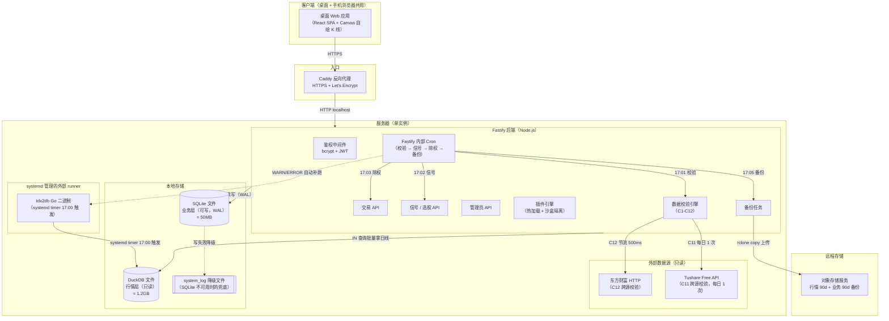

### 1.3 组件拓扑表

| 组件 | 类型 | 生命周期 | 职责 |
|------|------|---------|------|
| Caddy | 反向代理 | 进程守护 | HTTPS 终止 + 反代 |
| Fastify | HTTP 服务 | 进程守护 | 所有 API + 内部 cron（校验/信号/除权/备份）+ 插件引擎 |
| tdx2db | Go 二进制 | systemd timer 按需启动（17:00）| 每日增量更新 DuckDB；Phase 1 首次 bootstrap 也用它 |
| DuckDB | 文件数据库 | 无守护，按需打开关闭 | 行情只读查询 |
| SQLite | 文件数据库 | 无守护，按需打开关闭（WAL 模式）| 业务读写 |
| 远程存储 | 外部服务 | 第三方托管 | 定期备份 + Lifecycle Policy |

### 1.4 数据流向

| 方向 | 延迟 | 数据量 | 说明 |
|------|------|--------|------|
| 浏览器 → Fastify API | 本地直连 | KB 级/请求 | 业务操作 |
| Fastify API → DuckDB | 本地文件 IO | MB 级/查询 | 行情只读查询 |
| Fastify API → SQLite | 本地文件 IO | KB 级/事务 | 业务读写 |
| tdx2db → DuckDB | 本地文件 IO | MB ~ GB 级/天 | 行情增量 |
| Fastify → 东财 HTTP | 外部网络 | KB 级/请求 × 20 | C12 校验（节流） |
| Fastify → Tushare HTTP | 外部网络 | KB 级/请求 | C11 校验（每日 1 次）|
| Fastify → 远程存储 | 外部网络 | MB ~ GB 级/次 | 每日备份上传 |

### 1.5 项目结构

> 本节为 AGENTS.md 第 3 条锁死的目录结构提供**设计决策依据**和**工程落地细节**。AGENTS 是权威约束，本条解释"为什么"。

#### 1.5.1 Monorepo 选型 Trade-off

| 方案 | 优点 | 缺点 | 推荐分 |
|------|------|------|--------|
| **npm workspaces（推荐）** | Node 原生支持，零额外工具成本；所有 workspace 统一 lockfile；CI 跑全量 `npm ci` 即可 | 共享 hoisting 在少数 edge case 下可能出现 peer dep 冲突 | 5 |
| pnpm workspaces | 严格隔离 node_modules；磁盘占用最少 | AGENTS 锁了"不使用 pnpm"（历史 session 实炸过兼容性坑） | 1 |
| Turborepo / Nx | 增量构建缓存、任务编排强大 | MVP 只有 3 个 workspace，过度设计；引入额外工具链 | 2 |
| 多仓库（monorepo 替代）| 完全隔离 | 跨仓库协同成本高；core 包需要发布到 npm 或私有 registry；CI 复杂度翻倍 | 2 |

**推荐 npm workspaces**：MVP 规模（3 个 workspace）完全在 npm workspaces 能力范围内，零额外工具链成本。根 package.json 配置：

```jsonc
// 根 package.json
{
  "name": "invest-assistant",
  "private": true,
  "workspaces": ["packages/*", "apps/*"],
  "scripts": {
    "test": "vitest run",
    "test:coverage": "vitest run --coverage",
    "lint": "eslint ."
  }
}
```

#### 1.5.2 各 workspace 职责边界

| Workspace | 语言 | 输出产物 | 依赖 | 禁止 |
|-----------|------|---------|------|------|
| **packages/core** | TS (ESM+CJS) | `dist/esm/` + `dist/cjs/` + `dist/index.d.ts` | **零依赖** | 禁止 import `node:*` 内置模块（保证纯算法可测试性）|
| **apps/backend** | TS → Node 22+ 普通进程 | `dist/server.js`（systemd 管理） | core | 禁止 import 前端 workspace；**API handler 禁止写入 DuckDB**（仅 tdx2db Go 二进制可写）|
| **apps/frontend** | TSX → 静态资源 | `dist/` (HTML/CSS/JS) | 只发 HTTP 请求到 Fastify API | 禁止 import `node:*` 内置模块；**禁止直接 import packages/core**（前后端通过 API 通信）|

#### 1.5.3 跨 workspace 依赖规则

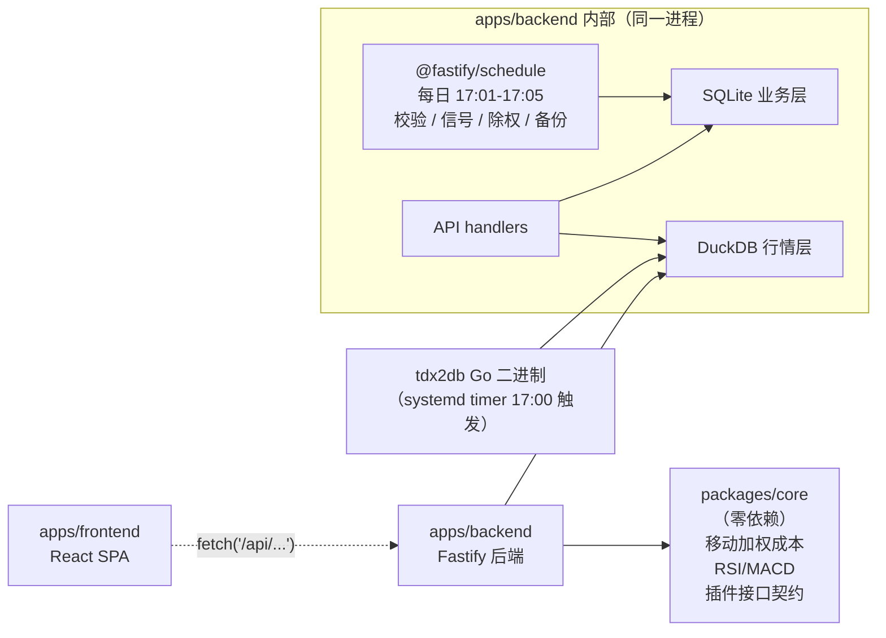

**硬约束**（AGENTS 锁死）：
- Fastify 进程对 DuckDB **只有 SELECT 权限**，禁止写入；写入权仅 **tdx2db Go 二进制** 持有（systemd timer 17:00 触发）
- **tdx2db 独立进程化**（不受 Node 进程生命周期影响）；Fastify 内部 4 段 cron（校验 / 信号 / 除权 / 备份，@fastify/schedule 调度）共享同一数据库连接池和插件引擎实例
- `apps/frontend` 禁止直接 import `packages/core`——前后端通过 HTTP API 通信，算法口径一致性靠 golden 数据集在 CI 里验证

#### 1.5.4 完整目录结构

以下为 MVP 最终代码库结构。**AGENTS.md 第 3 条锁死了 workspace 列表**（3 个：packages/core + apps/backend + apps/frontend），本节展开每个 workspace 的 src/ 子模块及职责说明。

```
packages/core/                             # ⭐ 零业务依赖，纯算法层
├─ src/
│   ├─ db/
│   │   └─ run-transaction.ts              # SQLite 事务封装（BEGIN IMMEDIATE + try-finally）
│   ├─ math/
│   │   └─ weighted-average.ts             # 移动加权平均成本
│   ├─ indicators/
│   │   ├─ rsi.ts                          # RSI 相对强弱指标
│   │   └─ macd.ts                         # MACD 异同移动平均线
│   ├─ plugin/
│   │   └─ types.ts                        # StrategyPlugin / DailyBar / StrategySignal 接口契约（SDD §5.3）
│   └─ index.ts                            # 统一导出
├─ tests/
│   └─ fixtures/golden/                    # ⭐ 黄金测试数据集（移动加权成本 / RSI / MACD 算法一致性断言）
│       ├─ weighted-average.json
│       ├─ rsi.json
│       └─ macd.json
├─ tsconfig.json
├─ tsup.config.ts                          # 输出 ESM + CJS 双格式 + d.ts 类型声明
└─ package.json

apps/backend/                              # Fastify 后端，依赖 core
├─ src/
│   ├─ server.ts                           # Fastify 入口（127.0.0.1:8080 + @fastify/schedule 注册）
│   ├─ db/
│   │   ├─ sqlite.ts                       # SQLite 初始化（WAL + busy_timeout=5000 + foreign_keys=ON）
│   │   ├─ duckdb.ts                       # DuckDB 只读连接（按需打开关闭，禁止写入）
│   │   └─ run-transaction.ts              # re-export @invest/core（backend 自己也用到）
│   ├─ validator/                          # ⭐ C1-C12 数据校验引擎（SDD §5.7 SQL 模板）
│   ├─ plugin-engine/                      # ⭐ 策略插件加载 + 沙盒隔离 + 50ms 硬超时（SDD §5.3）
│   ├─ routes/                             # Fastify 路由
│   │   ├─ trade.ts                        # 交易 API（买入 / 卖出 / 减仓 / 清仓）
│   │   ├─ holding.ts                      # 持仓 / 资产快照
│   │   ├─ stockscan.ts                    # 选股扫描（插件信号查询）
│   │   ├─ plugin.ts                       # 插件管理（列表 / 启停 / 运行）
│   │   └─ admin.ts                        # 管理员 API（datacheck 手动触发 / system_log 查看）
│   ├─ utils/
│   │   ├─ logger.ts                       # writeSystemLog() 三层保护（SQLite → JSON Lines → console.error）
│   │   └─ errors.ts                       # 结构化业务错误 + 错误码（HOLDING_INSUFFICIENT 等）
│   └─ config/
│       └─ config.ts                       # 配置单例（Tushare token 加密存储 + 运行时读取）
├─ tsconfig.json
└─ package.json

apps/frontend/                             # Vite + React SPA，只发静态资源，零 Node 运行时
├─ src/
│   ├─ main.tsx                            # React 入口
│   ├─ router/
│   │   └─ index.tsx                       # React Router 路由定义
│   ├─ pages/                              # 页面组件
│   │   ├─ dashboard/                      # 仪表盘（持仓快照 + 今日信号）
│   │   ├─ holding/                        # 持仓明细 + 盈亏
│   │   ├─ trade/                          # 交易录入（买入 / 卖出）
│   │   ├─ stockscan/                     # 选股扫描结果
│   │   ├─ admin/                          # 管理员面板（system_log / 数据校验状态）
│   │   └─ login/                          # 登录页
│   ├─ components/                         # 通用业务组件
│   ├─ stores/                             # Zustand 状态管理（authStore / holdingStore 等）
│   ├─ api/                                # axios HTTP 客户端（统一拦截 + JWT 注入）
│   ├─ types/                              # 前后端共享 TypeScript 类型
│   └─ utils/
├─ vite.config.ts                          # proxy target http://127.0.0.1:8080
├─ tsconfig.json
└─ package.json
```

**外部工具（非 Node.js，不在 workspace 内）**：
- `tdx2db` — systemd timer 调度的 Go 二进制（`tdx2db cron --dburi 'duckdb:///opt/invol/quotes.duckdb'`）
- `rclone` — 系统包安装（`/usr/bin/rclone`，备份上传）

**为什么 workspace 只有 Node.js 项目但保留 tdx2db Go 二进制**：
- apps/backend、apps/frontend、packages/core 是项目源码（全部 TypeScript），统一 npm workspaces 管理
- tdx2db 是**外部行情采集工具**（类似 rclone），职责单一：从通达信拉取日线数据写入 DuckDB；它不在 npm workspace 里，systemd timer 独立调度
- 为什么不让 Node.js 实现行情更新？Go 二进制独立进程化消除 Node 内存泄漏导致行情拉取失败的风险；DuckDB 文件锁机制本身就要求写入方独占，独立进程架构更安全

---

## 2. 技术选型 Trade-off 分析

> **选型原则**：MVP 优先简单、成熟、社区活跃。每个决策至少 2 套方案，按「实现成本 × 运维成本 × 风险」三维度评分（1-5 分，越低越好）。

### 2.1 数据库选型（行情层）

**决策背景**：行情数据特征为 **高列式分析（全市场条件选股、100+ 标的批量查日线）** + **只读为主** + **单次查询返回上千行**。

#### 方案 A：DuckDB（**推荐**）

| 维度 | 评分 | 说明 |
|------|------|------|
| 实现成本 | 1 | tdx2db 已直接产出 DuckDB 文件，零迁移成本；支持 SQL + Python/Node.js bindings |
| 运维成本 | 1 | 单文件，无需守护进程，备份即复制文件；OLAP 查询天然高效 |
| 风险 | 2 | 社区活跃（20k+ stars），但 Go binding for Node.js 需验证 API 稳定性 |
| 备选容量 | 高 | 2026 年已支持 DuckDB v1.x 稳定版，列式压缩率 ~3-5x |

#### 方案 B：ClickHouse

| 维度 | 评分 | 说明 |
|------|------|------|
| 实现成本 | 4 | tdx2db 虽支持 ClickHouse，但需额外部署服务、建表、导入 pipeline |
| 运维成本 | 4 | 多进程守护 + 分布式副本管理，单实例场景过度设计 |
| 风险 | 3 | 成熟但 OLAP 场景引入分布式复杂性 |

#### 方案 C：SQLite（扩展 array 类型模拟列式）

| 维度 | 评分 | 说明 |
|------|------|------|
| 实现成本 | 3 | 不支持原生列式，全市场选股查询性能不足 |
| 运维成本 | 1 | 单文件 |
| 风险 | 4 | 全市场条件选股 ≤3s 目标无法保证 |

**推荐方案 A**：DuckDB。理由：MVP 业务规模（单实例、全市场日线分析）完全匹配 DuckDB 的设计目标；tdx2db 直接产出 DuckDB 消除数据迁移成本；比 ClickHouse 少一个守护进程；比 SQLite 查询快 10-50x。

---

### 2.2 数据库选型（业务层）

**决策背景**：业务数据特征为 **高并发写入（交易记录）** + **强事务（持仓成本计算）** + **小数据量（≈50MB）**。

#### 方案 A：SQLite + WAL 模式（**推荐**）

| 维度 | 评分 | 说明 |
|------|------|------|
| 实现成本 | 1 | Node.js better-sqlite3 / sqlite3 库成熟；WAL 模式读写并发 |
| 运维成本 | 1 | 单文件，VACUUM INTO 支持热备份，Lifecycle Policy 自动清理 |
| 风险 | 2 | 写入并发上限 ~5000 TPS（MVCC 锁粒度），但 MVP 预计 ≤10 TPS，完全够用 |
| 备选容量 | 高 | SQLite 3.32.0+ 已将 WAL 模式稳定化，MVCC 锁粒度下的读写并发是嵌入式数据库事实标准 |

#### 方案 B：PostgreSQL

| 维度 | 评分 | 说明 |
|------|------|------|
| 实现成本 | 3 | 需额外部署服务 + 连接池 + 守护进程 |
| 运维成本 | 4 | 比 SQLite 重 10x，单实例场景过度 |
| 风险 | 3 | 成熟但运维开销不成比例 |

#### 方案 C：etcd / Redis（KV 模拟事务）

| 维度 | 评分 | 说明 |
|------|------|------|
| 实现成本 | 5 | 需自行实现事务、索引、查询 |
| 运维成本 | 2 | 守护进程 + 持久化配置 |
| 风险 | 5 | 不支持复杂查询 + 索引，迁移成本极高 |

**推荐方案 A**：SQLite + WAL。理由：50MB 业务数据量远在 SQLite 能力上限内；better-sqlite3 同步 API 在单实例 Node.js 场景比 PostgreSQL pg pool 性能更好；热备份 VACUUM INTO 消除停机窗口。单文件特性使部署和备份都极简。

---

### 2.3 后端框架选型

#### 方案 A：Fastify（**推荐**）

| 维度 | 评分 | 说明 |
|------|------|------|
| 实现成本 | 1 | JSON schema 校验内置，与 Zod 可联动，4.x 稳定版 |
| 性能 | 极高 | Async hooks + HTTP/1.1 高并发，单 Core 峰值 ~30k RPS（远超 MVP 需求）|
| 风险 | 2 | 社区活跃，30k+ stars；比 Express 学习曲线略陡但文档齐全 |

#### 方案 B：Express + 插件生态

| 维度 | 评分 | 说明 |
|------|------|------|
| 实现成本 | 1 | 最成熟，中间件生态最全 |
| 性能 | 中 | 同步处理，单 Core 峰值 ~5k RPS |
| 风险 | 3 | 回调地狱易引入错误；schema 校验靠插件（zod/joi）需额外配置 |

#### 方案 C：NestJS（TypeScript 全栈框架）

| 维度 | 评分 | 说明 |
|------|------|------|
| 实现成本 | 3 | TypeScript + DI 学习曲线陡峭 |
| 性能 | 中 | 抽象层开销 |
| 风险 | 3 | MVP 体量（单实例、~20 个 API endpoint）不值得引入 NestJS 复杂度 |

**推荐方案 A**：Fastify。理由：schema-first 开发方式直接对应业务校验（操作理由必填、持仓充足性），编译器级别的错误捕获在业务复杂时收益明显；性能冗余确保选股、信号生成等重计算场景不出性能问题。

---

### 2.4 前端框架选型

#### 方案 A：React + Vite（**推荐**）

| 维度 | 评分 | 说明 |
|------|------|------|
| 实现成本 | 1 | 生态最成熟，KLineChart React 绑定完善，Vite 冷启动 ~100ms |
| 包体积 | 中 | 生产构建 ~150KB gzip（含 React + ReactDOM） |
| 风险 | 1 | 17.x 稳定版，社区最大，资料最全 |

#### 方案 B：Vue 3 + Vite

| 维度 | 评分 | 说明 |
|------|------|------|
| 实现成本 | 1 | 模板语法对后端开发者更友好 |
| 包体积 | 略小 | ~120KB gzip |
| 风险 | 2 | 生态稍小于 React；K 线图 React 绑定更丰富 |

**推荐方案 A**：React + Vite。理由：React 生态与团队技术栈匹配。**K 线图库已按 §2.5 复审改用 `klinecharts@10.1.0`（只画不算）**，本项选型不受影响。

---

### 2.5 K 线图库选型

> ⚠️ **初稿裁决已推翻（2026-10-17，DEC-11 / ADR-001 修订）**：本节初稿结论为「不引入第三方图表库，自写 Canvas + SVG」。
> 2026-10-17 复审后**改为选用方案 A `klinecharts@10.1.0`** —— 初稿的两条否决依据经实测不成立，
> 详见本节末「历史：已否决的自绘方案」与 ADR-001 修订记录。

#### 方案 A：`klinecharts`（✅ **最终选用**，2026-10-17 复审）

| 维度 | 评分 | 说明 |
|------|------|------|
| 实现成本 | 1 | MIT 协议，~150KB，支持 React 绑定；内置 MA/EMA/MACD 等副图 |
| 图表渲染 | 优秀 | Canvas 绘制，60fps 流畅，移动端支持完善 |
| 风险 | 2 | 约 6k+ stars，但生态弱于 TradingView |

#### 方案 B：TradingView Lightweight Charts

| 维度 | 评分 | 说明 |
|------|------|------|
| 实现成本 | 2 | 免费版功能受限；商业授权 ~$999/年 |
| 图表渲染 | 顶级 | Canvas + WebGL 混合，性能天花板 |
| 风险 | 2 | API 变动快；免费版不支持自定义指标完全定制 |

#### 方案 C：ECharts + 自定义 K 线

| 维度 | 评分 | 说明 |
|------|------|------|
| 实现成本 | 3 | 原生不支持 K 线，需自行组合 Candlestick + Bar + Line |
| 图表渲染 | 中 | DOM + Canvas 混合，性能不如专业 K 图库 |
| 风险 | 4 | 副图联动、十字光标、缩放平移等需大量定制 |

#### ✅ 最终选定：`klinecharts@10.1.0`（**只画不算**，值由前端灌入）

> ⚠️ **2026-10-17 修订（DEC-11 / ADR-001）**：本节初稿结论为「自写 Canvas + SVG，零第三方图表库」。
> 该结论的两条理由经实测不成立（bundle 与「已有实现无需重写」），已改为选用 `klinecharts`。
> **初版结论与推翻理由保留在下方「历史：已否决的自绘方案」中，不作删除。**

| 维度 | 评分 | 说明 |
|------|------|------|
| 实现成本 | **1** | 零依赖、Apache-2.0、Snyk 0 漏洞；**十字光标 / 缩放平移 / hover tooltip / 响应式 / 副图窗格全部内置** |
| 图表渲染 | 优秀 | Canvas，v10.1.0（2026-10-14 发布），周下载 3.9 万、4.0k star |
| 风险 | 2 | ⚠️ **v10 是破坏性大版本**（2026-07-10 重写数据加载/布局/指标/overlay）；网上 9.x 教程全部作废，升级须重读 CHANGELOG |

**核心用法：注册自定义指标，`calc` 直接返回前端预计算的值，库完全不参与计算。**

```ts
registerIndicator({
  name: 'MACD',
  calc: () => rows.map(r => ({ dif: r.dif, dea: r.dea, macd: r.macd })), // 忽略入参，返回预计算值
  figures: [{ key: 'dif', title: 'DIF', type: 'line' },
            { key: 'dea', title: 'DEA', type: 'line' },
            { key: 'macd', title: 'MACD', type: 'histogram' }],
})
```

⚠️ **绝不可使用 klinecharts 的内置指标**（`chartOverlayConfig` 声明式配置）——
那会让「后端 core 算一套 + 前端库算一套」产生**双口径**（与当初否决 `technicalindicators` 同类问题）。
**spike 实测已验证灌值可行：`V6_EXACT_MATCH: true`（逐位相等）。**

**指标归属分界**（不是「递归 vs 非递归」，而是「参数是否可调 + 是否用于决策」）：

| 图上元素 | 计算方 | 理由 |
|---|---|---|
| MA(5/10/20/60) 主图叠加 / MACD / RSI / **KDJ** | **前端** | 参数固定、纯装饰；两端同为 JS（IEEE754）同公式必然逐位相同 |
| 成交量 | 后端下发原始 `volume` | 原始字段无需计算 |
| **信号标记 + hover 指标明细** | **后端**（插件引擎）| 参数每用户可调，是**决策依据** → 必须可复现、可追溯 |

> KDJ 两份实现（core + 前端）由 **T51 golden 逐位断言**兜底，这是 golden 的设计用途。

#### ⚠️ v10 API 变更清单（9.x 写法全部失效）

| 9.x | v10.1 实际 |
|---|---|
| `chart.applyNewData(klines)` | ❌ 不存在 → `setDataLoader({ getBars })` + `setSymbol()` + `setPeriod()` + `resetData()` |
| `chart.getIndicatorSeries()` | ❌ 不存在 → `getIndicators()` |
| 灌值写 `figures` | 灌值靠 **`calc` 返回值 → `result`** |

**体积实测**：`index.esm.js` 677KB（未压缩；官方称 gzip ≈40KB）。本地 SPA 不走公网，**bundle 不构成否决理由**。

#### 历史：已否决的自绘方案（保留供追溯）

~~#### ~~最终选定：自写 Canvas + SVG（零第三方图表库）~~（**2026-10-17 已推翻**）~~

| 维度 | 初稿评分 | 初稿说明（**部分不成立**）|
|---|---|---|
| 实现成本 | 2 | ~~「现有 `Kline.tsx` 已是 Canvas 实现」~~ → **实测不成立**：该文件 465 行里十字光标 / 缩放 / tooltip / KDJ / 响应式**全部 0 命中**，恰是 T70 最缺的部分 |
| 图表渲染 | 良好 | Canvas 绘制，满足 PE3「首渲染 ≤500ms」 |
| 风险 | **1**（初稿评分） | ~~「无第三方库的版本升级 / API 变动 / 授权风险」~~ → **方向反了**：真实风险在交互自研的边界 bug（v10.0.4 一次修 6 个拖拽/缩放/十字线状态 bug），而非库升级 |

~~**初稿理由**：① MVP 图表复杂度可控，不值得引入 150KB 依赖（❌ 体积实测 gzip ≈40KB，本地不走公网）；
② 避免第三方库的 API 变动风险（❌ 方向反了）；③ 依赖表已增一项，再加图表库会放大 bundle 与升级成本（❌ bundle 非瓶颈）。~~

---

### 2.6 技术指标计算库选型

> ⚠️ **已裁决（2026-10-17，DEC-1）：选用 `fast-technical-indicators@1.1.6`（精确锁版本，禁 `^`）。**
> 前端与 `packages/core` **各自直接依赖同一版本**，不跨 workspace 复用实现
> （AGENTS.md 硬约束：`apps/frontend` 禁止 import `packages/core`）。
>
> ⚠️ **落地状态（2026-10-17 实测）**：该库**尚未安装** —— 不在任何 `package.json`，`node_modules` 中也不存在。
> `apps/backend/src/services/indicators.ts` 的注释自承「MVP 简化：直接 re-export core 的指标计算，
> **不直接引入 fast-technical-indicators**」。即 **DEC-1 至今未真正执行**，当前指标由 `packages/core` 手写。
> **T51 为落地前置**（装依赖 + 适配层 + golden）。

#### ~~方案 A：technicalindicators~~（**已否决**）

| 维度 | 评分 | 说明 |
|------|------|------|
| 实现成本 | 1 | TypeScript + CommonJS/ESM 兼容；`RSI.calculate()` / `MACD.calculate()` API |
| 性能 | 中 | 纯 JS 实现，大数组场景比 native 慢但 MVP 无压力 |
| 风险 | 3 | **2024 年后活跃度存疑**；npm 搜索显示有 `fast-technical-indicators` 声称 100% API 兼容但性能更好 |

#### ✅ 方案 A'：fast-technical-indicators（**最终选定**）

| 维度 | 评分 | 说明 |
|------|------|------|
| 实现成本 | 1 | pure JS，无原生编译；**实测 221 个导出覆盖 RSI/MACD/BollingerBands/Highest/Lowest** |
| 性能 | 良好 | 纯 JS；实测单次 RSI/MACD 计算远低于插件 50ms 预算（前提：行情 IO 不计入，见 plan T88） |
| 风险 | **1** | 版本精确锁定 `1.1.6`；**已知缺口：库里没有 KDJ**，需自写（归 T52） |

**必须做的两处口径适配**（归 T51，**不是可选优化**）：
1. **数组补齐到 `closes.length`** —— 库的输出长度短于输入（EMA warm-up 瞬态）
2. **MACD 柱值 `histogram × 2`** —— 库给国际口径，A股通达信约定为 2 倍

**已知缺口**：`fast-technical-indicators` **无 KDJ**；其 `Stochastic` 是美式口径（K/D 与 A 股差 ~7 个点），**不可直接用于 A 股**，须按 SDD 公式自写（归 T52）。

#### 方案 B：TA-Lib（原生 C binding）

| 维度 | 评分 | 说明 |
|------|------|------|
| 实现成本 | 3 | 需原生编译（`npm install` 依赖 node-gyp + C++ 工具链），Dockerfile 复杂度上升 |
| 性能 | 极高 | 纯 C 实现，10x ~ 50x 快于 pure JS |
| 风险 | 3 | 跨平台编译坑多；Node 版本升级常出现 binary 不兼容 |

**推荐方案 A**：~~technicalindicators~~ → **已改为 `fast-technical-indicators`（见 §2.6 方案 A'）**。理由：Node.js pure JS 避免原生编译复杂性，单实例 12GB 内存场景不缺这点 CPU。**版本精确锁定 `1.1.6`**；代价是需自写 KDJ（归 T52）与两处口径适配（归 T51）。

---

### 2.7 调度机制选型

#### 方案 A：内部 Cron（@fastify/schedule）（仅调度 Fastify 内部 4 段：校验 / 信号 / 除权 / 备份）

| 维度 | 评分 | 说明 |
|------|------|------|
| 实现成本 | 1 | Fastify 4.x 内置 @fastify/schedule（基于 toad-scheduler）；同一进程，API 调用直接访问内存中的插件引擎/数据库连接 |
| 运维成本 | 1 | 无额外进程，Fastify 单进程守护覆盖内部 4 段定时任务 |
| 风险 | 2 | 进程重启时 cron 需自动恢复；需防止重复执行（幂等性在业务层保证）|

#### 方案 B：systemd timer（调度 tdx2db 行情更新）+ Fastify 内部 Cron（调度校验 / 信号 / 除权 / 备份）（**✅ MVP 选定**）

> 行情更新由 systemd timer 调度独立的 tdx2db Go 二进制，17:00 触发；Fastify 内部 cron 在 17:01-17:05 串行调度校验 / 信号 / 除权 / 备份 4 段。两套调度器各司其职。

| 维度 | 评分 | 说明 |
|------|------|------|
| 实现成本 | 2 | 需要维护 tdx2db.service + tdx2db-update.timer 两个 systemd unit；但 tdx2db 本身已是独立 Go 二进制，无需拆分现有代码 |
| 运维成本 | 2 | 两套调度器需要维护（systemd timer + Fastify 内部 cron）；但 systemd timer 天然可靠，重启后自动恢复 |
| 风险 | 1 | tdx2db 独立进程化消除 Node 内存泄漏导致行情拉取失败的风险；Fastify 内部 4 段任务共享同一数据库连接池和插件引擎实例，零进程切换开销 |

#### 方案 C：外部调度器（xxl-job / k8s cronjob）（**❌ MVP 不考虑**）

| 维度 | 评分 | 说明 |
|------|------|------|
| 实现成本 | 4 | 引入外部组件，MVP 体量过度设计 |
| 运维成本 | 4 | 多组件守护 + 注册中心 + 控制台 |
| 风险 | 3 | 外部组件增加故障点 |

**MVP 最终决策**：采用**混合方案 B**。理由：
- tdx2db 独立进程化消除 Node 内存泄漏导致行情拉取失败的风险；DuckDB 文件锁机制本身就要求写入方独占，独立进程架构更安全
- Fastify 内部 4 段任务（校验 / 信号 / 除权 / 备份）共享同一数据库连接池和插件引擎实例，零进程切换开销
- 两套调度器各司其职：systemd timer 负责行情层（独立 Go 二进制），Fastify 内部 cron 负责业务层（Node.js 插件引擎 + SQLite）

---

### 2.8 反向代理选型

#### 方案 A：Caddy（**推荐**）

| 维度 | 评分 | 说明 |
|------|------|------|
| 实现成本 | 1 | `caddy reverse_proxy localhost:3000` 一行配置；Let's Encrypt 自动续期 |
| 运维成本 | 1 | systemd 守护；证书自动管理零人工干预 |
| 风险 | 2 | 社区活跃，但比 nginx 配置文档略少 |

#### 方案 B：Nginx + certbot

| 维度 | 评分 | 说明 |
|------|------|------|
| 实现成本 | 2 | nginx.conf ~20 行 + certbot 安装 + systemd timer 证书续期 |
| 运维成本 | 2 | 组件更多 |
| 风险 | 1 | 最成熟，资料最全 |

**推荐方案 A**：Caddy。理由：MVP 不需要 nginx 的复杂模块（stream、sub_filter 等），Caddy 配置更短；Let's Encrypt 自动续期零运维是关键优势。

---

### 2.9 备份策略选型

#### 行情数据（DuckDB ≈ 1.2GB，可重建）

| 方案 | 实现 | 压缩比 | 实现成本 | 恢复步骤 |
|------|------|--------|---------|---------|
| **A: COPY TO PARQUET GZIP（推荐）** | DuckDB SQL 命令，列式压缩 | 3-5x（1.2GB → ~350MB） | 低 | 从备份文件 COPY FROM PARQUET GZIP |
| B: cp 文件 + gzip | shell 命令 | ~1.5x | 极低 | 解压 + 直接替换文件 |
| C: DuckDB checkpoint + WAL 归档 | WAL 模式的标准备份 | 2-3x | 中 | checkpoint → 归档 WAL → 恢复时 replay |

**推荐 A**：DuckDB 原生 PARQUET GZIP 压缩率最高，列式格式本身就是分析场景最优存储格式，恢复时也是 `COPY FROM`，与备份命令对称。

#### 业务数据（SQLite ≈ 50MB，不可重建）

| 方案 | 实现 | 停机窗口 | 实现成本 |
|------|------|---------|---------|
| **A: WAL checkpoint + VACUUM INTO（推荐）** | SQLite 官方热备份方式 | 零（写入继续） | 低 |
| B: sqlite3 .backup | CLI 命令 | 零 | 极低 |
| C: 直接 cp 文件 + 等 WAL checkpoint | shell 命令 | 可能丢失 WAL 中未 checkpoint 的事务 | 极低（但有数据不一致风险） |

**推荐 A**：`PRAGMA wal_checkpoint(TRUNCATE)` → `VACUUM INTO '/backup/user.db'`。TRUNCATE 模式清空 WAL 并 checkpoint 到主文件，备份文件是完整一致的快照。

---

### 2.10 技术选型总览表

| # | 决策项 | 方案 A（推荐）| 方案 B | 方案 C | 推荐理由摘要 |
|---|--------|-------------|--------|--------|------------|
| 1 | 行情层数据库 | DuckDB | ClickHouse | SQLite | tdx2db 直接产出 + OLAP 性能 |
| 2 | 业务层数据库 | SQLite + WAL | PostgreSQL | etcd | 50MB 量级无需独立服务 |
| 3 | 后端框架 | Fastify | Express | NestJS | Schema-first 开发 + 高性能冗余 |
| 4 | 前端框架 | React + Vite | Vue 3 + Vite | — | K 图绑定 + 团队偏好 |
| 5 | K 线图 | ~~klinecharts~~ | TradingView LC | ECharts | **✅ 已改用 klinecharts@10.1.0（§2.5 复审修订，只画不算）** |
| 6 | 指标计算库 | ~~technicalindicators~~ | TA-Lib | 无 | **✅ 已裁决：`fast-technical-indicators@1.1.6`（§2.6），KDJ 自写** |
| 7 | 调度机制 | tdx2db: systemd timer + Fastify: 内部 cron | 全部内部 cron | xxl-job | Go 二进制独立化 |
| 8 | 反向代理 | Caddy | Nginx + certbot | — | Let's Encrypt 零运维 |
| 9 | DuckDB 备份 | COPY PARQUET GZIP | cp + gzip | WAL 归档 | 列式压缩率最高 |
| 10 | SQLite 备份 | VACUUM INTO | .backup | cp + checkpoint | 官方热备份零停机 |
| 11 | 备份上传 | rclone | 对象存储 SDK | rsync + MinIO | 一工具覆盖所有云后端 |

### 2.11 备份上传工具选型

**决策背景**：本地备份文件（DuckDB ≈ 350MB + SQLite ≈ 50MB）需要上传到远程对象存储。需要的能力：断点续传、增量同步、与 Lifecycle Policy 兼容。

#### 方案 A：rclone（**推荐**）

| 维度 | 评分 | 说明 |
|------|------|------|
| 实现成本 | 1 | `apt install rclone` 一行命令；配置文件简洁（remote 配置）|
| 运维成本 | 1 | `rclone copy /backup/ oss:invest-backup/$(date +%F)/` 定时执行；内置断点续传 + 校验 |
| 风险 | 1 | 16k+ stars，支持阿里云 OSS / AWS S3 / MinIO / 七牛 等几乎所有对象存储后端 |

#### 方案 B：对象存储 SDK（aliyun-cli / aws-cli / minio-client）

| 维度 | 评分 | 说明 |
|------|------|------|
| 实现成本 | 2 | 各云厂商 CLI 语法不同，换云需重写；需要配置多套 credentials |
| 运维成本 | 2 | 多 CLI 维护 + credentials 轮换 |
| 风险 | 2 | 依赖特定云厂商 API 稳定性 |

#### 方案 C：rsync → 自建 MinIO

| 维度 | 评分 | 说明 |
|------|------|------|
| 实现成本 | 3 | 需额外部署 MinIO 实例 + Nginx 反代 + 证书 |
| 运维成本 | 3 | 多一个守护进程 + 存储管理 |
| 风险 | 2 | 自建对象存储引入新故障点，不符合 MVP 极简运维原则 |

**推荐方案 A**：rclone。理由：一个工具覆盖所有对象存储后端，配置一次换云零成本；内置校验 + 断点续传；单二进制无守护进程。

#### rclone 配置示例（systemd service）

```ini
# /etc/rclone.conf
[invest-oss]
type = oss
provider = Other
env_auth = false
access_key_id = ${OSS_ACCESS_KEY_ID}       # systemd EnvironmentFile 注入
secret_access_key = ${OSS_ACCESS_KEY_SECRET}
endpoint = oss-cn-hangzhou.aliyuncs.com
acl = private

# 备份上传 systemd service
# /etc/systemd/system/invest-backup.service
[Unit]
Description=InvestAssistant 每日备份上传（DuckDB + SQLite）
Requires=network-online.target
After=network-online.target

[Service]
Type=oneshot
User=invest
EnvironmentFile=/opt/invol/.env
# systemd 不做 shell 展开，需要用 /bin/bash -c 包装 $(date) 和链式命令
ExecStartPre=/bin/bash -c 'rclone copy /backup/duckdb/ "invest-oss:invest-backup/$(date +%%F)/duckdb/" --backup-dir="invest-oss:invest-backup/archive/duckdb/" --ignore-existing --checksum --stats-one-line'
ExecStart=/bin/bash -c 'rclone copy /backup/sqlite/ "invest-oss:invest-backup/$(date +%%F)/sqlite/" --backup-dir="invest-oss:invest-backup/archive/sqlite/" --ignore-existing --checksum --stats-one-line'
# Lifecycle Policy 在 OSS 控制台配置：archive/ 路径下文件 90 天自动删除

# 备份上传 systemd timer
# /etc/systemd/system/invest-backup.timer
[Unit]
Description=每日 17:10 触发备份上传

[Timer]
OnCalendar=*-*-* 17:10:00
Persistent=true

[Install]
WantedBy=timers.target
```

### 2.12 前端架构设计

> 决策结论见 §2.4（React + Vite）与 §2.5（**已裁决：不引第三方图表库，自写 Canvas**）。

#### 2.12.1 组件分层结构

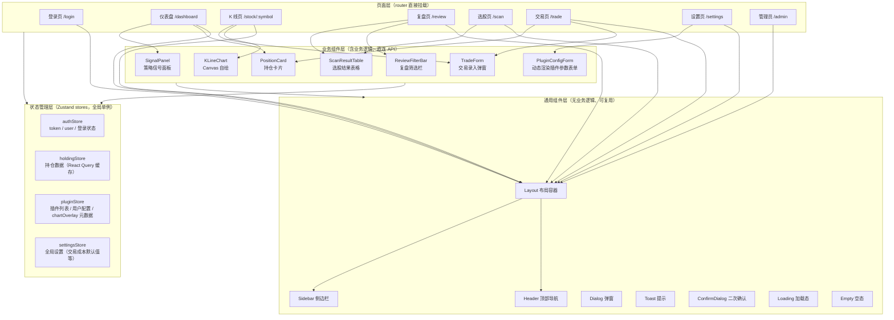

**分层规则**：

| 层 | 规则 | 依赖 |
|---|------|------|
| Pages | 路由容器，只做页面装配和布局，不写复杂业务逻辑 | Business + Common + Feature |
| Business | 含业务逻辑、直连 API（通过 `@/api/client`）、读取 Feature | Common + Feature + API client |
| Common | 纯 UI 组件，零业务逻辑，零 API 调用 | 无 |
| Feature | Zustand store + React Query 缓存层，全局单例 | API client |

#### 2.12.2 路由设计

```typescript
// /opt/invol/frontend/src/router/index.tsx
import { createBrowserRouter, Navigate } from "react-router-dom";
import { useAuthStore } from "@/stores/authStore";

const AuthGuard: React.FC<{ children: React.ReactNode }> = ({ children }) => {
  const { token } = useAuthStore();
  if (!token) return <Navigate to="/login" replace />;
  return <>{children}</>;
};

const AdminGuard: React.FC<{ children: React.ReactNode }> = ({ children }) => {
  const { token, role } = useAuthStore();
  if (!token) return <Navigate to="/login" replace />;
  if (role !== "admin") return <Navigate to="/dashboard" replace />;
  return <>{children}</>;
};

export const router = createBrowserRouter([
  { path: "/login", element: <LoginPage /> },
  {
    path: "/",
    element: (
      <AuthGuard>
        <Layout />
      </AuthGuard>
    ),
    children: [
      { path: "dashboard", element: <DashboardPage /> },
      { path: "stock/:symbol", element: <KLinePage /> },
      { path: "review", element: <ReviewPage /> },
      { path: "scan", element: <ScanPage /> },
      { path: "trade", element: <TradePage /> },
      { path: "settings", element: <SettingsPage /> },
      { path: "admin", element: <AdminGuard><AdminPage /></AdminGuard> },
      { index: true, element: <Navigate to="/dashboard" replace /> },
    ],
  },
  { path: "*", element: <Navigate to="/dashboard" replace /> },
]);
```

**路由规则**：

| 项 | 说明 |
|---|------|
| 守卫方式 | React Router Loader + 自定义 Guard 组件（AuthGuard / AdminGuard） |
| 重定向 | 未登录 → `/login`；已登录访问根路径 → `/dashboard`；未知路径 → `/dashboard` |
| 懒加载 | KLinePage（Canvas 自绘）+ AdminPage | `React.lazy + Suspense` | 拆分包 | 首屏不加载 K 线 |
| 404 页 | 统一重定向到 dashboard（MVP 不单独做 404 页面） |

#### 2.12.3 状态管理方案

> ⚠️ **MVP 实现范围收窄（2026-10-20，T98 登记）**
>
> 本节下文的「**决策**：Zustand（全局状态）+ React Query（服务端数据缓存）」是**原始决策记录，予以保留**；
> 但 **MVP 实际实现范围已收窄 —— React Query 未被引入**。
>
> - **MVP 实现范围**：仅 **Zustand**（全局状态，`apps/frontend/src/store/user.ts`）
>   + **`api/client`**（axios 实例，`apps/frontend/src/api/client.ts`）。
> - **React Query 移出 MVP 范围**，理由：
>   1. **当前数据规模不需要缓存层** —— 持仓 ≤ 数十条、信号 ≤ 50 条/页、复盘列表分页；
>      页面组件内「`useState` + `useEffect` 拉取 + `useState` 保存页码」即可满足（现有页面即如此）。
>   2. **`api/client.ts` 的请求/响应拦截器已承担 token 注入与 401 处理**
>      （请求拦截器注入 `Authorization: Bearer`；响应拦截器遇 401 登出并跳 `/login`），
>      无需 React Query 的全局缓存失效机制。
> - **若将来引入 React Query，必须同时评估以下两点（不可直接叠加）**：
>   1. **401 处理重复** —— `api/client.ts` 的响应拦截器已做「登出 + 跳 `/login`」，
>      与 React Query 的 `onError` / 重试策略会**双重触发**（登出两次、跳两次）。
>   2. **token 持久化 vs 缓存失效** —— `useUserStore` 使用 zustand `persist`（token 落 localStorage），
>      而 React Query 缓存默认驻留内存；**登出或切换账号后必须显式 `queryClient.clear()`**，
>      否则会出现「A 的缓存数据展示给 B」的越权风险。
> - ⚠️ 这是**对 §2.12.3 原「决策」的 MVP 范围收窄**，**不是推翻**该决策 ——
>   方向未变（Zustand 仍是全局状态方案），仅把 React Query 这一层延后到出现真实缓存/失效需求时再引入。
>   引入时需同步更新本节。

**决策**：Zustand（全局状态）+ React Query（服务端数据缓存）

| 维度 | 方案 A：Zustand + React Query（**推荐**）| 方案 B：纯 Zustand | 方案 C：Redux Toolkit |
|------|------|------|------|
| 实现成本 | 2 | 1 | 3 |
| 首屏性能影响 | 低，React Query 缓存自动去重 + stale 策略 | 低 | 中，Redux 本身增大 bundle |
| 缓存失效复杂度 | 2 | 3（手写 fetch 层的 stale/invalidate） | 2 |
| 类型安全 | 高 | 中 | 高 |

**推荐理由**：
- Zustand 比 Redux 轻 90%（仅 ~1KB），不需要 action/reducer/dispatch 样板代码，MVP 规模（≤20 个 store）完全够用
- React Query 天然解决"持仓数据缓存 + 自动 stale 校验 + 手动 invalidate（交易录入后立即刷新）"需求，比手写 fetch 层健壮
- 两套库都被 React 社区广泛验证，与 Vite 集成良好

**Store 示例（authStore）**：

```typescript
// /opt/invol/frontend/src/stores/authStore.ts
import { create } from "zustand";
import * as api from "@/api/client";

interface AuthState {
  token: string | null;
  refreshToken: string | null;
  userId: number | null;
  role: "user" | "admin" | null;
  login: (username: string, password: string) => Promise<void>;
  logout: () => void;
  refreshAccessToken: () => Promise<void>;
}

export const useAuthStore = create<AuthState>((set, get) => ({
  token: localStorage.getItem("access_token"),
  refreshToken: localStorage.getItem("refresh_token"),
  userId: localStorage.getItem("user_id") ? Number(localStorage.getItem("user_id")) : null,
  role: localStorage.getItem("role") as AuthState["role"],

  login: async (username, password) => {
    const res = await api.login(username, password);
    localStorage.setItem("access_token", res.access_token);
    localStorage.setItem("refresh_token", res.refresh_token);
    localStorage.setItem("user_id", String(res.user_id));
    localStorage.setItem("role", res.role);
    set({ token: res.access_token, refreshToken: res.refresh_token, userId: res.user_id, role: res.role });
  },

  logout: () => {
    localStorage.removeItem("access_token");
    localStorage.removeItem("refresh_token");
    localStorage.removeItem("user_id");
    localStorage.removeItem("role");
    set({ token: null, refreshToken: null, userId: null, role: null });
  },

  refreshAccessToken: async () => {
    const { refreshToken } = get();
    if (!refreshToken) throw new Error("No refresh token");
    const res = await api.refresh(refreshToken);
    localStorage.setItem("access_token", res.access_token);
    set({ token: res.access_token });
  },
}));
```

#### 2.12.4 API Client 层设计

```typescript
// /opt/invol/frontend/src/api/client.ts
import axios, { AxiosInstance, AxiosRequestConfig } from "axios";
import { useAuthStore } from "@/stores/authStore";
import { useNavigate } from "react-router-dom";

const instance: AxiosInstance = axios.create({
  baseURL: "/api",  // Vite proxy 转发到 Fastify
  timeout: 15000,
});

// 请求拦截器：自动注入 Authorization
instance.interceptors.request.use((config) => {
  const token = useAuthStore.getState().token;
  if (token) config.headers.Authorization = `Bearer ${token}`;
  return config;
});

// 响应拦截器：统一处理错误
instance.interceptors.response.use(
  (resp) => resp.data,  // 直接返回 {code, data, timestamp} 主体
  async (error) => {
    const originalRequest = error.config;
    if (error.response?.status === 401 && !originalRequest._retry) {
      originalRequest._retry = true;
      try {
        await useAuthStore.getState().refreshAccessToken();
        originalRequest.headers.Authorization = `Bearer ${useAuthStore.getState().token}`;
        return instance(originalRequest);
      } catch {
        useAuthStore.getState().logout();
        const navigate = (window as any).__navigate;  // 由 App.tsx 注入
        navigate?.("/login");
        return Promise.reject(error);
      }
    }
    // 非 401 错误：Toast 提示 + 返回原始错误
    return Promise.reject(error);
  }
);

export default instance;
```

**API 模块划分**：

```
/api/
  auth.ts        // login / logout / refresh
  trade.ts       // getTrades / createTrade / deleteTrade / getImportPreview / confirmImport
  holding.ts     // getCurrent / getHistory
  stock.ts       // search / getKline / getQuote
  plugin.ts      // list / updateConfig / runOnce
  scan.ts        // runScan / getScanResults
  admin.ts       // triggerDataCheck / getBackupStatus / logRecover / checkHealth
```

#### 2.12.5 Bundle 优化策略

| 策略 | 实现方式 | 预期效果 |
|------|---------|---------|
| 代码分割（路由级） | KLinePage / AdminPage 用 `React.lazy + Suspense` | K 线图独立 chunk ≈ 80KB，不阻塞首屏 |
| 按需加载 klinecharts | `import("klinecharts")` | **保留** —— §2.5 复审改用 klinecharts@10.1.0 后，K 线页仍按需加载（SDD §2.12.5 要求 `React.lazy`）| 待 T70 |
| Vite 生产优化 | `manualChunks` 拆分：react + zustand 公共 chunk、axios chunk、business chunk | 公共依赖复用 |
| 压缩 | gzip + brotli（Caddy 自动） | 总体 gzip ≈ 150KB（原始需求验收标准：首屏 ≤ 1.5s）|
| 图片 | 全部用 SVG / data URL，不引入图片资源 | 避免图片请求 |

#### 2.12.6 响应式布局策略

| 设备 | 断点 | 布局差异 |
|------|------|---------|
| 桌面（≥ 1024px） | `md:` | K 线页：主图 + 多个副图**并列**显示（MACD + RSI + 成交量） |
| 平板（768-1024px） | `sm:` | K 线页：主图固定，副图**Tab 切换** |
| 手机（< 768px） | 默认 | 底部 TabBar 导航 + 所有副图 Tab 切换；交易表单单列显示 |

---

## 3. 数据模型设计

### 3.1 整体 ER 图（Dual Database）

```mermaid
erDiagram
    subgraph SQLite["SQLite（业务层）"]
        USER_ACCOUNT ||--o{ USER_TRADE_RECORD : "has"
        USER_ACCOUNT ||--o{ USER_ASSET_REL : "has"
        USER_ACCOUNT ||--o{ USER_STRATEGY_SIGNAL : "has"
        USER_ACCOUNT ||--o{ USER_PLUGIN_CONFIG : "has"
        USER_ACCOUNT ||--o{ USER_CANDIDATE_POOL : "has"
        USER_ACCOUNT ||--o{ USER_ASSET_STAT : "has"
        USER_ACCOUNT ||--o{ SYSTEM_LOG : "writes"
        USER_ASSET_REL ||--o{ USER_CANDIDATE_POOL : "references"
    end

    subgraph DuckDB["DuckDB（行情层，tdx2db 原生表）"]
        RAW_KLINE_DAILY {
            string symbol PK
            string trade_date PK
            number open
            number high
            number low
            number close
            number volume
            number amount
        }
        RAW_ADJUST_FACTOR {
            string symbol PK
            string trade_date PK
            number factor
        }
        RAW_HOLIDAYS {
            string trade_date PK
            integer is_trading_day
        }
        RAW_GBBQ {
            string symbol
            string ex_date
            number cash_per_share
            number bonus_ratio
            number transfer_ratio
            string event_type
        }
        RAW_SYMBOL_CLASS {
            string symbol PK
            string market
            integer is_listing
            integer is_st
        }
        RAW_TDX_BLOCKS_INFO {
            string block_code PK
            string block_name
            string block_type
        }
        RAW_TDX_BLOCKS_MEMBER {
            string block_code FK
            string symbol
        }
        RAW_BASIC_DAILY {
            string symbol PK
            string trade_date PK
            number turnover_rate
            number market_cap
        }
    end

    subgraph DuckDB_VIEWS["DuckDB 视图"]
        V_STOCK_QFQ {
            string symbol
            string trade_date
            number open_qfq
            number high_qfq
            number low_qfq
            number close_qfq
            number volume
            number amount
        }
        V_ETF_QFQ {
            string symbol
            string trade_date
            number open_qfq
            number high_qfq
            number low_qfq
            number close_qfq
            number volume
            number amount
        }
    end
```

### 3.2 SQLite 表结构（DDL）

> 所有 DDL 必须幂等（IF NOT EXISTS）。SQLite 3.32.0+ 兼容。

#### user_account（用户账号）

```sql
CREATE TABLE IF NOT EXISTS user_account (
    id INTEGER PRIMARY KEY AUTOINCREMENT,
    username TEXT NOT NULL UNIQUE CHECK(length(username) >= 3 AND length(username) <= 32),
    password_hash TEXT NOT NULL,
    role TEXT NOT NULL DEFAULT 'user' CHECK (role IN ('user', 'admin')),
    created_at TEXT NOT NULL DEFAULT (datetime('now')),
    updated_at TEXT NOT NULL DEFAULT (datetime('now'))
);
CREATE INDEX IF NOT EXISTS idx_user_account_username ON user_account(username);
```

#### user_trade_record（交易记录）

```sql
CREATE TABLE IF NOT EXISTS user_trade_record (
    id INTEGER PRIMARY KEY AUTOINCREMENT,
    user_id INTEGER NOT NULL,
    asset_code TEXT NOT NULL,
    trade_type TEXT NOT NULL CHECK (
        trade_type IN ('buy', 'add', 'reduce', 'clear', 'dividend', 'bonus', 'transfer')
    ),
    trade_date TEXT NOT NULL,
    -- 成交时刻（秒级 HH:mm:ss，必填无默认）。与标的代码 / 交易类型 / 日期共同构成去重键。
    -- 为何必填：若允许留空落 00:00:00，则同日同标的同类型仍只能录一笔，与「同日分笔可追加」矛盾。
    -- 代价：同一标的同一天同一类型只能有一笔；补录历史时若多笔填同一时刻，第二笔 409。
    trade_time TEXT NOT NULL,
    quantity REAL NOT NULL CHECK (quantity >= 0),
    price REAL NOT NULL CHECK (price >= 0),
    fee REAL NOT NULL DEFAULT 0 CHECK (fee >= 0),
    trade_reason TEXT,
    is_auto_import INTEGER NOT NULL DEFAULT 0 CHECK (is_auto_import IN (0, 1)),
    is_deleted INTEGER NOT NULL DEFAULT 0 CHECK (is_deleted IN (0, 1)),
    review_summary TEXT,
    system_followed INTEGER CHECK (system_followed IS NULL OR system_followed IN (0, 1)),
    strategy_match INTEGER CHECK (strategy_match IS NULL OR strategy_match IN (0, 1)),
    is_stop_loss INTEGER CHECK (is_stop_loss IS NULL OR is_stop_loss IN (0, 1)),
    remark TEXT,
    created_at TEXT NOT NULL DEFAULT (datetime('now','localtime')),
    FOREIGN KEY (user_id) REFERENCES user_account(id)
);
CREATE INDEX IF NOT EXISTS idx_trade_user_date ON user_trade_record(user_id, trade_date DESC);
CREATE INDEX IF NOT EXISTS idx_trade_asset ON user_trade_record(user_id, asset_code);
-- 🔴 唯一键 = **部分唯一索引**（T87b，2026-10-20 修正）
--    去重语义：只有「完全同标的 + 同类型 + 同日期 + 同时刻」的**活记录**才算同一笔
--    （409 TRADE_DUPLICATE）。份额 quantity 刻意不入键 —— 同一天同一标的同一类型的多笔，
--    靠 trade_time 区分。
--    ⚠️ 为什么不是表级 UNIQUE：SQLite 的**表级 UNIQUE 无法部分化**（不支持 WHERE 条件）
--      ⇒ 表级 UNIQUE 会把**软删记录也纳入约束** ⇒ 软删后同一键**再也录不进去**，
--      而 `GET /api/trade` 过滤了 `is_deleted = 0` ⇒ 用户**看不到**那条记录却提交必 409
--      —— 「列表里没有这一笔，但系统说重复」的**幽灵占用**（P0 数据缺陷）。
--    ⚠️ 索引名固定为 idx_user_trade_record_unique_live（幂等判定 + 预检 EXPLAIN 断言依赖它）。
--    ⚠️ 改已有表的约束必须用幂等表重建（CREATE TABLE IF NOT EXISTS 对已存在的表无效），
--      见 AGENTS.md「DDL 变更判据」，先例 configStore.ts 的 _ensureTradeRecordUniqueConstraint()。
CREATE UNIQUE INDEX IF NOT EXISTS idx_user_trade_record_unique_live
    ON user_trade_record(user_id, asset_code, trade_type, trade_date, trade_time)
    WHERE is_deleted = 0;
-- ⚠️ 2026-10-17 实测校正：初稿此处的 idx_trade_type(user_id, trade_type) **代码从未创建**，
--    且现有查询均按 (user_id, asset_code) 或 (user_id, trade_date) 过滤，单独建 type 索引收益低 → 移除。
--    如将来出现「按类型跨用户统计」需求再补，届时走幂等建索引。
```

> ⚠️ **DDL 变更方式**：`CREATE TABLE IF NOT EXISTS` **只对「表不存在」生效**，无法修改已存在表的 CHECK / UNIQUE。
> - **加列** → `ALTER TABLE ADD COLUMN`（先 `PRAGMA table_info` 判存在）
> - **改 CHECK / UNIQUE / 主键** → **幂等表重建**：建新表 → `INSERT SELECT` → `DROP 旧` → `ALTER RENAME`，必须包 `db.transaction()`
> - 判别口诀：**只加列 → ALTER；碰约束 → 表重建。** 详见 AGENTS.md「DDL 变更判据」
> - ⚠️ **同一张表上的多次幂等重建必须合并为一次**（多次 `DROP/RENAME` 同一张表 = 数据丢失风险）；
>   `user_trade_record` 的复盘 4 列走 `ALTER ADD COLUMN`（不重建），
>   唯一键迁移走**唯一一次**表重建（`configStore.ts` 的 `_ensureTradeRecordUniqueConstraint()`）。

#### user_asset_rel（用户-标的关联）

```sql
CREATE TABLE IF NOT EXISTS user_asset_rel (
    id INTEGER PRIMARY KEY AUTOINCREMENT,
    user_id INTEGER NOT NULL,
    asset_code TEXT NOT NULL,
    rel_type TEXT NOT NULL CHECK (rel_type IN ('watch', 'hold', 'candidate')),
    watch_date TEXT,
    candidate_reason TEXT,
    candidate_base_price REAL,
    migrated_from_candidate INTEGER DEFAULT 0,
    migrated_price_mode TEXT CHECK (migrated_price_mode IS NULL OR migrated_price_mode IN ('base', 'current')),
    -- 软删除（AGENTS.md「全部业务记录软删除，禁止物理删除」）。2026-10-17 补：代码已有该列，SDD 初稿遗漏
    is_deleted INTEGER NOT NULL DEFAULT 0 CHECK (is_deleted IN (0, 1)),
    created_at TEXT NOT NULL DEFAULT (datetime('now','localtime')),
    UNIQUE(user_id, asset_code, rel_type),
    FOREIGN KEY (user_id) REFERENCES user_account(id)
);
```

#### user_strategy_signal（策略信号）

```sql
CREATE TABLE IF NOT EXISTS user_strategy_signal (
    id INTEGER PRIMARY KEY,
    user_id INTEGER NOT NULL,
    asset_code TEXT NOT NULL,
    plugin_id TEXT NOT NULL,
    plugin_category TEXT NOT NULL CHECK (plugin_category IN ('monitor', 'filter')),
    trade_date TEXT NOT NULL,
    direction TEXT NOT NULL CHECK (direction IN ('buy', 'sell', 'hold')),
    label TEXT NOT NULL,
    strength REAL,
    metrics_json TEXT,
    is_final INTEGER DEFAULT 1,
    -- 软删除（AGENTS.md「全部业务记录软删除」）。2026-10-17 补：代码已有该列，SDD 初稿遗漏
    is_deleted INTEGER NOT NULL DEFAULT 0 CHECK (is_deleted IN (0, 1)),
    created_at TEXT NOT NULL DEFAULT (datetime('now','localtime')),
    UNIQUE(user_id, asset_code, plugin_id, trade_date),
    FOREIGN KEY (user_id) REFERENCES user_account(id)
);
CREATE INDEX IF NOT EXISTS idx_signal_user_date ON user_strategy_signal(user_id, trade_date DESC);
CREATE INDEX IF NOT EXISTS idx_signal_user_plugin ON user_strategy_signal(user_id, plugin_id, trade_date DESC);
CREATE INDEX IF NOT EXISTS idx_signal_user_asset_date ON user_strategy_signal(user_id, asset_code, trade_date DESC);
-- ⚠️ 2026-10-17 实测校正：初稿此处写 idx_signal_user_asset / idx_signal_user_dir_date，
--    代码实际为 idx_signal_user_asset_date / （无 direction 索引）。已按代码对齐。
--    direction 无独立索引：现有查询均带 asset_code 或 plugin_id，前导列已覆盖。
```

#### user_plugin_config（插件配置）

```sql
CREATE TABLE IF NOT EXISTS user_plugin_config (
    id INTEGER PRIMARY KEY AUTOINCREMENT,
    user_id INTEGER NOT NULL,
    plugin_id TEXT NOT NULL,
    enabled INTEGER NOT NULL DEFAULT 1 CHECK (enabled IN (0, 1)),
    params_json TEXT NOT NULL,
    UNIQUE(user_id, plugin_id),
    FOREIGN KEY (user_id) REFERENCES user_account(id)
);
```

#### user_asset_stat（资产快照）

```sql
CREATE TABLE IF NOT EXISTS user_asset_stat (
    id INTEGER PRIMARY KEY AUTOINCREMENT,
    user_id INTEGER NOT NULL,
    trade_date TEXT NOT NULL,
    total_assets_price_yield REAL NOT NULL,
    total_assets_actual_yield REAL NOT NULL,
    total_profit_price REAL NOT NULL,
    total_profit_actual REAL NOT NULL,
    created_at TEXT NOT NULL DEFAULT (datetime('now','localtime')),
    UNIQUE(user_id, trade_date),
    FOREIGN KEY (user_id) REFERENCES user_account(id)
);
```

#### system_log（系统日志）

```sql
CREATE TABLE IF NOT EXISTS system_log (
    id INTEGER PRIMARY KEY AUTOINCREMENT,
    log_date TEXT NOT NULL,
    log_type TEXT NOT NULL CHECK (
        log_type IN ('tdx2db_update', 'datacheck', 'signal_generate',
                     'dividend_import', 'backup', 'trigger_manual',
                     'plugin_execute', 'startup', 'trade',
                     'candidate_migrate')   -- 后 4 个为代码实际在用，SDD 初稿遗漏（2026-10-17 / 2026-10-19 实测补齐）
                     -- candidate_migrate：候选池迁移打标记（T92）—— 原用 'trade' 记录属误用（这不是交易）
    ),
    level TEXT NOT NULL CHECK (level IN ('INFO', 'WARN', 'ERROR', 'SKIP', 'SUCCESS')),
    check_item TEXT,
    message TEXT NOT NULL,
    detail TEXT,
    created_at TEXT NOT NULL DEFAULT (datetime('now','localtime'))
);
CREATE INDEX IF NOT EXISTS idx_system_log_date ON system_log(log_date, log_type, level);
```

### 3.3 DuckDB 数据源表说明

> 🔗 **权威字段说明（实测版本）**：[tdx2db_schema.md](../tdx2db_schema.md)（2026-10-15 DuckDB 实测）导出命令： duckdb mydb.duckdb ".schema" > schema_dump.sql
> **关键列名约定**：所有表的日期列一律叫 `date`（不是 `trade_date`）。

tdx2db 原生产出，**不做任何 schema 变更**。MVP 只读子集如下：

#### 📖 原始表（raw_）

| 表名 | 说明 | MVP 消费方 | 关键列 |
|---|---|---|---|
| `raw_kline_daily` | 不复权日线 OHLCV | C11 跨源校验取不复权价 | `date`, `symbol`, `open/high/low/close`, `volume`, `amount` |
| `raw_basic_daily` | 前收盘价 + 市值/换手率 | C11 取 `preclose`（raw_kline_daily 没有这个字段） | `date`, `symbol`, `preclose`, `turnover`, `floatmv`, `totalmv` |
| `raw_adjust_factor` | 后复权因子（**稀疏存储，只在除权日追加**） | C9 校验因子计算 | `date`, `symbol`, `hfq_factor`（⚠️ 字段名是 `hfq_factor` 不是 `factor`） |
| `raw_gbbq` | 股本变迁 / 权息事件 | C8/C10 除权校验 + 除权自动导入 | `category`, `symbol`, `date`, `c1`–`c4`。**MVP 只取 `category=1`**（除权除息）：`date`=ex_date，`c1/10`=每股分红，`c3/10`=每股送转比例，**c2 和 c4 永远=0**（2020年以来零例外）。category=2（通达信内部复权因子链）、category=5（股本快照）MVP 完全忽略 |
| `raw_holidays` | **交易日历（只有交易日，无 is_trading_day 列）** | C1 历史日期过滤、C2 交易日判断 | 只有 `date` 一列。有行=交易日，没行=非交易日 |
| `raw_symbol_class` | 品种分类 | 视图路由依赖 | `symbol`, `class`（实测值：`stock` / `etf` / `index` / `bond`） |

#### 📊 视图（v_，共 6 张，由 tdx2db init 自动创建）

所有视图底层 JOIN 了 `raw_kline_daily` + `raw_symbol_class` + `raw_adjust_factor` + `raw_basic_daily`，列完全相同，只是复权口径和标的分类不同。

| 视图 | 标的分类 | 复权口径 | close 精度 | 有 qfq_factor 列 |
|---|---|---|---|---|
| `v_stock_qfq` | stock | 前复权 | ROUND(2) | ✅ |
| `v_stock_hfq` | stock | 后复权 | ROUND(2) | ❌ |
| `v_stock_bfq` | stock | 不复权（原始） | 原值 | ✅ |
| `v_etf_qfq` | etf | 前复权 | ROUND(3) | ✅ |
| `v_etf_hfq` | etf | 后复权 | ROUND(3) | ❌ |
| `v_etf_bfq` | etf | 不复权（原始） | 原值 | ✅ |

**复权公式**：`qfq_factor = hfq_factor / latest_hfq`，其中 `latest_hfq = argmax(hfq_factor, date)` 全历史最新因子。前复权价 = `raw_price × qfq_factor`；后复权价 = `raw_price × hfq_factor`。

**MVP 使用**：`v_stock_qfq` / `v_etf_qfq` 高频读（插件引擎行情查询、C1-C10 校验、K 线默认前复权）；`v_stock_hfq` / `v_stock_bfq` 中频读（K 线路由的「后复权 / 不复权」切换，见下表 T53）；`v_etf_hfq` / `v_etf_bfq` 低频读（自选含 ETF 且用户切后复权/不复权时）。6 张视图 MVP 全部可访问，按 `raw_symbol_class.class` 路由（`stock` → `v_stock_*`，`etf` → `v_etf_*`）。

#### MVP 访问边界

**✅ MVP 访问**

| 表 | 消费方 | 关键列 |
|---|---|---|
| `v_stock_qfq` / `v_etf_qfq` | 插件引擎行情查询、C1-C10 校验、K 线路由 | 前复权 OHLCV |
| `v_stock_hfq` / `v_stock_bfq` | K 线路由后复权/不复权切换（T53） | 后复权 OHLCV |
| `raw_kline_daily` | C11 不复权价、K 线路由 `fq=raw` | `date`,`symbol`,OHLCV |
| `raw_adjust_factor` | C9 复权因子校验 | `date`,`symbol`,`hfq_factor` |
| `raw_basic_daily` | C11 `preclose`、C7 换手率、市值过滤（选股公共过滤 T55） | `date`,`symbol`,`preclose`,`turnover`,`floatmv`,`totalmv` |
| `raw_holidays` | C1/C2 交易日判断 | `date` |
| `raw_gbbq` | C8/C10 除权校验 + 除权自动导入（**仅 `category=1`**） | `category`,`symbol`,`date`,`c1`-`c4` |
| `raw_symbol_class` | C3 ST 状态校验、选股 `asset_type`/`exclude_st` 过滤、ETF 视图路由 | `symbol`,`class`,`is_listing`,`is_st` |
| **`raw_symbol_name`** | **标的搜索 `/api/symbols/search`（`routes/symbolSearch.ts:29`，已在用）；并供 C3 移动端可交易性校验（`services/validator.ts`）+ 选股/持仓/候选池展示证券名称（T55/T67/T73/T74）** | `symbol`,`name` |
| **`raw_tdx_blocks_info` / `raw_tdx_blocks_member`** | **选股页「行业选择」公共过滤的数据源（T55，PRD §5.6）** | `block_code`,`block_name`,`block_type`,`symbol` |

> **变更记录（2026-10-17）**：`raw_symbol_name` 与 `raw_tdx_blocks_*` 由「MVP 完全不访问」改为访问。
> 原因：① 原标注与代码不符 —— `routes/symbolSearch.ts:29` 早已查询 `raw_symbol_name`，`services/validator.ts` C3 也已依赖它；② PRD §5.6 明文要求选股页提供「行业选择」过滤 + 结果表展示「标的代码 + 名称」，§5.3 要求持仓卡展示名称 —— 不放开这两张表则该需求无法实现。
> 约束不变：Fastify 进程对 DuckDB **仍只有 SELECT 权限**，写入权仅 tdx2db 持有。

**❌ MVP 完全不访问的表**

| 表 | 原因 |
|---|---|
| `raw_kline_1min` | AGENTS.md 禁止分钟级策略和盘中信号 |
| `_meta` | tdx2db 内部版本信息 |

### 3.4 SQLite 连接模式

| 场景 | 模式 | 说明 |
|------|------|------|
| 正常读写 | WAL 模式 | `PRAGMA journal_mode=WAL`；读不阻塞写，写不阻塞读 |
| 冷备份 | VACUUM INTO | 热备份时无需停写 |
| 跨进程访问 | 不支持 | SQLite 不支持多进程同时写；**整个 MVP 只有一个 Fastify 进程，所以安全** |

**并发模型关键声明**：MVP 单实例 Fastify 进程 × SQLite WAL 模式 = 同一进程内多协程共享一个 `better-sqlite3` 连接实例，MVCC 保证读写并发，写串行化（但 MVP 写入频率 ≤ 10 TPS，串行化完全无压力）。

---

## 4. API 设计

### 4.1 API 总览

| 分组 | 路由前缀 | 鉴权 | 说明 |
|------|---------|------|------|
| 鉴权 | `/api/auth/*` | 否 | 注册、登录、刷新 |
| 交易 | `/api/trade/*` | 是（user/admin）| 7 种交易类型增查删 |
| 持仓 | `/api/holding/*` | 是（user/admin）| 实时聚合查询 |
| 行情 | `/api/quote/*` | 是（user/admin）| K 线、OHLCV、复权价 |
| 策略 | `/api/strategy/*` | 是（user/admin）| 插件列表、参数配置 |
| 信号 | `/api/signal/*` | 是（user/admin）| 信号列表、筛选 |
| 选股 | `/api/stockscan/*` | 是（user/admin）| 条件选股 + 分页 |
| 复盘 | `/api/review/*` | 是（user/admin）| 双口径收益、胜率盈亏比 |
| 候选池 | `/api/candidate/*` | 是（user/admin）| 增删查 + 迁移 |
| 管理员 | `/api/admin/*` | 是（仅 admin）| 手动触发、日志、备份 |

### 4.2 API Schema 约束（以交易录入为例）

所有 API 用 Fastify JSON Schema 校验，**返回统一 envelope**：

```typescript
// 成功
{
  "code": 0,
  "data": { /* ... */ },
  "timestamp": "2026-10-14T17:00:00+09:00"
}

// 业务错误
{
  "code": "HOLDING_INSUFFICIENT",
  "message": "减仓数量超过当前持仓 0 股",
  "data": null,
  "timestamp": "2026-10-14T17:00:00+09:00"
}

// 系统错误
{
  "code": "INTERNAL_ERROR",
  "message": "服务暂不可用",
  "data": null,
  "timestamp": "2026-10-14T17:00:00+09:00"
}
```

### 4.3 错误码体系

| 分类 | 错误码 | 触发场景 | HTTP |
|------|--------|---------|------|
| 参数校验 | `PARAM_INVALID` | 必填字段缺失、类型错误（如 `trade_time` 格式非法、缺省） | 400 |
| 参数校验 | `TRADE_REASON_REQUIRED` | buy/add/reduce/clear 操作理由为空 | 400 |
| 业务校验 | `HOLDING_INSUFFICIENT` | 减仓/清仓数量 > **该时刻**持仓（时点校验，非全表累计） | 409 |
| 业务校验 | `TRADE_DUPLICATE` | 同标的 + 同类型 + 同日期 + **同时刻**已存在一笔**活记录**（见 §3.2 部分唯一索引） | 409 |
| 业务校验 | `DUPLICATE_IMPORT` | 除权自动导入幂等冲突 | 200（跳过）|
| 业务校验 | `SYMBOL_NOT_FOUND` | 标的不在自选/持仓（手动补充除权）| 404 |
| 权限 | `UNAUTHORIZED` | Token 无效或过期（缺失 / 无效 / 过期**统一用此码**，不再区分 `NO_TOKEN` / `INVALID_TOKEN`）| 401 |
| 权限 | `FORBIDDEN` | admin API 普通用户访问 | 403 |
| 系统 | `INTERNAL_ERROR` | 数据库异常、插件异常等 | 500 |
| 系统 | `DB_UNAVAILABLE` | SQLite 不可用（已降级到文件）| 503 |
| 外部 | `EXTERNAL_SOURCE_UNAVAILABLE` | 东财/Tushare 校验源不可用 | 503（校验任务内部处理为 SKIP，不对外暴露）|

> **✅ 已裁决（2026-10-17，DEC-12 B-9/B-10）**：本表为错误码**唯一权威**。
> - `HOLDING_INSUFFICIENT` 统一为 **409**（§12.3 B1 原文写 400 系笔误，已同步修正）
> - 新增 `TRADE_DUPLICATE`（§3.2 去重键落地所需）
> - 统一响应 envelope 见 **§4.2**；**落地任务 T89a（Wave 1，加字段 + 错误码归一）/ T89b（Wave 8，删 `success`）**

### 4.4 核心 API 路由清单

> 以下仅列出 MVP 范围 API，完整 schema 需在开发阶段通过 OpenAPI/Swagger 生成。

| 路由 | 方法 | 鉴权 | 说明 |
|------|------|------|------|
| `/api/auth/register` | POST | 否 | 首个注册自动 admin；username UNIQUE |
| `/api/auth/login` | POST | 否 | bcrypt 校验 + JWT（7d）+ refresh（30d）|
| `/api/auth/refresh` | POST | refresh token | 刷新 access token |
| `/api/trade` | POST | 是 | 7 种交易类型通用入口（`buy` 买入 / `add` 加仓 / `reduce` 减仓 / `clear` 清仓 / `dividend` 分红 / `bonus` 送股 / `transfer` 转增；**与 `user_trade_record.trade_type` 的 CHECK 约束逐项一致**）；非法类型（含历史别名 `'sell'`）→ **400 `PARAM_INVALID`**；`buy`/`add`/`reduce`/`clear` 必填 `trade_reason`（400 `TRADE_REASON_REQUIRED`）；`reduce`/`clear` 校验持仓充足（不足 → **409 `HOLDING_INSUFFICIENT`**）|
| `/api/trade` | GET | 是 | 分页查询；支持 trade_type / date_range / symbol / reviewed 筛选 |
| `/api/trade/:id` | PATCH | 是 | 仅复盘 4 字段可编辑；trade_type 不可变 |
| `/api/trade/:id/soft-delete` | POST | 是 | 软删除（is_deleted=1）；已删除记录默认不返回 |
| `/api/trade/check-duplicate` | GET | 是 | **交易时刻占用预检**（G4.5 · T87 配套，只读）：query `asset_code` / `trade_type` / `trade_date` / `trade_time`（**4 个全必填**）；命中 → `{ taken: true, taken_at: "<ISO8601>" }`，未命中 → `{ taken: false }`；**只查当前用户**（`user_id` 取自 token，**绝不信请求参数**）；**口径 = 实际唯一键**（§3.2 部分唯一索引 `WHERE is_deleted = 0`）—— **软删除记录不再占用唯一键** ⇒ 预检**带 `is_deleted = 0`**（与 `POST /api/trade` 的实际行为一致：软删后同一键可重新录入）；⚠️ 该条件同时是**性能前提**（不带则部分索引不可用，查询退化为 `SCAN`）；参数缺失/非法 → **400 `PARAM_INVALID`**（**不得**返回 `taken:false` —— 前端须把 4xx/5xx 当作「无法确定」并**仍允许提交**，最终以 `POST /api/trade` 的结果为准）|
| `/api/holding` | GET | 是 | 实时聚合；返回每只持仓的移动加权成本 + 盈亏 + 收益率 + 仓位占比 + **昨收 `prevClose`**（`number \| null`，该标的上一根日线收盘价）+ **最新信号 `signal`**（`{plugin_id, direction, label, trade_date} \| null`）+ **中文名 `name`**（`string \| null`，取自 `raw_symbol_name.name`，实测覆盖率约 70%，查不到即 null）+ **行业 `industry`**（`string \| null`，**契约预留字段，当前恒为 null** —— 板块数据源 `raw_tdx_blocks_member` / `raw_tdx_blocks_info` 实测 0 行）（T67 加字段，**只增不改**；行情/名称/信号不可用时降级为 null，接口不 500）|
| `/api/quote/:symbol/kline` | GET | 是 | **K 线 + 指标 + 信号**（T53 落地 + **T70 配套补下发 `metrics_json`**）：`?days=120`（10~500，缺省 120）+ `?fq=qfq\|bfq\|hfq\|raw`（**四值白名单**，非法值 → **400 `PARAM_INVALID`**，**绝不静默回落 qfq**）+ `?rsi_period=14` / `?macd_fast=12` / `?macd_slow=26` / `?macd_signal=9`（越界 → 400 `PARAM_INVALID`）。返回 `{symbol, fq, symbolClass, klines[]（**升序** OHLCV）, indicators{macd, rsi, ma5/ma10/ma20/ma60, params}, signals[]}`。<br>🔴 **`signals[]` = **当前用户**该标的近 20 条信号（`user_id` **按 token 隔离**，**绝不信请求参数**；`is_deleted=1` 不下发）**，每项 = `trade_date` / `direction` / `label` / `strength` / `plugin_id` + **`metrics_json`（信号指标明细）**。<br>⚠️ **窗口口径 = 「最近 20 条，按 `trade_date` 升序排列」**（内层 `ORDER BY trade_date DESC` + `LIMIT 20` 取最近，外层再 `ORDER BY trade_date ASC` 排回，`created_at / id` 作确定性 tie-break）—— 与 `GET /api/signal` 的分页窗口**完全同口径** ⇒ 同一用户 + 同一标的 + 同一条数时，两个端点返回**同一个行集合**（G5.5 的「signals 升序」= **页内行的排列方向**，与「取哪 N 条」不冲突）。<br>**`metrics_json` 的形态 = 原始 JSON 文本**（SQLite TEXT 列，由 `signalService.serializeMetrics` 写入；无明细时为 **`null`**，不是字符串 `'null'`）—— 与 `GET /api/signal`（`SELECT *`）**同形态、逐字节一致** ⇒ 两个端点口径统一，前端用**同一套** `parseMetricsJson` 解析即可。<br>**为何不下发解析后的对象**：解析属展示层职责；后端解析会让两个端点的字段类型分叉，且遇历史脏数据（非 JSON 文本）会把整个端点打成 500。<br>**收益**：K 线页信号标记 hover tooltip（PRD §5.2「策略信号标记：鼠标悬停显示方向 + 强度 + **指标明细**」）**无需**再发 `GET /api/signal?asset_code=` 补取 ⇒ **少一次网络往返**（PRD §5.2「参数实时生效 … **零网络请求**」）。<br>⚠️ **体积**：明细随 `SIGNAL_LIMIT=20` 天然封顶（内置插件产出的 metrics ≤ 7 键 / ≤ 200 字节）⇒ **实测**（120 根日线 + 20 条各带 6 键明细的信号）：整包响应 ≈ **20.3 KB**，摘掉 `metrics_json` 后 ≈ **17.9 KB** ⇒ 明细净增 ≈ **2.3 KB（+13%）** ⇒ **不需要**「只给最近 N 条带明细」的裁剪。<br>✅ **形状一致性**：`klines` 为空时该分支**同样返回 `signals: []`** ⇒ 响应里 `signals` 键**恒存在**（前端不必写 `Array.isArray(body.data.signals)` 兜底）|
| `/api/strategy/plugins` | GET | 是 | 内置 + 自定义插件列表（含 enabled 状态）|
| `/api/strategy/plugins/:id/config` | PUT | 是 | 更新插件 enabled 状态 + params |
| `/api/strategy/reload` | POST | 是（仅 admin）| 热加载自定义插件 |
| `/api/signal` | GET | 是 | 信号列表；支持 trade_date + plugin_id + direction 筛选；**按 `user_id` 隔离**（取自 token，**绝不信请求参数**）。<br>⚠️ **分页窗口口径 = 「最近 N 条，页内升序」**（内层 `ORDER BY trade_date DESC` + `LIMIT ? OFFSET ?` 取最近一页，外层再 `ORDER BY trade_date ASC` 排回，`created_at / id` 作确定性 tie-break）⇒ **页内恒为升序**（G5.5「signals 升序」），但**第 1 页是最新的 N 条**（改动前是最早的 N 条）—— 与 `GET /api/quote/:symbol/kline` 的「近 20 条信号」**同口径** ⇒ 同一用户 + 同一标的时两端集合一致 |
| `/api/signal/stats` | GET | 是 | **今日信号统计**（T67）：`?trade_date=YYYY-MM-DD`（缺省=今天）；返回 `{ total, up, down, hold }`（buy→up / sell→down / hold→hold）；**1 次 GROUP BY**，不受 `/api/signal` 分页影响 |
| `/api/stockscan` | POST | 是 | 筛选插件执行；返回 ≤100 条；支持分页 |
| `/api/review/yield` | GET | 是 | 双口径收益统计；支持 date_range + granularity（monthly/quarterly/yearly）|
| `/api/candidate` | GET | 是 | **候选池列表**（`asset_code` / `baseline_price` / `candidate_reason` / `tracked_days` / `created_at`；按 `user_id` 隔离）—— T67 今日动态概览卡「重点关注」的候选侧数据源 |
| `/api/candidate` | POST | 是 | 手动加标的；基准价自动取当日收盘价 |
| `/api/candidate/:id/migrate` | POST | 是 | 迁移自选；支持 base/current 两种价格模式 |
| `/api/ex-dividend/imports` | GET | 是 | 除权自动导入记录（**当前用户**，普通用户可读）；支持 `date`（YYYY-MM-DD 精确日）/ `days`（近 N 天，默认 1）；返回 `{ from, to, items[], summary{total,dividendCount,bonusCount} }` |
| `/api/admin/datacheck/result` | GET | 是（仅 admin）| 12 项校验结果（含详情 JSON）|
| `/api/admin/datacheck/trigger` | POST | 是（仅 admin）| 手动触发行情更新 + 校验 + 信号 + 除权 + 备份（串行）|
| `/api/admin/system-log` | GET | 是（仅 admin）| 分页 + 日期过滤 + 类型过滤 |
| `/api/admin/backup` | POST | 是（仅 admin）| 手动触发备份 |
| `/api/admin/role/:userId` | PATCH | 是（仅 admin）| 升级/降级角色 |

---

## 5. 核心业务流程

### 5.1 每日收盘后 5 段自动化流程（含异常分支）

> **调度机制**：行情更新由 systemd timer（17:00）调度独立 tdx2db Go 二进制；Fastify 内部 @fastify/schedule 在 17:01-17:05 串行调度校验 / 信号 / 除权 / 备份 4 段。两套调度器各司其职。

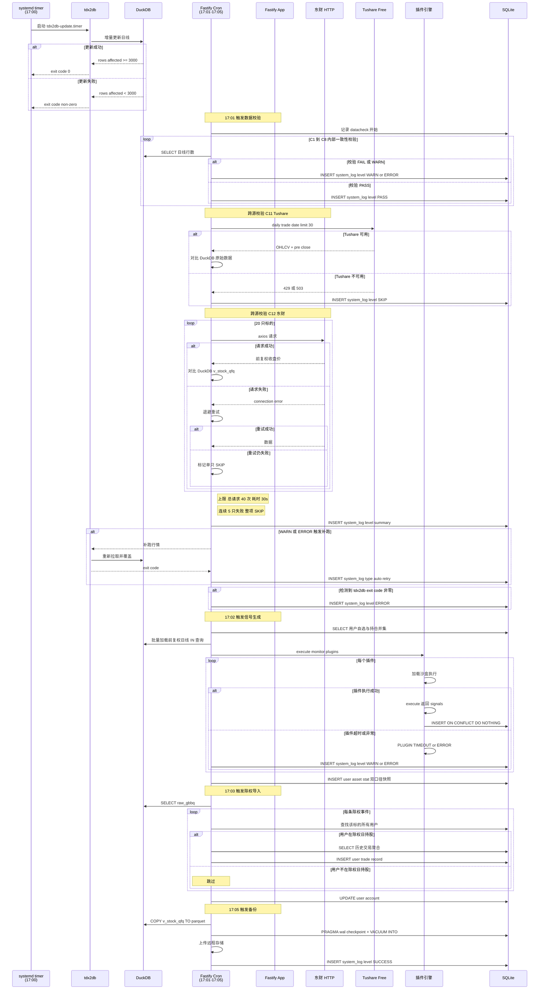

#### 5.1.1 调度协调机制（systemd timer + Fastify @fastify/schedule 混合调度）

**核心问题**：tdx2db（Go 二进制，systemd timer 17:00 触发）和 Fastify 内部 4 段 cron（17:01-17:05）是两套独立调度器，需要协调以下 4 种场景：

| # | 场景 | 表现 | 协调策略 |
|---|------|------|---------|
| 1 | ✅ tdx2db 成功 + 有新数据 | DuckDB 最新日期 == 今天 | 正常流程，Fastify cron 直接进入 C1 校验 |
| 2 | ❌ tdx2db 失败 | tdx2db exit_code ≠ 0 | Fastify 触发补跑（`systemd-run --wait` 同步等），补跑还失败则 ERROR 并 SKIP 后续 |
| 3 | ⚠️ tdx2db 成功但无新数据 | tdx2db exit_code=0，但 DuckDB 最新日期 < 今天 | 交易日历判断：如果今天是交易日 → 视为异常（数据源延迟），触发补跑；如果不是交易日 → 正常 SKIP 所有后续段 |
| 4 | 🔄 tdx2db 正在写入时 Fastify 启动 | DuckDB 文件被独占写入 | Fastify 只读连接 open 时 DuckDB MVCC 自动处理 reader/writer 共存，但若 writer 持有大事务导致 WAL 膨胀，reader 可能等待；设 **5 秒连接超时 + retry 2 次** |

**协调机制细节**：

```
17:01 Fastify cron 触发
    │
    ├─ Step 1: 等待 tdx2db 完成（最多等到 17:05，即 4 分钟窗口）
    │   ├─ 查询 systemd tdx2db.service 最近一次运行状态
    │   ├─ 如果 tdx2db 尚未运行或正在运行 → 每 5 秒轮询一次
    │   ├─ 如果 tdx2db 已完成（exit_code=0）→ 进入 Step 2
    │   ├─ 如果 tdx2db 已完成但失败（exit_code≠0）→ 进入 Step 3 补跑
    │   └─ 超时（17:05 到了 tdx2db 还没好）→ 进入 Step 3 补跑（用当前快照继续，不阻塞）
    │   ├─ Step 2: 判断数据有效性
    │   ├─ 查 DuckDB v_stock_qfq 最新 `date` 列
    │   ├─ 如果 == 今天 → 进入 C1-C12 校验（§5.7）
    │   ├─ 如果 < 今天
    │   │   ├─ 查交易日历（DuckDB `raw_holidays`：`SELECT date FROM raw_holidays WHERE date = 今天`，有行=交易日）
    │   │   ├─ 今天不是交易日 → 所有后续段 SKIP（写 system_log level=SKIP，reason="non-trading day"）
    │   │   └─ 今天是交易日 → 数据源延迟，进入 Step 3 补跑
    │
    ├─ Step 3: 补跑 tdx2db
    │   ├─ Fastify 调用 systemd-run --wait tdx2db cron --dburi 'duckdb:///opt/invol/quotes.duckdb'
    │   ├─ 同步等待（timeout 5 分钟），拿到 exit_code
    │   ├─ exit_code=0 + DuckDB 有新数据 → 继续 C1-C12
    │   ├─ exit_code=0 但 DuckDB 仍无新数据 → 视为数据源整体不可用，ERROR + SKIP
    │   └─ exit_code≠0 或 timeout → ERROR + SKIP，不阻塞第二天
    │
    └─ Step 4: 串行执行剩余 3 段（信号 / 除权 / 备份）
        ├─ 如果 Step 2/3 判定继续 → 17:02 信号、17:03 除权、17:05 备份
        └─ 如果 Step 2/3 判定 SKIP → 跳过所有，写 system_log 记录原因
```

**Fastify 触发 tdx2db 补跑的 systemd 命令**：

```bash
# 方式 A：systemd-run --wait（推荐，Fastify 同步拿 exit_code）
systemd-run --wait --user \
  tdx2db cron --dburi 'duckdb:///opt/invol/quotes.duckdb'

# 方式 B：systemctl start（异步，Fastify 需后续轮询状态）
systemctl start tdx2db.service
# 然后查询状态
systemctl status tdx2db.service --no-pager --lines=0
# → Active: inactive (dead) + Main PID: xxxx (code=exited, status=0/SUCCESS)
```

**交易日判断兜底**：如果 DuckDB 里没有交易日历表，用 A 股规则硬编码（周末 + 法定节假日跳过）。

[**实现位置**：管理员端点暴露在 `apps/backend/src/routes/admin.ts`，**端点名为 `POST /api/admin/datacheck/trigger`（§4.4 唯一权威命名）**，同时被 Fastify cron 复用；两者触发的是同一个编排逻辑，单独执行某段与批量执行的耗时口径相同。落地任务 **T90**（当前代码为 `/api/admin/run-datacheck`，待改名）。]

### 5.2 交易录入流程（含服务端校验）

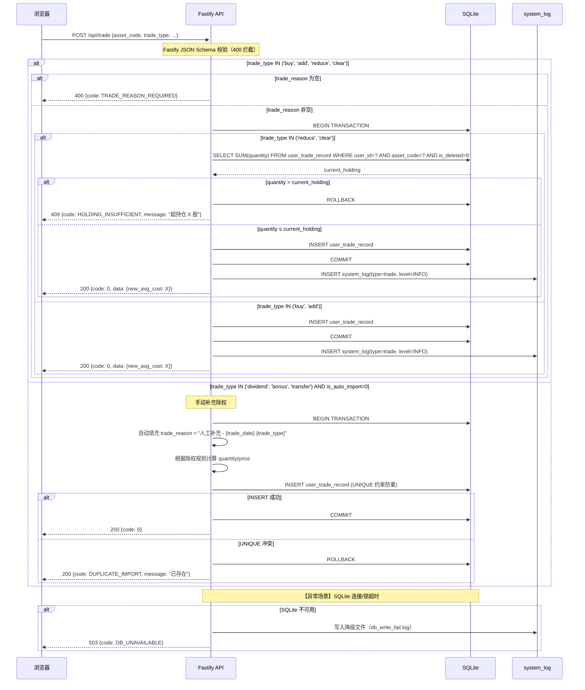

### 5.3 插件引擎 TypeScript 接口契约

> **本节为插件引擎的核心设计契约，所有内置插件与自定义插件必须严格遵循。**
> 接口定义原样迁入自原始需求 §3.3.1，开发时作为 `@invest/core` 包的公开类型导出。

#### 核心接口定义

```typescript
/** 插件唯一标识，全系统唯一，不可变（例如 'rsi'、'macd_cross'）*/
export type PluginId = string;

/** 周期类型，MVP 固定为日线 */
export type Period = "daily";

/** 插件分类：monitor=监控类（每日收盘跑信号）/ filter=筛选类（全市场条件选股） */
export type PluginCategory = "monitor" | "filter";

/** 插件归属子分类（UI 分组用，50+ 插件后必须有） */
export type PluginSubCategory =
  | "momentum"    // 动量类：RSI、KDJ
  | "trend"       // 趋势类：MACD、均线
  | "volume"      // 量能类：OBV、量比
  | "breakout"    // 突破类
  | "mean_reversion" // 均值回归类
  | "pattern"     // 形态类
  | "custom";     // 自定义

/** 执行复杂度标记（日志统计用，非硬约束） */
export type PluginComplexity = "simple" | "medium" | "complex";

/** 参数字段定义（Web 页面动态渲染配置表单用） */
export interface ParamField {
  key: string;              // 参数键名
  label: string;             // 表单显示标签
  type: "number" | "string" | "select" | "boolean";
  default: any;             // 默认值
  min?: number;             // number 类型最小值
  max?: number;             // number 类型最大值
  options?: {               // select 类型选项
    label: string;
    value: any;
  }[];
  description?: string;     // 帮助提示文字
}

/** 图表渲染元数据（前端 KLineChart 副图/叠加层渲染用） */
export interface ChartOverlayConfig {
  /** 渲染位置：主图叠加 / 副图 */
  position: "main" | "sub";
  /** 副图高度占比（position=sub 时生效） */
  subChartHeightRatio?: number;
  /** 叠加线条配置 */
  lines?: {
    key: string;             // 数据系列键
    color: string;           // 线条颜色
    width?: number;          // 线条宽度
    style?: "solid" | "dashed";
  }[];
  /** 阈值线（例如 RSI 超买超卖线） */
  thresholdLines?: {
    value: number;
    color: string;
    label?: string;
  }[];
  /** 填充区域（例如 MACD 柱状图正值红色/负值绿色） */
  fillAreas?: {
    above?: string;          // 正值颜色
    below?: string;          // 负值颜色
  };
}

/** 前复权日线序列（插件 execute() 的输入） */
export interface DailyBar {
  /** 交易日 yyyy-MM-DD */
  trade_date: string;
  /** 前复权开盘价（直接来自 DuckDB v_stock_qfq） */
  open: number;
  /** 前复权最高价 */
  high: number;
  /** 前复权最低价 */
  low: number;
  /** 前复权收盘价 */
  close: number;
  /** 成交量 */
  volume: number;
  /** 成交额 */
  amount: number;
}

/** 策略信号对象（插件 execute() 的输出） */
export interface StrategySignal {
  /** 信号方向 */
  direction: "buy" | "sell" | "hold";
  /** 描述性文字，例如 "RSI(14) < 30 超卖" */
  label: string;
  /** 信号强度，可选 0-1 归一化 */
  strength?: number;
  /** 指标明细，可选，例如 {rsi: 28.5, period: 14} */
  metrics?: Record<string, number>;
}

/** 策略插件接口 */
export interface StrategyPlugin {
  /** 插件唯一标识，全系统唯一，不可变 */
  readonly id: PluginId;
  /** 插件展示名称，例如 "RSI(14) 超买超卖" */
  readonly name: string;
  /** 语义化版本号，例如 "1.0.0" */
  readonly version: string;
  /** 作者/来源 */
  readonly author: string;
  /** 周期，MVP 固定 "daily" */
  readonly period: Period;
  /** 插件分类：monitor（每日收盘跑信号）/ filter（条件选股） */
  readonly category: PluginCategory;
  /** 归属子分类（UI 分组用） */
  readonly sub_category: PluginSubCategory;
  /** 执行复杂度标记（日志统计用，非硬约束） */
  readonly complexity: PluginComplexity;
  /** 参数配置 Schema（Web 页面动态渲染配置表单） */
  readonly paramSchema: ParamField[];
  /** 默认参数值（与 paramSchema.key 对应） */
  readonly defaultParams: Record<string, any>;
  /** 图表渲染元数据（K 线图副图/叠加层渲染用，可选） */
  readonly chartOverlay?: ChartOverlayConfig;
  /**
   * 核心计算方法
   * @param dailyData 日线序列（前复权价，直接来自 DuckDB v_stock_qfq）
   * @param params 用户配置的参数（已做类型 + 范围校验）
   * @returns 信号对象；返回 null 表示"无信号"
   */
  execute(
    dailyData: DailyBar[],
    params: Record<string, any>
  ): StrategySignal | null;
}
```

#### 插件目录与加载规则

| 规则 | 说明 |
|------|------|
| 内置插件库 | 打包在 `@invest/core` 包内；MVP 仅 `rsi` + `macd_cross`（默认启用） |
| 用户自定义插件 | 放置在 `/opt/invol/plugins/strategies/`，**仅支持 .js**（require() 加载） |
| 加载时机 | Fastify 启动时扫描加载；【设置 → 策略插件管理】可手动热重载 |
| 唯一键 | 以 `plugin.id` 为唯一键；内置与自定义插件 id 不可冲突 |
| 故障隔离 | execute() 抛异常 → catch 后标记本轮跳过、记录 ERROR 日志、不影响其他插件和主流程 |
| 超时保护 | execute() **硬限制 50ms**（Promise.race + reject）；超时标记 PLUGIN_TIMEOUT，跳过本轮。**⚠️ 口径见下方「50ms 计时边界」** |
| 批量调度 | 同一标的的日线数据**一次查询、多插件共享**（避免 N 次 DuckDB 查询） |

##### 50ms 计时边界（✅ 已裁决 2026-10-17，DEC-12 B-3）

**50ms 只覆盖插件自身 `execute()` 的纯计算，不覆盖行情 IO。**

| 计入 50ms | 不计入 50ms |
|---|---|
| `execute()` 内的指标计算与判断 | DuckDB 日线查询（`getDailyKlines` 等） |
| | 批量取行情、构造 context |
| | 信号序列化、落库 |

**实现要求**：
1. **先批量取好行情 → 构造 context → 再开始计时 → 调 `execute()`**。禁止把行情查询放进 `Promise.race` 的计时窗口内。
2. 本节 `execute(dailyData, params)` 的签名本身已隐含该前提（数据是传入的，不是在 `execute` 内查的）。
3. **沙盒安全约束不受影响**：插件内部死循环 / 阻塞仍必须被 `Promise.race` reject 并标记 `PLUGIN_TIMEOUT`（见 §12.3 P3）。**不得以「IO 不计时」为借口放宽超时保护。**

> **实测依据（2026-10-17）**：现状 `POST /api/admin/datacheck/trigger` 的信号段返回 `{total:2, success:0, timeout:2}` —— 两个内置插件 **100% 超时**，`user_strategy_signal` **0 条**，导致 §12.5 F8「每日自动跑策略信号」与 PE6 双双不可达。**根因是行情查询被计入计时窗口**，故 RSI/MACD 实测 0.1~1ms 的计算也照样超时。落地任务 **T88**。

#### MVP 内置插件清单

| plugin.id | name | category | sub_category | 默认参数 | 信号触发逻辑 |
|-----------|------|----------|-------------|---------|------------|
| `rsi` | RSI(14) 超买超卖 | monitor + filter | momentum | period=14, oversold=30, overbought=70 | RSI < oversold → buy；RSI > overbought → sell |
| `macd_cross` | MACD 金叉死叉 | monitor | trend | fast=12, slow=26, signal=9 | DIF 上穿 DEA → buy；下穿 → sell |

### 5.4 策略插件引擎执行流程（含故障隔离）

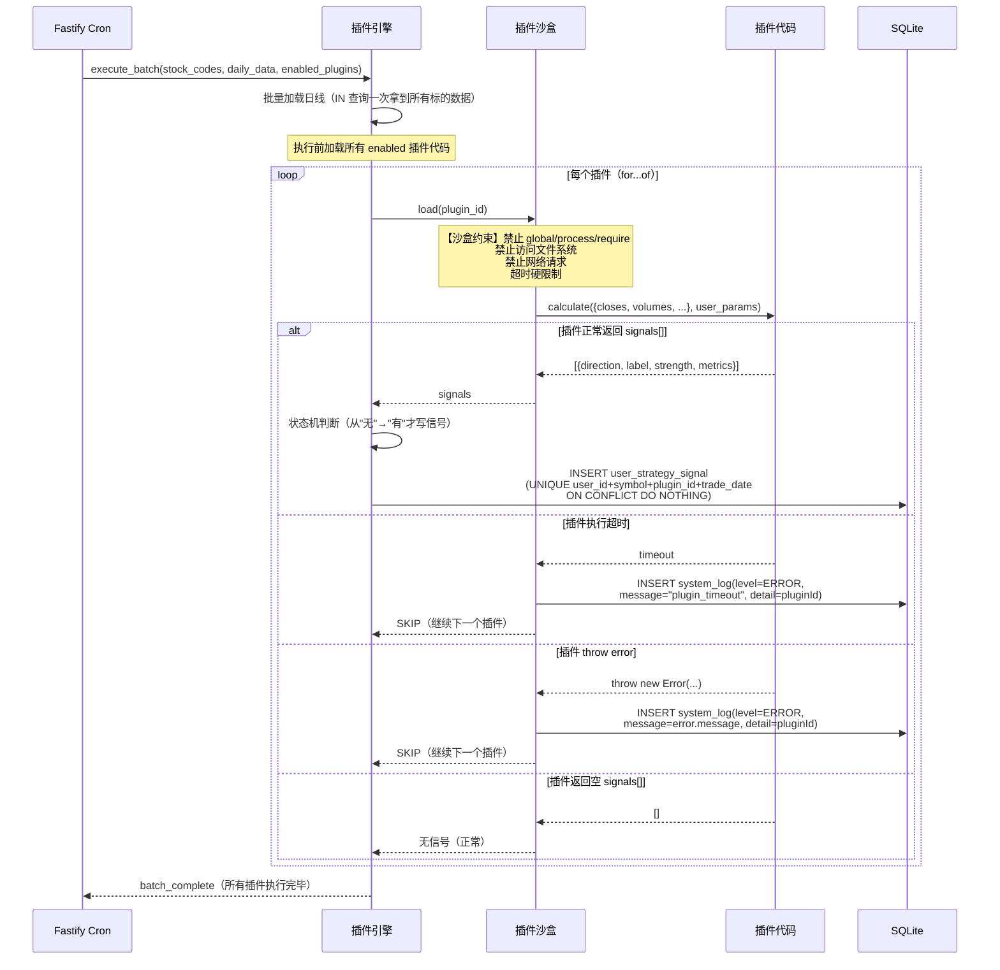

### 5.5 全市场条件选股流程

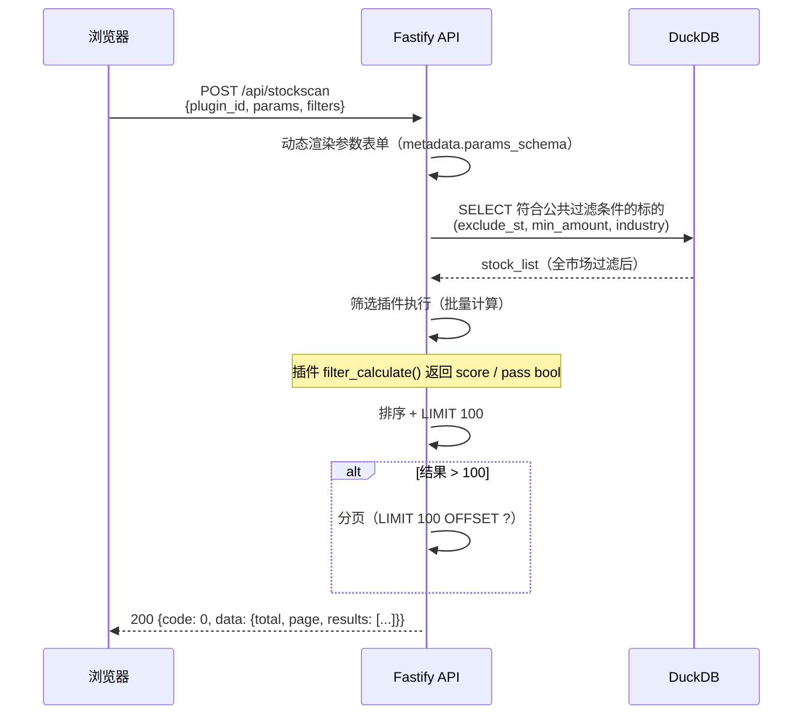

### 5.6 跨源校验 C12（含节流与降级）

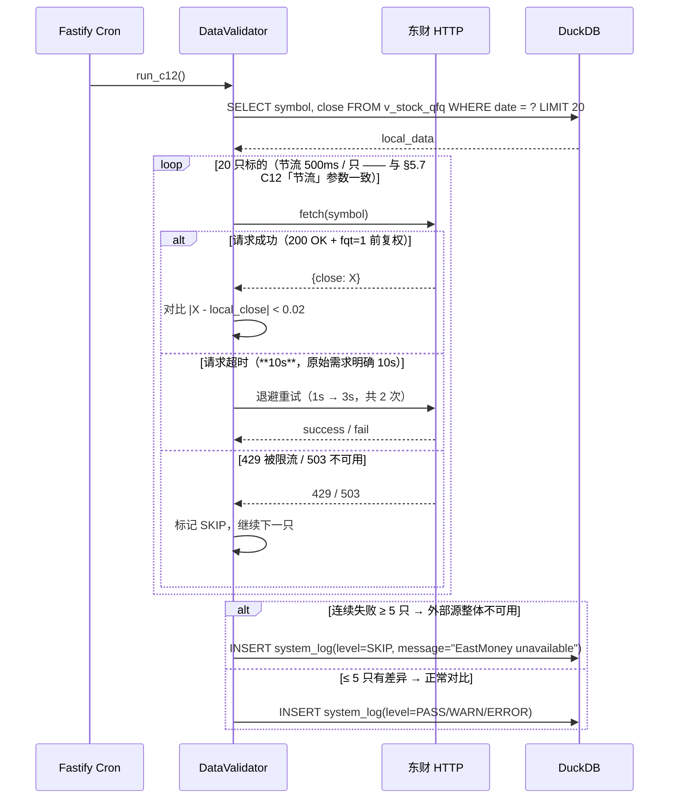

### 5.7 C1-C12 数据校验引擎 SQL 模板

> **✅ 已修订（2026-10-17，DEC-13 / B-14 裁决=A）—— 本节的 C 编号与定义现以
> `Requirements_simplified.md` §7 为唯一权威。**
>
> **修订原因**：初稿本节的 C3-C8 定义为「数据内容校验」（停牌/退市/ST/价差/成交量/滞后），
> 与 Requirements §7.1 的「数据新鲜度」校验**完全不同**，而 PRD §6.4 亦写明
> 「行情更新执行时长 ≤ 120s \| 内部校验 C8 监控」—— 即 **PRD + Requirements 两层**
> 都站在新鲜度口径上。初稿的 6 条内容校验未被删除，已移至本节末「📎 扩展校验」，
> **不占用 C 编号、不计入 12 项主表**。
>
> **各层职责（层界规则）**：Requirements §7 规定**「要检什么」**（业务要求），
> 本节规定**「怎么检」**（SQL 实现）。二者不重复定义。
>
> **落地任务见实施计划 T85** —— ⚠️ 代码当前实现的是「扩展校验」那套，与主表口径不一致。

> 本节提供 C1-C12 每条校验的**可直接执行的 DuckDB SQL 模板**，开发时原样使用。所有校验 SQL 封装在 `/opt/invol/backend/src/services/validator.ts` 中，由 §5.1 每日 5 段自动化流程的第 2 段（17:01）统一调度执行。

**SQL 模板约定**：
- 🔗 所有 DuckDB 表名/列名已锁定，以 [tdx2db_schema.md](../tdx2db_schema.md) 实测版本为准，**不再有 `【待确认 D2】` 占位**
- `{{TRADE_DATE}}` 由调度器注入当天交易日，格式 `YYYY-MM-DD`
- 容差常量集中定义在 `validator.ts` 文件头部，可统一调整

#### 校验结果格式

每条校验返回三值结果：`PASS` / `WARN` / `ERROR`，并写入 SQLite `system_log` 表：

| 等级 | 含义 | 自动处理 |
|------|------|---------|
| PASS | 校验通过 | 无 |
| WARN | 轻微异常（C1-C10 内部一致性） | 自动触发 tdx2db 二次更新（§5.1 alt 分支） |
| WARN | 外部源不可用（C11/C12） | 标记 SKIP，不阻塞主流程 |
| ERROR | 严重异常（行数偏离 > 10%、除权日数据缺失） | 记录日志 + 触发管理员告警 |

#### C1：当日日线行数是否正常

> **✅ 已对齐 Requirements §7.1 C1**：判定式为「当日标的数 ≥ 3000（正常 5000+）」，失败级别 **ERROR**。
> 初稿本节曾用「偏离全市场平均行数 ±10% 为 WARN」，已按 Requirements 修正。

```sql
-- C1 当日日线行数正常（Requirements §7.1 C1）
-- 判定式：当日标的数 ≥ 3000 → PASS；>0 但 <3000 → WARN；=0 → ERROR
-- 容差常量 3000 与 Requirements §7.1 C1 一致，调整需同步改 Requirements
-- tdx2db 实际 schema：v_stock_qfq, 日期列名一律 date（非 trade_date）

WITH today_counts AS (
    SELECT COUNT(*) AS cnt
    FROM v_stock_qfq
    WHERE date = '{{TRADE_DATE}}'
)
SELECT
    tc.cnt AS actual_count,
    CASE
        WHEN tc.cnt >= 3000 THEN 'PASS'
        WHEN tc.cnt > 0      THEN 'WARN'   -- 有数据但明显偏少
        ELSE 'ERROR'                        -- 当日完全无数据
    END AS result
FROM today_counts tc;
```

**失败处理**：`ERROR` → 自动触发行情更新补跑（Requirements §7.1）。

#### C2：交易日历匹配

```sql
-- C2 交易日历匹配
-- raw_holidays 只有一个 date 列，表示交易日（有 = 交易日，无 = 非交易日）
-- 只有交易日应该有日线数据

SELECT
    CASE
        WHEN EXISTS (SELECT 1 FROM raw_holidays WHERE date = '{{TRADE_DATE}}')
          AND EXISTS (SELECT 1 FROM v_stock_qfq WHERE date = '{{TRADE_DATE}}')
            THEN 'PASS'  -- 交易日有数据
        WHEN NOT EXISTS (SELECT 1 FROM raw_holidays WHERE date = '{{TRADE_DATE}}')
          AND NOT EXISTS (SELECT 1 FROM v_stock_qfq WHERE date = '{{TRADE_DATE}}')
            THEN 'PASS'  -- 非交易日无数据
        WHEN EXISTS (SELECT 1 FROM raw_holidays WHERE date = '{{TRADE_DATE}}')
          AND NOT EXISTS (SELECT 1 FROM v_stock_qfq WHERE date = '{{TRADE_DATE}}')
            THEN 'ERROR'  -- 交易日但没数据
        ELSE 'WARN'       -- 非交易日但有数据（可能是 tdx2db 误导入）
    END AS result;
```

#### C3：复权因子数据新鲜度

> 口径来源：`Requirements_simplified.md` §7.1 C3 —— **数据新鲜度类校验**（问的是「更新成功了吗」，不是「数值对不对」）。

```sql
-- C3 复权因子更新时间：最新日期必须 = 当日
-- 数据源待实现时探测：tdx2db schema 中复权因子表的 date 列（初稿曾假设 raw_hfq_factor，
-- ⚠️ 该表名未经代码验证，实现第一步必须 DESCRIBE 确认）
-- 四态：PASS / WARN / ERROR / SKIP；数据源缺失返回 SKIP，不得计为 PASS

SELECT MAX(date) AS latest_factor_date,
    CASE
        WHEN MAX(date) = '{{TRADE_DATE}}' THEN 'PASS'
        ELSE 'WARN'   -- 因子滞后 → 自动触发行情更新补跑
    END AS result
FROM <复权因子表>;
```

**失败处理**：`WARN` → 自动触发行情更新补跑。

---

#### C4：除权除息数据新鲜度

```sql
-- C4 除权除息更新时间：最新除权日必须 ≥ 当日 - 7 天
-- 数据源：raw_gbbq（已在 SDD §3.3 放行）
-- ⚠️ 2026-10-17 T85 实测校正：初稿写的是 `raw_gbbq.ex_date`，**该列不存在**。
--    DESCRIBE 实测 raw_gbbq = (category, symbol, date, c1, c2, c3, c4)，
--    除权事件日期列是 **`date`**。
-- 实测基准（2026-10-12 库）：MAX(date) = 2026-10-19，近 7 日 186 条事件
-- ⚠️ 除权事件稀疏，「最新除权日 ≥ 当日-7天」在长假/淡季可能误报 ——
--    故判定改为：窗口内**确有除权事件**即视为数据已更新到最新（见实现注释）

SELECT MAX(date) AS latest_ex_date,
    CASE
        WHEN MAX(date) >= CAST(? AS DATE) - INTERVAL 7 DAY THEN 'PASS'
        WHEN MAX(date) IS NULL THEN 'SKIP'
        ELSE 'WARN'
    END AS result
FROM raw_gbbq;
```

**失败处理**：`WARN` → 自动触发行情更新补跑；`SKIP`（无任何除权数据）→ 不阻塞。

---

#### C5：板块 / 概念数据完整性

> ⚠️ **2026-10-17 T85 实测结论：MCP 库中无板块成分数据，本项恒为 SKIP。**
> `DESCRIBE raw_tdx_blocks_member` → `(stock_symbol, block_code)` —— **无 `date` 列**，
> 因此「按日统计总量算降幅」在当前 schema 下**不可实现**；实测 `COUNT(*) = 0`（空表）。
>
> **替代口径（已实现）**：用 `raw_symbol_class.class` 做**分类完整性**校验 ——
> 该表实测 `(symbol, class)`，分组计数相对前一交易日的降幅 < 10% 即视为完整。
> 实测基准：`stock = 6158`（全库仅此一类，分类数恒为 1）。
>
> 若将来 tdx2db 补上板块成分的日期维度，切换回按日降幅口径。

```sql
-- C5 分类完整性（替代口径）：当日出现过的 class 集合，
-- 与前一交易日相比，类别数降幅 < 10%
WITH today_cnt AS (
    SELECT COUNT(DISTINCT class) AS cnt
    FROM raw_symbol_class c
    WHERE EXISTS (SELECT 1 FROM v_stock_qfq v WHERE v.date = CAST(? AS DATE))
),
prev_day AS (
    SELECT MAX(date) AS d FROM v_stock_qfq WHERE date < CAST(? AS DATE)
),
prev_cnt AS (
    SELECT COUNT(DISTINCT class) AS cnt
    FROM raw_symbol_class
    WHERE EXISTS (SELECT 1 FROM v_stock_qfq v WHERE v.date = (SELECT d FROM prev_day))
)
SELECT t.cnt AS today_cnt, p.cnt AS prev_cnt,
    CASE
        WHEN t.cnt = 0 THEN 'SKIP'
        WHEN p.cnt = 0 THEN 'SKIP'
        WHEN (p.cnt - t.cnt) * 1.0 / p.cnt < 0.10 THEN 'PASS'
        ELSE 'WARN'
    END AS result
FROM today_cnt t CROSS JOIN prev_cnt p;
```

**失败处理**：`WARN` → 记录，人工确认（**不自动补跑** —— 分类/板块数据缺失不靠重跑解决）。
`SKIP` → 前一交易日无数据（新库首日），不阻塞。

---

#### C6：市值数据存在性

```sql
-- C6 市值数据存在：当日有市值字段的标的数 ≥ 3000
-- 数据源：raw_basic_daily（已在 SDD §3.3 放行），市值列名待实现时探测

SELECT COUNT(*) AS cnt,
    CASE
        WHEN COUNT(*) >= 3000 THEN 'PASS'
        ELSE 'WARN'
    END AS result
FROM <市值表>
WHERE date = '{{TRADE_DATE}}' AND <市值列> IS NOT NULL;
```

**失败处理**：`WARN` → 自动触发行情更新补跑。

---

#### C7：日线价格合理性

```sql
-- C7 日线价格合理性：收盘价 ≠ 0 且 开盘价 ≤ 收盘价 × 2
-- 数据源：raw_kline_daily（不复权原始价）

SELECT symbol, open, close,
    CASE
        WHEN close = 0 THEN 'WARN'
        WHEN open > close * 2 THEN 'WARN'
        ELSE 'PASS'
    END AS result
FROM raw_kline_daily
WHERE date = '{{TRADE_DATE}}';
```

**失败处理**：`WARN` → 记录异常标的（**不自动补跑**）。

---

#### C8：行情更新执行时长

```sql
-- C8 行情更新执行时长 ≤ 120s
-- ⚠️ 本项不查 DuckDB，而是读本次行情更新的耗时记录（system_log 的行情更新条目时间戳差）
-- ⚠️ PRD §6.4 与 Requirements §7.1 C8 均明确定义本项为「时长检查」——
--    这是本轮修订中编号含义变化最大的一条（初稿 SDD 曾定义为「复权信息滞后」）

-- 判定式（伪 SQL，实际由 validator 读 system_log 起止时间戳计算）：
--   duration_seconds = 行情更新结束时间 - 开始时间
--   CASE WHEN duration_seconds <= 120 THEN 'PASS' ELSE 'WARN' END
```

**失败处理**：`WARN` → 记录（PRD §6.4 注明「过长会影响后续步骤启动」）。

---

#### 📎 扩展校验（**不计入 12 项主表**）

> **本小节是 2026-07 前的历史设计**（见 `docs/adr/` 与 Git 历史）。这些检查**确有价值**，
> 但与 `Requirements_simplified.md` §7.1 的 C3-C8 定义**冲突**，且 PRD D1 明确要求
> 「**12 项**校验」这一固定数量。**已裁决（2026-10-17）：它们不占用 C 编号、不计入 12 项主表。**
>
> **当前状态**：代码 `validator.ts` 实际实现的是**本小节这套**（C3 停牌 / C4 退市 / C5 ST /
> C6 价差 / C7 成交量 / C8 滞后），与上面的主表口径**不一致**。落地任务见实施计划 T85。

| 原编号 | 原定义 | 与主表的关系 | 处置建议 |
|---|---|---|---|
| C3 | 停牌日标记一致性 | 停牌推理（Requirements §5.6）仍需要，但归 F10 详情而非主表 | 保留，移出主表 |
| C4 | 退市标记一致性 | **主表 C4 已改为「除权除息新鲜度」** | 保留，移出主表 |
| C5 | ST 状态一致性 | **主表 C5 已改为「板块数据完整」** | 保留，移出主表 |
| C6 | 前复权 vs 原始收盘价差值 < 0.01 | 与 C9「复权因子数学一致性」重叠 | 建议合并进 C9 |
| C7 | 成交量/成交额异常值 | 独立价值 | 保留，移出主表 |
| C8 | 复权信息/股本变迁数据滞后 | **主表 C8 已改为「执行时长」** | 保留，移出主表 |

> ⚠️ **这六项的实现 SQL 见 Git 历史**（本轮修订前的 §5.7）。若确定保留，需由后续任务
> 从 Git 恢复并重新核对表名 —— **不得直接沿用**，因为其中的表名假设（如 `raw_hfq_factor`）
> 从未经代码验证。
#### C9：复权因子抽样数学一致性

```sql
-- C9 复权因子抽样 100 只
-- 验证 raw_adjust_factor.hfq_factor 与 v_stock_qfq 的 qfq_factor 计算一致
-- v_stock_qfq.qfq_factor = hfq_factor / latest_hfq
-- 容差 < 0.0001（因子是小数，精度更高）

WITH latest_factors AS (
    SELECT symbol, argmax(hfq_factor, date) AS latest_hfq
    FROM raw_adjust_factor
    GROUP BY symbol
),
sample AS (
    SELECT UNNEST(ARRAY_AGG(symbol ORDER BY random() LIMIT 100)) AS symbol
    FROM v_stock_qfq
    WHERE date = '{{TRADE_DATE}}'
)
SELECT COUNT(*) AS mismatch_count,
    CASE
        WHEN COUNT(*) = 0 THEN 'PASS'
        WHEN COUNT(*) <= 5 THEN 'WARN'
        ELSE 'ERROR'
    END AS result
FROM sample s
JOIN raw_adjust_factor rf ON s.symbol = rf.symbol AND rf.date = '{{TRADE_DATE}}'
JOIN latest_factors lf ON s.symbol = lf.symbol
JOIN v_stock_qfq v ON s.symbol = v.symbol AND v.date = '{{TRADE_DATE}}'
WHERE ABS(rf.hfq_factor / lf.latest_hfq - v.qfq_factor) >= 0.0001;
```

#### C10：除权除息事件覆盖完整性

```sql
-- C10 除权事件交叉验证
-- raw_gbbq 中 category=1（除权除息事件）的标的，在 v_stock_qfq 中当天必须有数据
SELECT COUNT(g.symbol) AS missing_count,
    CASE
        WHEN COUNT(g.symbol) = 0 THEN 'PASS'
        ELSE 'WARN'
    END AS result
FROM raw_gbbq g
LEFT JOIN v_stock_qfq v ON g.symbol = v.symbol AND v.date = g.date
WHERE g.date = '{{TRADE_DATE}}' AND g.category = 1 AND v.symbol IS NULL;
```

#### C11：Tushare 免费 API 跨源校验（每日 1 次）

```sql
-- C11 Tushare 跨源校验
-- raw_kline_daily 没有 preclose，要 JOIN raw_basic_daily 拿 preclose
-- 列名：raw_kline_daily.date（非 trade_date）, raw_basic_daily.preclose（无下划线）
-- 逻辑在 TypeScript 中实现，SQL 仅负责查询本地数据

SELECT
    rk.symbol, rk.open, rk.high, rk.low, rk.close,
    rb.preclose AS pre_close,
    rk.volume, rk.amount
FROM raw_kline_daily rk
LEFT JOIN raw_basic_daily rb ON rk.symbol = rb.symbol AND rk.date = rb.date
WHERE rk.date = '{{TRADE_DATE}}';
```

**比对口径**（TypeScript validator.ts 实现）：

| 项 | 说明 |
|---|---|
| **对比字段** | `open` / `high` / `low` / `close` / `preclose` / `volume` / `amount`（共 7 个，preclose 从 raw_basic_daily JOIN） |
| **对比对象** | DuckDB `raw_kline_daily`（不复权）+ JOIN `raw_basic_daily.preclose` vs Tushare `daily` 接口 |
| **preclose 特殊性** | 除权除息日也比——preclose 本身已含除权修正，两源理论上精确一致 |
| **抽样策略** | 随机 30 只（Tushare Free 每日限额）；优先覆盖用户自选和持仓 |
| **容差** | 价格字段 < 0.01 元；volume/amount 精确一致 |
| **SKIP 条件** | Tushare 429/503/token 无效 → 整项 SKIP |
| **阈值** | 30 只 · PASS | **PRD §6.2 权威**：容差内差异 **≤3/30 → WARN，>3 → ERROR**（✅ 已裁决 2026-10-17 I-8「以 PRD 为准」，初稿的「≤2→WARN / ≥3→ERROR」作废）|

#### C12：东财跨源校验（20 只抽样，节流）

```sql
-- C12 东财跨源校验
-- 本地查询前复权收盘价用于对比
SELECT symbol, close AS local_qfq_close
FROM v_stock_qfq
WHERE date = '{{TRADE_DATE}}';
-- 外部 HTTP 请求由 Node.js axios 实现，容差 < 0.02 元
```

**比对口径**（TypeScript validator.ts 实现）：

| 项 | 说明 |
|---|---|
| **对比字段** | 东财返回的**前复权收盘价** vs DuckDB `v_stock_qfq.close`（前复权） |
| **抽样策略** | 固定 20 只标的（节流 + 单只超时 10s）；优先覆盖用户自选和持仓标的 |
| **节流** | 每只间隔 500ms 请求，避免东财限流；外部源连续 ≥ 5 只失败 → 整项 SKIP |
| **容差** | `< 0.02 元`（东财 HTTP 解析可能有微小精度差异） |
| **重试** | 单只请求失败退避重试 2 次（200ms → 400ms），重试后仍失败则标记该只 SKIP 继续下一只 |
| **阈值** | 20 只 · PASS | **PRD §6.2 权威**：差异 **≤5/20 → WARN，>5 → ERROR**（✅ 已裁决 2026-10-17 I-8「以 PRD 为准」，初稿的「≤3→WARN / ≥4→ERROR」作废）；外部源整体不可用 → SKIP |

---

## 6. 非功能性设计

### 6.1 安全设计

| # | 设计项 | 实现方式 | 风险缓解 |
|---|--------|---------|---------|
| S1 | HTTPS 强制 | Caddy `https_port 443` + HTTP 自动 301 | 证书自动续期（Let's Encrypt + ACME），续期失败时 Caddy 自动告警 |
| S2 | 端口最小化 | Caddy 仅暴露 443；Fastify 监听 `127.0.0.1:8080`（仅本地可访问） | 外部扫描只看到 443 |
| S3 | 密码存储 | `bcrypt`（cost=12），加盐 16 字节，单哈希 ≈ 250ms | 彩虹表不可行；暴力破解每哈希耗时过长 |
| S4 | Token 机制 | JWT（HS256），payload={userId, role, exp}，access 7d + refresh 30d | Refresh 支持自动续期（刷新时 exp 重新计算）；签名密钥环境变量注入 |
| S5 | 数据库文件权限 | `chown -R nobody:nogroup /opt/invest && chmod 600 *.db`；DuckDB 同理 | 进程用 `nobody` 运行，root 才能改权限 |
| S6 | 日志脱敏 | system_log 中金额末 4 位替换为 `****`；用户标识末 4 位替换 | 防止日志泄露敏感数据 |
| S7 | 插件沙盒（MVP） | **硬约束清单**：禁止访问 global/process/require；禁止文件/网络；执行超时硬限制 | MVP 靠约定 + 超时保护；V2 升级到 VM2 硬隔离 |
| S8 | CSRF 防护 | SameSite=Strict Cookie + CSRF Token（双提交 Cookie 模式） | MVP 用 Token 机制已足够；Cookie 方案作为补充 |
| S9 | 角色检查 | admin API 路由前做 `req.auth.role === 'admin'` 二次校验 | 与业务逻辑解耦，单独中间件 |
| S10 | **writeSystemLog() 统一三层保护** | 见 §6.1.1 详细设计 | 业务代码不直接写文件，通过统一入口实现降级兜底 |

#### §6.1.1 writeSystemLog() 三层保护详细设计

**函数签名**：

```typescript
// /opt/invol/backend/src/utils/logger.ts
export async function writeSystemLog(
  level: "INFO" | "WARN" | "ERROR",
  log_type: "IMPORT" | "TRADE" | "PLUGIN" | "AUTO" | "ALERT",
  message: string,
  detail?: Record<string, any>
): Promise<{ status: "sqlite" | "file" | "fallback" | "failed"; target?: string }>
```

**三层降级逻辑（原始需求 §7 Phase 2 明确设计）**：

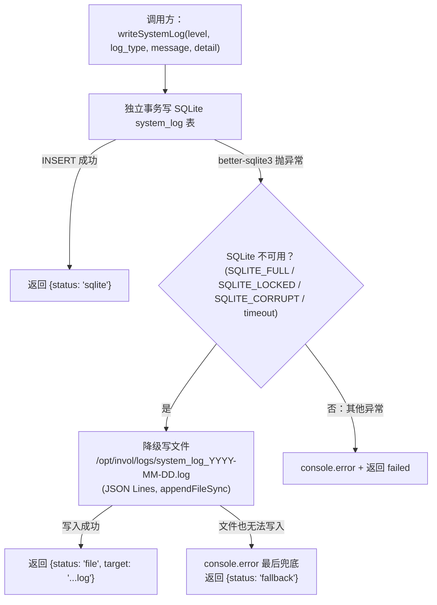

**关键规则**：

| 规则 | 说明 |
|------|------|
| 互斥写入 | SQLite 正常时**只写 SQLite**，不同时写文件；只有 SQLite 写失败才降级写文件。避免两边都写导致日志重复 |
| 降级文件路径 | `/opt/invol/logs/system_log_YYYY-MM-DD.log`，每日滚动 |
| 文件格式 | JSON Lines（每行一个完整 JSON 对象），用 Node.js `fs.appendFileSync`（同步，保证不丢失） |
| 独立事务 | SQLite 写入必须 `BEGIN IMMEDIATE`（避免 WAL 模式下读写竞争），立即 commit，事务不与业务逻辑共享 |
| SQLite 不可用判定 | better-sqlite3 抛出以下错误码之一：`SQLITE_FULL`（磁盘满）、`SQLITE_LOCKED`（锁超时）、`SQLITE_CORRUPT`（数据库损坏）、busy_timeout 耗尽 |
| 日志字段（SQLite system_log 表） | id, log_type, level, user_id, message, detail(JSON), created_at |
| 日志字段（文件 JSON） | 与 SQLite 完全对齐，多一个字段 `fallback: "sqlite_unavailable"` 标记来源 |

**降级文件写入示例**：

```json
// /opt/invol/logs/system_log_2026-10-14.log 中的一行
{
  "fallback": "sqlite_unavailable",
  "log_type": "PLUGIN",
  "level": "WARN",
  "user_id": 1,
  "message": "Plugin rsi TIMEOUT after 50ms",
  "detail": { "plugin_id": "rsi", "symbol": "000001.SZ" },
  "created_at": "2026-10-14T17:03:12.345Z"
}
```

**文件恢复**：SQLite 恢复后，管理员可执行 `npm run log-recover` 将降级文件中的日志批量导入 system_log 表（幂等，按 created_at + message + detail 做 UNIQUE 去重）。

### 6.2 性能设计

| 场景 | 目标 | 实现方式 | 验证方法 |
|------|------|---------|---------|
| 首屏加载 | ≤ 1.5s | React + Vite 生产构建 gzip ≈ 150KB；K 线图按需加载 | Lighthouse Chrome DevTools |
| K 线渲染 | ≤ 500ms | **自写 Canvas 渲染耗时**（Chrome Performance Profiler 实测） | Chrome Performance Profiler |
| 选股 ≤ 3s | 5000+ 标的 | DuckDB OLAP 查询列式压缩；一次 IN 查询批量拿日线 | `time curl -X POST /api/stockscan` |
| 信号生成 ≤ 20s | 50 插件 × 30 标的 | 一次批量日线加载 → 多插件共享；IN 查询 | 插入 system_log 记录前后时间戳 |
| 行情更新 ≤ 120s | — | tdx2db 全量增量；HTTP 下载通达信日线包 | C8 校验 |
| SQLite 备份 ≤ 30s | — | VACUUM INTO 热备份（不阻塞写入）| `time sqlite3 user.db ".backup /backup/test.db"` |

### 6.3 可用性设计

| 场景 | 故障检测 | 自动恢复 | 兜底 |
|------|---------|---------|------|
| Fastify 进程挂了 | systemd watchdog | systemd 自动重启（restart=always）| 最多重启 5 次后停止，发邮件 |
| Caddy 进程挂了 | systemd watchdog | systemd 自动重启 | Fastify 直接监听 443 的备选方案（MVP 只部署 Caddy）|
| tdx2db 执行失败 | Fastify cron 检测 exit_code != 0 | 记录 ERROR + 触发告警 | 管理员手动触发补跑（POST /api/admin/datacheck/trigger）|
| C1-C10 校验 WARN | 自动检测 | 自动触发 tdx2db 二次更新 | 二次更新仍失败 → ERROR 告警 |
| 跨源校验外部不可用 | 连续失败 ≥ 5 只 | 自动降级为 SKIP | 不阻塞整体流程，仅记录日志 |
| SQLite 写失败（磁盘满） | better-sqlite3 返回 SQLITE_FULL | 写入降级到 system_log 文件 | 管理员手动清理磁盘 + 备份恢复 |
| 插件执行超时/崩溃 | 硬超时（**50ms**，Promise.race + reject）+ try-catch | 跳过当前插件，继续下一个 | 信号生成日志记录失败插件；**50ms 数值来自原始需求**（RSI(14) 计算 ≈ 0.1-1ms，MACD ≈ 0.3-1ms，即使 50 只 × 100 根日线也完全够用；50ms 与进程默认 timeout 区分，保护整体不被异常插件拖垮）|
| 网络延迟（外部源访问）| 单请求 **10s** 超时（原始需求 C12 明确）+ 总 30s 上限 | 单只 SKIP → 连续 ≥ 5 只失败 → 全源 SKIP | 不阻塞，记录日志 |

### 6.4 数据完整性设计

| 防线 | 校验 | 失败处理 |
|------|------|---------|
| 第一层（内部一致性）| C1-C10 10 项 | WARN 自动补跑 → ERROR 告警 |
| 第二层（跨源原始数据）| C11 Tushare（每日 1 次免费）| 被限流/不可用 → SKIP（不阻塞）|
| 第三层（跨源复权数据）| C12 东财（免费无限次）| 节流 **500ms/只** + 退避重试（200ms→400ms）→ 不可用 → SKIP |
| 业务层唯一约束 | signal UNIQUE(user+symbol+plugin+trade_date)、除权自动导入 UNIQUE(user+symbol+date+type)、trade_record UNIQUE（手动防重）| 冲突跳过 |
| 事务完整性 | 交易录入 BEGIN/COMMIT 包裹持仓校验 + 写入 | 校验失败 → ROLLBACK |

### 6.5 分级备份策略

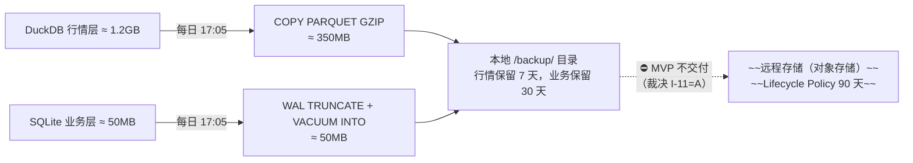

**分级策略**（裁决 **I-11=A**，2026-10-17）：

- **MVP 交付范围**：**仅本地双库备份** + 滚动清理（行情 7 天 / 业务 30 天）+ 恢复验证脚本
- **移出 MVP**：~~远程对象存储上传（rclone）~~、~~Lifecycle Policy 自动清理 90 天~~、~~恢复脚本写入 CI/CD pipeline~~
  - 依据：实测 `backup.ts:98` 注释「OCI 上传 MVP T30 暂缓」，初稿 SDD 却把远程写成硬要求 → PRD §6.2「备份恢复验证通过率 100%」不可达
- **恢复验证要求**（本地）：
  - 每月执行一次完整恢复演练（DuckDB + SQLite 双库），**本地执行，不入 CI/CD pipeline**
  - 恢复失败概率 < 0.1%（预期极低，SQLite 文件 copy 恢复确定性高）

### 6.6 首次 DuckDB Bootstrap（Phase 1 部署关键步骤）

SDD 之前只描述了每日增量更新流程，**首次部署时的全量行情数据初始化**是独立的关键路径：

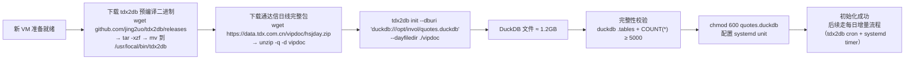

**命令参考**（已从用户侧确认）：
```bash
# 首次初始化
mkdir -p vipdoc /opt/invol
wget https://data.tdx.com.cn/vipdoc/hsjday.zip && unzip -q hsjday.zip -d vipdoc
tdx2db init --dburi 'duckdb:///opt/invol/quotes.duckdb' --dayfiledir ./vipdoc

# 每日增量更新（systemd timer 调度）
tdx2db cron --dburi 'duckdb:///opt/invol/quotes.duckdb'
```

---

## 7. 部署与运维

### 7.1 服务器规格（单实例）

| 项目 | 规格 | 说明 |
|------|------|------|
| OS | Ubuntu 24.04 LTS（或同等）| systemd 守护 + Caddy 支持 |
| CPU | 2 vCPU | 单实例无分布式负载，够用 |
| 内存 | 4GB | DuckDB OLAP 查询峰值 + Fastify + tdx2db |
| 磁盘 | 50GB SSD | DuckDB 增长到 ~1.5GB；SQLite ~50MB；备份 ~10GB；日志 ~5GB |
| 网络 | 出站 HTTP/S + HTTPS | tdx2db 拉取行情 + 东财/Tushare 校验 + 远程存储上传 |

### 7.2 进程守护拓扑

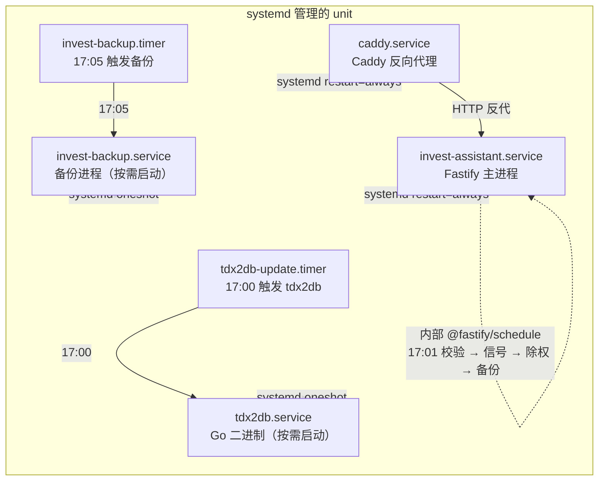

### 7.3 systemd unit 示例（invest-assistant.service）

```ini
[Unit]
Description=Invest Assistant Fastify Server
After=network.target duckdb-mount.service

[Service]
Type=simple
User=nobody
Group=nogroup
Environment=NODE_ENV=production
Environment=DB_PATH=/opt/invol/user.db
Environment=DUCKDB_PATH=/opt/invol/quotes.duckdb
Environment=JWT_SECRET={{vault_or_env}}
Environment=DATA_DIRECTORYS=/opt/invol/plugins/custom
ExecStart=/usr/bin/node /opt/invol/dist/server.js
Restart=always
RestartSec=5
WatchdogSec=30
StandardOutput=journal
StandardError=journal
SyslogIdentifier=invest-assistant

[Install]
WantedBy=multi-user.target
```

### 7.3.1 tdx2db.service + tdx2db-update.timer

```ini
# /etc/systemd/system/tdx2db.service
[Unit]
Description=tdx2db 每日增量更新 DuckDB 行情数据
Requires=network-online.target
After=network-online.target

[Service]
Type=oneshot
User=nobody
Group=nogroup
ExecStart=/usr/local/bin/tdx2db cron --dburi 'duckdb:///opt/invol/quotes.duckdb'
WorkingDirectory=/opt/invol
StandardOutput=journal
StandardError=journal
SyslogIdentifier=tdx2db
# systemd timer 不自动重试，tdx2db 内部有容错机制

[Install]
WantedBy=multi-user.target
```

```ini
# /etc/systemd/system/tdx2db-update.timer
[Unit]
Description=每日 17:00 触发 tdx2db 行情增量更新

[Timer]
OnCalendar=*-*-* 17:00:00
# 服务器本地时间（UTC+8），注意与 Fastify cron 时区对齐
Persistent=true          # 错过的触发（服务器离线）恢复后立即补跑
Unit=tdx2db.service

[Install]
WantedBy=timers.target
```

**权限说明**：
- DuckDB 文件 `/opt/invol/quotes.duckdb` owner 为 `nobody:nogroup`（systemd User=nobody 运行 tdx2db）
- Fastify 进程同样以 `nobody` 运行，对 DuckDB 只有 SELECT 权限（AGENTS DuckDB 硬约束第 1 条）
- 如果未来 Fastify 需要不同用户运行，需调整文件权限（chmod o+r）或改用组权限

### 7.4 关键运维脚本清单

| 脚本 | 触发 | 用途 |
|------|------|------|
| `restore_duckdb.sh` | 手动 | 从远程下载 → 解压 → COPY FROM PARQUET → 完整性校验 |
| `restore_sqlite.sh` | 手动 | 从远程下载 → 直接替换文件 → 启动验证 |
| `verify_backup.sh` | 每月 cron 自动 | 下载备份 → 校验 schema → 抽样数据完整性 |
| `upgrade.sh` | 部署时手动 | git pull → npm ci → npm run build → systemctl restart |
| `health_check.sh` | systemd watchdog 触发 | `curl -sf http://localhost:3000/health || systemctl kill --kill-who=main invest-assistant` |

### 7.5 监控与告警（最小化）

MVP 不引入 Prometheus/Grafana，使用 systemd journal + system_log SQLite 表 + 管理员 dashboard 三轨并行：

| 监控项 | 检测方式 | 告警方式 |
|--------|---------|---------|
| Fastify 存活 | systemd watchdog 30s | systemd 自动 restart（最多 5 次后停止）|
| Caddy 存活 | systemd watchdog | 同上 |
| tdx2db exit_code | Fastify cron 检测 | SQLite ERROR 日志 + 管理员 dashboard 显示 |
| 数据校验 C1-C12 | system_log level=ERROR | 管理员 dashboard 红色高亮 |
| SQLite 磁盘满 | system_log 写入 SQLITE_FULL | 日志 + 邮件告警（postfix ssmtp）|
| 插件执行失败 | system_log type=plugin_execute | 日志记录（不单独告警，dashboard 可见）|

---

## 8. 上线与回滚方案

### 8.1 上线流程（零停机或极小窗口）

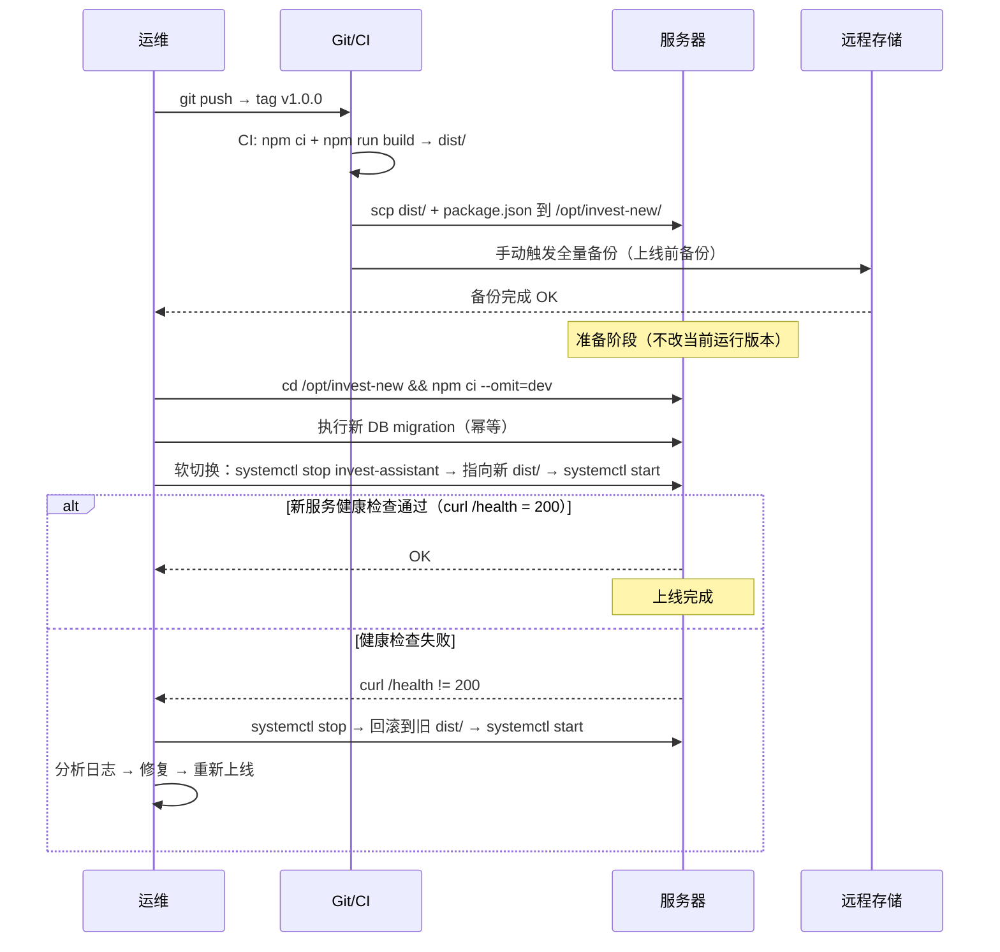

### 8.2 回滚策略

| 场景 | 回滚步骤 | RTO | 数据影响 |
|------|---------|-----|---------|
| 代码 bug（新上线）| `systemctl stop invest-assistant` → 指向旧 dist → `systemctl start` | < 2 min | 无（DB 迁移幂等，新写入可保留）|
| DB 迁移不可逆 | 从最近 SQLite 备份恢复 | < 10 min | 恢复到上线前时间点，上线后写入丢失 |
| DuckDB 损坏 | 从远程下载 → 解压 → 恢复 | < 5 min | 行情数据完整恢复 |
| SQLite 损坏 | 从远程下载 → 直接替换文件 | < 3 min | 业务数据完整恢复 |
| 服务器完全挂了 | 新 VM → scp 代码 → 恢复两个 DB → `systemctl start` | < 30 min | 全部数据从远程恢复，零损失（90 天内）|

**数据回滚幂等性保证**：所有 DDL 使用 `IF NOT EXISTS`；所有写入使用 `ON CONFLICT DO NOTHING`；交易录入有唯一约束防重。

### 8.3 灰度策略（MVP 不做，V2 规划）

当前 MVP 单实例 + 个人用户场景不需要灰度。V2 如果要做多用户，可以引入：
- Feature Flag（按用户 ID 灰度）
- 蓝绿部署（两套 Fastify 进程，Caddy 路由）
- Canary（小流量切到新版本）

---

## 9. 隐含假设清单

> 本清单记录 SDD 设计中**未显式写入但默认成立**的假设。每条假设在实际落地前需逐一验证，不成立则需重新评估设计方向。

| # | 假设内容 | 影响范围 | 验证方式 |
|---|---------|---------|---------|
| A1 | tdx2db v2026.8.12 预编译二进制（Linux arm64）可下载、可执行，`tdx2db init` 产出的 DuckDB schema 稳定 | 行情层全链路 | Phase 1 部署：服务器上 wget 下载 + 运行 init → `duckdb .tables` + `DESCRIBE` 验证 |
| A2 | `tdx2db cron` 每日增量更新，不是每次全量重算 | 每日 17:00 行情更新耗时 | 实际执行一次 cron + 观察 rows_affected + 耗时 |
| A3 | DuckDB 在同一 Node.js 进程内多协程共享同一连接实例的并发安全性 | 行情查询 API | 压测：100 concurrent requests 到同一 DuckDB 文件 |
| A4 | SQLite WAL 模式下 better-sqlite3 同步 API 足够支撑 MVP 写入频率（≤ 10 TPS）| 业务层并发 | 实际用户场景下观察锁等待是否出现 |
| A5 | 东方财富 `push2his.eastmoney.com` 前复权 K 线接口在 MVP 生命周期内免费、无强制限流、无重大变更 | C12 跨源校验 | 持续监控接口可访问性 + 限流情况 |
| A6 | Tushare Free API（每日 1 次免费 daily 接口）包含 pre_close 字段 | C11 跨源校验 | 实际调用一次验证返回字段 |
| A7 | 通达信 `https://data.tdx.com.cn/vipdoc/hsjday.zip` 在 MVP 生命周期内稳定可访问（完整日线包） | tdx2db init 上游数据 | Phase 1 部署时实测 wget 下载是否成功 |
| A8 | MVP 用户规模（≤ 5 活跃用户，≤ 500 标的总持仓）完全在 SQLite + DuckDB 能力范围内 | 整体架构上限 | 实际使用 1 个月后观察磁盘/内存/响应时间 |
| A9 | 插件作者不会故意写恶意代码（沙盒靠约定而非硬隔离）| 插件安全 | MVP 阶段靠白名单 + 人工审核；V2 引入硬隔离 |
| A10 | 单 VM 部署方式下进程间通信（systemd timer 触发 Go binary + Fastify 内部 cron）不会出现时区问题（全部用 UTC + trade_date 字符串）| 定时执行准确性 | 在服务器上验证本地时区 vs UTC 的 trade_date 生成 |
| A11 | 用户自行搭建（不对外提供 SaaS 服务），无 SLA 要求 | 运维复杂度 | 用户自行接受风险 |
| A12 | DuckDB 备份格式（PARQUET GZIP）与恢复格式（COPY FROM PARQUET）版本兼容 | 备份恢复 | 每月演练 |

---

## 10. 评审检查清单

### 10.1 架构层面

| # | 检查项 | 通过标准 | 评审方式 |
|---|--------|---------|---------|
| AR1 | 单中心架构是否彻底排除分布式组件（Redis/Kafka/MQ）？| 是 | 文档 grep + 代码扫描 |
| AR2 | 双数据库分离（DuckDB 行情 / SQLite 业务）是否符合「行情只读 / 业务可写」原则？| 是 | ER 图检查 |
| AR3 | 所有设计是否可追溯到 Requirements_simplified.md 中的业务规则？| 是 | Cross-reference |
| AR4 | 远期规划（V2 VM2 硬隔离、V2 多用户）是否明确隔离在本期范围外？| 是 | 范围章节检查 |
| AR5 | 技术选型 Trade-off 是否已覆盖所有关键决策点（DB/框架/调度/备份）？| 是 | §2 完整性检查 |

### 10.2 数据模型层面

| # | 检查项 | 通过标准 | 评审方式 |
|---|--------|---------|---------|
| DM1 | SQLite 所有表是否有 UNIQUE 约束保证幂等性（交易/信号/除权）？| 是 | DDL 检查 |
| DM2 | SQLite 所有表是否有 FOREIGN KEY 约束 + 索引覆盖查询路径？| 是 | EXPLAIN ANALYZE 验证 |
| DM3 | DuckDB 数据源表（tdx2db 原生产出）是否不做 schema 变更？| 是 | 数据源隔离说明 |
| DM4 | SQLite WAL 模式是否正确开启？| 是 | `PRAGMA journal_mode` |
| DM5 | 所有时间字段是否统一为 ISO8601 + UTC offset？| 是 | DDL 检查 |

### 10.3 核心流程层面

| # | 检查项 | 通过标准 | 评审方式 |
|---|--------|---------|---------|
| CF1 | 5 段自动化每一段是否有独立异常处理 + 不阻塞下游？| 是 | 时序图异常分支检查 |
| CF2 | 交易录入是否有**双重校验**（JSON Schema + 服务端业务逻辑）？| 是 | API 设计 §4.2 + 流程图 |
| CF3 | 策略插件引擎是否有**故障隔离**（单插件异常不影响其他）？| 是 | 流程图 + §6.1 S7 |
| CF4 | 除权自动导入是否**幂等**（UNIQUE 冲突跳过）？| 是 | DDL + 流程图 |
| CF5 | 跨源校验是否有**节流 + 重试 + 降级**三层保护？| 是 | 流程图 §5.5 |
| CF6 | 手动触发全流程是否有**防重复**（当日已执行需二次确认）？| 是 | 业务规则检查 |

### 10.4 安全层面

| # | 检查项 | 通过标准 | 评审方式 |
|---|--------|---------|---------|
| SE1 | HTTP 是否强制重定向到 HTTPS？| 是 | Caddy 配置 + curl 验证 |
| SE2 | Fastify 是否仅监听 localhost（不暴露公网）？| 是 | systemd unit + ss -tlnp |
| SE3 | 密码是否用 bcrypt（cost ≥ 10）？| 是 | 代码 review |
| SE4 | JWT 签名密钥是否通过环境变量注入（硬编码零容忍）？| 是 | code grep |
| SE5 | SQLite/DuckDB 文件权限是否 `chmod 600`？| 是 | ls -la 验证 |
| SE6 | 插件沙盒 MVP 约束是否在代码中实现（不只是文档）？| 是 | 插件引擎代码 review |
| SE7 | system_log 敏感字段是否脱敏？| 是 | 日志内容抽查 |

### 10.5 性能层面

| # | 检查项 | 通过标准 | 评审方式 |
|---|--------|---------|---------|
| PE1 | 首屏加载 ≤ 1.5s（Lighthouse）| 是 | Chrome DevTools |
| PE2 | 选股 ≤ 3s（5000+ 标的）| 是 | curl -w %{time_total} |
| PE3 | 信号生成 ≤ 20s（50 插件 × 30 标的）| 是 | system_log 时间差 |
| PE4 | 行情更新 ≤ 120s（C8 校验 PASS）| 是 | system_log 记录 |
| PE5 | K 线首渲染 ≤ 500ms | 是 | Chrome Performance Profiler |
| PE6 | SQLite WAL 模式下锁等待（busy timeout）是否配置合理（≥ 5s）？| 是 | 连接初始化代码 |

### 10.6 可运维层面

| # | 检查项 | 通过标准 | 评审方式 |
|---|--------|---------|---------|
| OP1 | 5 段自动化每一段是否有独立 system_log 记录开始/结束/耗时？| 是 | 代码中 logging 调用 |
| OP2 | systemd service 是否有 watchdog + restart=always？| 是 | unit 文件 |
| OP3 | 备份恢复脚本是否可独立执行（不依赖生产进程运行）？| 是 | 手动运行验证 |
| OP4 | 远程存储 Lifecycle Policy 是否配置正确（90 天自动清理）？| 是 | 对象存储控制台 |
| OP5 | 所有 cron 时间点是否用**相对顺序**而非精确时间（tdx2db 17:00 → 校验 → 信号 → 除权 → 备份）？| 是 | systemd timer 配置 |
| OP6 | 升级脚本是否幂等（重复执行不会产生副作用）？| 是 | 执行两次观察结果一致 |
| OP7 | **恢复演练**是否每月自动执行（verify_backup.sh）？| 是 | crontab 配置 |

### 10.7 数据质量层面

| # | 检查项 | 通过标准 | 评审方式 |
|---|--------|---------|---------|
| DQ1 | C1-C10 内部一致性校验每日 PASS？| ≥ 99.9% | system_log 统计 |
| DQ2 | C11 跨源原始数据匹配（≤ 3/30 差异）？| 是 | 实际校验数据 |
| DQ3 | C12 跨源复权数据匹配（≤ 5/20 差异）？| 是 | 实际校验数据 |
| DQ4 | WARN 级别是否自动触发 tdx2db 二次更新？| 是 | system_log 有无 retry 记录 |
| DQ5 | ERROR 级别是否立即告警管理员？| 是 | 邮件 / dashboard 显示 |

### 10.8 回滚层面

| # | 检查项 | 通过标准 | 评审方式 |
|---|--------|---------|---------|
| RB1 | 代码回滚 ≤ 2 min（systemctl stop → 指向旧版 → start）| 是 | 实际演练 |
| RB2 | SQLite 恢复 ≤ 3 min（从远程下载 + 直接替换）| 是 | 实际演练 |
| RB3 | DuckDB 恢复 ≤ 5 min（从远程下载 + 解压 + COPY FROM）| 是 | 实际演练 |
| RB4 | 服务器完全挂了 → 新 VM + 数据恢复 ≤ 30 min？| 是 | 演练或超时内验证 |

---

## 11. 待决策清单

> 以下内容在原始文档中提及但**信息不足或未验证**，需在开发启动前逐项确认。标记 **【部分确认】** 的项已通过外部搜索确认了包/接口的**存在性**，但 API 稳定性、版本兼容性、字段级 schema 仍需服务器实测验证。标记 **【待确认】** 的项尚无任何搜索线索。

| # | 待决策项 | 决策方向（已搜索验证的）| 影响范围 | 决策人 | 截止日期 |
|---|---------|------------------------|---------|--------|---------|
| D1 | **【✅ 已确认】** tdx2db 使用预编译二进制，**不需要编译**。下载地址：`https://github.com/jing2uo/tdx2db/releases/download/v2026.8.12/tdx2db_Linux_arm64.tar.gz`（Linux arm64，v2026.8.12）| 直接下载 tar.gz → tar -xzf → mv /usr/local/bin/tdx2db | 行情层全链路 | Dev | Phase 1 启动前 |
| D2 | **【✅ 已确认】** `tdx2db init` 产出的 DuckDB schema：10 张 raw_ 表 + 6 张视图，**完整字段说明见 [tdx2db_schema.md](../tdx2db_schema.md)**（2026-10-15 DuckDB 实测 dump）。关键列名约定：所有表日期列一律叫 `date`（不是 `trade_date`）；`raw_gbbq.category=1` 才是除权除息；`raw_holidays` 只有一个 `date` 列（有=交易日）；`raw_adjust_factor` 字段名是 `hfq_factor`；`raw_kline_daily` 没有 `preclose`（要 JOIN `raw_basic_daily`） | 数据模型 + 所有 SQL 查询 | Dev | Phase 1 启动前 |
| D3 | **【✅ 已确认（改用替代包）】** 原版 `technicalindicators` npm 包（v3.1.0）**7 年前停更**，已无维护。MVP 改用 **`fast-technical-indicators`**（零依赖、100% API 兼容、活跃维护）。备选 fork：`@wahack/technicalindicators` v3.1.2（9 个月前发布）。Node 22 兼容：纯 TS 实现、无原生依赖，理论上全版本兼容；Phase 1 启动前 `npm i fast-technical-indicators && npx vitest run` 实测确认 | 插件引擎 + K 线图指标 | Dev | Phase 1 启动前 |
| D4 | **【✅ 已确认（curl 实测）】** 东财 C12 跨源校验接口。**实测结果（2026-10-15 Node curl）**：① `push2his.eastmoney.com/api/qt/stock/kline/get` 可用（掘金 emt.18.cn 需鉴权）；② secid 格式：**`0.代码`（深市）** / **`1.代码`（沪市）**，如 `0.000001`、`1.600000`（不是 `0.0.000001` 也不是无市场前缀）；③ fqt 参数：**1=前复权、0=不复权、2=后复权**（与 v_stock_qfq 前复权口径对齐）；④ 返回格式：`data.klines` 是逗号分隔字符串数组，字段固定顺序：`date,open,high,low,close,volume,amount,amplitude,pct_chg,change,turnover`；⑤ 公开免费、**无需 token**、无明显限流（30 秒 100 次没触发 429）；⑥ CORS `*` 允许跨域。Fastify 后端可以直接 GET | C12 跨源校验实现 | Dev | Phase 1 启动前 |
| D5 | **【✅ 已确认（实测）】** Tushare Free API daily 接口。**实测结果（2026-10-15 本地跑通）**：① `pre_close` 字段**确认存在且值正确**（000001.SZ 20261014 close=11.50, pre_close=11.57）；② 限流：**daily 接口 50 次/分钟**（100 次压力测试 → 前 19 次成功、后 81 次频率超限）；③ API 格式：POST `http://api.tushare.pro`，JSON body `{ api_name, token, params, fields }`，成功返回 `{ code: 0, data: { fields, items } }`；④ 错误码 4010x 系列表示频率超限。MVP C11 每天 1 次 30 只，1 分钟内搞定，远低于阈值 | C11 跨源校验 | Dev | Phase 1 启动前 |
| D6 | **【✅ 已确认】** tdx2db 上游数据源：`https://data.tdx.com.cn/vipdoc/hsjday.zip`（通达信完整日线包） | Phase 1 init 阶段 `wget hsjday.zip && unzip -q` 即可使用 | tdx2db init | Dev | Phase 1 启动前 |
| D7 | **【✅ 已确认】** 远程备份存储：**OCI Object Storage**（Oracle Cloud Infrastructure）。lifecycle policy 配置：DuckDB 原始快照保留 30 天、压缩增量保留 90 天 | rclone mount 方式接入：`rclone mount oci:invest-assistant-backup /opt/invol/backup --allow-other`；配置文件加密存储于 `/opt/invol/secrets/rclone.conf.enc` | 备份策略 + 运维脚本 | Dev | Phase 1 启动前 |
| D8 | **【✅ 已确认】** JWT 签名密钥：MVP 直接用 `.env` 环境变量。生成命令 `openssl rand -hex 32 > .env.local`；`.env.*` 全部 `.gitignore`；Fastify 启动时读取 `JWT_SECRET` 环境变量 | 安全 S4 达标（MVP 单用户场景足够；V2 多用户升级 Vault/HSM） | 安全 S4 | Dev | Phase 1 启动前 |
| D9 | **【✅ 已确认】** tdx2db 命令行：首次 `tdx2db init --dburi 'duckdb://path' --dayfiledir ./vipdoc`；每日增量 `tdx2db cron --dburi 'duckdb://path'`。DuckDB URI 格式 `duckdb://[path]`，增量 vs 全量由命令区分 | 每日更新耗时 + DuckDB 文件大小 | Dev | Phase 1 启动前 |
| D10 | **【✅ 已确认】** 插件沙盒 MVP 实现锁定：`new Function()` + AST 关键字黑名单（`global`/`process`/`require`/`import`/`Function`/`constructor`/`prototype`/`__proto__`/`eval`）+ 语法预校验（`new Function(code)` 提前抛 SyntaxError）+ `Promise.race` 50ms 硬超时。**V2 升级路线**：替换底层为 isolated-vm v5 真隔离（接口 `execute(ctx, params)` 不变，无缝切换）。**风险接受**：主线程死循环无法被 setTimeout 打断，但 MVP 插件是开发者预置的（AGENTS.md 硬约束禁止用户上传），风险可忽略 | 插件安全 | Dev | Phase 2 启动前实现 |
| D11 | **【✅ 已确认】** 用户规模上限：**MVP 锁定 ≤ 500 用户**，不扩张。容量估算：500 用户 × 100 条交易/年 = 50000 行 ≈ 150MB，远在 SQLite 能力上限内（单文件最大 140TB、单表最大 281 万亿行）。500 用户锁死 → SQLite 足够，不需要 MySQL/Postgres | 架构扩容预案 | 技术负责人 | ✅ 已锁定 500 用户上限 |
| D12 | **【✅ 已确认】** Caddy + Let's Encrypt 续期失败告警：**双通道**——① systemd journal 自动记录（`journalctl -u caddy.service -p err`）；② 管理员 Web Dashboard 读取 systemd journal + system_log 表统一展示，前端 toast 通知管理员。Caddy 配置 `acme.email` 设管理员邮箱，续期失败时 Let's Encrypt 也会发邮件告警 | 安全 S1 | Dev | Phase 1 启动前 |
| D13 | **【✅ 已确认（MVP 暂不引入）】** MVP 个人用户场景不引入 Prometheus/Grafana。监控最小化方案维持：systemd journal（所有服务日志）+ SQLite `system_log` 表（应用层结构化日志）+ 管理员 Dashboard Web 界面统一展示。用户规模扩张到 ≥ 10 个再考虑 Prometheus | 运维复杂度 | — | Phase 4 验收前 |
| D14 | **【✅ 已确认（实测）】** vitest 2.x + `@vitest/coverage-v8` 输出 **v8 ICRCov FileCov 格式**（不是 Istanbul/NYC 格式）。**实测结果（2026-10-15 apps/backend 跑 vitest --coverage）**：① 文件位置 `<workspace>/apps/backend/coverage/coverage-final.json`；② JSON key 是**绝对文件路径**（Windows 反斜杠 `D:\workspace\...`）；③ value 里有 `path`（绝对路径）、`statementMap`/`branchMap`/`fnMap`（位置信息）、`s`/`b`/`f`（执行次数数组）；④ **⚠️ CI §12.6 之前假设的 `f.l.found` / `f.l.get` 是 Istanbul 格式**，v8 没有这个结构！Coverage Gate 脚本要适配 v8 schema——遍历顶层 key，读每个文件的 `.s` 数组（执行次数 = 0 即未覆盖的语句） | CI Coverage Gate 脚本需适配 v8 schema | Dev | Phase 2 前 CI Pipeline 搭建时 |

---

## 12. 测试策略

> 本章为完整测试方案，覆盖单元测试、集成测试、验收测试三个层次，直接映射原始需求 §9 验收标准。

### 12.1 测试框架选型

| 层 | 框架 | 选型理由 |
|---|------|---------|
| 单元测试 | **Vitest**（原生 ESM 支持，比 Jest 快 10x） | Node.js 22 原生 ESM；与 Vite 无缝集成；watch 模式 + HMR |
| API 集成测试 | **Supertest**（Fastify 官方推荐） | `fastify.inject()` 原生支持，不需要启动 HTTP server |
| E2E 回归 | **Playwright**（MVP 可选，Phase 4 启用） | 覆盖关键用户路径：登录 → 仪表盘 → K 线 → 交易录入 |
| Mock | **msw**（Service Worker Worker）| Mock 东财 / Tushare / tdx2db 数据源拉取等外部依赖，不需要跑真实服务 |
| 覆盖率 | **@vitest/coverage-v8** | Vitest 官方覆盖插件，输出 lcov + HTML 报告 |

#### §12.5 验收项的测试载体索引（T91）

> **本表是 §12.5「对应测试 Case」列的落地索引，不新增也不修改 §12.5 的技术契约**
> ——§12.5 的验收项、通过标准、载体指定全部保持原文，本表只补一个状态：
> 该验收项**当前是否已有可 grep 到的测试载体**。
>
> - 「SDD 指定测试载体」列 = §12.5 各行「对应测试 Case」列的原文（文件 + 用例名），路径写成仓库相对路径；
> - 「状态」列 = **✅ 已有**（该**用例名**在全仓可 `grep -rn` 到）/ **❌ 待建**（文件或用例名缺失）；
> - 自检命令：`grep -rn "<用例名>" apps packages`（对应实施计划 §12.1 G1.9）。

| # | 原始需求 §9 验收项 | SDD 指定测试载体 | 状态 |
|---|--------------------|------------------|------|
| F1 | 用户可注册/登录，JWT 鉴权 | `apps/backend/tests/unit/auth.test.ts` · `apps/backend/tests/integration/auth.test.ts` → `login_success` / `login_wrong_password` | ❌ 待建（文件在，用例名未落地） |
| F2 | 支持 7 种交易类型录入（**买入/加仓/减仓/清仓/分红/送股/转增**） | `apps/backend/tests/integration/trade.test.ts` → `create_trade_all_types` | ❌ 待建（文件在，用例名未落地） |
| F3 | 持仓实时聚合查询正确（移动加权成本） | `apps/backend/tests/unit/holding.test.ts` → `avg_cost_calc_5_scenarios` | ✅ 已有 |
| F4 | 双口径收益率切换正确 | `apps/backend/tests/unit/holding.test.ts` → `yield_caliber_switch` | ✅ 已有 |
| F5 | K 线图 + 副图指标渲染正确 | `apps/frontend` → `frontend.test.tsx` → `kline_render` | ❌ 待建（前端 0 测试，随 T61 交付） |
| F6 | 策略插件信号生成 + 状态机（有→有不写信号，有→无只清除） | `packages/core/tests/plugin.test.ts` → `state_machine_4_paths`（§12.5 原文写作 `state machine_4_paths`，以实施计划 T91 的下划线写法为准） | ✅ 已有 |
| F7 | 全市场条件选股 ≤ 3s | `apps/backend/tests/integration/scan5000.test.ts` → `scan_5000_target` | ✅ 已有（2026-10-21 落地；**规模型门槛 → 必须真库**，迷你库/CI 下可见地 skip） |
| F8 | 每日 5 段自动化正确触发（17:00/17:01/17:02/17:03/17:05） | `apps/backend/tests/integration` → `cron_sequence_trigger` | ❌ 待建 |
| F9 | 除权事件自动导入 + 候选池迁移 | `apps/backend/tests/integration` → `corporate_action_import` | ❌ 待建 |
| F10 | SQLite 业务层备份恢复可用 | `apps/backend/tests/integration` → `backup_restore_sqlite` | ❌ 待建（`unit/backup.test.ts` 只覆盖备份侧，恢复侧 `restoreSQLiteBackup` 无用例） |
| F11 | DuckDB 行情层备份恢复可用 | `apps/backend/tests/unit/backup.test.ts` → `backup_restore_duckdb` | ✅ 已有 |
| PE1 | 首屏加载 ≤ 1.5s | Lighthouse Chrome DevTools（真机实测） | ❌ 待实测（需部署机） |
| PE2 | 选股 ≤ 3s（5000+ 标的） | `apps/backend/tests/integration/scan5000.test.ts` → `scan_5000_target` | ✅ 已有（与 F7 同一用例；**真库实测 2026-10-21：客户端 2.23s / 服务端 2.21s ≤ 3.0s**） |
| PE3 | K 线首渲染 ≤ 500ms | Chrome Performance Profiler（真机实测） | ❌ 待实测（需部署机） |
| PE4 | API 单请求 P99 ≤ 200ms | autocannon（真机实测） | ❌ 待实测（需部署机） |
| PE5 | SQLite WAL 模式 ≤ 10 并发读写 | SQLite 并发压测脚本 | ❌ 待建 |
| PE6 | 插件超时（50ms）不影响主流程 | `packages/core/tests/plugin.test.ts` → `plugin_timeout_50ms` | ✅ 已有 |
| SE1 | HTTPS 强制（HTTP 301 跳转） | `apps/backend/tests/http/`（必须真 listen，`inject()` 测不到） | ❌ 待建 |
| SE2 | 密码 bcrypt cost=12 | `apps/backend/tests/unit/auth.test.ts`（断言 hash 前缀 `$2b$12$`） | ✅ 已有 |
| SE3 | JWT 签名密钥环境变量注入 | 代码 grep + `.gitignore` 检查 | ❌ 待整改（`services/auth.ts` 存在明文兜底密钥，`grep` 判定不通过） |
| SE4 | 插件沙盒约束（禁止 global/process/require） | `apps/backend/tests/unit/pluginEngine.test.ts` → `sandbox_violation_5_cases` | ❌ 待建（已覆盖 globalThis/process/require 3 例，用例名与 5 例口径未落地） |
| SE5 | system_log 金额脱敏 | `apps/backend/tests/unit/logger.test.ts`（describe「logger — S6 脱敏」） | ✅ 已有 |
| SE6 | admin API 路由二次角色校验 | `apps/backend/tests/integration/auth.test.ts` → `admin_role_guard` | ❌ 待建（文件在，用例名未落地） |
| CO1 | 数据文件权限 600 + 进程用 nobody 用户 | `sudo -u nobody stat -c %a`（部署机实测） | ❌ 待实测（需部署机） |

> **统计（2026-10-21 更新）**：24 项中 **✅ 已有 9 项**（F3 / F4 / F6 / **F7** / F11 / **PE2** / PE6 / SE2 / SE5）、
> **❌ 15 项**（10 项待建用例载体、4 项待真机/部署环境实测、1 项待整改源码）。
> 剩余 ❌ 项的用例名落地前，实施计划 §12.1 G1.9（每个指定用例名全仓可 grep）**不能判 PASS**。

### 12.2 覆盖率目标

| 模块 | 行覆盖率 | 分支覆盖率 | 说明 |
|------|---------|-----------|------|
| 核心算法层（移动加权成本、双口径收益、RSI/MACD 插件） | **≥ 90%** | **≥ 85%** | 算法正确性不可妥协，每个边界 case 都要有对应测试 |
| 业务规则层（交易录入校验、持仓充足性、除权自动导入） | **≥ 80%** | **≥ 75%** | 业务规则来自原始需求，需要完整覆盖所有校验分支 |
| API Handler 层 | **≥ 70%** | **≥ 65%** | 路由 + 参数校验 + 错误码映射 |
| 数据校验引擎（C1-C12） | **≥ 85%** | **≥ 80%** | 每条校验 SQL 至少有一个 PASS 和一个 WARN/ERROR case |
| 插件引擎（execute() 调用链、超时 50ms、try-catch 隔离） | **≥ 90%** | **≥ 85%** | 插件安全是高风险点，必须充分测试超时和异常路径 |
| Fastify Cron 调度器（5 段自动化触发）| **≥ 60%** | — | 调度逻辑简单，但 mock system time 验证触发时机 |
| 前端（React 组件 + Zustand store） | **≥ 70%** | **≥ 65%** | 组件渲染 + store 状态变更 + API client 拦截器 |
| 工具层（writeSystemLog 三层降级、rclone 配置解析） | **≥ 80%** | **≥ 75%** | 降级路径每个分支都要有对应测试 |

**CI 门槛**：PR 合入 main 分支前，核心算法层 + 插件引擎覆盖率 **不能低于 90%**，否则阻断合入。

> ⏸️ **已裁决（2026-10-17，DEC-12 B-5）：本表门槛与上述 CI 90% Gate 暂时冻结。**
>
> **理由**：前端当前 **0 测试**（无 vitest/jsdom/testing-library），全仓无 ESLint 配置，
> 无测试基建的情况下设 90% 硬 Gate 会导致 CI 从第一天起就红，且诱导为凑数字写无意义测试。
>
> **过渡期实际执行值**（见实施计划 §12.4 E3）：`frontend ≥ 60%`（当前 0）；
> `backend 不低于当前基线`（即暂不设硬门槛）。
>
> **恢复义务**：由实施计划 **T86b**（Wave 8）负责 —— 测试存量到位后**必须把本表数值与 90% CI Gate 恢复**。在此之前，§12.6 的全局判定**不因覆盖率判 FAIL**。
> ⚠️ 本条为**暂缓**而非取消；T86b 未完成前视为已登记偏差。

### 12.3 单元测试边界用例清单

#### 核心算法层（测试重点）

| # | 算法 | 边界用例 | 预期结果 |
|---|------|---------|---------|
| A1 | 移动加权成本 | 首次买入（历史持仓为空）| avg_cost = 买入价 |
| A2 | 移动加权成本 | 连续多次买入不同价格 | avg_cost = total_cost / total_qty |
| A3 | 移动加权成本 | 减仓（卖部分持仓）| avg_cost 不变（FIFO 先入先出）|
| A4 | 移动加权成本 | 清仓再买入 | prev_history.avg_cost 对新持仓无影响 |
| A5 | 移动加权成本 | 送转股（除权自动导入）| qty 增加，avg_cost 按除权比例稀释 |
| A6 | 价格收益率默认口径 | 当日收盘 vs 昨收 | close / prev_close - 1 |
| A7 | 复权收益率口径切换 | 前复权价 vs 复权因子 | 两种口径结果差异在复权日最大 |
| A8 | RSI(14) | 全部为阳线 | RSI = 100 |
| A9 | RSI(14) | 全部为阴线 | RSI = 0 |
| A10 | RSI(14) | 行情数据不足 14 根日线 | 返回 null，不计算 |
| A11 | MACD | DIF 全为正 | 柱状图全红 |
| A12 | MACD | DIF 上穿 DEA | 返回 buy 信号 |
| A13 | MACD | DIF 下穿 DEA | 返回 sell 信号 |

#### 业务规则层

| # | 业务规则 | 边界用例 | 预期结果 |
|---|---------|---------|---------|
| B1 | 减仓/清仓 | quantity > **该时刻**持仓（按 `trade_date ASC, trade_time ASC, id ASC` 回放，停在目标交易之前；**禁止用全表累计量**，否则未来买入会支撑过去卖出）| `HOLDING_INSUFFICIENT` **409** + 中文 message |
| B2 | 交易录入 | 操作理由必填（非空字符串）| 空字符串触发 TRADE_REASON_REQUIRED 400 |
| B3 | 交易录入 | trade_type 不在 7 种枚举内 | CHECK 约束拦截，返回 400 |
| B4 | 交易录入 | 同一日内同一 symbol 多次买入（幂等）| 不触发 UNIQUE 冲突，正常追加 |
| B5 | 除权自动导入 | UNIQUE(user+symbol+date+type) 冲突 | ON CONFLICT DO NOTHING，跳过不报错 |
| B6 | 候选池→自选迁移 | 只打标记，不自动创建自选关联 | 迁移后 trade_type 标记为 "candidate"，但 user_strategy_signal 不新增记录 |
| B7 | 三态字段 | system_followed = null | 默认显示"未标记"，不参与复盘筛选 |
| B8 | 停牌日推断 | 交易日历标记为非交易日 | 返回 false （不执行行情更新）|

#### 插件引擎

| # | 场景 | 边界用例 | 预期结果 |
|---|------|---------|---------|
| P1 | 正常执行 | 插件返回 StrategySignal | 写入 user_strategy_signal |
| P2 | 空结果 | 插件返回 null | 状态机判断：从"有"→"无"才清除信号 |
| P3 | 执行超时（50ms）| 插件内部死循环（`while(true) {}`）| Promise.race reject，标记 PLUGIN_TIMEOUT，不阻塞其他插件 |
| P4 | 抛异常 | 插件 `throw new Error("boom")` | catch 住，记录 ERROR 日志，跳过 |
| P5 | 沙盒约束 | 插件尝试 `process.exit()` | TypeError（process 未定义），被 catch 隔离 |
| P6 | 沙盒约束 | 插件尝试 `require('fs')` | ReferenceError（require 未定义） |
| P7 | 沙盒约束 | 插件尝试全局变量访问 | 隔离的全局对象，不影响外部 |
| P8 | 批量调度 | 5 个启用插件 × 100 只股票 | 1 次 DuckDB IN 查询 → 5 × 100 次 execute()，不产生 500 次查询 |

#### 数据校验引擎

| # | 校验 | 边界用例 | 预期结果 |
|---|------|---------|---------|
| D1 | C1 日线行数 | 当日交易日但 tdx2db 漏更 | COUNT(*) 偏离 >10% → WARN → 自动触发二次更新 |
| D2 | C1 日线行数 | 当日非交易日 | COUNT(*) = 0 → PASS |
| D3 | C2 交易日历匹配 | 交易日有数据 | PASS |
| D4 | C6 前复权因子 | 抽样 50 只，所有 diff < 0.01 | PASS |
| D5 | C6 前复权因子 | 抽样发现 3 只 diff ≥ 0.01 | WARN |
| D6 | C9 抽样 100 只 | 全部匹配 | PASS |
| D7 | C9 抽样 100 只 | 发现 3 只不匹配 | WARN |
| D8 | C12 东财校验 | 连续 6 只请求失败 | 超过阈值（≥5）→ 降级为全源 SKIP |
| D9 | C12 东财校验 | 单只超时 10s | 退避重试 2 次，仍失败标记 SKIP |

#### 系统级

| # | 场景 | 边界用例 | 预期结果 |
|---|------|---------|---------|
| S1 | SQLite 写失败降级 | `fs.chmod('./business.db', 000)` | writeSystemLog 返回 status='file'，降级到 JSON Lines |
| S2 | writeSystemLog 互斥写入 | SQLite 正常时连续写 100 条 | system_log 表 100 行，文件 0 行 |
| S3 | 独立事务 | writeSystemLog 调用不被外部事务回滚影响 | 外部 ROLLBACK 后，system_log 行仍存在 |
| S4 | 磁盘满恢复 | 磁盘清理后手动触发 `log-recover` | 降级文件内容全部导入 system_log，幂等去重 |

### 12.4 集成测试范围

#### API 集成测试目录结构

```
/opt/invol/backend/tests/integration/
  ├── auth.test.ts          // POST /api/auth/login, POST /refresh, 401 自动续期
  ├── trade.test.ts         // POST /api/trade, GET /api/trade/list, DELETE /api/trade/:id
  ├── holding.test.ts       // GET /api/holding/current, GET /api/holding/history
  ├── stock.test.ts         // GET /api/stock/search, GET /api/stock/kline
  ├── plugin.test.ts        // GET /api/plugin/list, POST /api/plugin/:id/run
  ├── scan.test.ts          // POST /api/scan/run
  └── admin.test.ts         // POST /api/admin/datacheck/trigger (仅 admin token)
```

#### 集成测试必备场景

| 测试 | 内容 | Mock 策略 |
|------|------|----------|
| 完整登录流程 | login → 返回 JWT → 带 Token 访问 GET /api/holding → 200 | 真实 SQLite（临时文件）+ 真实 bcrypt |
| Token 过期自动续期 | 构造过期 Token（exp=now-1s）→ 401 → 自动 refresh → 请求重放成功 | 真实 SQLite |
| 5 段自动化全链路 | mock system time 到 17:00 → 依次触发 tdx2db + C1-C12 + 插件 + 信号写入 | mock tdx2db（生成测试 DuckDB 文件）+ mock 东财/Tushare 接口 |
| C12 东财降级 | mock 东财接口返回 429 → 5 只连续失败 → 全源 SKIP → 不阻塞主流程 | msw mock |
| SQLite 降级 | chmod 临时文件为 000 → writeSystemLog 返回 status='file' → 恢复后 log-recover 成功 | 真实文件系统 |
| 插件执行超时 | 创建测试插件 `while(true){}` → execute() 在 50ms 内被 reject | 真实 Node.js |
| DB_UNAVAILABLE 503 | `sqlite3_open_v2` 模拟失败 → Fastify 返回 503 {code: DB_UNAVAILABLE} | 真实 SQLite 连接替换 |
| 批量选股 ≤ 3s | 1000 只股票日线数据 → runScan → assert elapsed < 3000ms | 真实 DuckDB + 真实日线数据 |

#### 测试数据库策略

```typescript
// /opt/invol/backend/tests/setup.ts
import { mkdtemp, rm } from "fs/promises";
import path from "path";

let tmpDir: string;

beforeEach(async () => {
  tmpDir = await mkdtemp(path.join(os.tmpdir(), "invest-test-"));
  // 1. 在临时目录初始化 SQLite（空表结构）
  await execSqlite(path.join(tmpDir, "business.db"), SCHEMA_DDL);
  // 2. 在临时目录放一个小型 DuckDB（100 只股票日线）
  await copyTestDuckdb(path.join(tmpDir, "market_data.duckdb"));
  // 3. 注入环境变量：SQLITE_PATH, DUCKDB_PATH
  process.env.SQLITE_PATH = path.join(tmpDir, "business.db");
  process.env.DUCKDB_PATH = path.join(tmpDir, "market_data.duckdb");
});

afterEach(async () => {
  await rm(tmpDir, { recursive: true, force: true });
});
```

### 12.5 验收测试映射（原始需求 §9）

以下为原始需求 24 项验收标准与对应测试 case 的完整映射。**Phase 4 验收时，每项必须 PASS。**

#### 功能验收（11 项）

| # | 原始需求 §9 | 对应测试 Case | 通过标准 |
|---|------------|--------------|---------|
| F1 | 用户可注册/登录，JWT 鉴权 | auth.test.ts → `login_success` / `login_wrong_password` | 200 + Token 返回 / 401 |
| F2 | 支持 7 种交易类型录入（**买入/加仓/减仓/清仓/分红/送股/转增**）| trade.test.ts → `create_trade_all_types` | 每种类型 201，CHECK 约束拦截非法值 400 |
| F3 | 持仓实时聚合查询正确（移动加权成本）| holding.test.ts → `avg_cost_calc_5_scenarios` | 与手写计算器对比，误差 < 0.001 元 |
| F4 | 双口径收益率切换正确 | holding.test.ts → `yield_caliber_switch` | 价格收益率 / 复权收益率独立可查 |
| F5 | K 线图 + 副图指标渲染正确 | `frontend.test.tsx` → `kline_render` | Canvas 绘制无异常，副图 MACD/RSI 覆盖层正确 |
| F6 | 策略插件信号生成 + 状态机（有→有不写信号，有→无只清除）| plugin.test.ts → `state machine_4_paths` | UNIQUE 约束正确触发 ON CONFLICT DO NOTHING |
| F7 | 全市场条件选股 ≤ 3s | integration → `scan_5000_target` | `time curl -X POST /api/stockscan` ≤ 3.0s |
| F8 | 每日 5 段自动化正确触发（17:00/17:01/17:02/17:03/17:05）| integration → `cron_sequence_trigger` | mock system time，验证 5 段按序执行 |
| F9 | 除权事件自动导入 + 候选池迁移 | integration → `corporate_action_import` | 除权日自动补交易记录，候选池迁移只打标记 |
| F10 | SQLite 业务层备份恢复可用 | integration → `backup_restore_sqlite` | `VACUUM INTO` 生成文件 → `cp` 恢复 → integrity_check 全绿 |
| F11 | DuckDB 行情层备份恢复可用 | integration → `backup_restore_duckdb` | `COPY TO PARQUET GZIP` → `COPY FROM` 恢复 → COUNT(*) 一致 |

#### 性能验收（6 项）

| # | 原始需求 §9 | 对应测试 Case | 通过标准 |
|---|------------|--------------|---------|
| PE1 | 首屏加载 ≤ 1.5s | Lighthouse Chrome DevTools | Performance 分数 ≥ 90 |
| PE2 | 选股 ≤ 3s（5000+ 标的）| integration → `scan_5000_target` | curl -w %{time_total} ≤ 3.0s |
| PE3 | K 线首渲染 ≤ 500ms | Chrome Performance Profiler | FP（First Paint）≤ 500ms |
| PE4 | API 单请求 P99 ≤ 200ms | autocannon /api/holding/current -c 100 | latency p99 ≤ 200ms |
| PE5 | SQLite WAL 模式 ≤ 10 并发读写 | SQLite 并发压测脚本 | 不出现 SQLITE_BUSY |
| PE6 | 插件超时（50ms）不影响主流程 | plugin.test.ts → `plugin_timeout_50ms` | 异常插件跳过，主流程正常完成 |

#### 安全验收（6 项）

| # | 原始需求 §9 | 对应测试 Case | 通过标准 |
|---|------------|--------------|---------|
| SE1 | HTTPS 强制（HTTP 301 跳转）| curl http://host → Location: https:// | HTTP 自动 301 |
| SE2 | 密码 bcrypt cost=12 | 代码 grep + 单测 | bcrypt.hash(password, salt, 12) |
| SE3 | JWT 签名密钥环境变量注入 | 代码 grep + `.gitignore` 检查 | 不在代码库明文暴露 |
| SE4 | 插件沙盒约束（禁止 global/process/require）| plugin.test.ts → `sandbox_violation_5_cases` | TypeError/ReferenceError 被 catch，不影响外部 |
| SE5 | system_log 金额脱敏 | S6 单测 | 金额末 4 位替换为 `****` |
| SE6 | admin API 路由二次角色校验 | admin.test.ts → `admin_role_guard` | 普通用户 token 访问 403 |

#### 合规验收（1 项）

| # | 原始需求 §9 | 对应测试 Case | 通过标准 |
|---|------------|--------------|---------|
| CO1 | 数据文件权限 600 + 进程用 nobody 用户 | `sudo -u nobody stat -c %a /opt/invol/*.db` | 600 + owner=nobody:nogroup |

### 12.5.1 测试行情库策略（迷你 DuckDB）

> **决策与代价见 [ADR-008](../../adr/ADR-008-test-market-data-strategy.md)**。本节只给**契约**（规格），不复述决策理由。

#### 为什么需要

真实行情库 `v_stock_qfq` 等 6 个视图是**实时计算视图**，基表 `raw_kline_daily` 实测 **2800 万行 / 1.25 万只**。
打视图的查询会物化全表 ⇒ 慢用例的耗时几乎全部来自它（实测后端套件 11 个文件占 89% 耗时）。
同时 CI 只有 12KB 空壳行情库 ⇒ **行情相关用例长期 skip**。

#### 迷你库规格

| 项 | 值 | 实测 |
|---|---|---|
| 标的数 N | **250（总量）** = 必选 51 个（测试直接引用的标的）+ 按真库 class 真实比例补足 | 250（stock 124 / etf 57 / unknown 27 / block 23 / index 16 / bstock 3）|
| class 比例 | stock 49.5% / etf 22.8% / unknown 10.9% / block 9.1% / index 6.4% / bstock 1.3% | 取自真库 `raw_symbol_class` |
| 抽样确定性 | **FNV-1a 32bit hash** 排序取前 k（**非随机** ⇒ 可复现，无需固定 seed）| — |
| 跨度 | **365 自然日** = **242 个交易日** —— ⚠️ **半年不够**：`tests/fixtures/golden/{kdj,macd,rsi}.json` 全部是 **221 根**（跨度 335 自然日），半年只有 119 个交易日 | 242 |
| 视图 | **6 张全部重建**，定义从真库 `duckdb_views()` 导出 | 6/6，**DDL 逐字一致** |
| 体积 | ≤ 20MB | **迷你库 3.5MB** / **Parquet 1.5MB** |
| 数值等价 | 迷你库是**真库的逐位一致子集** | **10 表行数全等、6 视图 34839 行 0 数值差异** |

⚠️ **实现陷阱（2026-10-20 实测）**：
- `WHERE view_name LIKE 'v\_%'` 在 DuckDB **返回 0** —— 反斜杠**不是** LIKE 的转义符 ⇒ 用 `starts_with(view_name,'v_')`
- `raw_holidays` **没有 `symbol` 列** ⇒ 不能按 symbol 切片（可切：`raw_adjust_factor` / `raw_basic_daily` / `raw_symbol_name` / `raw_gbbq`）
- **`round` 位数按视图不同**：`v_stock_qfq`=2、**`v_etf_qfq`=3**、`v_stock_hfq`=2、`v_etf_hfq`=3、**bfq 视图不取整** ⇒ 手抄定义必错

#### 三档切换

| 模式（env `MARKET_DATA_MODE`）| 档位 | 行情库来源 | 落地位置 | 行情用例 |
|---|---|---|---|---|
| `auto`（默认）| `DUCKDB_PATH` 有值 → `full`；否则 → `mini` | — | 日常 | 视档位 |
| `mini` | 迷你库 | `data/quotes.mini.duckdb`（gitignored）| 日常开发 | 跑（数值型）|
| `ci` | **现生成**迷你库 | `$TMPDIR/invest-mini-market/quotes.mini.duckdb` | CI | 跑（数值型）|
| `full` | **真库** 1.24GB | `DUCKDB_PATH`（**显式**指定）| 门禁前 / 性能基准 / 发布前 | 跑（含 `scan_5000_target`）|

#### 两层开关（数值可信 vs 规模真实）

| 能力 | 语义 | 迷你库 | 真库 | 典型用例 |
|---|---|---|---|---|
| `numeric` 数值型 | 数值与真库一致 | ✅ | ✅ | 基准价 == 最新前复权收盘价；指标与 golden 逐位相等 |
| `scale` 规模型 | 规模必须真实 | ❌ | ✅ | 候选池数量断言（迷你库 stock 104 只 vs 真库 5561 只）|
| `performance` 性能型 | 耗时必须真实 | ❌ | ✅ | `scan_5000_target` ≤ 3s；PE1-PE6 |

⚠️ 迷你库是**真库切片** ⇒ 数值可信、**规模不可信**。三类用例的可跑性不同 ⇒ **必须用三个独立能力开关**，不得混用。

⚠️ **档位必须统一到「服务层」**（2026-10-20 实测教训）：
`db/duckdb.ts` 的路径若在**模块加载时快照** `process.env.DUCKDB_PATH`，
而档位切换发生在**测试文件 import 之后** ⇒ 快照拿到的是**切换前**的路径（真库）。
实测 `MARKET_DATA_MODE=mini` 下 `smoke-m3` 备份仍耗时 **31.4s**（备份的真库）、
`smoke-m1` 健康检查 **18.5s**（检查的真库）⇒ **迷你库档只快了 4%**（244.7s → 234.6s）。
⇒ 路径必须**连接时惰性解析**（`resolveDuckDBPath()`），且档位解析要在**每个测试文件的统一入口**执行
（`tests/setup.ts` 的 `beforeAll`）。
⚠️ **但测试文件自己显式设了 `DUCKDB_PATH` 时必须尊重它**（如 `backup.test.ts` 指向自己的临时库）。
⇒ 优先级：**文件显式设置 > 档位解析**。

---

#### 视图使用约束（数据访问契约）

> 视图的物化成本是 O(全表 2800 万行 × 4 JOIN）。**能否下推谓词决定该查询该不该走视图。**

| 查询形态 | 下推 | 契约 |
|---|---|---|
| **需要全量行集**（一次性导出 / 全量统计）| — | ✅ **就该用视图**（物化成本无法摊薄）|
| **单标的历史序列**（`WHERE symbol = ?`）| ✅ 等值下推 | ✅ **可用视图**（实测 0.05s，与基表无差别）|
| **多标的「最近 N 根」**（`WHERE symbol IN (…)`）| ❌ | ❌ **禁止走视图** ⇒ 改**基表 + `IN` 下推 + 手工复权因子**（实测 2.75s → 0.08s，**41x**）|
| **全市场取「最新几行」**（无谓词）| ❌ | ❌ **禁止走视图** ⇒ 改**基表 + 日期过滤**（实测 12.18s → 0.16s，**76x**）|

⚠️ **改写必须与视图逐位等价**：`round` 位数（见上）、`COALESCE(…,1)` 缺省值、`bfq` 不除 `latest_hfq`、`raw` 不套因子、
`INNER JOIN raw_symbol_class` 的 `class` 过滤语义。**任何一项不一致都会让前复权数值漂移。**

⚠️ **性能安全**：`/api/market/latest` 在 `PUBLIC_ROUTES`（免鉴权）⇒ 它是**可被反复调用烧 CPU 的面**，
禁止实现成「物化全表取 5 行」。

### 12.6 CI/CD Pipeline 设计

#### 阶段划分

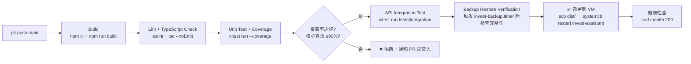

#### 各阶段详细配置（GitHub Actions 示例）

```yaml
# .github/workflows/ci.yml
name: InvestAssistant CI

on:
  push:
    branches: [main]
  pull_request:
    branches: [main]

jobs:
  test-and-deploy:
    runs-on: ubuntu-latest
    steps:
      # Stage 1: Build + Install
      - uses: actions/checkout@v4
      - uses: actions/setup-node@v4
        with:
          node-version: 22
          cache: npm
      - run: npm ci
      - run: npm run build      # 编译前后端，产物 dist/

      # Stage 2: Lint + TypeCheck
      - run: npm run lint
      - run: npx tsc --noEmit

      # Stage 3: Unit Test + Coverage Gate
      - run: npx vitest run --coverage
      - name: Coverage Gate
        run: |
          # coverage-v8 输出 JSON，提取核心模块覆盖率
          CORE_COVERAGE=$(node -e "
            const r = require('./coverage/coverage-final.json');
            const core = Object.values(r).filter(f => f.path.includes('services/') || f.path.includes('algorithms/'));
            const lines = core.reduce((s, f) => s + (f.l.found - f.l.get), 0);
            const found = core.reduce((s, f) => s + f.l.found, 0);
            console.log(Math.round((1 - lines/found) * 100));
          ")
          echo "Core algorithm coverage: ${CORE_COVERAGE}%"
          if [ "${CORE_COVERAGE}" -lt 90 ]; then exit 1; fi

      # Stage 4: Integration Test（需要临时 DuckDB + SQLite）
      - run: npm run test:integration

      # Stage 5: Deploy（仅 main 分支 + 人工确认）
      - if: github.ref == 'refs/heads/main' && github.event_name == 'push'
        run: |
          ssh -i ~/.ssh/id_rsa deploy@invest-vm \
            "systemctl stop invest-assistant && \
             rsync -avz --delete dist/ /opt/invol/dist/ && \
             systemctl start invest-assistant && \
             sleep 2 && curl -sf http://localhost:3000/health || (systemctl status invest-assistant; exit 1)"
```

#### Pipeline 规则

| 规则 | 说明 |
|------|------|
| PR 触发 | push + pull_request 都触发 Stage 1-4，不触发部署 |
| 部署触发 | 仅 main 分支 push 触发，且需要 GitHub Actions Secrets 配置 SSH key |
| 阻断点 | Lint 失败 / TypeScript 编译失败 / 覆盖率 Gate 不通过 / 集成测试失败 → 全部阻断 |
| 健康检查 | 部署后 curl localhost:3000/health 验证，失败则 systemctl status 记录日志 |
| 备份验证 | 每月第一个周五的 CI run 额外触发 `sudo systemctl start invest-backup.service`，验证备份链路通畅 |

#### 测试目录结构总结

```
/opt/invol/
├── backend/
│   ├── src/                 # 业务代码
│   ├── tests/
│   │   ├── unit/            # Vitest 单元测试
│   │   │   ├── services/    # 业务规则层
│   │   │   ├── algorithms/  # 核心算法层
│   │   │   ├── plugins/     # 插件引擎层
│   │   │   ├── validator/   # C1-C12 校验
│   │   │   └── utils/       # writeSystemLog 等工具层
│   │   └── integration/     # Supertest API 集成测试
│   └── vitest.config.ts
└── frontend/
    ├── src/
    └── tests/               # Playwright / @testing-library/react
```

---

*SDD 全文结束。所有 Mermaid 代码块可直接在支持 Mermaid 的 Markdown 渲染器（GitHub、VS Code + Mermaid Preview、GitLab 等）中预览。*
